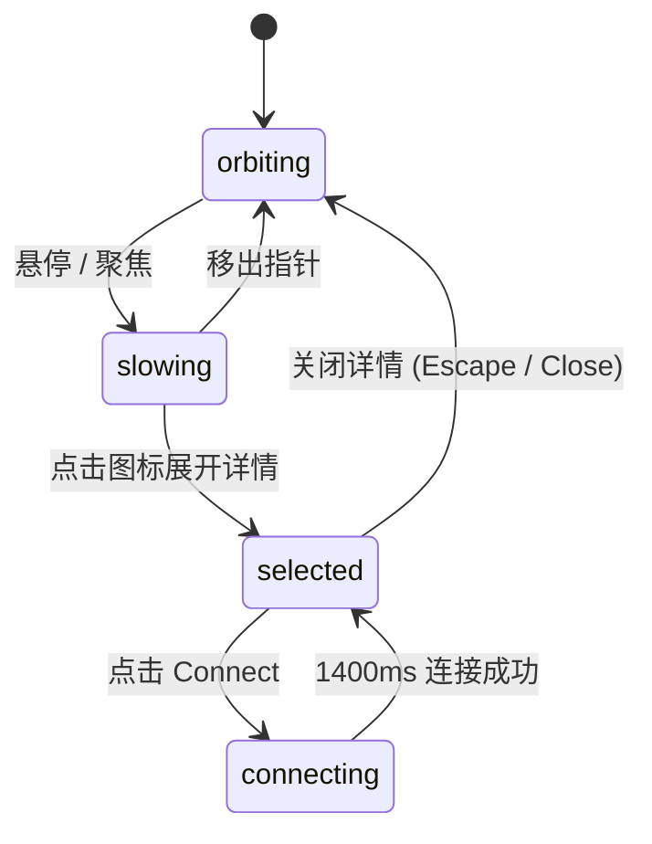

# Orbit Logos · 双同心轨道集成图标坞

基于双层同心圆轨道与多频物理阻尼的图标环形漫游与详情卡片展开组件。包含三大核心机制：

1. **同心双轨道差频旋转与弹性降速**：14 个生态集成图标分布在内外两圈轨道上，分别以 64s 与 88s 周期连续漫游；当鼠标悬停、焦点进入或打开详情时，角速度经刚度 60 的临界阻尼弹簧平滑减速直至悬停。
2. **中心轮毂连接线动力学（Connector Physics）**：选中某个图标后，从中心控制轮毂边缘向目标图标伸展出一条 SVG 动态连接线，伸展过程受刚度 200、阻尼 24 的物理弹簧驱动。
3. **图标至详情卡片就地形态形变（Tile-to-Card Morph）**：卡片以 `visualDuration: 0.42s, bounce: 0.16` 弹簧从所选图标的物理位置展开为圆角面板，延迟 140ms 后淡入内容；内置 1400ms 模拟连接交互。

## 原型清单

| 原型分组 | 原型元素 | 动效 / 状态变化 | 去向 |
| --- | --- | --- | --- |
| — | 轨道圆环与连接线 `svg.orbit-logos_rings__urcAY` | 双同心圆底轨、SVG 连接线延伸与收回 | `.orbit-rings` |
| — | 中心轮毂 `.orbit-logos_core__LHrTZ` | 虚线旋转微动效、中心定位 | `.orbit-core` |
| — | 轨道图标节点 `.orbit-logos_chip__dA2XY` | 沿极坐标轨迹移动、连接点高亮、悬停标签显示 | `.orbit-chip` |
| — | 分类过滤栏 `.orbit-logos_categories__h54xQ` | 分类过滤高光滑块跟随、未匹配项降级淡出 | `.orbit-categories` |
| — | 详情展开面板 `.orbit-logos_panel__hAzaX` | 图标原位展开为卡片、连接状态按钮反馈 | `.orbit-panel` |
| — | 顶栏、外观切换 `#themeBtn`、舞台外壳 | — | 演示外壳，已删除 |

## 适用

- 产品生态集成展示页（如 SaaS 的第三方 App 市场）。
- 科技感与互动感极强的 Hero 区域视觉展台。
- 允许用户浏览、筛选分类并点击查看详情或发起绑定的场景。

## 不适用

- 真实翻书折角与拖拽物理翻页 → [page-curl](page-curl.md)
- 纯连续几何形态过渡加载器 → [morph-loader](../loaders/morph-loader.md)
- 常规平铺网格工具栏 → [button-group](../buttons/button-group.md)

## 状态机

| 状态 | 进入条件 | 视觉表现 | 退出到 |
| --- | --- | --- | --- |
| orbiting | 初始；指针移出且无卡片激活 | 内外圈分别以 64s/88s 匀速漫游，连接线隐藏 | slowing |
| slowing | 鼠标悬停在轨道内或聚焦图标 | 轨道角速度经弹簧减速至 0，悬停图标露出标签 | orbiting / selected |
| selected | 点击任意集成图标 | 轨道暂停，连接线延伸至该图标，弹出对应详情卡片 | orbiting (关闭卡片) |
| connecting | 在详情卡片内点击 Connect 按钮 | 按钮展示加载 Spinner，持续 1400ms 后变为 Connected | selected |



## 最小 DOM

```html
<div class="orbit-root" role="region" aria-label="Integrations orbit showcase">
  <div class="orbit-categories" role="toolbar" aria-label="Filter by category">
    <button type="button" class="orbit-cat-btn" aria-pressed="true" data-cat="all">All</button>
    <button type="button" class="orbit-cat-btn" aria-pressed="false" data-cat="dev">Dev</button>
    <button type="button" class="orbit-cat-btn" aria-pressed="false" data-cat="design">Design</button>
  </div>

  <div class="orbit-stage">
    <svg class="orbit-rings" viewBox="0 0 460 460" width="460" height="460" aria-hidden="true">
      <circle class="ring inner" cx="230" cy="230" r="115"/>
      <circle class="ring outer" cx="230" cy="230" r="202"/>
      <line class="orbit-connector" x1="230" y1="230" x2="230" y2="230"/>
    </svg>

    <div class="orbit-core" aria-hidden="true">
      <div class="core-hub"></div>
    </div>

    <ul class="orbit-list" aria-label="Integrations">
      <li class="orbit-slot">
        <button type="button" class="orbit-chip" data-id="github" data-cat="dev" aria-label="GitHub, Dev" style="transform: translate3d(206px, 88px, 0);">
          <span class="chip-icon">GH</span>
          <span class="chip-label">GitHub</span>
        </button>
      </li>
      <li class="orbit-slot">
        <button type="button" class="orbit-chip" data-id="figma" data-cat="design" aria-label="Figma, Design" style="transform: translate3d(314px, 171px, 0);">
          <span class="chip-icon">FG</span>
          <span class="chip-label">Figma</span>
        </button>
      </li>
    </ul>

    <div class="orbit-panel" data-state="idle">
      <div class="panel-idle">
        <h4 class="panel-title">Integrations</h4>
        <p class="panel-desc">Click any icon to view details and connect.</p>
      </div>
      <div class="panel-card" style="display: none;">
        <h4 class="card-title">GitHub</h4>
        <p class="card-desc">Code hosting and version control.</p>
        <button type="button" class="btn-connect">Connect</button>
        <button type="button" class="btn-close">Close</button>
      </div>
    </div>
  </div>
</div>
```

- `.orbit-root`：宿主容器。
- `.orbit-categories`：分类过滤工具栏。
- `.orbit-stage`：460×460 固定相对尺寸的环形舞台。
- `.orbit-rings` 与 `.orbit-connector`：底层同心圆轨道与动态连接线 SVG。
- `.orbit-core`：中央控制中心圆盘。
- `.orbit-chip`：极坐标驱动位置的独立图标按钮。
- `.orbit-panel`：处于下方的详情卡片/空闲说明切换容器。

## 参数

| 名称 | 值 | 用于 | 来源 |
| --- | --- | --- | --- |
| periodSeconds | `[64s, 88s]` | 内圈与外圈公转周期时长 | 原型 |
| rateSpring | `{ stiffness: 60, damping: 15.5 }` | 漫游减速与恢复加速度弹簧 | 原型 |
| connector.reachSpring | `{ stiffness: 200, damping: 24 }` | 连接线向目标延伸的物理弹簧 | 原型 |
| shell.visualDuration | `0.42s` (bounce: 0.16) | 详情卡片从图标展开弹性时间 | 原型 |
| connectDelayMs | `1400ms` | 模拟绑定连接的响应耗时 | 原型 |
| innerRadius | `115px` | 内圈轨道基准物理半径 | 原型 |
| outerRadius | `202px` | 外圈轨道基准物理半径 | 原型 |

## CSS

```css
.orbit-root {
  --orbit-bg: #ffffff;
  --orbit-border: rgba(0, 0, 0, 0.08);
  --orbit-ring: rgba(0, 0, 0, 0.06);
  --orbit-accent: #2563eb;
  --orbit-text: #111827;
  --orbit-text-muted: #6b7280;
  display: flex;
  flex-direction: column;
  align-items: center;
  gap: 20px;
  width: 100%;
  max-width: 600px;
  margin-inline: auto;
  font-family: system-ui, -apple-system, sans-serif;
  user-select: none;
}

@media (prefers-color-scheme: dark) {
  .orbit-root {
    --orbit-bg: #111827;
    --orbit-border: rgba(255, 255, 255, 0.1);
    --orbit-ring: rgba(255, 255, 255, 0.08);
    --orbit-text: #f9fafb;
    --orbit-text-muted: #9ca3af;
  }
}

.orbit-categories {
  display: inline-flex;
  gap: 4px;
  padding: 4px;
  border-radius: 9999px;
  background: rgba(0, 0, 0, 0.04);
}

.orbit-cat-btn {
  padding: 6px 14px;
  border: 0;
  border-radius: 9999px;
  background: transparent;
  color: var(--orbit-text-muted);
  font-size: 13px;
  font-weight: 500;
  cursor: pointer;
  transition: background-color 0.2s ease, color 0.2s ease, border-color 0.2s ease, transform 0.2s ease, opacity 0.2s ease, box-shadow 0.2s ease;
}

.orbit-cat-btn[aria-pressed="true"] {
  background: #ffffff;
  color: var(--orbit-text);
  box-shadow: 0 1px 3px rgba(0, 0, 0, 0.1);
}

.orbit-stage {
  position: relative;
  width: 460px;
  height: 460px;
}

.orbit-rings {
  position: absolute;
  inset: 0;
  pointer-events: none;
}

.orbit-rings circle {
  fill: none;
  stroke: var(--orbit-ring);
  stroke-width: 1.5;
}

.orbit-connector {
  stroke: var(--orbit-accent);
  stroke-width: 2;
  stroke-dasharray: 4 4;
  opacity: 0;
  transition: opacity 0.3s ease;
}

.orbit-core {
  position: absolute;
  left: 200px;
  top: 200px;
  width: 60px;
  height: 60px;
  border-radius: 50%;
  background: var(--orbit-bg);
  border: 1px solid var(--orbit-border);
  box-shadow: 0 4px 12px rgba(0, 0, 0, 0.08);
  display: flex;
  align-items: center;
  justify-content: center;
  pointer-events: none;
}

.core-hub {
  width: 16px;
  height: 16px;
  border-radius: 50%;
  background: var(--orbit-accent);
}

.orbit-list {
  list-style: none;
  margin: 0;
  padding: 0;
}

.orbit-chip {
  position: absolute;
  top: 0;
  left: 0;
  display: flex;
  align-items: center;
  gap: 6px;
  padding: 6px 12px;
  border-radius: 9999px;
  background: var(--orbit-bg);
  border: 1px solid var(--orbit-border);
  box-shadow: 0 2px 8px rgba(0, 0, 0, 0.06);
  color: var(--orbit-text);
  font-size: 13px;
  cursor: pointer;
  will-change: transform;
  transition: box-shadow 0.2s ease;
}

.orbit-chip:hover {
  box-shadow: 0 4px 16px rgba(0, 0, 0, 0.12);
}

.orbit-panel {
  position: absolute;
  bottom: 12px;
  left: 50%;
  transform: translateX(-50%);
  width: 280px;
  padding: 16px;
  border-radius: 14px;
  background: var(--orbit-bg);
  border: 1px solid var(--orbit-border);
  box-shadow: 0 8px 24px rgba(0, 0, 0, 0.12);
  text-align: center;
}

.panel-title, .card-title {
  margin: 0 0 6px 0;
  font-size: 15px;
  font-weight: 600;
  color: var(--orbit-text);
}

.panel-desc, .card-desc {
  margin: 0 0 12px 0;
  font-size: 12px;
  color: var(--orbit-text-muted);
}

.btn-connect {
  padding: 6px 14px;
  border-radius: 8px;
  border: 0;
  background: var(--orbit-accent);
  color: #ffffff;
  font-size: 13px;
  font-weight: 500;
  cursor: pointer;
  margin-right: 8px;
}

.btn-close {
  padding: 6px 12px;
  border-radius: 8px;
  border: 1px solid var(--orbit-border);
  background: transparent;
  color: var(--orbit-text);
  font-size: 13px;
  cursor: pointer;
}

@media (prefers-reduced-motion: reduce) {
  .orbit-chip {
    transition: none !important;
  }
}
```

## JS

```js
export function createOrbitLogos(el, options = {}) {
  const chips = Array.from(el.querySelectorAll('.orbit-chip'));
  const connector = el.querySelector('.orbit-connector');
  const panelIdle = el.querySelector('.panel-idle');
  const panelCard = el.querySelector('.panel-card');
  const cardTitle = el.querySelector('.card-title');
  const btnConnect = el.querySelector('.btn-connect');
  const btnClose = el.querySelector('.btn-close');

  let isHovered = false;
  let selectedId = null;
  let animId = null;
  let disposed = false;
  let connectTimer = null;
  const isReduced = window.matchMedia('(prefers-reduced-motion: reduce)').matches;

  const R_INNER = 115;
  const R_OUTER = 202;
  const CENTER = 230;

  // 极坐标角度存储
  const nodeStates = chips.map((chip, idx) => ({
    chip,
    radius: idx % 2 === 0 ? R_INNER : R_OUTER,
    theta: (idx / chips.length) * Math.PI * 2,
    speed: (idx % 2 === 0 ? 1 / 64 : 1 / 88) * Math.PI * 2
  }));

  let lastTime = performance.now();

  function loop(now) {
    if (disposed) return;
    const dt = Math.min((now - lastTime) / 1000, 0.05);
    lastTime = now;

    if (!isReduced && !isHovered && !selectedId) {
      for (const st of nodeStates) {
        st.theta = (st.theta + st.speed * dt) % (Math.PI * 2);
        const x = CENTER + Math.cos(st.theta) * st.radius - 32;
        const y = CENTER + Math.sin(st.theta) * st.radius - 16;
        st.chip.style.transform = `translate3d(${x.toFixed(1)}px, ${y.toFixed(1)}px, 0)`;
      }
    }

    // 更新连接线
    if (selectedId && connector) {
      const match = nodeStates.find((st) => st.chip.dataset.id === selectedId);
      if (match) {
        const x = CENTER + Math.cos(match.theta) * match.radius;
        const y = CENTER + Math.sin(match.theta) * match.radius;
        connector.setAttribute('x1', CENTER.toString());
        connector.setAttribute('y1', CENTER.toString());
        connector.setAttribute('x2', x.toFixed(1));
        connector.setAttribute('y2', y.toFixed(1));
        connector.style.opacity = '1';
      }
    } else if (connector) {
      connector.style.opacity = '0';
    }

    animId = requestAnimationFrame(loop);
  }

  function selectChip(id) {
    selectedId = id;
    if (panelIdle) panelIdle.style.display = id ? 'none' : 'block';
    if (panelCard) panelCard.style.display = id ? 'block' : 'none';
    if (cardTitle && id) cardTitle.textContent = id.toUpperCase();
  }

  function onConnect() {
    if (!btnConnect) return;
    btnConnect.textContent = 'Connecting...';
    clearTimeout(connectTimer);
    connectTimer = setTimeout(() => {
      if (disposed) return;
      btnConnect.textContent = 'Connected';
    }, 1400);
  }

  chips.forEach((chip) => {
    chip.addEventListener('mouseenter', () => { isHovered = true; });
    chip.addEventListener('mouseleave', () => { isHovered = false; });
    chip.addEventListener('click', () => selectChip(chip.dataset.id));
  });

  btnClose?.addEventListener('click', () => selectChip(null));
  btnConnect?.addEventListener('click', onConnect);

  // 初始静态定位
  for (const st of nodeStates) {
    const x = CENTER + Math.cos(st.theta) * st.radius - 32;
    const y = CENTER + Math.sin(st.theta) * st.radius - 16;
    st.chip.style.transform = `translate3d(${x.toFixed(1)}px, ${y.toFixed(1)}px, 0)`;
  }

  animId = requestAnimationFrame(loop);

  return {
    select(id) {
      selectChip(id);
    },
    destroy() {
      disposed = true;
      if (animId) cancelAnimationFrame(animId);
      clearTimeout(connectTimer);
      chips.forEach((chip) => chip.replaceWith(chip.cloneNode(true)));
      btnClose?.replaceWith(btnClose.cloneNode(true));
      btnConnect?.replaceWith(btnConnect.cloneNode(true));
    }
  };
}
```

## 接入目标项目

- 状态来源：目标业务的第三方授权状态（Connected / Not Connected）注入各节点并响应 `select(id)`。
- 尺寸策略：推荐固定 460px~600px 正方形舞台，内圈与外圈半径保持黄金比例（115:202）。
- 驱动方式：`const orbit = createOrbitLogos(rootEl);`，离开路由时调用 `orbit.destroy()`。

## 重入与清理

- 连续点击多个图标时，连接线与卡片内容直接就地重新定位，避免残存上一个节点的连接动画。
- 卸载时彻底取消 `requestAnimationFrame` 并清空连接延时器。

## 减少动态效果

- 在 `prefers-reduced-motion: reduce` 设置下，轨道保持静态极坐标排布，无自转公转动画。
- 仍保留点击选中弹出卡片与连接反馈等核心业务逻辑。

## 焦点与键盘

- 图标列表配置标准 Tab 键 Roving 焦点控制。
- 用户可按 Enter / Space 激活选中的生态图标，按 Escape 快捷关闭展开的详情卡片。

## 兼容回退

| 特性 | 不支持时 |
| --- | --- |
| SVG 虚线动画 `stroke-dasharray` | 回退至常规实线连接 |
| `will-change: transform` | 降级为常规 GPU 属性重绘 |

## 验收清单

- [ ] 页面加载后，14 个图标分别在内外两圈同心轨道上保持不同速率平滑旋转。
- [ ] 鼠标悬停在轨道内任意图标上时，轨道平滑减速停靠。
- [ ] 点击某个图标，中心轮毂向该图标射出动态虚线连接线，底部弹出对应详情面板。
- [ ] 点击 Connect 按钮，展示 1400ms 连接状态，随后显示已连接状态。
- [ ] 开启系统的“减少动态效果”时，图标呈静态环形排布，不发生旋转。
