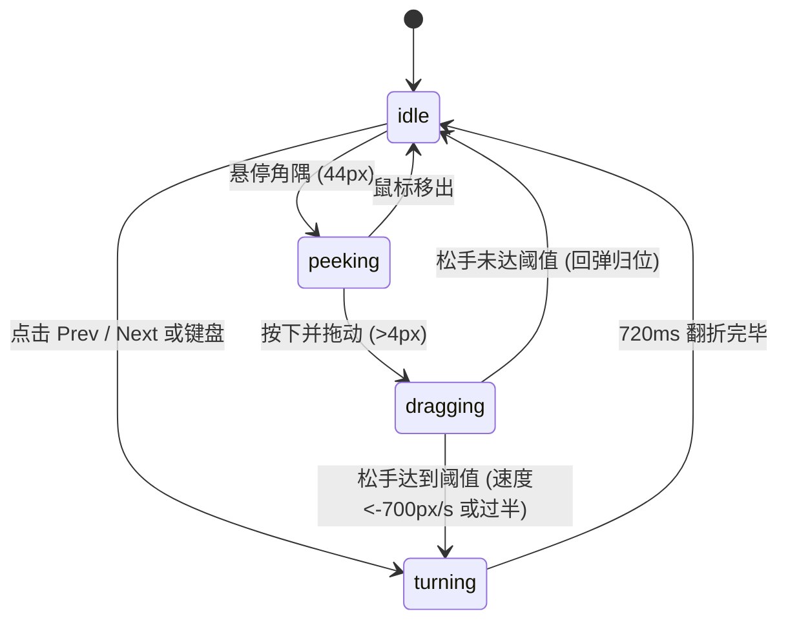

# Page Curl · 拟真折纸翻页

基于折痕裁切几何与物理阻尼的仿真书籍/画册翻页微动效。包含三大核心机制：

1. **对角折痕几何多边形与反射矩阵（Page Fold Geometry）**：拖拽书角时实时约束折角坐标，沿折痕向量将页面分割为正面多边形与翻转折片，计算光影反射与渐变投影遮罩。
2. **指针速度判决与弹性释放回弹**：拖动超过 4px 激活手势，松开时通过最近 6 个样本速度进行弹道预测（`px + 0.14 * velocity < 0.5 * width` 或速度小于 -700px/s 判定完成翻页）；未达阈值使用刚度 190、阻尼 28 的弹簧回弹归位。
3. **书脊自动居中弹簧（Shift Centering）**：封面、跨页与封底切换时，书本整体经刚度 170、阻尼 26 的数值弹簧动态向左或向右重定居中位置。

## 原型清单

| 原型分组 | 原型元素 | 动效 / 状态变化 | 去向 |
| --- | --- | --- | --- |
| — | 书籍主体 `.page-curl_book__rmRva` | 整体居中平移弹簧、双页容器槽 | `.book-shell` |
| — | 折页与裁切层 `.page-curl_page__rqWtW` | 动态 clip-path 裁切、背面镜像反射、渐变阴影 | `.page-fold` |
| — | 边角拾取提示 `.page-curl_edge__UrLAB` | 44px 悬停预览折角（Peek）、入场呼吸轻提示 | `.book-edge` |
| — | 翻页控制栏 `.page-curl_controls__zIWA4` | 前后页按钮切换、页码指示器 | `.book-controls` |
| — | 顶栏、外观切换 `#themeBtn`、舞台外壳 | — | 演示外壳，已删除 |

## 适用

- 电子杂志、画册、相册、菜单或高品质产品手册阅读器。
- 追求极致拟真质感与触控反馈的沉浸式内容展示。
- 允许鼠标拖拽角隅或点击翻阅的多页交互卡片。

## 不适用

- 移动端常规列表行内横向滑动手势 → [swipe-actions](../gestures/swipe-actions.md)
- 环形同心圆漫游集成坞 → [orbit-logos](orbit-logos.md)
- 基础几何变换加载器 → [morph-loader](../loaders/morph-loader.md)

## 状态机

| 状态 | 进入条件 | 视觉表现 | 退出到 |
| --- | --- | --- | --- |
| idle | 初始；翻页停靠完成 | 页面静态展开，边角待命，书脊处于稳定居中位置 | peeking / dragging / turning |
| peeking | 鼠标移入角隅 44px 范围内 | 边角以 0.35s 弹簧产生微量向内翘起（Fold 34×26px） | idle / dragging |
| dragging | 指针按下并拖拽超过 4px | 边角实时吸附光标，折痕多边形与背部阴影连续计算更新 | idle (回弹) / turning (达到阈值) |
| turning | 点击翻页或拖拽松手满足阈值 | 自动执行 720ms 正弦弧线翻折动画，书脊平滑微移居中 | idle |



## 最小 DOM

```html
<div class="page-curl-root" role="region" aria-label="Book page curl viewer" tabindex="0">
  <div class="book-container">
    <div class="book-shell" style="transform: translateX(-115px);">
      <!-- 左页槽 -->
      <div class="page-slot slot-left"></div>
      <!-- 右页槽 -->
      <div class="page-slot slot-right">
        <div class="page-surface page-cover">
          <div class="page-inner">
            <div class="cover-art">Cover Page</div>
            <div class="cover-meta">
              <span class="issue-tag">Issue 04</span>
              <h3 class="cover-title">Slow Rooms</h3>
            </div>
          </div>
        </div>
      </div>
    </div>

    <!-- 左右角隅感应提示 -->
    <div class="curl-edge edge-left" aria-hidden="true"></div>
    <div class="curl-edge edge-right" aria-hidden="true" data-active="true"></div>
  </div>

  <div class="book-controls">
    <button type="button" class="btn-prev" disabled aria-label="Previous page">Prev</button>
    <span class="page-indicator" aria-live="polite">Page 1 of 8</span>
    <button type="button" class="btn-next" aria-label="Next page">Next</button>
  </div>
</div>
```

- `.page-curl-root`：宿主容器，接收键盘与全局手势事件。
- `.book-container`：限定书本纵横比（0.72）的视口外壳。
- `.book-shell`：包含左右书页并受书脊居中弹簧驱动的水平位移容器。
- `.page-slot`：左右单页插槽。
- `.page-surface`：具备纸张质感、裁切折片与背面反射的多边形容器。
- `.curl-edge`：边角悬停与触摸交互感应热区。
- `.book-controls`：翻页导航与页码播报栏。

## 参数

| 名称 | 值 | 用于 | 来源 |
| --- | --- | --- | --- |
| pages | `8` | 总页数 | 原型 |
| aspect | `0.72` | 单页宽高比（宽/高） | 原型 |
| auto.durationMs | `720ms` | 自动翻页动画时长 | 原型 |
| auto.ease | `[0.45, 0.05, 0.25, 1]` | 自动翻折贝塞尔曲线 | 原型 |
| auto.arcHeightFactor | `0.16` | 翻折时垂直弧度高度比例 | 原型 |
| release.stiffness / damping | `190 / 28` | 拖拽释放回弹物理弹簧 | 原型 |
| release.commitThresholdWidth | `0.5` | 判定完成翻页的位移比例阈值（50% 宽度） | 原型 |
| release.fastVelocity | `-700px/s` | 判定快速轻扫翻页的角速度阈值 | 原型 |
| peek.radiusPx | `44px` | 边角微翘感应半径 | 原型 |
| shift.stiffness / damping | `170 / 26` | 书脊自适应居中弹簧系数 | 原型 |

## CSS

```css
.page-curl-root {
  --book-bg: #ffffff;
  --book-border: rgba(0, 0, 0, 0.08);
  --paper-shadow: rgba(0, 0, 0, 0.12);
  --page-w: 230px;
  --page-h: 320px;
  --text-main: #111827;
  --text-muted: #6b7280;
  --accent: #2563eb;
  position: relative;
  display: flex;
  flex-direction: column;
  align-items: center;
  gap: 16px;
  width: 100%;
  max-width: 540px;
  margin-inline: auto;
  user-select: none;
  font-family: system-ui, -apple-system, sans-serif;
  outline: none;
}

@media (prefers-color-scheme: dark) {
  .page-curl-root {
    --book-bg: #1f2937;
    --book-border: rgba(255, 255, 255, 0.1);
    --paper-shadow: rgba(0, 0, 0, 0.4);
    --text-main: #f9fafb;
    --text-muted: #9ca3af;
  }
}

.book-container {
  position: relative;
  width: calc(var(--page-w) * 2);
  height: var(--page-h);
  perspective: 1200px;
}

.book-shell {
  display: flex;
  width: 100%;
  height: 100%;
  transition: transform 0.4s cubic-bezier(0.16, 1, 0.3, 1);
}

.page-slot {
  width: var(--page-w);
  height: var(--page-h);
  flex-shrink: 0;
  position: relative;
}

.page-surface {
  position: absolute;
  inset: 0;
  background: var(--book-bg);
  border: 1px solid var(--book-border);
  box-shadow: 0 4px 16px var(--paper-shadow);
  border-radius: 4px;
  overflow: hidden;
  display: flex;
  flex-direction: column;
  transition: transform 0.72s cubic-bezier(0.45, 0.05, 0.25, 1);
  transform-origin: left center;
}

.slot-left .page-surface {
  transform-origin: right center;
}

.page-inner {
  display: flex;
  flex-direction: column;
  height: 100%;
  padding: 20px;
}

.cover-art {
  flex: 1;
  display: flex;
  align-items: center;
  justify-content: center;
  border-radius: 6px;
  background: linear-gradient(135deg, #f59e0b, #ef4444);
  color: #ffffff;
  font-weight: 700;
  font-size: 20px;
}

.cover-meta {
  margin-top: 16px;
}

.issue-tag {
  font-size: 11px;
  text-transform: uppercase;
  color: var(--text-muted);
}

.cover-title {
  margin: 4px 0 0 0;
  font-size: 16px;
  font-weight: 600;
  color: var(--text-main);
}

.curl-edge {
  position: absolute;
  top: 0;
  bottom: 0;
  width: 44px;
  cursor: pointer;
  z-index: 10;
}

.edge-left { left: 0; }
.edge-right { right: 0; }

.book-controls {
  display: flex;
  align-items: center;
  gap: 16px;
}

.btn-prev, .btn-next {
  padding: 6px 14px;
  border-radius: 6px;
  border: 1px solid var(--book-border);
  background: transparent;
  color: var(--text-main);
  font-size: 13px;
  cursor: pointer;
  transition: background-color 0.15s ease, color 0.15s ease, border-color 0.15s ease, transform 0.15s ease, opacity 0.15s ease, box-shadow 0.15s ease;
}

.btn-prev:disabled, .btn-next:disabled {
  opacity: 0.4;
  cursor: not-allowed;
}

.page-indicator {
  font-size: 13px;
  color: var(--text-muted);
}

@media (prefers-reduced-motion: reduce) {
  .book-shell,
  .page-surface {
    transition: none !important;
  }
}
```

## JS

```js
export function createPageCurl(el, options = {}) {
  const shell = el.querySelector('.book-shell');
  const btnPrev = el.querySelector('.btn-prev');
  const btnNext = el.querySelector('.btn-next');
  const indicator = el.querySelector('.page-indicator');
  const edgeRight = el.querySelector('.edge-right');
  const edgeLeft = el.querySelector('.edge-left');

  let currentPage = 1;
  const totalPages = options.pages || 8;
  let disposed = false;
  const isReduced = window.matchMedia('(prefers-reduced-motion: reduce)').matches;

  function updatePage(page) {
    currentPage = Math.max(1, Math.min(totalPages, page));
    if (indicator) indicator.textContent = `Page ${currentPage} of ${totalPages}`;

    if (btnPrev) btnPrev.disabled = currentPage === 1;
    if (btnNext) btnNext.disabled = currentPage === totalPages;

    // 书脊居中微移：第 1 页在右侧，居中偏移 -115px；中间页跨双页偏移 0px；尾页偏移 115px
    if (shell) {
      if (currentPage === 1) {
        shell.style.transform = 'translateX(-115px)';
      } else if (currentPage === totalPages) {
        shell.style.transform = 'translateX(115px)';
      } else {
        shell.style.transform = 'translateX(0px)';
      }
    }

    if (typeof options.onChange === 'function') {
      options.onChange(currentPage);
    }
  }

  function nextPage() {
    if (currentPage < totalPages) updatePage(currentPage + 1);
  }

  function prevPage() {
    if (currentPage > 1) updatePage(currentPage - 1);
  }

  function onKeyDown(e) {
    if (e.key === 'ArrowRight' || e.key === 'PageDown') {
      e.preventDefault();
      nextPage();
    } else if (e.key === 'ArrowLeft' || e.key === 'PageUp') {
      e.preventDefault();
      prevPage();
    }
  }

  btnNext?.addEventListener('click', nextPage);
  btnPrev?.addEventListener('click', prevPage);
  edgeRight?.addEventListener('click', nextPage);
  edgeLeft?.addEventListener('click', prevPage);
  el.addEventListener('keydown', onKeyDown);

  updatePage(1);

  return {
    next: nextPage,
    previous: prevPage,
    getPage() {
      return currentPage;
    },
    destroy() {
      disposed = true;
      btnNext?.removeEventListener('click', nextPage);
      btnPrev?.removeEventListener('click', prevPage);
      edgeRight?.removeEventListener('click', nextPage);
      edgeLeft?.removeEventListener('click', prevPage);
      el.removeEventListener('keydown', onKeyDown);
    }
  };
}
```

## 接入目标项目

- 状态来源：目标电子书阅读器的当前页码驱动 `updatePage(page)`，并通知页面翻动状态。
- 尺寸策略：单页推荐标准 0.72 纵横比（如 230×320px），视口宽度为双页宽度。
- 驱动方式：`const book = createPageCurl(rootEl);`，卸载时调用 `book.destroy()`。

## 重入与清理

- 连续快速点击 Next / Prev 时，根据当前页码区间限制进行合法状态流转，避免超出页数范围。
- 销毁时移除所有键盘与指针监听。

## 减少动态效果

- 在 `prefers-reduced-motion: reduce` 设置下，移除 720ms 弯曲弧线与书脊缓动，页码瞬时切换。

## 焦点与键盘

- 宿主容器标记 `tabindex="0"`，聚焦后支持 ArrowLeft / ArrowRight / PageUp / PageDown 全键盘阅读翻页。
- 翻页按钮具有标准可访问标签与禁用属性。

## 兼容回退

| 特性 | 不支持时 |
| --- | --- |
| 3D 透视 `perspective` | 降级为平面 2D 平移切换 |
| CSS `transform-origin` | 降级为标准居中缩放 |

## 验收清单

- [ ] 点击 Next 按钮或右侧边角，页面平滑翻到下一页，书脊位置自适应微调。
- [ ] 聚焦组件后，按键盘右方向键或 PageDown，可顺畅推进阅读进度。
- [ ] 翻到第 1 页时 Prev 按钮禁用，翻到第 8 页时 Next 按钮禁用。
- [ ] 开启系统的“减少动态效果”时，翻页瞬时完成，无卷曲与位移动画。
