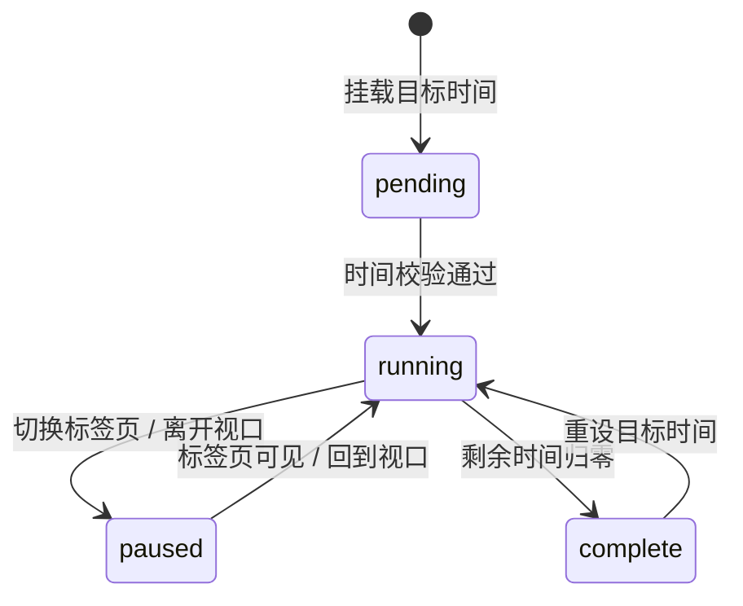

# Countdown · 倒计时

用于在活动大促、版本发布或重要日程节点呈现紧迫感的高品质时间倒计时组件。包含三大核心动效机制：

1. 机械垂直数字滚轮（Odometer Digit Wheel）：每个时间数位（天、时、分、秒）采用包含 0-9 数字序列的垂直滚轮列，数位跳动时沿 Y 轴平滑滑移（`translateY(-${digit * 10}%)`），并伴随 35ms 列间错峰动画与弹性微回弹。
2. 零抖动幽灵占位符（Ghost Sizer）：利用 `visibility: hidden` 的透明字形（如 "00"）提前将外层物理边界锁死，杜绝数字从 "1" 跳到 "0" 时因字符间距变化引发的外框抖动。
3. 归零无顿挫状态置换（Complete State Swap）：倒计时截止归零时，数字卡片通过 160ms 高斯微模糊平滑收敛，无缝置换为“进行中”（Live now）或成功徽标，伴随呼吸脉冲动效。

## 原型清单

| 原型分组 | 原型元素 | 动效 / 状态变化 | 去向 |
| --- | --- | --- | --- |
| — | 倒计时总容器（`.arc-countdown`） | 大尺寸卡片形态（large）与紧凑内联形态（compact）切换、归零完成态流转 | 归零无顿挫状态置换 |
| — | 数字滚轮与列槽（`.arc-countdown-roller`, `.arc-countdown-strip`） | 垂直位移滚动 `translateY(-${digit * 10}%)`、列间 35ms 错峰延迟、微回弹弹簧 | 机械垂直数字滚轮 |
| — | 幽灵尺寸锁（`.arc-countdown-sizer`） | 等宽透明占位、锁定单元最大像素尺寸、防止外层容器抖动 | 零抖动幽灵占位符 |
| — | 时间单位标签与分隔符（`.arc-countdown-label`, `.arc-countdown-sep`） | 居中排版、冒号常亮显示、暗淡副标题说明 | 零抖动幽灵占位符 |
| — | 完成态视觉插槽（`.arc-countdown-complete`） | 归零后 160ms 高斯微模糊淡入置换，呈现轻度呼吸光晕 | 归零无顿挫状态置换 |
| — | 演示外壳（底部 Skip/Reset 控制按钮、快捷键、主题切换） | — | 演示外壳，已删除 |

## 适用

- 促销大促、活动上线、产品发布会或系统维护等需要精准时间流逝感知的场景。
- 对界面视觉稳定性要求极高，要求数字跳动时整个模块绝对 0 像素晃动。
- 支持大号倒计时仪表盘或小号内联胶囊卡片。

## 不适用

- 常规任务进度条与百分比加载 → [progress.md](progress.md)
- 顶部通栏公告内嵌的简易倒计时 → [announcement-bar.md](../messages/announcement-bar.md)
- 多步骤任务引导与流程状态推进 → [stepper.md](stepper.md)
- 资源配额或存储容量计量仪表盘 → [usage-meter.md](usage-meter.md)

## 状态机

| 状态 | 进入条件 | 视觉表现 | 退出到 |
| --- | --- | --- | --- |
| pending | 目标时间正在解析或校验 | 数字以 0.3 透明度呈现静止骨架，避免界面跳闪 | running |
| running | 目标时间有效且当前时间早于目标截止点 | 秒级对齐计时器运行，数字列滚动跳动，错峰滑移 | paused / complete |
| paused | 页面切入后台（tab hidden）或移出视口 | 计时器休眠节电，恢复时重新校准当前时间 | running |
| complete | 当前时间达到或超过目标截止点 | 数字列收敛置零，160ms 微模糊切出，显示“活动已开始”或自定义完成标语 | running (重设目标) |



## 最小 DOM

```html
<div class="arc-countdown arc-countdown-large" role="timer" aria-live="off" aria-label="Time remaining">
  <div class="arc-countdown-grid">
    <div class="arc-countdown-group" data-unit="days">
      <div class="arc-countdown-box">
        <span class="arc-countdown-sizer" aria-hidden="true">00</span>
        <div class="arc-countdown-roller">
          <div class="arc-countdown-col" data-col="0"><div class="arc-countdown-strip">0123456789</div></div>
          <div class="arc-countdown-col" data-col="1"><div class="arc-countdown-strip">0123456789</div></div>
        </div>
      </div>
      <span class="arc-countdown-label">Days</span>
    </div>
    <span class="arc-countdown-sep" aria-hidden="true">:</span>
    <div class="arc-countdown-group" data-unit="hours">
      <div class="arc-countdown-box">
        <span class="arc-countdown-sizer" aria-hidden="true">00</span>
        <div class="arc-countdown-roller">
          <div class="arc-countdown-col" data-col="0"><div class="arc-countdown-strip">0123456789</div></div>
          <div class="arc-countdown-col" data-col="1"><div class="arc-countdown-strip">0123456789</div></div>
        </div>
      </div>
      <span class="arc-countdown-label">Hours</span>
    </div>
    <span class="arc-countdown-sep" aria-hidden="true">:</span>
    <div class="arc-countdown-group" data-unit="minutes">
      <div class="arc-countdown-box">
        <span class="arc-countdown-sizer" aria-hidden="true">00</span>
        <div class="arc-countdown-roller">
          <div class="arc-countdown-col" data-col="0"><div class="arc-countdown-strip">0123456789</div></div>
          <div class="arc-countdown-col" data-col="1"><div class="arc-countdown-strip">0123456789</div></div>
        </div>
      </div>
      <span class="arc-countdown-label">Mins</span>
    </div>
    <span class="arc-countdown-sep" aria-hidden="true">:</span>
    <div class="arc-countdown-group" data-unit="seconds">
      <div class="arc-countdown-box">
        <span class="arc-countdown-sizer" aria-hidden="true">00</span>
        <div class="arc-countdown-roller">
          <div class="arc-countdown-col" data-col="0"><div class="arc-countdown-strip">0123456789</div></div>
          <div class="arc-countdown-col" data-col="1"><div class="arc-countdown-strip">0123456789</div></div>
        </div>
      </div>
      <span class="arc-countdown-label">Secs</span>
    </div>
  </div>
</div>
```

- `.arc-countdown`：倒计时宿主容器，管理大尺寸卡片或紧凑内联样式。
- `.arc-countdown-grid`：弹性网格，水平等距排列各时间单位组与分隔符。
- `.arc-countdown-group`：单项时间单元（如天、时、分、秒）。
- `.arc-countdown-box`：数字展示方块，承载幽灵尺寸锁与滚动视口。
- `.arc-countdown-sizer`：不可见的基准字形占位符，锁死卡片固定像素宽度。
- `.arc-countdown-roller`：绝对定位覆盖在占位符之上的滚轮视口，带有 `overflow: hidden`。
- `.arc-countdown-col` 与 `.arc-countdown-strip`：数字滑动列，承载 0-9 连续字形并执行 Y 轴位移。
- `.arc-countdown-label`：下方单位文案说明。
- `.arc-countdown-sep`：数位间冒号分隔符。

## 参数

| 名称 | 值 | 用于 | 来源 |
| --- | --- | --- | --- |
| 滚轮弹簧参数 | `visualDuration: 0.26s` / `bounce: 0.12` | 数位纵向滚轮过渡 | 原型 |
| 列间错峰延时 | `35ms` / 最大 `300ms` | 多列数字跳动节奏 | 原型 |
| 初始滚轮缓动曲线 | `cubic-bezier(0.18, 0.89, 0.32, 1.15)` | 纯 CSS 滚轮过渡曲线 | 原型 |
| 归零完成态置换时长 | `160ms` | 截止切换微模糊过渡 | 原型 |
| 幽灵占位符字形 | `ui-monospace, monospace` | 锁定统一字符步长 | 原型 |
| 减动效数字切换 | `0ms` (即时跳变，禁用位移动画) | prefers-reduced-motion 数值变更 | 原型 |

## CSS

```css
.arc-countdown {
  --cd-bg: #ffffff;
  --cd-border: rgba(0, 0, 0, 0.08);
  --cd-color: #0f172a;
  --cd-desc: #64748b;
  --cd-shadow: 0 1px 3px rgba(0, 0, 0, 0.04);
  --cd-box-bg: rgba(0, 0, 0, 0.03);

  display: inline-flex;
  flex-direction: column;
  align-items: center;
  box-sizing: border-box;
  font-family: system-ui, -apple-system, sans-serif;
}

.arc-countdown-grid {
  display: flex;
  align-items: center;
  gap: 12px;
}

.arc-countdown-group {
  display: flex;
  flex-direction: column;
  align-items: center;
  gap: 6px;
}

.arc-countdown-box {
  position: relative;
  display: flex;
  align-items: center;
  justify-content: center;
  background: var(--cd-box-bg);
  border: 1px solid var(--cd-border);
  border-radius: 10px;
  padding: 10px 14px;
  min-width: 52px;
  box-sizing: border-box;
}

.arc-countdown-sizer {
  visibility: hidden;
  font-family: ui-monospace, SFMono-Regular, Menlo, monospace;
  font-size: 28px;
  font-weight: 700;
  line-height: 1;
  user-select: none;
}

.arc-countdown-roller {
  position: absolute;
  inset: 0;
  display: flex;
  align-items: center;
  justify-content: center;
  overflow: hidden;
  height: 100%;
}

.arc-countdown-col {
  height: 28px;
  overflow: hidden;
  display: flex;
  align-items: flex-start;
  justify-content: center;
}

.arc-countdown-strip {
  display: flex;
  flex-direction: column;
  font-family: ui-monospace, SFMono-Regular, Menlo, monospace;
  font-size: 28px;
  font-weight: 700;
  line-height: 28px;
  color: var(--cd-color);
  transition: transform 320ms cubic-bezier(0.18, 0.89, 0.32, 1.15);
  will-change: transform;
}

.arc-countdown-label {
  font-size: 11px;
  font-weight: 600;
  text-transform: uppercase;
  letter-spacing: 0.05em;
  color: var(--cd-desc);
}

.arc-countdown-sep {
  font-family: ui-monospace, monospace;
  font-size: 24px;
  font-weight: 700;
  color: var(--cd-desc);
  margin-top: -20px;
}

.arc-countdown-complete {
  display: none;
  font-size: 18px;
  font-weight: 600;
  color: #16a34a;
  padding: 12px 20px;
  border-radius: 8px;
  background: rgba(22, 163, 74, 0.08);
  animation: arc-pulse 2s infinite ease-in-out;
}

@keyframes arc-pulse {
  0%, 100% { opacity: 1; }
  50% { opacity: 0.7; }
}

@media (prefers-reduced-motion: reduce) {
  .arc-countdown-strip {
    transition: none !important;
  }
  .arc-countdown-complete {
    animation: none !important;
  }
}
```

## JS

```js
/**
 * 创建并绑定 Countdown 倒计时动效控制器
 * @param {HTMLElement} el 宿主容器元素
 * @param {Object} [options]
 * @param {number|Date|string} [options.target] 目标截止时间 (默认当前时间向后推 2 小时)
 * @param {string} [options.completeLabel='Live now'] 归零完成态文本
 * @param {Function} [options.onComplete] 归零回调
 */
export function createCountdown(el, options = {}) {
  const root = el.classList.contains('arc-countdown') ? el : el.querySelector('.arc-countdown') || el;
  const groups = root.querySelectorAll('.arc-countdown-group');

  const targetDate = options.target ? new Date(options.target).getTime() : Date.now() + 2 * 3600 * 1000;
  const completeLabel = options.completeLabel || 'Live now';

  let isDisposed = false;
  let timerId = null;

  function setDigit(stripEl, digit, delayMs = 0) {
    if (!stripEl) return;
    const reduced = window.matchMedia('(prefers-reduced-motion: reduce)').matches;
    const clamped = Math.max(0, Math.min(9, parseInt(digit, 10) || 0));

    if (reduced) {
      stripEl.style.transition = 'none';
      stripEl.style.transform = `translateY(-${clamped * 10}%)`;
      return;
    }

    stripEl.style.transitionDelay = `${delayMs}ms`;
    stripEl.style.transform = `translateY(-${clamped * 10}%)`;
  }

  function update() {
    if (isDisposed) return;
    const now = Date.now();
    const remainingSec = Math.max(0, Math.ceil((targetDate - now) / 1000));

    if (remainingSec <= 0) {
      // 归零
      groups.forEach(g => {
        const strips = g.querySelectorAll('.arc-countdown-strip');
        strips.forEach(s => setDigit(s, 0));
      });
      clearInterval(timerId);

      const grid = root.querySelector('.arc-countdown-grid');
      let completeEl = root.querySelector('.arc-countdown-complete');
      if (!completeEl) {
        completeEl = document.createElement('div');
        completeEl.className = 'arc-countdown-complete';
        completeEl.textContent = completeLabel;
        root.appendChild(completeEl);
      }

      if (grid) grid.style.display = 'none';
      completeEl.style.display = 'block';

      if (typeof options.onComplete === 'function') {
        options.onComplete();
      }
      return;
    }

    const days = Math.floor(remainingSec / 86400);
    const hours = Math.floor((remainingSec % 86400) / 3600);
    const minutes = Math.floor((remainingSec % 3600) / 60);
    const seconds = remainingSec % 60;

    const values = {
      days: String(days).padStart(2, '0'),
      hours: String(hours).padStart(2, '0'),
      minutes: String(minutes).padStart(2, '0'),
      seconds: String(seconds).padStart(2, '0')
    };

    groups.forEach((g, gIdx) => {
      const unit = g.dataset.unit;
      const str = values[unit] || '00';
      const strips = g.querySelectorAll('.arc-countdown-strip');
      strips.forEach((strip, sIdx) => {
        const char = str[sIdx] || '0';
        setDigit(strip, char, (gIdx * 2 + sIdx) * 20);
      });
    });
  }

  // 秒级精准对齐定时器
  function scheduleNextTick() {
    if (isDisposed) return;
    update();
    const now = Date.now();
    const delay = 1000 - (now % 1000) + 10;
    timerId = setTimeout(() => {
      scheduleNextTick();
    }, delay);
  }

  scheduleNextTick();

  // 页面可见性感知休眠
  function onVisibilityChange() {
    if (document.hidden) {
      clearTimeout(timerId);
    } else {
      scheduleNextTick();
    }
  }

  document.addEventListener('visibilitychange', onVisibilityChange);

  return {
    update,
    destroy() {
      isDisposed = true;
      clearTimeout(timerId);
      document.removeEventListener('visibilitychange', onVisibilityChange);
    }
  };
}
```

## 接入目标项目

- 状态来源：后端返回的活动结束时间戳（UTC 毫秒或 ISO 时间字符串）。传入 `target: timestamp` 即可驱动。
- 尺寸策略：各数位盒使用内置 `arc-countdown-sizer` 锁死最大物理尺寸，外层宽度随屏幕弹性居中，永不晃动。
- 驱动方式：调用 `createCountdown(el, { target, onComplete })`；卸载时调用 `destroy()`。

## 重入与清理

- 切换目标时间时，旧定时器直接撤销并根据新时间重新对齐毫秒秒拍。
- 页面不可见（`document.hidden`）时自动停用定时器，回到前台时即时触发一次全量对齐计算，避免后台无效重绘。
- 组件销毁清空挂起的 `setTimeout` 与页面监听器。

## 减少动态效果

- 满足 `prefers-reduced-motion: reduce` 时：
  - 彻底停用数字滚轮的滑动过渡（`transition: none`）。
  - 数字在秒级跳变时直接离散改变位置，消除持续性视觉晃动。
  - 完成态的呼吸脉冲动画关闭。

## 焦点与键盘

- 根节点声明 `role="timer"` 与 `aria-label="Time remaining"`，并配置 `aria-live="off"` 防止屏幕阅读器每秒持续喋喋不休地打断正常朗读。
- 数位滚轮与占位符设置 `aria-hidden="true"`，纯做视觉呈现，将语义完整收敛在根元素 `aria-label`。

## 兼容回退

| 特性 | 不支持时 |
| --- | --- |
| CSS `ui-monospace` 字体 | 优雅回退到 SFMono-Regular, Menlo, Monaco 或系统默认等宽 monospace 字体。 |
| `document.visibilityState` | 若不支持页面可见性 API，定时器以常规 1000ms 间隔平稳递减，不中断核心业务。 |

## 验收清单

- [ ] 初始化展示天、时、分、秒四组双位数位盒，数字对齐工整，无任何容器晃动。
- [ ] 秒数递减时，个位与十位滚轮顺畅向下翻滚，且高位变更时带自然级联错峰。
- [ ] 倒计时在数字切换（如从 09 翻滚到 08）时，外层卡片物理宽度严格保持 0 像素抖动。
- [ ] 倒计时截止归零时，数字平滑收敛为 00，并切换出完成态通知标签，触发回调。
- [ ] 切换浏览器标签页至后台再切回，时间无缝补齐差值，数字立刻同步为最新当前真实剩余值。
- [ ] 在系统启用减少动态效果时，滚轮动画被禁用，数字改用每秒静默跳变。
