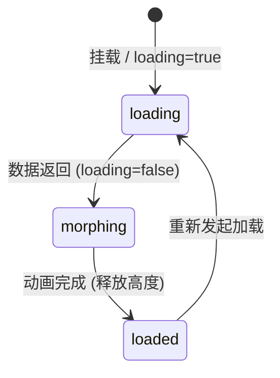

# Skeleton · 骨架屏

用于在网络异步请求或数据加载期间提供排版占位预期的骨架屏组件。包含三大核心动效机制：

1. 错峰呼吸波浪脉冲（Staggered Wave Pulse）：多个骨架区块（头像圆块、多行文本条）按 90ms 逐级错峰延迟执行柔和的透明度波浪律动（`opacity: 1 -> 0.52 -> 1`，周期 1800ms），营造宁静克制的加载等待感。
2. 容器高度自适应弹簧伸展（Height Spring Expansion）：真实业务内容返回时，外层容器计算高度落差，以无超调弹簧曲线（visualDuration 0.4s, bounce 0）平滑拉伸或收缩，动画结束后自动释放剪裁恢复 `height: auto`。
3. 骨架与真实内容无缝置换（Cross-fade & Micro-Lift）：骨架占位层脱离流式布局并在原位 160ms 淡出，真实内容携带 4px 轻微向上浮动与淡入过渡在 240ms 内就绪，彻底避免白屏闪烁或布局跳动。

## 原型清单

| 原型分组 | 原型元素 | 动效 / 状态变化 | 去向 |
| --- | --- | --- | --- |
| — | 骨架总容器（`.arc-skeleton`） | 高度测量与平滑弹簧过渡、`aria-busy` 状态管理 | 容器高度自适应弹簧伸展 |
| — | 骨架占位层（`.arc-skeleton-placeholder`） | 结构占位、退出时绝对定位脱离文档流与 160ms 淡出 | 骨架与真实内容无缝置换 |
| — | 头像骨架块（`.arc-skeleton-avatar`） | 圆形占位、呼吸波浪脉冲起点 | 错峰呼吸波浪脉冲 |
| — | 文本骨架条（`.arc-skeleton-line`） | 12px 细条、多行错落（末行 60% 宽度）、90ms 错峰延迟 | 错峰呼吸波浪脉冲 |
| — | 真实内容层（`.arc-skeleton-content`） | 数据就绪后 4px 上移与 240ms 平滑升入 | 骨架与真实内容无缝置换 |
| — | 演示外壳（底部 Auto load / Reload 控制按钮、快捷键） | — | 演示外壳，已删除 |

## 适用

- 耗时不可预期的网络数据请求排版占位（如个人主页、博客卡片、评论列表）。
- 杜绝累计布局偏移（CLS），维持页面初次渲染时的排版结构稳定。
- 数据就绪后需要极其平滑、自然的变身揭示效果。

## 不适用

- 明确已知下载或上传进度的百分比指示 → [progress.md](progress.md)
- 活动大促倒计时与翻牌数字 → [countdown.md](countdown.md)
- 多步骤任务引导与流程状态推进 → [stepper.md](stepper.md)
- 局部错误提示或状态警告横幅 → [alert.md](../messages/alert.md)

## 状态机

| 状态 | 进入条件 | 视觉表现 | 退出到 |
| --- | --- | --- | --- |
| loading | 初始挂载或触发重新加载 (`loading: true`) | 骨架块错峰呼吸脉冲运行中，真实内容隐藏，`aria-busy="true"` | morphing |
| morphing | 业务数据返回 (`loading: false`) | 骨架层原位淡出，外框高度平滑弹簧拉伸，真实内容 4px 升起淡入 | loaded |
| loaded | 高度与透明度动画全部完成 | 骨架完全隐藏，真实内容自然流式呈现，`height: auto` 解除裁剪 | loading (若重载) |



## 最小 DOM

```html
<div class="arc-skeleton" data-loading="true" aria-busy="true" aria-label="Loading content">
  <div class="arc-skeleton-placeholder">
    <div class="arc-skeleton-avatar"></div>
    <div class="arc-skeleton-lines">
      <div class="arc-skeleton-line" style="--stagger: 0;"></div>
      <div class="arc-skeleton-line" style="--stagger: 1;"></div>
      <div class="arc-skeleton-line arc-skeleton-short" style="--stagger: 2;"></div>
    </div>
  </div>
  <div class="arc-skeleton-content" style="display: none;">
    <!-- 真实内容插槽 -->
  </div>
</div>
```

- `.arc-skeleton`：骨架屏根容器，管理加载状态与高度自适应。
- `.arc-skeleton-placeholder`：骨架占位结构层，包含头像与文本占位条。
- `.arc-skeleton-avatar`：40px 圆形头像占位符。
- `.arc-skeleton-lines`：文本条排列容器。
- `.arc-skeleton-line`：模拟文本单行的圆角条带，通过 `--stagger` 变量注入错峰延迟。
- `.arc-skeleton-short`：尾行缩短 60% 宽度，模拟自然段落收尾。
- `.arc-skeleton-content`：真实内容容器，挂载真实业务 DOM。

## 参数

| 名称 | 值 | 用于 | 来源 |
| --- | --- | --- | --- |
| 呼吸波浪周期 | `1800ms` | 单个骨架条呼吸循环时长 | 原型 |
| 错峰递增延时 | `90ms` | 邻近骨架条动画延迟步长 | 原型 |
| 呼吸透明度范围 | `1 -> 0.52 -> 1` | 呼吸明暗范围 | 原型 |
| 高度弹簧物理参数 | `visualDuration: 0.4s` / `bounce: 0` | 真实内容展开高度伸缩 | 原型 |
| 真实内容升入位移 | `translateY(4px)` | 真实内容切入微位移 | 原型 |
| 真实内容升入时长与曲线 | `240ms` / `cubic-bezier(0.16, 1, 0.3, 1)` | 真实内容淡入过渡 | 原型 |
| 骨架层退场时长与曲线 | `160ms` / `cubic-bezier(0.22, 1, 0.36, 1)` | 骨架占位原位淡出 | 原型 |
| 减动效模式 | `animation: none` (静止高对比度纯色) | prefers-reduced-motion 占位 | 原型 |

## CSS

```css
.arc-skeleton {
  --sk-bg: rgba(0, 0, 0, 0.08);
  --sk-radius: 6px;

  position: relative;
  width: 100%;
  max-width: 420px;
  box-sizing: border-box;
  transition: height 400ms cubic-bezier(0.16, 1, 0.3, 1);
}

.arc-skeleton-placeholder {
  display: flex;
  align-items: flex-start;
  gap: 14px;
  width: 100%;
  transition: opacity 160ms cubic-bezier(0.22, 1, 0.36, 1);
}

.arc-skeleton-avatar {
  flex: 0 0 40px;
  width: 40px;
  height: 40px;
  border-radius: 9999px;
  background: var(--sk-bg);
  animation: arc-sk-wave 1800ms infinite ease-in-out;
}

.arc-skeleton-lines {
  flex: 1;
  display: flex;
  flex-direction: column;
  gap: 10px;
  padding-top: 4px;
}

.arc-skeleton-line {
  height: 12px;
  width: 100%;
  border-radius: var(--sk-radius);
  background: var(--sk-bg);
  animation: arc-sk-wave 1800ms infinite ease-in-out;
  animation-delay: calc(var(--stagger, 0) * 90ms);
}

.arc-skeleton-line.arc-skeleton-short {
  width: 60%;
}

@keyframes arc-sk-wave {
  0%, 100% {
    opacity: 1;
  }
  50% {
    opacity: 0.52;
  }
}

.arc-skeleton-content {
  width: 100%;
  transition: opacity 240ms cubic-bezier(0.16, 1, 0.3, 1), transform 240ms cubic-bezier(0.16, 1, 0.3, 1);
  will-change: transform, opacity;
}

@media (prefers-reduced-motion: reduce) {
  .arc-skeleton-avatar,
  .arc-skeleton-line {
    animation: none !important;
    opacity: 0.8 !important;
  }
  .arc-skeleton {
    transition: none !important;
  }
  .arc-skeleton-placeholder,
  .arc-skeleton-content {
    transition: opacity 120ms linear !important;
    transform: none !important;
  }
}
```

## JS

```js
/**
 * 创建并绑定 Skeleton 骨架屏控制器
 * @param {HTMLElement} el 宿主容器元素
 * @param {Object} [options]
 * @param {boolean} [options.loading=true] 初始加载状态
 * @param {Function} [options.onLoaded] 加载完成回调
 */
export function createSkeleton(el, options = {}) {
  const root = el.classList.contains('arc-skeleton') ? el : el.querySelector('.arc-skeleton') || el;
  const placeholder = root.querySelector('.arc-skeleton-placeholder');
  const content = root.querySelector('.arc-skeleton-content');

  let isLoading = options.loading !== false;
  let isDisposed = false;
  let transitionTimer = null;

  function setLoading(loadingState) {
    if (isDisposed) return;
    isLoading = loadingState;
    root.dataset.loading = String(isLoading);
    root.setAttribute('aria-busy', String(isLoading));

    const reduced = window.matchMedia('(prefers-reduced-motion: reduce)').matches;

    if (isLoading) {
      // 切回骨架
      if (placeholder) {
        placeholder.style.display = 'flex';
        placeholder.style.opacity = '1';
      }
      if (content) {
        content.style.display = 'none';
        content.style.opacity = '0';
        content.style.transform = 'translateY(4px)';
      }
      root.style.height = 'auto';
    } else {
      // 变身为真实内容
      if (!placeholder || !content) return;

      const initialHeight = root.offsetHeight;
      content.style.display = 'block';
      content.style.opacity = '0';
      content.style.transform = 'translateY(4px)';

      const targetHeight = content.offsetHeight;

      if (reduced) {
        placeholder.style.display = 'none';
        content.style.opacity = '1';
        content.style.transform = 'none';
        root.style.height = 'auto';
        if (typeof options.onLoaded === 'function') {
          options.onLoaded();
        }
        return;
      }

      // 锁定外框高度并启动平滑过渡
      root.style.overflow = 'hidden';
      root.style.height = `${initialHeight}px`;

      placeholder.style.opacity = '0';

      requestAnimationFrame(() => {
        root.style.height = `${targetHeight}px`;
        content.style.opacity = '1';
        content.style.transform = 'translateY(0)';
      });

      clearTimeout(transitionTimer);
      transitionTimer = setTimeout(() => {
        if (isDisposed) return;
        placeholder.style.display = 'none';
        root.style.height = 'auto';
        root.style.overflow = '';
        if (typeof options.onLoaded === 'function') {
          options.onLoaded();
        }
      }, 400);
    }
  }

  setLoading(isLoading);

  return {
    setLoading,
    destroy() {
      isDisposed = true;
      clearTimeout(transitionTimer);
    }
  };
}
```

## 接入目标项目

- 状态来源：目标页面的数据请求生命周期（如数据加载发起时 `setLoading(true)`，数据返回渲染完毕时 `setLoading(false)`）。
- 尺寸策略：自然撑满父级容器宽度，高度根据占位元素与真实内容自然测量并平滑伸展。
- 驱动方式：初始化调用 `createSkeleton(el, { loading })`；数据变更时调用 `setLoading(false)`；页面卸载时调用 `destroy()`。

## 重入与清理

- 连续快速切换加载状态（如用户连续刷新）时，重置高度延时器，即时重算最新真实内容高度，杜绝状态撕裂。
- 组件销毁（`destroy()`）清空过渡定时器，还原裁剪样式。

## 减少动态效果

- 满足 `prefers-reduced-motion: reduce` 时：
  - 彻底停用骨架条与头像的呼吸波浪脉冲动画（`animation: none`），保持静态半透明呈现。
  - 数据就绪后跳过外框高度弹簧拉伸，骨架与真实内容改用 120ms 纯透明度切换。

## 焦点与键盘

- 加载期间配置 `aria-busy="true"` 与 `aria-label="Loading content"`，向屏幕阅读器清晰传达当前内容仍在载入中。
- 骨架占位结构默认不包含任何可聚焦元素，键盘焦点顺畅跳过未完成区块。

## 兼容回退

| 特性 | 不支持时 |
| --- | --- |
| CSS `@keyframes` 动画 | 优雅退化为纯静态灰色占位色块，仍完好保留消除布局抖动（CLS）的核心收益。 |
| CSS 自定义属性 `--stagger` | 错峰延迟回退为同时呼吸，视觉感知同样柔和。 |

## 验收清单

- [ ] 加载态下头像与多行骨架条呈现柔和错峰呼吸波浪律动，末行自然缩短。
- [ ] 切换为数据就绪状态时，骨架层在原位平滑淡出，真实内容轻微升起淡入。
- [ ] 骨架到真实内容的形变过程中，外层容器高度平滑自适应拉伸，无突兀跳闪。
- [ ] 动画完成后，容器高度安全恢复为自然流式 `height: auto`，解除溢出裁剪。
- [ ] 在系统启用减少动态效果时，波浪动画停用，以静态占位块平稳等待数据。
