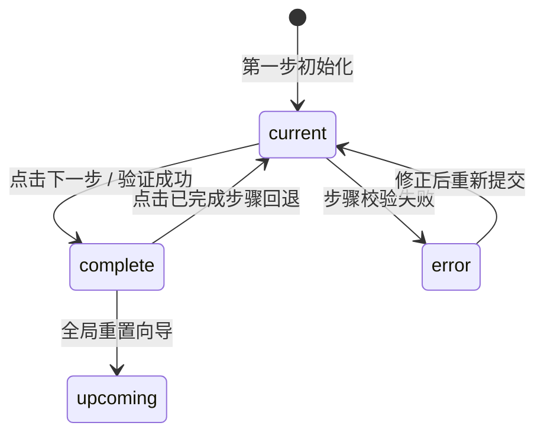

# Stepper · 步骤向导

用于引导用户完成多阶段复杂表单、安装向导或订单推进的步骤条组件。包含三大核心动效机制：

1. 方向感知流水线错峰（Direction-Aware Stagger Pipeline）：前进时按自左至右 80ms 级联点亮连线与步骤圆环；回退时按反向流水线逆向收拢，赋予操作清晰的推进流向感。
2. 节点圆环与字形弹簧形变（Ring & Glyph Spring Morph）：当前步骤激活时外部光环以 `scale(0.6 -> 1)` 弹出；进入完成态时，数位字形平滑微缩淡出，SVG 对勾描边在 240ms 内如书写笔触般展开。
3. 连线标量弹簧贯通（Connector Spring Fill）：步骤间的连接线采用基于 `transform: scaleX()` 的硬件加速弹簧伸长机制（visualDuration 0.4s, bounce 0），两端平滑衔接相邻圆环。

## 原型清单

| 原型分组 | 原型元素 | 动效 / 状态变化 | 去向 |
| --- | --- | --- | --- |
| — | 步骤条导航宿主（`.arc-stepper`） | 水平（horizontal）与垂直（vertical）布局自适应、无障碍导航列表管理 | 方向感知流水线错峰 |
| — | 步骤节点指示器（`.arc-stepper-indicator`） | 状态切换（upcoming, current, complete, error）、圆环缩放、背景色过渡 | 节点圆环与字形弹簧形变 |
| — | 步骤圆环内字形与对勾（`.arc-stepper-glyph`, `.arc-stepper-check`） | 数字淡出收缩、对勾 SVG 路径描边动画（`stroke-dashoffset: 24 -> 0`） | 节点圆环与字形弹簧形变 |
| — | 步骤间连线槽与填充条（`.arc-stepper-connector`, `.arc-stepper-line`） | 连线平滑弹簧填充（`scaleX` 或 `scaleY`）、80ms 错峰级联推进 | 连线标量弹簧贯通 |
| — | 步骤标题与说明文案（`.arc-stepper-title`, `.arc-stepper-desc`） | 当前步骤高亮、状态辅助文案微模糊平滑置换 | 方向感知流水线错峰 |
| — | 演示外壳（底部前后导航按钮、快捷键、主题切换） | — | 演示外壳，已删除 |

## 适用

- 注册引导、支付结账、云服务配置、认证流程等多阶段分步操作。
- 步骤间存在严格逻辑因果关系，需要向用户明确“当前处于何处、已完成何处、后续仍剩何处”。
- 支持用户点击已完成的步骤回退修改，全键盘方向键自由漫游。

## 不适用

- 单一任务的不间断百分比加载指示 → [progress.md](progress.md)
- 带有确定截止时间的时钟倒流 → [countdown.md](countdown.md)
- 磁盘存储分配与限额使用仪表盘 → [usage-meter.md](usage-meter.md)
- 局部页面的表单错误与反馈提示 → [alert.md](../messages/alert.md)

## 状态机

| 状态 | 进入条件 | 视觉表现 | 退出到 |
| --- | --- | --- | --- |
| upcoming | 步骤索引 > 当前激活步骤 | 灰色圆环与数字，标题浅灰色，后续连线未填充，不可点击 | current |
| current | 步骤索引 === 当前激活步骤 | 品牌色高亮圆环与数字，标题强调突出，下方展示进行中描述 | complete / error / upcoming |
| complete | 步骤索引 < 当前激活步骤 | 实心成功绿背景，显示描边对勾，连接下一级的连线完全贯通，支持点击回退 | current |
| error | 当前步骤校验未通过且标记 error | 红色警示圆环与错误图标，提示对应校验错误信息 | current |



## 最小 DOM

```html
<nav class="arc-stepper arc-stepper-horizontal" aria-label="Progress">
  <ol class="arc-stepper-list" role="list">
    <li class="arc-stepper-item is-complete" data-step="0">
      <div class="arc-stepper-header">
        <span class="arc-stepper-indicator">
          <span class="arc-stepper-glyph">
            <svg class="arc-stepper-check" width="14" height="14" viewBox="0 0 24 24" fill="none" stroke="currentColor" stroke-width="2.5" stroke-linecap="round" stroke-linejoin="round">
              <polyline points="20 6 9 17 4 12"></polyline>
            </svg>
          </span>
        </span>
        <div class="arc-stepper-text">
          <strong class="arc-stepper-title">Account details</strong>
          <span class="arc-stepper-desc">Completed</span>
        </div>
      </div>
      <div class="arc-stepper-connector"><div class="arc-stepper-line" style="transform: scaleX(1);"></div></div>
    </li>
    <li class="arc-stepper-item is-current" data-step="1">
      <div class="arc-stepper-header">
        <span class="arc-stepper-indicator">
          <span class="arc-stepper-glyph"><span class="arc-stepper-number">2</span></span>
        </span>
        <div class="arc-stepper-text">
          <strong class="arc-stepper-title">Workspace setup</strong>
          <span class="arc-stepper-desc">In progress</span>
        </div>
      </div>
      <div class="arc-stepper-connector"><div class="arc-stepper-line" style="transform: scaleX(0);"></div></div>
    </li>
    <li class="arc-stepper-item is-upcoming" data-step="2">
      <div class="arc-stepper-header">
        <span class="arc-stepper-indicator">
          <span class="arc-stepper-glyph"><span class="arc-stepper-number">3</span></span>
        </span>
        <div class="arc-stepper-text">
          <strong class="arc-stepper-title">Invite members</strong>
          <span class="arc-stepper-desc">Pending</span>
        </div>
      </div>
    </li>
  </ol>
</nav>
```

- `.arc-stepper`：步骤向导语义化导航根容器。
- `.arc-stepper-list`：有序步骤列表 `ol`。
- `.arc-stepper-item`：单步节点容器，附带 `is-complete`、`is-current`、`is-upcoming` 状态。
- `.arc-stepper-header`：节点圆环与文案排版行。
- `.arc-stepper-indicator`：28px 视觉圆环指示器。
- `.arc-stepper-glyph`：数字或对勾图标插槽。
- `.arc-stepper-check`：绿色对勾图标，负责描边书写。
- `.arc-stepper-connector` 与 `.arc-stepper-line`：相邻步骤间的弹性物理连接线。
- `.arc-stepper-title` 与 `.arc-stepper-desc`：步骤标题与状态小字。

## 参数

| 名称 | 值 | 用于 | 来源 |
| --- | --- | --- | --- |
| 跨步流水线错峰延时 | `80ms` | 多步跳转时级联动画延时步长 | 原型 |
| 节点光环弹簧参数 | `visualDuration: 0.26s` / `bounce: 0.12` | 圆环缩放与对勾弹出 | 原型 |
| 连线伸长弹簧参数 | `visualDuration: 0.4s` / `bounce: 0` | `.arc-stepper-line` 平滑贯通 | 原型 |
| 对勾描边书写时长 | `240ms` / `cubic-bezier(0.16, 1, 0.3, 1)` | `stroke-dashoffset: 24 -> 0` | 原型 |
| 对勾书写延时 | `40ms` | 节点稳定后的书写延时 | 原型 |
| 指示器标准尺寸 | `28px` | 圆环直径 | 原型 |
| 减动效模式 | `0ms` (即时状态置换，停用连线缩放与描边) | prefers-reduced-motion 模式 | 原型 |

## CSS

```css
.arc-stepper {
  --stp-primary: #2563eb;
  --stp-success: #16a34a;
  --stp-muted: #e2e8f0;
  --stp-text: #0f172a;
  --stp-desc: #64748b;
  --stp-ring-size: 28px;

  width: 100%;
  max-width: 680px;
  box-sizing: border-box;
}

.arc-stepper-list {
  display: flex;
  align-items: flex-start;
  list-style: none;
  margin: 0;
  padding: 0;
  position: relative;
  width: 100%;
}

.arc-stepper-item {
  position: relative;
  flex: 1;
  display: flex;
  flex-direction: column;
}

.arc-stepper-item:last-child {
  flex: 0 0 auto;
}

.arc-stepper-header {
  display: flex;
  align-items: center;
  gap: 10px;
  cursor: default;
  position: relative;
  z-index: 2;
}

.arc-stepper-item.is-complete .arc-stepper-header {
  cursor: pointer;
}

.arc-stepper-indicator {
  display: flex;
  align-items: center;
  justify-content: center;
  width: var(--stp-ring-size);
  height: var(--stp-ring-size);
  border-radius: 9999px;
  background: #ffffff;
  border: 2px solid var(--stp-muted);
  color: var(--stp-desc);
  font-size: 12px;
  font-weight: 600;
  box-sizing: border-box;
  transition: border-color 240ms ease, background-color 240ms ease, color 240ms ease, transform 260ms cubic-bezier(0.18, 0.89, 0.32, 1.28);
}

.arc-stepper-item.is-current .arc-stepper-indicator {
  border-color: var(--stp-primary);
  color: var(--stp-primary);
  transform: scale(1.06);
}

.arc-stepper-item.is-complete .arc-stepper-indicator {
  border-color: var(--stp-success);
  background: var(--stp-success);
  color: #ffffff;
}

.arc-stepper-glyph {
  display: flex;
  align-items: center;
  justify-content: center;
}

.arc-stepper-check {
  stroke-dasharray: 24;
  stroke-dashoffset: 0;
  transition: stroke-dashoffset 240ms cubic-bezier(0.16, 1, 0.3, 1) 40ms;
}

.arc-stepper-text {
  display: flex;
  flex-direction: column;
  line-height: 1.35;
}

.arc-stepper-title {
  font-size: 13px;
  font-weight: 600;
  color: var(--stp-desc);
  transition: color 200ms ease;
}

.arc-stepper-item.is-current .arc-stepper-title,
.arc-stepper-item.is-complete .arc-stepper-title {
  color: var(--stp-text);
}

.arc-stepper-desc {
  font-size: 11px;
  color: var(--stp-desc);
}

.arc-stepper-connector {
  position: absolute;
  top: 13px;
  left: 34px;
  right: 12px;
  height: 2px;
  background: var(--stp-muted);
  overflow: hidden;
  z-index: 1;
}

.arc-stepper-line {
  width: 100%;
  height: 100%;
  background: var(--stp-success);
  transform-origin: 0 50%;
  transform: scaleX(0);
  transition: transform 400ms cubic-bezier(0.16, 1, 0.3, 1);
  will-change: transform;
}

.arc-stepper-item.is-complete .arc-stepper-line {
  transform: scaleX(1);
}

@media (prefers-reduced-motion: reduce) {
  .arc-stepper-indicator,
  .arc-stepper-line,
  .arc-stepper-check {
    transition: none !important;
    transform: none !important;
  }
}
```

## JS

```js
/**
 * 创建并绑定 Stepper 步骤向导控制器
 * @param {HTMLElement} el 宿主容器元素
 * @param {Object} [options]
 * @param {number} [options.current=0] 初始步骤索引 (从 0 开始)
 * @param {Function} [options.onChange] 步骤变动回调
 */
export function createStepper(el, options = {}) {
  const root = el.classList.contains('arc-stepper') ? el : el.querySelector('.arc-stepper') || el;
  const items = Array.from(root.querySelectorAll('.arc-stepper-item'));

  let activeIndex = options.current || 0;
  let isDisposed = false;

  function renderSteps() {
    if (isDisposed) return;
    const reduced = window.matchMedia('(prefers-reduced-motion: reduce)').matches;

    items.forEach((item, index) => {
      item.classList.remove('is-complete', 'is-current', 'is-upcoming');
      const glyphSlot = item.querySelector('.arc-stepper-glyph');
      const line = item.querySelector('.arc-stepper-line');

      if (index < activeIndex) {
        // 已完成步骤
        item.classList.add('is-complete');
        if (glyphSlot) {
          glyphSlot.innerHTML = `<svg class="arc-stepper-check" width="14" height="14" viewBox="0 0 24 24" fill="none" stroke="currentColor" stroke-width="2.5" stroke-linecap="round" stroke-linejoin="round"><polyline points="20 6 9 17 4 12"></polyline></svg>`;
        }
        if (line) {
          line.style.transform = 'scaleX(1)';
        }
      } else if (index === activeIndex) {
        // 当前步骤
        item.classList.add('is-current');
        if (glyphSlot) {
          glyphSlot.innerHTML = `<span class="arc-stepper-number">${index + 1}</span>`;
        }
        if (line) {
          line.style.transform = 'scaleX(0)';
        }
      } else {
        // 未至步骤
        item.classList.add('is-upcoming');
        if (glyphSlot) {
          glyphSlot.innerHTML = `<span class="arc-stepper-number">${index + 1}</span>`;
        }
        if (line) {
          line.style.transform = 'scaleX(0)';
        }
      }
    });

    if (typeof options.onChange === 'function') {
      options.onChange(activeIndex);
    }
  }

  function goTo(index) {
    if (isDisposed) return;
    const clamped = Math.max(0, Math.min(items.length - 1, index));
    if (clamped === activeIndex) return;
    activeIndex = clamped;
    renderSteps();
  }

  function onHeaderClick(e) {
    const item = e.target.closest('.arc-stepper-item');
    if (!item) return;
    const idx = parseInt(item.dataset.step, 10);
    // 仅允许回退到已完成步骤或当前步骤
    if (idx <= activeIndex) {
      goTo(idx);
    }
  }

  root.addEventListener('click', onHeaderClick);
  renderSteps();

  return {
    goTo,
    next: () => goTo(activeIndex + 1),
    prev: () => goTo(activeIndex - 1),
    destroy() {
      isDisposed = true;
      root.removeEventListener('click', onHeaderClick);
    }
  };
}
```

## 接入目标项目

- 状态来源：向导表单生命周期控制器或路由守卫。传入 `current: stepIndex` 响应步骤流转。
- 尺寸策略：水平方向支持弹性 100% 伸展，连线自动随各步骤间距拉伸对齐。
- 驱动方式：初始化调用 `createStepper(el, { current, onChange })`；前进时调用 `next()`，回退时调用 `prev()`；卸载时调用 `destroy()`。

## 重入与清理

- 连续快速调用 `goTo()` 时，内部直接定位至最新索引并统一刷新 DOM 类名与连线比例，不产生未完成动画堆叠。
- 卸载时调用 `destroy()` 注销向导点击事件委托，防止内存泄漏。

## 减少动态效果

- 满足 `prefers-reduced-motion: reduce` 时：
  - 彻底停用步骤连线的 `scaleX` 伸展动画与指示器缩放。
  - 对勾描边动画被置为 0ms 即时呈现，状态以纯静态色彩直接落位。

## 焦点与键盘

- 使用语义化 `nav[aria-label="Progress"]` 包裹有序列表 `ol[role="list"]`。
- 已完成步骤可通过键盘 Tab 键获得焦点，并按 Enter / Space 回退查看历史输入。
- 当前步骤标记 `aria-current="step"`，向读屏用户明确告知当前所处的向导阶段。

## 兼容回退

| 特性 | 不支持时 |
| --- | --- |
| SVG `stroke-dashoffset` | 描边动画优雅降级为静态对勾图标显示，不影响功能逻辑。 |
| CSS `transform: scaleX()` | 回退至标准 `width: 100%`，兼容所有低版本浏览器。 |

## 验收清单

- [ ] 初始化正确标示当前步骤、已完成步骤与未至步骤，连线与节点准确对齐。
- [ ] 推进至下一步时，已完成节点的数字平滑微缩淡出并切换为描边对勾，连接线顺畅向右延伸贯通。
- [ ] 点击前面已完成的步骤卡片，向导能够即时无跳动回退，并重新点亮对应节点。
- [ ] 键盘使用 Tab 键聚焦到已完成步骤时，回车可直接激活回退，焦点轮廓清晰可见。
- [ ] 开启系统级减少动态效果时，连线伸缩与缩放动画关闭，状态即时离散切换。
