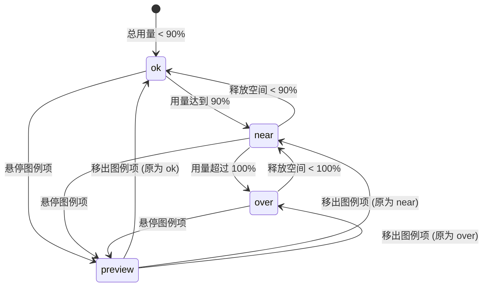

# Usage Meter · 用量计量表

用于多维度资源配额、云存储用量与计费限额监控的复合计量仪表盘组件。包含三大核心动效机制：

1. 多分段错峰弹性揭示（Staggered Segment Reveal）：当组件首次进入视口时，各分类分段（如媒体、文档、备份）按 70ms 错峰延迟以弹性弹簧（visualDuration 0.58s, bounce 0）从 0 宽度横向伸展到位，直观展现多分类配比。
2. 限额阈值线与超额斜纹警示（Threshold Marker & Overflow Hatch）：超过额定配额（≥ 90% 触发 near 警告，> 100% 触发 over 严重警示）时，超出界限部分自动覆盖 45° 警告斜线条纹，状态徽标同步微模糊变色。
3. 图例聚焦悬停单项隔离预览（Legend Hover Preview & Isolation）：鼠标悬停或键盘聚焦到下方图例项时，对应轨道分段轻度高亮，其余分段降至 0.35 透明度静音，数值联动切换至该单项明细。

## 原型清单

| 原型分组 | 原型元素 | 动效 / 状态变化 | 去向 |
| --- | --- | --- | --- |
| — | 计量总容器（`.arc-usage-meter`） | 状态机驱动（ok, near, over, preview）、整体卡片背景与内衬阴影 | 限额阈值线与超额斜纹警示 |
| — | 计量复合轨道与分段（`.arc-usage-track`, `.arc-usage-segment`） | 8px 复合轨道、2px 物理分段微间隙、70ms 错峰弹性伸展 | 多分段错峰弹性揭示 |
| — | 限额基准刻度线（`.arc-usage-marker`） | 100% 配额物理刻度虚线/竖线指示 | 限额阈值线与超额斜纹警示 |
| — | 超额斜纹覆盖层（`.arc-usage-hatch`） | 超额时的 45° 警告斜线条纹纹理与红色警示 | 限额阈值线与超额斜纹警示 |
| — | 状态微章与数值行（`.arc-usage-badge`, `.arc-usage-numbers`） | 状态文案切换、当前用量与总限额 tabular 数字排版 | 限额阈值线与超额斜纹警示 |
| — | 交互图例项（`.arc-usage-legend`, `.arc-usage-legend-item`） | 悬停单项隔离高亮、其余分段静音淡化 | 图例聚焦悬停单项隔离预览 |
| — | 演示外壳（底部模拟数据切换按钮、快捷键） | — | 演示外壳，已删除 |

## 适用

- 云存储配额、API 调用量、计算核数、项目席位等带有多分类拆分的容量监控。
- 拥有硬性套餐上限（Limit），需要提前告知用户“健康 / 接近上限 / 已超额”。
- 用户需要将鼠标移到具体图例上查看某类资源的单独占比。

## 不适用

- 单一任务的不间断百分比加载指示 → [progress.md](progress.md)
- 带有具体截止时间的时间倒计时 → [countdown.md](countdown.md)
- 多步骤任务向导推进 → [stepper.md](stepper.md)
- 页面通知与警示横幅 → [alert.md](../messages/alert.md)

## 状态机

| 状态 | 进入条件 | 视觉表现 | 退出到 |
| --- | --- | --- | --- |
| ok | 总用量 < 90% 限额 | 轨道各色块健康展开，状态徽标中性/绿色展示 "Within limit" | near / over / preview |
| near | 90% <= 总用量 <= 100% 限额 | 状态徽标切换为琥珀黄色 "Near limit"，高亮接近上限风险 | ok / over / preview |
| over | 总用量 > 100% 限额 | 超额部分覆盖 45° 红色警告斜线，状态徽标标红展示 "Over limit" | ok / near / preview |
| preview | 鼠标悬停或键盘聚焦到具体图例项 | 目标分段保持 100% 不透明度，其余分段淡化至 0.35，数值联动显示该项 | ok / near / over (移出后恢复) |



## 最小 DOM

```html
<div class="arc-usage-meter" data-status="ok" role="region" aria-label="Usage meter">
  <div class="arc-usage-header">
    <div class="arc-usage-meta">
      <strong class="arc-usage-title">Storage usage</strong>
      <span class="arc-usage-badge">Within limit</span>
    </div>
    <div class="arc-usage-numbers">
      <span class="arc-usage-current">18.4 GB</span>
      <span class="arc-usage-limit">/ 25.0 GB</span>
    </div>
  </div>
  <div class="arc-usage-track" role="progressbar" aria-valuenow="74" aria-valuemin="0" aria-valuemax="100">
    <div class="arc-usage-segment arc-usage-seg-0" style="width: 45%; background: #2563eb;" title="Media: 11.2 GB"></div>
    <div class="arc-usage-segment arc-usage-seg-1" style="width: 20%; background: #8b5cf6;" title="Documents: 5.0 GB"></div>
    <div class="arc-usage-segment arc-usage-seg-2" style="width: 9%; background: #06b6d4;" title="Backups: 2.2 GB"></div>
    <div class="arc-usage-marker" style="left: 100%;" title="Limit"></div>
  </div>
  <div class="arc-usage-legend">
    <div class="arc-usage-legend-item" data-segment="0">
      <span class="arc-usage-dot" style="background: #2563eb;"></span>
      <span class="arc-usage-legend-label">Media</span>
      <span class="arc-usage-legend-val">11.2 GB</span>
    </div>
    <div class="arc-usage-legend-item" data-segment="1">
      <span class="arc-usage-dot" style="background: #8b5cf6;"></span>
      <span class="arc-usage-legend-label">Documents</span>
      <span class="arc-usage-legend-val">5.0 GB</span>
    </div>
    <div class="arc-usage-legend-item" data-segment="2">
      <span class="arc-usage-dot" style="background: #06b6d4;"></span>
      <span class="arc-usage-legend-label">Backups</span>
      <span class="arc-usage-legend-val">2.2 GB</span>
    </div>
  </div>
</div>
```

- `.arc-usage-meter`：用量计量表宿主，承载状态机与无障碍区域。
- `.arc-usage-header`：顶栏标题与用量数字。
- `.arc-usage-meta`：包含标题 `.arc-usage-title` 与预警徽标 `.arc-usage-badge`。
- `.arc-usage-numbers`：当前实际用量与总限额说明。
- `.arc-usage-track`：8px 高度复合轨道，管理各分段横向排布。
- `.arc-usage-segment`：单项资源用量色块，支持错峰展开与悬停高亮。
- `.arc-usage-marker`：限额刻度线。
- `.arc-usage-legend` 与 `.arc-usage-legend-item`：底部图例列表，支持鼠标悬停与键盘聚焦联动。

## 参数

| 名称 | 值 | 用于 | 来源 |
| --- | --- | --- | --- |
| 级联展开弹簧物理参数 | `visualDuration: 0.58s` / `bounce: 0` | 首次进入视口各分段伸展 | 原型 |
| 分段错峰延时 | `70ms` | 邻近色块展开时间差 | 原型 |
| 轨道高度与分段间隙 | `height: 8px` / `gap: 2px` | 轨道槽几何参数 | 原型 |
| 预警临界阈值比例 | `0.9` (90%) | 触发 near 警告状态 | 原型 |
| 状态徽标过渡时长 | `200ms ease` | 徽标色彩平滑渐变 | 原型 |
| 图例隔离淡化透明度 | `0.35` | 非聚焦分段淡化 | 原型 |
| 减动效模式 | `0ms` (即时物理宽度落位) | prefers-reduced-motion 模式 | 原型 |

## CSS

```css
.arc-usage-meter {
  --um-track-bg: rgba(0, 0, 0, 0.06);
  --um-border: rgba(0, 0, 0, 0.08);
  --um-text: #0f172a;
  --um-desc: #64748b;
  --um-ok: #16a34a;
  --um-warn: #d97706;
  --um-danger: #dc2626;

  display: flex;
  flex-direction: column;
  gap: 12px;
  width: 100%;
  max-width: 480px;
  box-sizing: border-box;
  font-family: system-ui, -apple-system, sans-serif;
}

.arc-usage-header {
  display: flex;
  align-items: center;
  justify-content: space-between;
  line-height: 1.4;
}

.arc-usage-meta {
  display: flex;
  align-items: center;
  gap: 8px;
}

.arc-usage-title {
  font-size: 14px;
  font-weight: 600;
  color: var(--um-text);
}

.arc-usage-badge {
  font-size: 11px;
  font-weight: 600;
  padding: 1px 7px;
  border-radius: 9999px;
  background: rgba(22, 163, 74, 0.1);
  color: var(--um-ok);
  transition: background-color 200ms ease, color 200ms ease;
}

.arc-usage-meter[data-status="near"] .arc-usage-badge {
  background: rgba(217, 119, 6, 0.1);
  color: var(--um-warn);
}

.arc-usage-meter[data-status="over"] .arc-usage-badge {
  background: rgba(220, 38, 38, 0.1);
  color: var(--um-danger);
}

.arc-usage-numbers {
  font-variant-numeric: tabular-nums;
  font-size: 13px;
}

.arc-usage-current {
  font-weight: 700;
  color: var(--um-text);
}

.arc-usage-limit {
  color: var(--um-desc);
}

.arc-usage-track {
  position: relative;
  display: flex;
  align-items: center;
  gap: 2px;
  width: 100%;
  height: 8px;
  background: var(--um-track-bg);
  border-radius: 99px;
  overflow: hidden;
  box-sizing: border-box;
}

.arc-usage-segment {
  height: 100%;
  border-radius: 2px;
  transition: width 400ms cubic-bezier(0.16, 1, 0.3, 1), opacity 200ms ease, transform 200ms ease;
  will-change: width, opacity;
}

.arc-usage-segment.is-dimmed {
  opacity: 0.35;
}

.arc-usage-segment.is-highlighted {
  opacity: 1;
  transform: scaleY(1.25);
}

.arc-usage-marker {
  position: absolute;
  top: 0;
  bottom: 0;
  width: 2px;
  background: #0f172a;
  z-index: 2;
  transform: translateX(-50%);
}

.arc-usage-legend {
  display: flex;
  flex-wrap: wrap;
  align-items: center;
  gap: 16px;
  margin-top: 4px;
}

.arc-usage-legend-item {
  display: flex;
  align-items: center;
  gap: 6px;
  font-size: 12px;
  cursor: pointer;
  user-select: none;
  padding: 2px 4px;
  border-radius: 4px;
  transition: background-color 150ms ease, opacity 150ms ease;
}

.arc-usage-legend-item:hover,
.arc-usage-legend-item:focus-visible {
  background: rgba(0, 0, 0, 0.04);
}

.arc-usage-dot {
  width: 8px;
  height: 8px;
  border-radius: 9999px;
  flex-shrink: 0;
}

.arc-usage-legend-label {
  color: var(--um-desc);
}

.arc-usage-legend-val {
  font-weight: 600;
  color: var(--um-text);
  font-variant-numeric: tabular-nums;
}

@media (prefers-reduced-motion: reduce) {
  .arc-usage-segment {
    transition: none !important;
  }
}
```

## JS

```js
/**
 * 创建并绑定 UsageMeter 用量仪表盘控制器
 * @param {HTMLElement} el 宿主容器元素
 * @param {Object} [options]
 * @param {number} [options.limit=25] 总配额上限
 * @param {Array<{ label: string, value: number, color: string }>} [options.segments] 分段数据
 * @param {string} [options.unit='GB'] 度量单位
 * @param {Function} [options.onHoverSegment] 图例悬停回调
 */
export function createUsageMeter(el, options = {}) {
  const root = el.classList.contains('arc-usage-meter') ? el : el.querySelector('.arc-usage-meter') || el;
  const track = root.querySelector('.arc-usage-track');
  const badge = root.querySelector('.arc-usage-badge');
  const currentEl = root.querySelector('.arc-usage-current');
  const limitEl = root.querySelector('.arc-usage-limit');
  const legendItems = Array.from(root.querySelectorAll('.arc-usage-legend-item'));
  const segments = Array.from(root.querySelectorAll('.arc-usage-segment'));

  const limit = options.limit || 25;
  const unit = options.unit || 'GB';
  let isDisposed = false;

  function updateStatus(totalValue) {
    const ratio = totalValue / limit;
    if (ratio > 1) {
      root.dataset.status = 'over';
      if (badge) badge.textContent = 'Over limit';
    } else if (ratio >= 0.9) {
      root.dataset.status = 'near';
      if (badge) badge.textContent = 'Near limit';
    } else {
      root.dataset.status = 'ok';
      if (badge) badge.textContent = 'Within limit';
    }
  }

  function highlightSegment(segIndex) {
    if (isDisposed) return;
    segments.forEach((seg, idx) => {
      if (idx === segIndex) {
        seg.classList.remove('is-dimmed');
        seg.classList.add('is-highlighted');
      } else {
        seg.classList.remove('is-highlighted');
        seg.classList.add('is-dimmed');
      }
    });
  }

  function resetHighlight() {
    if (isDisposed) return;
    segments.forEach(seg => {
      seg.classList.remove('is-dimmed', 'is-highlighted');
    });
  }

  legendItems.forEach((item, idx) => {
    item.addEventListener('mouseenter', () => highlightSegment(idx));
    item.addEventListener('mouseleave', resetHighlight);
    item.addEventListener('focus', () => highlightSegment(idx));
    item.addEventListener('blur', resetHighlight);
  });

  return {
    setData({ current, segmentsData }) {
      if (isDisposed) return;
      if (current !== undefined) {
        if (currentEl) currentEl.textContent = `${current} ${unit}`;
        updateStatus(current);
      }
    },
    destroy() {
      isDisposed = true;
      legendItems.forEach(item => {
        item.replaceWith(item.cloneNode(true));
      });
    }
  };
}
```

## 接入目标项目

- 状态来源：目标业务层订阅的存储或 API 配额用量模型。
- 尺寸策略：卡片自适应容器宽度（最大 480px），轨道高度 8px，图例行自适应折行。
- 驱动方式：初始化调用 `createUsageMeter(el, options)`；数据更新时调用 `setData()`；页面卸载时调用 `destroy()`。

## 重入与清理

- 多次悬停图例时，高亮类名原子化置换，移除光标即时还原所有分段的不透明度。
- 卸载时调用 `destroy()` 解除图例悬停与聚焦监听器。

## 减少动态效果

- 满足 `prefers-reduced-motion: reduce` 时：
  - 各分段宽度直接按百分比物理呈现，不执行横向弹簧展开。
  - 图例悬停的高亮轻微放大（`scaleY`）效果停用，改由轻量透明度对比区分。

## 焦点与键盘

- 计量轨道配置 `role="progressbar"`，并动态标注当前使用百分比。
- 底部图例支持 Tab 键聚焦与键盘高亮联动，为键盘导航用户提供便捷的明细预览能力。

## 兼容回退

| 特性 | 不支持时 |
| --- | --- |
| CSS `font-variant-numeric: tabular-nums` | 回退至等宽 monospace 字体，保证数字增减时不产生文字跳动。 |
| CSS `scaleY()` 变换 | 悬停时仅保留透明度明暗区分，功能完全不受影响。 |

## 验收清单

- [ ] 初始化展示各分段彩色色块与限额刻度线，分段间隙清晰规整。
- [ ] 首次加载时各分段以错峰弹簧顺畅自左向右横向展开。
- [ ] 鼠标光标移入某一图例项，对应轨道色块高亮凸显，其余色块轻度淡化。
- [ ] 当用量达到或超过限额（如 90% 或 100%），状态徽标精准切换为警告色与提示文案。
- [ ] 开启系统减少动态效果时，色块跳过展开动画直接就绪，无任何闪烁。
