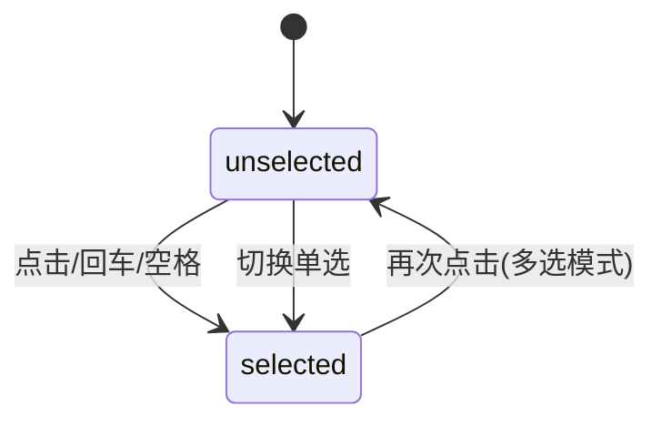

# Chip Group · 过滤标签胶囊组

用于多维标签筛选、状态标记与分类选择的高性能交互组件。包含三大核心动效机制：

1. 弹性位移滞后（Layout Lag / FLIP）：标签在增删、折叠展开与换行重排时，通过欠阻尼谐振子（Damped Oscillator）保持速度并平滑过渡到新布局网格，消除硬跳。
2. 勾选槽与笔触实时绘制：选中时标签表面展开 18px 勾选槽位，标签文字平移让位，SVG 对勾路径通过 `stroke-dasharray` 动态笔触展开并附带微缩放与高斯模糊过渡。
3. 动态折叠与展开收敛：超出最大可见数时收缩为 "+N more" 折叠胶囊，点击手风琴展开平滑测量并解除裁剪，内置全键盘 Roving Tabindex。

## 原型清单

| 原型分组 | 原型元素 | 动效 / 状态变化 | 去向 |
| --- | --- | --- | --- |
| 标签组容器 | 框架 `.chip-group-frame` | 高度随换行行数平滑伸缩，测量实际尺寸并在稳定后解除 overflow: clip | 框架自适应测量与裁剪控制 |
| 过滤胶囊 | 标签按钮 `.chip-group-chip` | 激活状态切换、按压缩放 0.97、布局换行重排平滑过渡 | 胶囊按压与 FLIP 布局重排 |
| 勾选反馈 | 勾选槽 `.chip-group-slot` 与 `.chip-group-check` | 18px 宽度展开、SVG 描边书写、微模糊与缩放显隐 | 勾选槽展开与描边书写 |
| 展开按钮 | "+N more" 折叠按钮 `.chip-group-more` | 展开剩余标签，文案微模糊切换，35ms 错峰淡入显现 | 展开折叠与错峰动画 |
| 演示外壳 | 顶部主题切换按钮 `#themeBtn`、演示框架 `.demo-raw`、结果列表、匹配单选切换 | — | 演示外壳，已删除 |

## 适用

- 列表或资源看板的分类、话题、标签多选与单选过滤场景。
- 选项数量较多、需要折叠展示并支持原地手风琴展开。
- 标签选中时需要极其清晰的勾选反馈（带平滑展开、位移让位与对勾笔触书写）。
- 允许选项随屏幕尺寸自适应流动换行，重排时不发生突兀跳动。

## 不适用

- 紧凑型单选下拉框，空间不足以平铺展开 → [select](select.md)
- 大数据量模糊搜索并支持输入建议的组合输入框 → [combobox](combobox.md)
- 触发器直接原地变形为卡片浮层的高级选择器 → [morph-select](morph-select.md)
- 收集型多选下拉菜单（在输入框内回填已选标签） → [multi-select](multi-select.md)

## 状态机

| 状态 | 进入条件 | 视觉表现 | 退出到 |
| --- | --- | --- | --- |
| unselected | 初始；或点击已选项取消 | 灰色边框，勾选槽宽度为 0，对勾透明度 0 且 scale(0) | selected |
| selected | 点击未选胶囊 | 背景与边框高亮，勾选槽平滑展开 18px，对勾笔触书写绘制，文字向右平移 | unselected |
| folded | 默认折叠态（>6 项时） | 仅展示前 6 项及已选钉选项目，末尾显示 "+N more" 胶囊 | expanded |
| expanded | 点击 "+N more" 按钮 | 容器高度弹性拉伸，隐藏胶囊按 35ms 间隔依次入场，按钮变为折叠文案 | folded |



## 最小 DOM

```html
<div class="chip-group-frame" data-expanded="false">
  <div class="chip-group-content">
    <div class="chip-group-group" role="group" aria-label="Topics">
      <button type="button" class="chip-group-chip" data-chip="Typography" aria-pressed="false" tabindex="0">
        <span class="chip-group-body" data-selected="false">
          <span class="chip-group-surface" aria-hidden="true"></span>
          <span class="chip-group-check" aria-hidden="true">
            <svg width="14" height="14" viewBox="0 0 24 24" fill="none" stroke="currentColor" stroke-width="2.5" stroke-linecap="round" stroke-linejoin="round">
              <path d="M4 12.5 9.5 18 20 6.5" pathLength="1" stroke-dashoffset="1" stroke-dasharray="1 1" />
            </svg>
          </span>
          <span class="chip-group-slot" aria-hidden="true"></span>
          <span class="chip-group-label">Typography</span>
        </span>
      </button>
      <button type="button" class="chip-group-chip" data-chip="Motion" aria-pressed="true" tabindex="-1">
        <span class="chip-group-body" data-selected="true">
          <span class="chip-group-surface" aria-hidden="true"></span>
          <span class="chip-group-check" aria-hidden="true">
            <svg width="14" height="14" viewBox="0 0 24 24" fill="none" stroke="currentColor" stroke-width="2.5" stroke-linecap="round" stroke-linejoin="round">
              <path d="M4 12.5 9.5 18 20 6.5" pathLength="1" stroke-dashoffset="0" stroke-dasharray="1 1" />
            </svg>
          </span>
          <span class="chip-group-slot" aria-hidden="true"></span>
          <span class="chip-group-label">Motion</span>
        </span>
      </button>
      <button type="button" class="chip-group-chip chip-group-more" data-more="" aria-expanded="false" tabindex="-1">
        <span class="chip-group-body">
          <span class="chip-group-surface" aria-hidden="true"></span>
          <span class="chip-group-more-text">
            <span class="chip-group-more-line">+4 more</span>
          </span>
        </span>
      </button>
    </div>
  </div>
</div>
```

- `.chip-group-frame`：主外框，承载自适应高度弹簧过渡与布局裁剪。
- `.chip-group-content`：内层测高包装器。
- `.chip-group-group`：流式标签容器，承载 Roving Tabindex 焦点流。
- `.chip-group-chip`：单个标签按钮，管理激活态与按压反馈。
- `.chip-group-surface`：绝对定位胶囊底衬，负责背景色和描边过渡。
- `.chip-group-check`：对勾图标槽，承载 SVG path 描边动画。
- `.chip-group-slot`：宽度占位弹性槽，选中时由 0 伸缩至 18px。
- `.chip-group-label`：标签文字承载槽。
- `.chip-group-more`：折叠/展开指示胶囊。

## 参数

| 名称 | 值 | 用于 | 来源 |
| --- | --- | --- | --- |
| checkSlotPx | 18px | 选中时展开的对勾槽位宽度 | 原型 |
| maxVisible | 6 | 折叠时默认保留的最多标签数 | 原型 |
| widthAndLayoutLag | duration: 0.42s, bounce: 0.16 | 换行重排与宽度滞后谐振弹簧 | 原型 |
| pressScale | 0.97 | 鼠标按压瞬间缩放比 | 原型 |
| revealStaggerMs | 35ms | 展开多余标签时的错峰入场延迟 | 原型 |
| revealStaggerCapMs | 300ms | 错峰延迟最大上限 | 原型 |
| chipExitMs | 100ms | 胶囊离场淡出持续时间 | 原型 |
| enterScale | 0.9 | 新增标签入场初始缩放 | 原型 |
| heightSpring | visualDuration: 0.4s, bounce: 0 | 容器高度自适应伸缩平滑阻尼 | 原型 |

## CSS

```css
.chip-group-frame {
  position: relative;
  width: 100%;
  transition: height 0.3s cubic-bezier(0.16, 1, 0.3, 1);
}

.chip-group-group {
  display: flex;
  flex-wrap: wrap;
  gap: 8px;
  align-items: center;
}

.chip-group-chip {
  position: relative;
  display: inline-flex;
  max-width: 100%;
  padding: 0;
  border: 0;
  border-radius: 9999px;
  background: transparent;
  color: #555;
  font: inherit;
  font-size: 14px;
  font-weight: 500;
  line-height: 20px;
  cursor: pointer;
  user-select: none;
  -webkit-tap-highlight-color: transparent;
  outline: none;
}

.chip-group-body {
  position: relative;
  isolation: isolate;
  display: inline-flex;
  min-width: 0;
  height: 36px;
  align-items: center;
  padding: 0 14px;
  transition: scale 0.12s cubic-bezier(0.22, 1, 0.36, 1);
}

.chip-group-chip:active .chip-group-body {
  scale: 0.97;
}

.chip-group-surface {
  position: absolute;
  inset: 0;
  z-index: -1;
  border: 1px solid #e2e8f0;
  border-radius: 9999px;
  background: #fff;
  transition: background-color 0.15s ease, border-color 0.15s ease;
}

.chip-group-chip:hover .chip-group-surface {
  border-color: #cbd5e1;
}

.chip-group-body[data-selected="true"] .chip-group-surface {
  border-color: #3b82f6;
  background: #eff6ff;
}

.chip-group-chip[aria-pressed="true"] {
  color: #1d4ed8;
  font-weight: 600;
}

.chip-group-check {
  position: absolute;
  top: calc(50% - 7px);
  left: 12px;
  display: grid;
  width: 14px;
  height: 14px;
  place-items: center;
  color: #2563eb;
  pointer-events: none;
  transform-origin: 0 50%;
  transition: transform 0.2s ease, opacity 0.2s ease;
}

.chip-group-check svg {
  display: block;
}

.chip-group-check path {
  transition: stroke-dashoffset 0.24s cubic-bezier(0.16, 1, 0.3, 1);
}

.chip-group-slot {
  width: 0;
  flex: none;
  transition: width 0.24s cubic-bezier(0.16, 1, 0.3, 1);
}

.chip-group-body[data-selected="true"] .chip-group-slot {
  width: 18px;
}

.chip-group-label {
  overflow: hidden;
  text-overflow: ellipsis;
  white-space: nowrap;
}

.chip-group-more {
  color: #64748b;
}

.chip-group-more .chip-group-surface {
  border-color: #e2e8f0;
  background: #f8fafc;
}

.chip-group-chip:focus-visible .chip-group-surface {
  box-shadow: 0 0 0 2px #fff, 0 0 0 4px #3b82f6;
}

@media (prefers-reduced-motion: reduce) {
  .chip-group-frame,
  .chip-group-body,
  .chip-group-surface,
  .chip-group-check,
  .chip-group-check path,
  .chip-group-slot {
    transition: none !important;
  }
}
```

## JS

```js
export function createChipGroup(frameEl, options = {}) {
  const groupEl = frameEl.querySelector('.chip-group-group') || frameEl;
  const chipButtons = Array.from(groupEl.querySelectorAll('.chip-group-chip:not(.chip-group-more)'));
  const moreBtn = groupEl.querySelector('.chip-group-more');
  let multiple = options.multiple !== undefined ? options.multiple : true;
  let expanded = false;
  let activeFocus = null;

  function updateVisuals(btn, isSelected) {
    btn.setAttribute('aria-pressed', String(isSelected));
    const body = btn.querySelector('.chip-group-body');
    if (body) body.setAttribute('data-selected', String(isSelected));
    const path = btn.querySelector('.chip-group-check path');
    if (path) {
      path.style.strokeDashoffset = isSelected ? '0' : '1';
    }
  }

  function getSelected() {
    return chipButtons
      .filter(b => b.getAttribute('aria-pressed') === 'true')
      .map(b => b.getAttribute('data-chip') || b.textContent.trim());
  }

  function handleChipClick(btn) {
    const isSelected = btn.getAttribute('aria-pressed') === 'true';
    if (!multiple) {
      chipButtons.forEach(b => updateVisuals(b, false));
      updateVisuals(btn, !isSelected);
    } else {
      updateVisuals(btn, !isSelected);
    }
    const currentValues = getSelected();
    if (typeof options.onChange === 'function') {
      options.onChange(currentValues);
    }
    frameEl.dispatchEvent(new CustomEvent('arc:chips-change', {
      bubbles: true,
      detail: { value: currentValues }
    }));
  }

  function updateRovingFocus() {
    const allButtons = Array.from(groupEl.querySelectorAll('.chip-group-chip'));
    allButtons.forEach(b => {
      b.tabIndex = (b === activeFocus || (!activeFocus && b === allButtons[0])) ? 0 : -1;
    });
  }

  const chipListeners = [];
  chipButtons.forEach(btn => {
    const onClick = () => {
      activeFocus = btn;
      updateRovingFocus();
      handleChipClick(btn);
    };
    const onFocus = () => {
      activeFocus = btn;
      updateRovingFocus();
    };
    btn.addEventListener('click', onClick);
    btn.addEventListener('focus', onFocus);
    chipListeners.push({ el: btn, event: 'click', handler: onClick });
    chipListeners.push({ el: btn, event: 'focus', handler: onFocus });
  });

  const onKeyDown = (e) => {
    const allButtons = Array.from(groupEl.querySelectorAll('.chip-group-chip'));
    const index = allButtons.indexOf(document.activeElement);
    if (index === -1) return;

    if (e.key === 'ArrowRight' || e.key === 'ArrowDown') {
      e.preventDefault();
      const next = allButtons[(index + 1) % allButtons.length];
      next.focus();
    } else if (e.key === 'ArrowLeft' || e.key === 'ArrowUp') {
      e.preventDefault();
      const prev = allButtons[(index - 1 + allButtons.length) % allButtons.length];
      prev.focus();
    } else if (e.key === 'Home') {
      e.preventDefault();
      allButtons[0].focus();
    } else if (e.key === 'End') {
      e.preventDefault();
      allButtons[allButtons.length - 1].focus();
    }
  };

  groupEl.addEventListener('keydown', onKeyDown);

  let moreClickListener = null;
  if (moreBtn) {
    moreClickListener = () => {
      expanded = !expanded;
      frameEl.setAttribute('data-expanded', String(expanded));
      moreBtn.setAttribute('aria-expanded', String(expanded));
      const textLine = moreBtn.querySelector('.chip-group-more-line');
      if (textLine) {
        textLine.textContent = expanded ? 'Fold' : '+4 more';
      }
    };
    moreBtn.addEventListener('click', moreClickListener);
  }

  updateRovingFocus();

  return {
    getValue: getSelected,
    setValue: (values = []) => {
      chipButtons.forEach(btn => {
        const key = btn.getAttribute('data-chip') || btn.textContent.trim();
        updateVisuals(btn, values.includes(key));
      });
    },
    destroy: () => {
      chipListeners.forEach(({ el, event, handler }) => el.removeEventListener(event, handler));
      groupEl.removeEventListener('keydown', onKeyDown);
      if (moreBtn && moreClickListener) {
        moreBtn.removeEventListener('click', moreClickListener);
      }
    }
  };
}
```

## 接入目标项目

- 状态来源：由组件内部管理当前选中标签数组，或通过目标项目的过滤状态受控更新。
- 尺寸策略：流式自然换行布局，宽度由外部容器决定，高度根据内容自动测量伸缩。
- 驱动方式：通过 `createChipGroup(el, { multiple: true, onChange: (vals) => {} })` 初始化，外部可通过 `setValue(vals)` 设值。

## 重入与清理

- 连续快速点击胶囊时，直接更新状态并无缝过渡描边与宽度。
- 销毁时清理全部 click/focus/keydown 监听，解除 DOM 引用。

## 减少动态效果

- 在 `prefers-reduced-motion: reduce` 环境下，所有 `transition` 置为 `none`。
- 勾选对勾路径直接跳变显示，无平滑滑动和展开过程，保持语义完整。

## 焦点与键盘

- 容器为 `role="group"`，各标签 `button` 采用 Roving Tabindex。
- 支持 `ArrowRight` / `ArrowLeft` / `ArrowDown` / `ArrowUp` 循环轮巡导航，`Home` 跳转至第一项，`End` 跳转至最后一项。
- `Space` 与 `Enter` 触发原生按钮点击并切换勾选。

## 兼容回退

| 特性 | 不支持时 |
| --- | --- |
| SVG pathLength | 使用固定 stroke-dasharray (如 24) 配合像素 offset 实现笔触描绘 |
| CSS gap (flex) | 回退为子元素的 margin-right 和 margin-bottom |
| Roving Tabindex | 原生全量可 Tab 聚焦 |

## 验收清单

- [ ] 点击未选中胶囊，底衬高亮且左侧 18px 勾选槽平滑展开，SVG 对勾完整书写绘制。
- [ ] 再次点击取消选中，对勾笔触收缩，槽位闭合，标签文本回退原位。
- [ ] 键盘左右方向键在胶囊之间流畅循环聚焦，Tab 键只在当前选中项停留 1 次。
- [ ] 点击 "+N more" 折叠按钮，折叠状态翻转且外框平滑伸展。
- [ ] 开启减弱动态效果时，所有展开与描边动效即时完成无动画。
