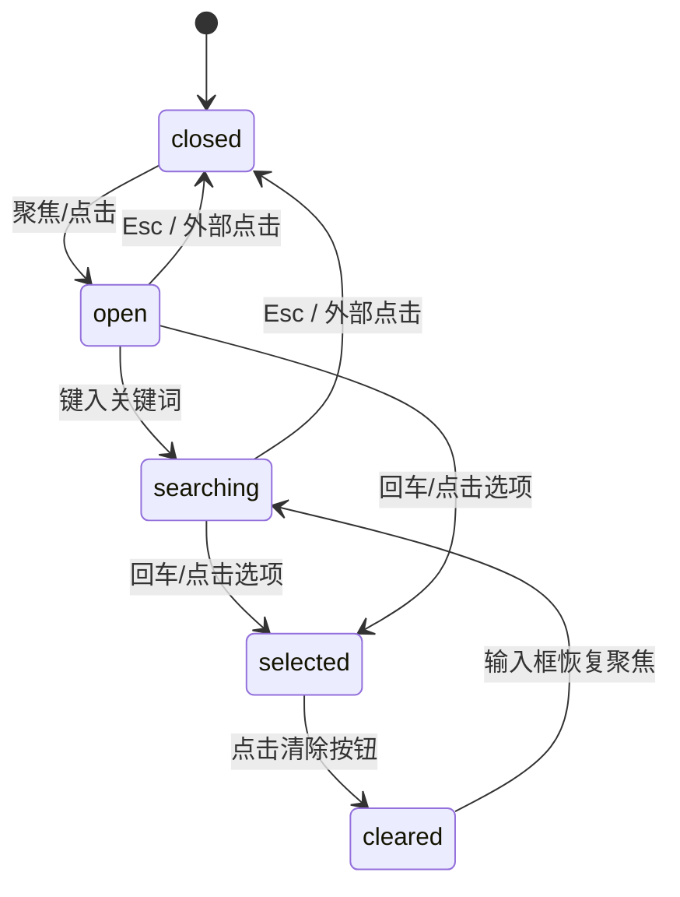

# Combobox · 组合搜索选择框

结合单行文本搜索与浮动候选项列表的自适应选择器。包含三大核心动效机制：

1. 浮动面板弹性升降与高度收敛：展开时面板从 `scale(0.97)` 与 `translateY(-6px)` 在 260ms 内平滑淡入展开；当输入内容导致过滤结果行数变动时，面板高度平滑收敛，避免高度突变引起的闪烁。
2. 文本微模糊置换与清除弹出：已选中项目时显示微型清除按钮，点击时清除按钮微缩伴随高斯模糊淡出（`scale(0.6)`、`blur(2px)`）；候选项选中落入输入框时带微模糊下沉入场。
3. 全键盘循环巡游与外部失焦收回：支持方向键循环高亮候选项、Enter 选中、Escape 撤销输入并关闭面板、点击外部区域安全关闭。

## 原型清单

| 原型分组 | 原型元素 | 动效 / 状态变化 | 去向 |
| --- | --- | --- | --- |
| 控件外壳 | 组合框容器 `.combobox-control` | 聚焦光标环、悬停边框高亮、激活态轮廓 | 控件外壳状态机与轮廓高亮 |
| 文本输入框 | 输入框 `input[role="combobox"]` | 输入过滤查询、占位符微模糊切换、键盘事件监听 | 搜索过滤与键盘漫游 |
| 清除按钮 | 清除图标按钮 `.combobox-clear` | 选中内容存在时以 `scale(0.6)` + 2px 模糊淡入，点击后即刻淡出 | 清除按钮微缩显隐 |
| 下拉指示器 | 下拉箭头 `.combobox-chevron` | 面板打开时旋转 180°，关闭时复原 | 箭头旋转过渡 |
| 选项浮层 | 候选项列表 `.combobox-popup` | 展开时 260ms 微缩与位移入场，高亮项跟随，过滤时高度自适应 | 浮动面板弹性升降与测量 |
| 演示外壳 | 顶部主题切换按钮 `#themeBtn`、底部状态提示 `.demo-status` | — | 演示外壳，已删除 |

## 适用

- 选项列表较长（超过 10 项），用户需要通过键入关键词进行即时模糊搜索。
- 表单中需要同时支持快速键盘选择（方向键选择并回车）与鼠标点选。
- 用户需要随时一键清空已选项并回到初始搜索状态。

## 不适用

- 纯固定少量枚举选项（如 3~5 项），无需搜索过滤 → [select](select.md)
- 允许多选多标签并展示折叠计数 → [multi-select](multi-select.md)
- 原地平铺的多选标签药丸组 → [chip-group](chip-group.md)
- 触发按钮直接膨胀变为完整浮动卡片 → [morph-select](morph-select.md)

## 状态机

| 状态 | 进入条件 | 视觉表现 | 退出到 |
| --- | --- | --- | --- |
| closed | 初始；或点击外部/按 Esc | 面板关闭（`opacity: 0, pointer-events: none`），箭头朝下 | open / searching |
| open | 点击输入框或聚焦 | 下拉面板淡入，箭头翻转 180°，展现全量匹配项 | closed / searching |
| searching | 键入过滤字符 | 列表行动态过滤，面板高度平滑伸缩，无匹配时显现空提示 | closed / selected |
| selected | 选中某一候选项 | 选中文本填入输入框，清除按钮以 `scale(1)` 显现，面板收起 | open / cleared |
| cleared | 点击清除按钮 | 输入框值清空，清除按钮以 `scale(0.6)` + 模糊淡出，面板保持展开并重置焦点 | searching |



## 最小 DOM

```html
<div class="combobox-field" data-state="closed">
  <label class="combobox-label" for="comboInput">Owner</label>
  <div class="combobox-control">
    <svg class="combobox-search-icon" width="16" height="16" viewBox="0 0 24 24" fill="none" stroke="currentColor" stroke-width="1.75" stroke-linecap="round" stroke-linejoin="round" aria-hidden="true">
      <circle cx="11" cy="11" r="8" />
      <path d="m21 21-4.34-4.34" />
    </svg>
    <input id="comboInput" class="combobox-input" type="text" role="combobox" aria-expanded="false" aria-autocomplete="list" aria-controls="comboListbox" placeholder="Select owner..." autocomplete="off">
    <button type="button" class="combobox-clear" aria-label="Clear selection" tabindex="-1">
      <svg width="14" height="14" viewBox="0 0 24 24" fill="none" stroke="currentColor" stroke-width="2" stroke-linecap="round" stroke-linejoin="round" aria-hidden="true">
        <path d="M18 6 6 18M6 6l12 12" />
      </svg>
    </button>
    <svg class="combobox-chevron" width="16" height="16" viewBox="0 0 24 24" fill="none" stroke="currentColor" stroke-width="1.75" stroke-linecap="round" stroke-linejoin="round" aria-hidden="true">
      <path d="m6 9 6 6 6-6" />
    </svg>
  </div>
  <div id="comboListbox" class="combobox-popup" role="listbox" aria-label="Owners" tabindex="-1">
    <div class="combobox-options">
      <div class="combobox-option" role="option" data-value="Emma Collins" aria-selected="false">
        <span class="combobox-option-label">Emma Collins</span>
        <svg class="combobox-check" width="14" height="14" viewBox="0 0 24 24" fill="none" stroke="currentColor" stroke-width="2" stroke-linecap="round" stroke-linejoin="round" aria-hidden="true">
          <polyline points="20 6 9 17 4 12" />
        </svg>
      </div>
      <div class="combobox-option" role="option" data-value="Marcus Johnson" aria-selected="false">
        <span class="combobox-option-label">Marcus Johnson</span>
        <svg class="combobox-check" width="14" height="14" viewBox="0 0 24 24" fill="none" stroke="currentColor" stroke-width="2" stroke-linecap="round" stroke-linejoin="round" aria-hidden="true">
          <polyline points="20 6 9 17 4 12" />
        </svg>
      </div>
      <div class="combobox-option" role="option" data-value="Ava Mitchell" aria-selected="false">
        <span class="combobox-option-label">Ava Mitchell</span>
        <svg class="combobox-check" width="14" height="14" viewBox="0 0 24 24" fill="none" stroke="currentColor" stroke-width="2" stroke-linecap="round" stroke-linejoin="round" aria-hidden="true">
          <polyline points="20 6 9 17 4 12" />
        </svg>
      </div>
    </div>
  </div>
</div>
```

- `.combobox-field`：整体宿主包装器，`data-state="open"|"closed"` 驱动整体展开收起。
- `.combobox-control`：输入外框，布局搜索图标、输入控件、清除按钮与下拉指示箭头。
- `.combobox-input`：原生输入控件，承载 WAI-ARIA 属性（`role="combobox"`、`aria-expanded`）。
- `.combobox-clear`：单击清空选值的浮动按钮。
- `.combobox-chevron`：指示下拉状态的箭头，伴随面板打开平滑旋转。
- `.combobox-popup`：悬浮候选项面板，设置 `role="listbox"`。
- `.combobox-option`：候选项单行，`aria-selected` 标记选中。
- `.combobox-check`：选中状态对勾指示图标。

## 参数

| 名称 | 值 | 用于 | 来源 |
| --- | --- | --- | --- |
| panelEnterMs | 260ms | 浮动面板入场过渡时间 | 原型 |
| panelEnterScale | 0.97 | 浮动面板入场初始微缩比 | 原型 |
| panelEnterYPx | -6px | 浮动面板入场垂直位移 | 原型 |
| panelExitMs | 100ms | 浮动面板快速淡出时间 | 原型 |
| panelExitScale | 0.98 | 浮动面板离场微缩比 | 原型 |
| clearEnterScale | 0.6 | 清除按钮显现初值缩放 | 原型 |
| clearBlurPx | 2px | 清除按钮显隐过渡微模糊 | 原型 |
| selectedEnterYPx | 0.35em | 选中文本落入输入框位移 | 原型 |
| selectedBlurPx | 4px | 选中文本落入高斯微模糊 | 原型 |
| selectedEnterMs | 240ms | 选中值落定动画时间 | 原型 |
| optionHighlightMs | 80ms | 候选项键盘/鼠标悬停高亮反应时间 | 原型 |
| listMaxHeight | min(300px, 40vh) | 下拉列表最大限制高度 | 原型 |

## CSS

```css
.combobox-field {
  position: relative;
  width: 100%;
  max-width: 380px;
  font-family: system-ui, -apple-system, sans-serif;
}

.combobox-label {
  display: block;
  margin-bottom: 6px;
  color: #334155;
  font-size: 13px;
  font-weight: 500;
}

.combobox-control {
  position: relative;
  display: flex;
  align-items: center;
  height: 40px;
  padding: 0 12px;
  border: 1px solid #cbd5e1;
  border-radius: 8px;
  background: #ffffff;
  transition: border-color 0.15s ease, box-shadow 0.15s ease;
}

.combobox-control:focus-within {
  border-color: #3b82f6;
  box-shadow: 0 0 0 3px rgba(59, 130, 246, 0.15);
}

.combobox-search-icon {
  margin-right: 8px;
  color: #94a3b8;
  flex: none;
}

.combobox-input {
  flex: 1;
  min-width: 0;
  border: none;
  background: transparent;
  color: #0f172a;
  font: inherit;
  font-size: 14px;
  outline: none;
}

.combobox-input::placeholder {
  color: #94a3b8;
}

.combobox-clear {
  display: grid;
  width: 20px;
  height: 20px;
  margin-right: 4px;
  padding: 0;
  place-items: center;
  border: none;
  border-radius: 9999px;
  background: #f1f5f9;
  color: #64748b;
  cursor: pointer;
  opacity: 0;
  transform: scale(0.6);
  filter: blur(2px);
  pointer-events: none;
  transition: opacity 0.16s ease, transform 0.16s ease, filter 0.16s ease;
}

.combobox-field[data-has-value="true"] .combobox-clear {
  opacity: 1;
  transform: scale(1);
  filter: blur(0);
  pointer-events: auto;
}

.combobox-clear:hover {
  background: #e2e8f0;
  color: #0f172a;
}

.combobox-chevron {
  color: #94a3b8;
  flex: none;
  transition: transform 0.2s cubic-bezier(0.16, 1, 0.3, 1);
}

.combobox-field[data-state="open"] .combobox-chevron {
  transform: rotate(180deg);
}

.combobox-popup {
  position: absolute;
  top: calc(100% + 6px);
  left: 0;
  right: 0;
  z-index: 50;
  max-height: min(300px, 40vh);
  overflow-y: auto;
  border: 1px solid #e2e8f0;
  border-radius: 8px;
  background: #ffffff;
  box-shadow: 0 10px 25px -5px rgba(0, 0, 0, 0.1), 0 8px 10px -6px rgba(0, 0, 0, 0.05);
  opacity: 0;
  transform: translateY(-6px) scale(0.97);
  pointer-events: none;
  transition: opacity 0.1s ease, transform 0.1s ease;
}

.combobox-field[data-state="open"] .combobox-popup {
  opacity: 1;
  transform: translateY(0) scale(1);
  pointer-events: auto;
  transition: opacity 0.26s cubic-bezier(0.16, 1, 0.3, 1), transform 0.26s cubic-bezier(0.16, 1, 0.3, 1);
}

.combobox-options {
  padding: 4px;
}

.combobox-option {
  display: flex;
  align-items: center;
  justify-content: space-between;
  padding: 8px 10px;
  border-radius: 6px;
  color: #334155;
  font-size: 14px;
  cursor: pointer;
  transition: background-color 80ms ease, color 80ms ease;
}

.combobox-option:hover,
.combobox-option[data-active="true"] {
  background-color: #f1f5f9;
  color: #0f172a;
}

.combobox-option[aria-selected="true"] {
  background-color: #eff6ff;
  color: #2563eb;
  font-weight: 500;
}

.combobox-check {
  opacity: 0;
  color: #2563eb;
}

.combobox-option[aria-selected="true"] .combobox-check {
  opacity: 1;
}

@media (prefers-reduced-motion: reduce) {
  .combobox-control,
  .combobox-clear,
  .combobox-chevron,
  .combobox-popup,
  .combobox-option {
    transition: none !important;
  }
}
```

## JS

```js
export function createCombobox(fieldEl, options = {}) {
  const input = fieldEl.querySelector('.combobox-input');
  const popup = fieldEl.querySelector('.combobox-popup');
  const clearBtn = fieldEl.querySelector('.combobox-clear');
  const optionsContainer = fieldEl.querySelector('.combobox-options');
  const optionEls = Array.from(fieldEl.querySelectorAll('.combobox-option'));

  let isOpen = false;
  let activeIndex = -1;
  let selectedValue = options.defaultValue || (input ? input.value : '');

  function syncValue(val) {
    selectedValue = val;
    if (input) input.value = val;
    fieldEl.setAttribute('data-has-value', String(Boolean(val)));
    optionEls.forEach(opt => {
      const match = opt.getAttribute('data-value') === val;
      opt.setAttribute('aria-selected', String(match));
    });
  }

  function setOpen(open) {
    isOpen = open;
    fieldEl.setAttribute('data-state', open ? 'open' : 'closed');
    if (input) input.setAttribute('aria-expanded', String(open));
    if (!open) {
      activeIndex = -1;
      optionEls.forEach(o => o.removeAttribute('data-active'));
    }
  }

  function filterOptions(query) {
    const q = query.toLowerCase().trim();
    let visibleCount = 0;
    optionEls.forEach(opt => {
      const val = (opt.getAttribute('data-value') || '').toLowerCase();
      const match = val.includes(q);
      opt.style.display = match ? 'flex' : 'none';
      if (match) visibleCount++;
    });
  }

  function getVisibleOptions() {
    return optionEls.filter(o => o.style.display !== 'none');
  }

  function setActiveOption(index) {
    const visible = getVisibleOptions();
    if (visible.length === 0) {
      activeIndex = -1;
      return;
    }
    activeIndex = (index + visible.length) % visible.length;
    visible.forEach((opt, idx) => {
      opt.setAttribute('data-active', String(idx === activeIndex));
      if (idx === activeIndex) {
        opt.scrollIntoView({ block: 'nearest' });
      }
    });
  }

  function selectOption(val) {
    syncValue(val);
    setOpen(false);
    if (typeof options.onChange === 'function') {
      options.onChange(val);
    }
    fieldEl.dispatchEvent(new CustomEvent('arc:value-change', {
      bubbles: true,
      detail: { value: val }
    }));
  }

  const onInputFocus = () => {
    setOpen(true);
    filterOptions(input.value);
  };

  const onInputChange = (e) => {
    setOpen(true);
    filterOptions(e.target.value);
  };

  const onKeyDown = (e) => {
    if (!isOpen) {
      if (e.key === 'ArrowDown' || e.key === 'ArrowUp') {
        e.preventDefault();
        setOpen(true);
        setActiveOption(0);
        return;
      }
    }

    if (e.key === 'ArrowDown') {
      e.preventDefault();
      setActiveOption(activeIndex + 1);
    } else if (e.key === 'ArrowUp') {
      e.preventDefault();
      setActiveOption(activeIndex - 1);
    } else if (e.key === 'Enter') {
      const visible = getVisibleOptions();
      if (isOpen && activeIndex >= 0 && visible[activeIndex]) {
        e.preventDefault();
        const val = visible[activeIndex].getAttribute('data-value');
        selectOption(val);
      }
    } else if (e.key === 'Escape') {
      e.preventDefault();
      if (input) input.value = selectedValue;
      setOpen(false);
    }
  };

  const onOptionClick = (e) => {
    const opt = e.target.closest('.combobox-option');
    if (!opt) return;
    const val = opt.getAttribute('data-value');
    selectOption(val);
  };

  const onClearClick = (e) => {
    e.stopPropagation();
    syncValue('');
    filterOptions('');
    if (input) input.focus();
    setOpen(true);
    if (typeof options.onChange === 'function') {
      options.onChange('');
    }
  };

  const onDocClick = (e) => {
    if (!fieldEl.contains(e.target)) {
      setOpen(false);
      if (input && !selectedValue) {
        input.value = '';
      } else if (input) {
        input.value = selectedValue;
      }
    }
  };

  if (input) {
    input.addEventListener('focus', onInputFocus);
    input.addEventListener('input', onInputChange);
    input.addEventListener('keydown', onKeyDown);
  }
  if (optionsContainer) {
    optionsContainer.addEventListener('click', onOptionClick);
  }
  if (clearBtn) {
    clearBtn.addEventListener('click', onClearClick);
  }
  document.addEventListener('pointerdown', onDocClick);

  syncValue(selectedValue);

  return {
    getValue: () => selectedValue,
    setValue: (val) => syncValue(val),
    open: () => setOpen(true),
    close: () => setOpen(false),
    destroy: () => {
      if (input) {
        input.removeEventListener('focus', onInputFocus);
        input.removeEventListener('input', onInputChange);
        input.removeEventListener('keydown', onKeyDown);
      }
      if (optionsContainer) {
        optionsContainer.removeEventListener('click', onOptionClick);
      }
      if (clearBtn) {
        clearBtn.removeEventListener('click', onClearClick);
      }
      document.removeEventListener('pointerdown', onDocClick);
    }
  };
}
```

## 接入目标项目

- 状态来源：单值受控或非受控组件，支持 `defaultValue` 与外部 `setValue(val)`。
- 尺寸策略：宽度继承外层或受限制于 `max-width: 380px`，列表高度由 `min(300px, 40vh)` 限制并自适应滚动。
- 驱动方式：通过 `createCombobox(fieldEl, { defaultValue: 'Emma Collins', onChange: (val) => {} })` 挂载。

## 重入与清理

- 连续快速按键打字时，通过事件直接过滤候选项并更新 DOM `display`，无需冗余计时器。
- 卸载时调用 `destroy()` 完整注销全局 `pointerdown` 及输入框与按钮上的所有事件监听。

## 减少动态效果

- 在 `prefers-reduced-motion: reduce` 环境下，所有 `transition` 置为 `none`。
- 面板显隐、清除按钮缩放与箭头翻转均直接跳变，保留业务逻辑与无障碍可用性。

## 焦点与键盘

- 输入框保留原生键盘焦点，`aria-expanded` 与 `aria-autocomplete="list"` 同步下拉状态。
- `ArrowDown` / `ArrowUp` 循环轮巡候选项，`Enter` 提交选中项，`Escape` 撤销并关闭。
- 外部点击（Outside Pointer）失焦时自动收起面板并回退未提交输入。

## 兼容回退

| 特性 | 不支持时 |
| --- | --- |
| :focus-within | 依赖 input focus/blur 事件为父级添加 `.is-focused` 类 |
| pointerdown 事件 | 回退为 `mousedown` / `touchstart` 事件 |

## 验收清单

- [ ] 点击输入框或聚焦，面板以 260ms 带微位移与缩放平滑展开，箭头翻转 180°。
- [ ] 键入字符，列表候选项即时过滤，面板高度流畅收敛。
- [ ] 键盘上下方向键循环高亮候选项，回车确认选中，选中文本同步至输入框且面板关闭。
- [ ] 拥有选值时微型清除按钮显现，点击清除按钮值被清空，按钮微缩淡出，输入框重获焦点。
- [ ] 点击组件外部区域，面板平滑收起且未确认的输入内容自动还原。
