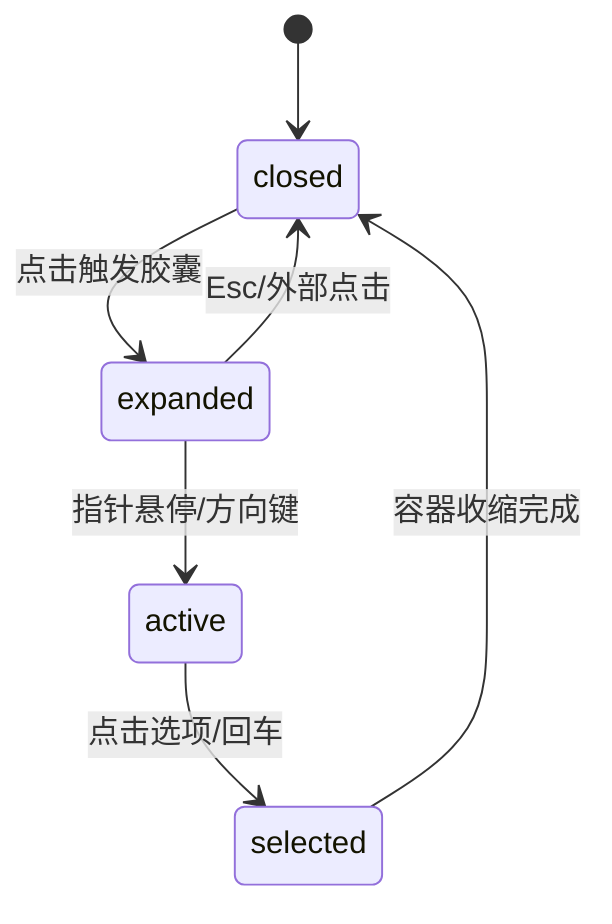

# Morph Select · 形变卡片选择器

将触发器按钮与展开列表整合为单一连续形变容器的高阶选择器。包含三大核心动效机制：

1. 原地表面变形（Container Morphing）：触发器外框并非传统离散的 Popover 挂载，而是由单一物理形状容器（`.morph-select-shape`）从收拢胶囊（152px × 44px）在 400ms 内弹性拉伸并扩张为完整选项卡片（232px × 296px），保持视觉连续性。
2. 盖板值提升与层级置换（Lid Lifting & Swap）：选择器顶部盖板（`.morph-select-lid`）始终固定在容器顶端，选中候选项时，值以 300ms 阻尼平滑“提升”并置换盖板图文，下方选项列表从 `translateY(-6px)` 与 2px 模糊处显现。
3. 共享滑动高光条（Gliding Highlight）：列表内包含单例高光条（`.morph-select-highlight`），在鼠标悬停或键盘导航时以 280ms 弹性阻尼跟随吸附，避免传统批量 `:hover` 造成的杂乱频闪。

## 原型清单

| 原型分组 | 原型元素 | 动效 / 状态变化 | 去向 |
| --- | --- | --- | --- |
| 变形宿主 | 物理外形容器 `.morph-select-shape` | 展开时宽高从胶囊尺寸弹性膨胀为面板尺寸，收拢时平滑回弹 | 原地表面变形与尺寸动画 |
| 顶层盖板 | 盖板区域 `.morph-select-lid` | 承载触发器按钮与下拉箭头，值变化时图文微模糊置换 | 盖板值提升与微模糊置换 |
| 选项列表面 | 列表图层 `.morph-select-list-face` | 展开时带 2px 模糊与 6px 位移淡入，收拢时淡出并设置 inert | 选项列表微模糊与显隐 |
| 共享高光 | 高光指示器 `.morph-select-highlight` | 根据当前悬停/激活选项的 offsetTop 与 offsetHeight 弹性滑动 | 共享滑动高光条 |
| 对勾标记 | 选中指示图标 `.morph-select-check` | 当前选中行显现对勾并高亮 | 对勾指示 |
| 演示外壳 | 顶部主题切换按钮 `#themeBtn`、工单卡片演示外框、活动日志列表 `.morph-select_log` | — | 演示外壳，已删除 |

## 适用

- 紧凑仪表盘、属性面板（如工单状态、指派人、优先级）中需要高级质感的内联选择操作。
- 追求极致的物理触感与容器形变，杜绝弹窗瞬间切出导致的视觉断层。
- 选项包含图标、状态标签与副文本元信息的富内容选择。

## 不适用

- 常规简单单选下拉框 → [select](select.md)
- 大量数据模糊检索与输入匹配的组合框 → [combobox](combobox.md)
- 收集型多选多标签选择器 → [multi-select](multi-select.md)
- 原地平铺的过滤标签组 → [chip-group](chip-group.md)

## 状态机

| 状态 | 进入条件 | 视觉表现 | 退出到 |
| --- | --- | --- | --- |
| closed | 初始；或点击外部/按 Esc | 容器尺寸为单胶囊大小（如 152px × 44px），圆角 22px，列表层隐藏（`inert`） | expanded |
| expanded | 点击触发器按钮 | 容器向右下方膨胀至面板尺寸（232px × 296px），箭头旋转 180°，列表层淡入 | closed / selected |
| active | 鼠标划过或方向键选中项 | 共享高光滑块以 280ms 弹性吸附至对应选项背后 | active / selected |
| selected | 点击或回车选中候选项 | 选中文本提升置入顶层盖板，对勾移动至新项，容器平滑收缩归位 | closed |



## 最小 DOM

```html
<div class="morph-select-root" data-state="closed" style="--ms-panel-w: 232px; --ms-panel-h: 296px; --ms-trigger-w: 152px;">
  <div class="morph-select-anchor">
    <div class="morph-select-shape">
      <div class="morph-select-lid">
        <button type="button" class="morph-select-trigger" role="combobox" aria-haspopup="listbox" aria-expanded="false" aria-controls="msList" tabindex="0">
          <span class="morph-select-slot">
            <span class="morph-select-layer">
              <span class="morph-select-icon">
                <svg width="16" height="16" viewBox="0 0 24 24" fill="none" stroke="currentColor" stroke-width="2" stroke-linecap="round" stroke-linejoin="round" aria-hidden="true">
                  <circle cx="12" cy="12" r="10" />
                </svg>
              </span>
              <span class="morph-select-value-text">In progress</span>
            </span>
          </span>
        </button>
        <span class="morph-select-chevron" aria-hidden="true">
          <svg width="16" height="16" viewBox="0 0 24 24" fill="none" stroke="currentColor" stroke-width="2" stroke-linecap="round" stroke-linejoin="round">
            <path d="m6 9 6 6 6-6" />
          </svg>
        </span>
      </div>
      <div class="morph-select-list-face" inert="" aria-hidden="true">
        <div class="morph-select-scroll">
          <div id="msList" class="morph-select-options" role="listbox">
            <span class="morph-select-highlight" aria-hidden="true"></span>
            <div class="morph-select-option" role="option" data-value="backlog" aria-selected="false">
              <span class="morph-select-option-value">Backlog</span>
              <svg class="morph-select-check" width="16" height="16" viewBox="0 0 24 24" fill="none" stroke="currentColor" stroke-width="2" stroke-linecap="round" stroke-linejoin="round" aria-hidden="true">
                <path d="M20 6 9 17l-5-5" />
              </svg>
            </div>
            <div class="morph-select-option" role="option" data-value="in-progress" aria-selected="true">
              <span class="morph-select-option-value">In progress</span>
              <svg class="morph-select-check" width="16" height="16" viewBox="0 0 24 24" fill="none" stroke="currentColor" stroke-width="2" stroke-linecap="round" stroke-linejoin="round" aria-hidden="true">
                <path d="M20 6 9 17l-5-5" />
              </svg>
            </div>
            <div class="morph-select-option" role="option" data-value="done" aria-selected="false">
              <span class="morph-select-option-value">Done</span>
              <svg class="morph-select-check" width="16" height="16" viewBox="0 0 24 24" fill="none" stroke="currentColor" stroke-width="2" stroke-linecap="round" stroke-linejoin="round" aria-hidden="true">
                <path d="M20 6 9 17l-5-5" />
              </svg>
            </div>
          </div>
        </div>
      </div>
    </div>
  </div>
</div>
```

- `.morph-select-root`：宿主根节点，提供 CSS 变量 `--ms-panel-w`、`--ms-panel-h`、`--ms-trigger-w`。
- `.morph-select-anchor`：定位锚点，固定未展开时的占位宽度。
- `.morph-select-shape`：核心物理形态容器，执行宽高与圆角的弹簧拉伸过渡。
- `.morph-select-lid`：顶部固定盖板，包裹触发按钮与下拉箭头。
- `.morph-select-trigger`：可交互的触发按钮，控制面板开闭。
- `.morph-select-chevron`：指示展开状态的箭头图标。
- `.morph-select-list-face`：选项表面层，开合时带微模糊和位移渐变。
- `.morph-select-highlight`：共享滑动高光条。
- `.morph-select-option`：候选项行节点。

## 参数

| 名称 | 值 | 用于 | 来源 |
| --- | --- | --- | --- |
| grow | visualDuration: 0.4s, bounce: 0.12 | 展开时容器膨胀谐振弹簧 | 原型 |
| shrink | visualDuration: 0.34s, bounce: 0 | 收起时容器平滑回缩阻尼 | 原型 |
| highlight | visualDuration: 0.28s, bounce: 0.08 | 共享高光条移动阻尼 | 原型 |
| liftedValue | visualDuration: 0.3s, bounce: 0.06 | 选值提升至盖板的微模糊置换 | 原型 |
| openRadiusPx | 22px | 容器初始与展开时的边角圆角半径 | 原型 |
| panelWidthsPx | [232, 264, 208]px | 典型展开宽度规格 | 原型 |
| listMaxHeightPx | 296px | 列表最大展示高度 | 原型 |

## CSS

```css
.morph-select-root {
  position: relative;
  display: inline-block;
  font-family: system-ui, -apple-system, sans-serif;
}

.morph-select-anchor {
  position: relative;
  width: var(--ms-trigger-w, 152px);
  height: 44px;
}

.morph-select-shape {
  position: absolute;
  top: 0;
  left: 0;
  z-index: 20;
  width: var(--ms-trigger-w, 152px);
  height: 44px;
  overflow: hidden;
  border: 1px solid #e2e8f0;
  border-radius: 22px;
  background: #ffffff;
  box-shadow: 0 1px 3px rgba(0, 0, 0, 0.05);
  transition: width 0.34s cubic-bezier(0.16, 1, 0.3, 1),
              height 0.34s cubic-bezier(0.16, 1, 0.3, 1),
              box-shadow 0.2s ease,
              border-color 0.2s ease;
}

.morph-select-root[data-state="open"] .morph-select-shape {
  z-index: 50;
  width: var(--ms-panel-w, 232px);
  height: var(--ms-panel-h, 296px);
  border-color: #cbd5e1;
  box-shadow: 0 12px 30px -4px rgba(0, 0, 0, 0.12), 0 4px 12px -2px rgba(0, 0, 0, 0.08);
  transition: width 0.4s cubic-bezier(0.18, 0.89, 0.32, 1.12),
              height 0.4s cubic-bezier(0.18, 0.89, 0.32, 1.12),
              box-shadow 0.2s ease,
              border-color 0.2s ease;
}

.morph-select-lid {
  display: flex;
  align-items: center;
  justify-content: space-between;
  height: 44px;
  padding: 0 14px;
  cursor: pointer;
}

.morph-select-trigger {
  display: flex;
  align-items: center;
  padding: 0;
  border: none;
  background: transparent;
  color: #0f172a;
  font: inherit;
  font-size: 14px;
  font-weight: 500;
  cursor: pointer;
  outline: none;
}

.morph-select-slot {
  display: inline-flex;
  align-items: center;
}

.morph-select-layer {
  display: inline-flex;
  align-items: center;
  gap: 8px;
  transition: opacity 0.15s ease, transform 0.15s ease, filter 0.15s ease;
}

.morph-select-chevron {
  color: #64748b;
  display: grid;
  place-items: center;
  transition: transform 0.24s cubic-bezier(0.16, 1, 0.3, 1);
}

.morph-select-root[data-state="open"] .morph-select-chevron {
  transform: rotate(180deg);
}

.morph-select-list-face {
  position: absolute;
  top: 44px;
  left: 0;
  right: 0;
  bottom: 0;
  opacity: 0;
  transform: translateY(-6px);
  filter: blur(2px);
  transition: opacity 0.15s ease, transform 0.15s ease, filter 0.15s ease;
  pointer-events: none;
}

.morph-select-root[data-state="open"] .morph-select-list-face {
  opacity: 1;
  transform: translateY(0);
  filter: blur(0);
  transition: opacity 0.28s cubic-bezier(0.16, 1, 0.3, 1),
              transform 0.28s cubic-bezier(0.16, 1, 0.3, 1),
              filter 0.28s cubic-bezier(0.16, 1, 0.3, 1);
  pointer-events: auto;
}

.morph-select-scroll {
  height: 100%;
  overflow-y: auto;
  padding: 6px;
}

.morph-select-options {
  position: relative;
  display: flex;
  flex-direction: column;
  gap: 2px;
}

.morph-select-highlight {
  position: absolute;
  left: 0;
  right: 0;
  top: 0;
  height: 36px;
  border-radius: 8px;
  background: #f1f5f9;
  pointer-events: none;
  opacity: 0;
  transition: transform 0.28s cubic-bezier(0.16, 1, 0.3, 1),
              height 0.28s cubic-bezier(0.16, 1, 0.3, 1),
              opacity 0.15s ease;
}

.morph-select-option {
  position: relative;
  z-index: 1;
  display: flex;
  align-items: center;
  justify-content: space-between;
  height: 36px;
  padding: 0 12px;
  border-radius: 8px;
  color: #334155;
  font-size: 14px;
  cursor: pointer;
  user-select: none;
}

.morph-select-option[aria-selected="true"] {
  color: #2563eb;
  font-weight: 500;
}

.morph-select-check {
  opacity: 0;
  color: #2563eb;
}

.morph-select-option[aria-selected="true"] .morph-select-check {
  opacity: 1;
}

@media (prefers-reduced-motion: reduce) {
  .morph-select-shape,
  .morph-select-chevron,
  .morph-select-list-face,
  .morph-select-highlight,
  .morph-select-layer {
    transition: none !important;
  }
}
```

## JS

```js
export function createMorphSelect(rootEl, options = {}) {
  const trigger = rootEl.querySelector('.morph-select-trigger');
  const lid = rootEl.querySelector('.morph-select-lid');
  const listFace = rootEl.querySelector('.morph-select-list-face');
  const highlight = rootEl.querySelector('.morph-select-highlight');
  const optionsContainer = rootEl.querySelector('.morph-select-options');
  const optionEls = Array.from(rootEl.querySelectorAll('.morph-select-option'));
  const valueText = rootEl.querySelector('.morph-select-value-text');

  let isOpen = false;
  let activeIndex = -1;
  let selectedValue = options.defaultValue || (valueText ? valueText.textContent.trim() : '');

  function setOpen(open) {
    isOpen = open;
    rootEl.setAttribute('data-state', open ? 'open' : 'closed');
    if (trigger) trigger.setAttribute('aria-expanded', String(open));
    if (listFace) {
      if (open) {
        listFace.removeAttribute('inert');
        listFace.setAttribute('aria-hidden', 'false');
      } else {
        listFace.setAttribute('inert', '');
        listFace.setAttribute('aria-hidden', 'true');
        if (highlight) highlight.style.opacity = '0';
      }
    }
  }

  function moveHighlight(targetEl) {
    if (!highlight || !targetEl) return;
    highlight.style.opacity = '1';
    highlight.style.transform = `translateY(${targetEl.offsetTop}px)`;
    highlight.style.height = `${targetEl.offsetHeight}px`;
  }

  function selectOption(optEl) {
    if (!optEl) return;
    selectedValue = optEl.getAttribute('data-value') || optEl.textContent.trim();
    optionEls.forEach(o => {
      const match = o === optEl;
      o.setAttribute('aria-selected', String(match));
    });

    if (valueText) {
      valueText.style.opacity = '0';
      valueText.style.transform = 'translateY(-4px)';
      setTimeout(() => {
        valueText.textContent = optEl.querySelector('.morph-select-option-value')?.textContent.trim() || selectedValue;
        valueText.style.opacity = '1';
        valueText.style.transform = 'translateY(0)';
      }, 120);
    }

    setOpen(false);

    if (typeof options.onChange === 'function') {
      options.onChange(selectedValue);
    }
    rootEl.dispatchEvent(new CustomEvent('arc:select-change', {
      bubbles: true,
      detail: { value: selectedValue }
    }));
  }

  const onLidClick = (e) => {
    e.stopPropagation();
    setOpen(!isOpen);
  };

  const onOptionClick = (e) => {
    const opt = e.target.closest('.morph-select-option');
    if (opt) {
      e.stopPropagation();
      selectOption(opt);
    }
  };

  const onOptionMouseEnter = (e) => {
    const opt = e.target.closest('.morph-select-option');
    if (opt) {
      activeIndex = optionEls.indexOf(opt);
      moveHighlight(opt);
    }
  };

  const onKeyDown = (e) => {
    if (!isOpen) {
      if (e.key === 'ArrowDown' || e.key === 'ArrowUp' || e.key === 'Enter' || e.key === ' ') {
        e.preventDefault();
        setOpen(true);
        activeIndex = optionEls.findIndex(o => o.getAttribute('aria-selected') === 'true');
        if (activeIndex === -1) activeIndex = 0;
        moveHighlight(optionEls[activeIndex]);
      }
      return;
    }

    if (e.key === 'ArrowDown') {
      e.preventDefault();
      activeIndex = (activeIndex + 1) % optionEls.length;
      moveHighlight(optionEls[activeIndex]);
    } else if (e.key === 'ArrowUp') {
      e.preventDefault();
      activeIndex = (activeIndex - 1 + optionEls.length) % optionEls.length;
      moveHighlight(optionEls[activeIndex]);
    } else if (e.key === 'Enter' || e.key === ' ') {
      e.preventDefault();
      if (activeIndex >= 0 && optionEls[activeIndex]) {
        selectOption(optionEls[activeIndex]);
      }
    } else if (e.key === 'Escape') {
      e.preventDefault();
      setOpen(false);
      if (trigger) trigger.focus();
    }
  };

  const onDocClick = (e) => {
    if (!rootEl.contains(e.target)) {
      setOpen(false);
    }
  };

  if (lid) lid.addEventListener('click', onLidClick);
  if (optionsContainer) {
    optionsContainer.addEventListener('click', onOptionClick);
    optionsContainer.addEventListener('mouseover', onOptionMouseEnter);
  }
  rootEl.addEventListener('keydown', onKeyDown);
  document.addEventListener('pointerdown', onDocClick);

  return {
    getValue: () => selectedValue,
    setValue: (val) => {
      const matchOpt = optionEls.find(o => o.getAttribute('data-value') === val);
      if (matchOpt) selectOption(matchOpt);
    },
    open: () => setOpen(true),
    close: () => setOpen(false),
    destroy: () => {
      if (lid) lid.removeEventListener('click', onLidClick);
      if (optionsContainer) {
        optionsContainer.removeEventListener('click', onOptionClick);
        optionsContainer.removeEventListener('mouseover', onOptionMouseEnter);
      }
      rootEl.removeEventListener('keydown', onKeyDown);
      document.removeEventListener('pointerdown', onDocClick);
    }
  };
}
```

## 接入目标项目

- 状态来源：单项业务枚举属性（如 issue status, priority, assignee），支持受控绑定。
- 尺寸策略：锚点容器锁定触发器原始尺寸，展开时形变层通过绝对定位膨胀，不挤压周围 DOM。
- 驱动方式：`createMorphSelect(rootEl, { defaultValue: 'in-progress', onChange: (val) => {} })`。

## 重入与清理

- 连续快速切换开合时，CSS 容器动画通过统一 `transition` 平滑打断并自适应调整当前尺寸。
- 销毁时清理对 `document` 的指针监听与内部键盘事件。

## 减少动态效果

- 在 `prefers-reduced-motion: reduce` 下，移除容器伸缩与位移过渡，尺寸与透明度直接置定。
- 保证形变面板与列表层在无动画模式下立即可用。

## 焦点与键盘

- 触发器按钮具备标准 `combobox` 角色与 `aria-expanded`。
- 面板闭合时子列表设置 `inert` 与 `aria-hidden="true"`，杜绝隐藏元素接收焦点。
- 支持 `ArrowDown` / `ArrowUp` 漫游，`Enter` / `Space` 确认，`Escape` 收缩并归还焦点至触发按钮。

## 兼容回退

| 特性 | 不支持时 |
| --- | --- |
| HTML inert 属性 | 回退为在关闭时显式将所有 option 的 `tabindex` 设为 -1 |
| CSS 变量计算 | 使用预设的固定像素面板尺寸 |

## 验收清单

- [ ] 点击触发胶囊，外框从 152px × 44px 在 400ms 内平滑膨胀为卡片面板，无任何瞬态闪烁。
- [ ] 鼠标在候选项之间划过，共享高光条以 280ms 弹性平滑吸附跟随。
- [ ] 选中新项后，顶层盖板文字发生 120ms 微模糊平滑置换，容器收缩回胶囊尺寸。
- [ ] 按下 Esc 键或点击组件外部，容器流畅收缩归位并设置 inert。
- [ ] 系统开启减弱动态效果时，开合瞬间完成，交互无阻塞。
