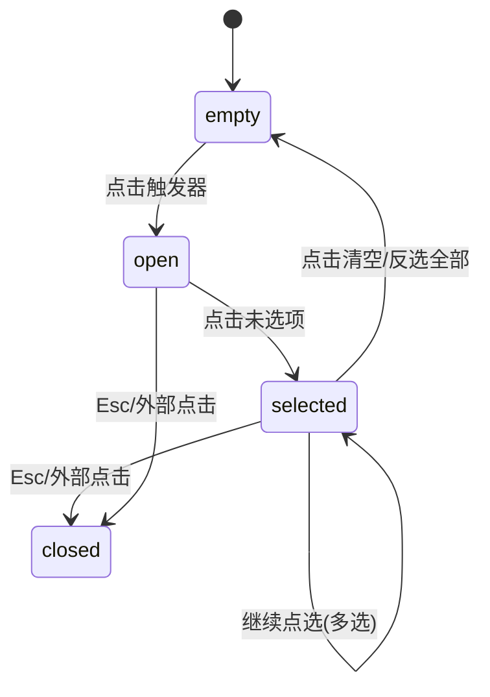

# Multi-select · 多选标签收集器

支持在紧凑输入框内收纳多项已选项的高品质选择器。包含三大核心动效机制：

1. 标签槽位平滑展开与微模糊入场：选中项目作为微型标签胶囊（`.multi-select-chip`）动态插入输入框槽位，以 `scale(0.9)`、4px 高斯模糊在 260ms 内平滑展开让位；取消选中时槽位收缩回缩。
2. 溢出滚动轮盘（Rolling Overflow Counter）：当选中数量超过最大可见容量（`maxVisible: 2`）时，自动折叠显示溢出胶囊（如 "+1 more"），数字跳动时沿垂直方向进行 0.5em 翻滚轮播。
3. 列表对勾路径动态绘制：下拉列表内多项并发勾选，选项点击后面板保持开启，SVG 路径通过 `stroke-dashoffset`（240ms）执行平滑笔触展开与回缩。

## 原型清单

| 原型分组 | 原型元素 | 动效 / 状态变化 | 去向 |
| --- | --- | --- | --- |
| 触发槽位 | 触发器外框 `.multi-select-trigger` | 宽度与高度弹性测量，容纳已选标签 | 触发外框状态与测量 |
| 选中标签 | 胶囊项 `.multi-select-chip` | 260ms 微缩与模糊入场，退场时槽位平滑合并 | 标签槽位微模糊入场与退场 |
| 溢出计数 | 折叠标记 `.multi-select-overflow` | 超出 2 项时淡入，数字垂直 0.5em 滚轮切换 | 溢出滚动轮盘 |
| 快速清空 | 一键清空按钮 `.multi-select-clear` | 存在已选值时淡入，按压缩放 0.96，点击全量清空 | 清空按钮按压缩放 |
| 下拉多选项 | 下拉列表选项 `.multi-select-option` | 点击保持面板展开，SVG 对勾描边实时书写 | 列表对勾路径绘制 |
| 演示外壳 | 顶部主题切换按钮 `#themeBtn`、外层居中容器 | — | 演示外壳，已删除 |

## 适用

- 表单中需要分配多个责任人、打上多重业务标签、分配多权限组的场景。
- 输入框空间有限，需要限制最多只直观展示 2 项，超出自动滚轮折叠。
- 允许用户在下拉列表中快速连续点选多个项目而不需要反复打开面板。

## 不适用

- 仅支持单一选项的下拉菜单 → [select](select.md)
- 需要实时搜索过滤候选项的组合框 → [combobox](combobox.md)
- 页面空间开阔、所有标签原地平铺排布的筛选栏 → [chip-group](chip-group.md)
- 触发器原地膨胀为卡片浮层的形变选择器 → [morph-select](morph-select.md)

## 状态机

| 状态 | 进入条件 | 视觉表现 | 退出到 |
| --- | --- | --- | --- |
| empty | 初始；或点击清空 | 显示占位符文本，清空按钮隐藏，面板闭合 | open / selected |
| open | 点击触发器 | 下拉面板 240ms 淡入，箭头旋转 180° | closed / selected |
| selected | 点选未选项 | 标签以 `scale(0.9)` + 4px 模糊插入槽位，对勾描边画出；超出 2 项时出现溢出滚轮 | selected / empty |
| unselected | 点选已选项 | 对应标签淡出收起，对勾笔触收缩，溢出滚轮数字递减 | selected / empty |
| closed | 点击外部/按 Esc | 面板淡出收起，焦点保留在触发器上 | open |



## 最小 DOM

```html
<div class="multi-select-root" data-state="closed" data-has-value="false">
  <button type="button" class="multi-select-trigger" role="combobox" aria-haspopup="listbox" aria-expanded="false" aria-controls="msPopup">
    <div class="multi-select-slot">
      <span class="multi-select-placeholder">Select reviewers...</span>
      <div class="multi-select-chips"></div>
      <div class="multi-select-overflow" style="display: none;">
        <span class="multi-select-overflow-prefix">+</span>
        <span class="multi-select-overflow-num">1</span>
        <span class="multi-select-overflow-suffix"> more</span>
      </div>
    </div>
    <div class="multi-select-actions">
      <button type="button" class="multi-select-clear" aria-label="Clear all selections" tabindex="-1">
        <svg width="14" height="14" viewBox="0 0 24 24" fill="none" stroke="currentColor" stroke-width="2" stroke-linecap="round" stroke-linejoin="round" aria-hidden="true">
          <path d="M18 6 6 18M6 6l12 12" />
        </svg>
      </button>
      <svg class="multi-select-chevron" width="16" height="16" viewBox="0 0 24 24" fill="none" stroke="currentColor" stroke-width="2" stroke-linecap="round" stroke-linejoin="round" aria-hidden="true">
        <path d="m6 9 6 6 6-6" />
      </svg>
    </div>
  </button>
  <div id="msPopup" class="multi-select-popup" role="listbox" aria-multiselectable="true">
    <div class="multi-select-options">
      <div class="multi-select-option" role="option" data-value="design" aria-selected="false">
        <span class="multi-select-option-label">Design Team</span>
        <svg class="multi-select-check" width="16" height="16" viewBox="0 0 24 24" fill="none" stroke="currentColor" stroke-width="2.5" stroke-linecap="round" stroke-linejoin="round" aria-hidden="true">
          <path d="M4 12.5 9.5 18 20 6.5" pathLength="1" stroke-dashoffset="1" stroke-dasharray="1 1" />
        </svg>
      </div>
      <div class="multi-select-option" role="option" data-value="eng" aria-selected="false">
        <span class="multi-select-option-label">Engineering</span>
        <svg class="multi-select-check" width="16" height="16" viewBox="0 0 24 24" fill="none" stroke="currentColor" stroke-width="2.5" stroke-linecap="round" stroke-linejoin="round" aria-hidden="true">
          <path d="M4 12.5 9.5 18 20 6.5" pathLength="1" stroke-dashoffset="1" stroke-dasharray="1 1" />
        </svg>
      </div>
      <div class="multi-select-option" role="option" data-value="product" aria-selected="false">
        <span class="multi-select-option-label">Product Management</span>
        <svg class="multi-select-check" width="16" height="16" viewBox="0 0 24 24" fill="none" stroke="currentColor" stroke-width="2.5" stroke-linecap="round" stroke-linejoin="round" aria-hidden="true">
          <path d="M4 12.5 9.5 18 20 6.5" pathLength="1" stroke-dashoffset="1" stroke-dasharray="1 1" />
        </svg>
      </div>
    </div>
  </div>
</div>
```

- `.multi-select-root`：宿主容器，管理 `data-state="open"|"closed"` 与 `data-has-value`。
- `.multi-select-trigger`：可聚焦的主按钮触发器。
- `.multi-select-slot`：内嵌标签排版容器。
- `.multi-select-placeholder`：无选中值时的淡灰占位文案。
- `.multi-select-chips`：已选标签胶囊动态挂载容器。
- `.multi-select-overflow`：超出 2 项时的折叠轮盘胶囊。
- `.multi-select-clear`：一键清空按钮，带按压缩放。
- `.multi-select-chevron`：展开状态指示箭头。
- `.multi-select-popup`：多选悬浮列表，`aria-multiselectable="true"`。
- `.multi-select-check`：带 SVG 描边属性（`pathLength="1"`）的动态对勾。

## 参数

| 名称 | 值 | 用于 | 来源 |
| --- | --- | --- | --- |
| maxVisible | 2 | 触发器内最多直接展示的标签胶囊数 | 原型 |
| chipEnterScale | 0.9 | 新增标签胶囊的入场微缩比 | 原型 |
| chipEnterBlurPx | 4px | 标签入场高斯微模糊 | 原型 |
| chipExitBlurPx | 2px | 标签离场高斯微模糊 | 原型 |
| chipEnterMs | 260ms | 标签入场弹性动画时间 | 原型 |
| overflowRollEm | 0.5em | 溢出计数器翻滚跳变行程 | 原型 |
| checkDrawMs | 240ms | SVG 对勾描边展开/收缩过渡时长 | 原型 |
| clearPressScale | 0.96 | 清空按钮按压瞬间缩放比 | 原型 |

## CSS

```css
.multi-select-root {
  position: relative;
  width: 100%;
  max-width: 380px;
  font-family: system-ui, -apple-system, sans-serif;
}

.multi-select-trigger {
  display: flex;
  align-items: center;
  justify-content: space-between;
  width: 100%;
  min-height: 42px;
  padding: 4px 10px;
  border: 1px solid #cbd5e1;
  border-radius: 8px;
  background: #ffffff;
  cursor: pointer;
  outline: none;
  transition: border-color 0.15s ease, box-shadow 0.15s ease;
}

.multi-select-trigger:focus-visible {
  border-color: #3b82f6;
  box-shadow: 0 0 0 3px rgba(59, 130, 246, 0.15);
}

.multi-select-slot {
  display: flex;
  flex-wrap: wrap;
  align-items: center;
  gap: 6px;
  flex: 1;
  min-width: 0;
}

.multi-select-placeholder {
  color: #94a3b8;
  font-size: 14px;
  user-select: none;
}

.multi-select-root[data-has-value="true"] .multi-select-placeholder {
  display: none;
}

.multi-select-chips {
  display: flex;
  align-items: center;
  gap: 6px;
}

.multi-select-chip {
  display: inline-flex;
  align-items: center;
  height: 28px;
  padding: 0 8px;
  border-radius: 6px;
  background: #f1f5f9;
  color: #1e293b;
  font-size: 13px;
  font-weight: 500;
  animation: chipEnter 0.26s cubic-bezier(0.16, 1, 0.3, 1) forwards;
}

@keyframes chipEnter {
  from {
    opacity: 0;
    transform: scale(0.9);
    filter: blur(4px);
  }
  to {
    opacity: 1;
    transform: scale(1);
    filter: blur(0);
  }
}

.multi-select-overflow {
  display: inline-flex;
  align-items: center;
  height: 28px;
  padding: 0 8px;
  border-radius: 6px;
  background: #e2e8f0;
  color: #475569;
  font-size: 12px;
  font-weight: 600;
}

.multi-select-overflow-num {
  display: inline-block;
  transition: transform 0.2s cubic-bezier(0.16, 1, 0.3, 1), opacity 0.2s ease;
}

.multi-select-actions {
  display: flex;
  align-items: center;
  gap: 4px;
  margin-left: 8px;
}

.multi-select-clear {
  display: grid;
  place-items: center;
  width: 22px;
  height: 22px;
  padding: 0;
  border: none;
  border-radius: 9999px;
  background: #f1f5f9;
  color: #64748b;
  cursor: pointer;
  opacity: 0;
  transform: scale(0.7);
  pointer-events: none;
  transition: opacity 0.15s ease, transform 0.15s ease, scale 0.1s ease;
}

.multi-select-root[data-has-value="true"] .multi-select-clear {
  opacity: 1;
  transform: scale(1);
  pointer-events: auto;
}

.multi-select-clear:active {
  scale: 0.96;
}

.multi-select-chevron {
  color: #94a3b8;
  transition: transform 0.2s cubic-bezier(0.16, 1, 0.3, 1);
}

.multi-select-root[data-state="open"] .multi-select-chevron {
  transform: rotate(180deg);
}

.multi-select-popup {
  position: absolute;
  top: calc(100% + 6px);
  left: 0;
  right: 0;
  z-index: 50;
  max-height: 260px;
  overflow-y: auto;
  border: 1px solid #e2e8f0;
  border-radius: 8px;
  background: #ffffff;
  box-shadow: 0 10px 25px -5px rgba(0, 0, 0, 0.1);
  opacity: 0;
  transform: translateY(-6px) scale(0.98);
  pointer-events: none;
  transition: opacity 0.12s ease, transform 0.12s ease;
}

.multi-select-root[data-state="open"] .multi-select-popup {
  opacity: 1;
  transform: translateY(0) scale(1);
  pointer-events: auto;
  transition: opacity 0.24s cubic-bezier(0.16, 1, 0.3, 1), transform 0.24s cubic-bezier(0.16, 1, 0.3, 1);
}

.multi-select-options {
  padding: 4px;
}

.multi-select-option {
  display: flex;
  align-items: center;
  justify-content: space-between;
  height: 38px;
  padding: 0 10px;
  border-radius: 6px;
  color: #334155;
  font-size: 14px;
  cursor: pointer;
  user-select: none;
  transition: background-color 80ms ease;
}

.multi-select-option:hover {
  background-color: #f8fafc;
}

.multi-select-option[aria-selected="true"] {
  background-color: #eff6ff;
  color: #2563eb;
  font-weight: 500;
}

.multi-select-check {
  color: #2563eb;
  pointer-events: none;
}

.multi-select-check path {
  transition: stroke-dashoffset 0.24s cubic-bezier(0.16, 1, 0.3, 1);
}

@media (prefers-reduced-motion: reduce) {
  .multi-select-trigger,
  .multi-select-clear,
  .multi-select-chevron,
  .multi-select-popup,
  .multi-select-chip,
  .multi-select-check path {
    transition: none !important;
    animation: none !important;
  }
}
```

## JS

```js
export function createMultiSelect(rootEl, options = {}) {
  const trigger = rootEl.querySelector('.multi-select-trigger');
  const chipsContainer = rootEl.querySelector('.multi-select-chips');
  const overflowEl = rootEl.querySelector('.multi-select-overflow');
  const overflowNum = rootEl.querySelector('.multi-select-overflow-num');
  const clearBtn = rootEl.querySelector('.multi-select-clear');
  const popup = rootEl.querySelector('.multi-select-popup');
  const optionEls = Array.from(rootEl.querySelectorAll('.multi-select-option'));

  const maxVisible = options.maxVisible || 2;
  let selected = Array.isArray(options.defaultValue) ? [...options.defaultValue] : [];
  let isOpen = false;

  function renderChips() {
    if (!chipsContainer) return;
    chipsContainer.innerHTML = '';
    const visibleKeys = selected.slice(0, maxVisible);
    const hiddenCount = selected.length - visibleKeys.length;

    visibleKeys.forEach(val => {
      const opt = optionEls.find(o => o.getAttribute('data-value') === val);
      const label = opt ? opt.querySelector('.multi-select-option-label')?.textContent.trim() : val;
      const chip = document.createElement('span');
      chip.className = 'multi-select-chip';
      chip.textContent = label;
      chipsContainer.appendChild(chip);
    });

    if (overflowEl && overflowNum) {
      if (hiddenCount > 0) {
        overflowEl.style.display = 'inline-flex';
        overflowNum.textContent = String(hiddenCount);
      } else {
        overflowEl.style.display = 'none';
      }
    }

    rootEl.setAttribute('data-has-value', String(selected.length > 0));

    optionEls.forEach(opt => {
      const val = opt.getAttribute('data-value');
      const isChecked = selected.includes(val);
      opt.setAttribute('aria-selected', String(isChecked));
      const path = opt.querySelector('.multi-select-check path');
      if (path) {
        path.style.strokeDashoffset = isChecked ? '0' : '1';
      }
    });
  }

  function toggleValue(val) {
    if (selected.includes(val)) {
      selected = selected.filter(v => v !== val);
    } else {
      selected.push(val);
    }
    renderChips();
    if (typeof options.onChange === 'function') {
      options.onChange([...selected]);
    }
    rootEl.dispatchEvent(new CustomEvent('arc:values-change', {
      bubbles: true,
      detail: { value: [...selected] }
    }));
  }

  function setOpen(open) {
    isOpen = open;
    rootEl.setAttribute('data-state', open ? 'open' : 'closed');
    if (trigger) trigger.setAttribute('aria-expanded', String(open));
  }

  const onTriggerClick = (e) => {
    if (clearBtn && clearBtn.contains(e.target)) return;
    setOpen(!isOpen);
  };

  const onOptionClick = (e) => {
    const opt = e.target.closest('.multi-select-option');
    if (!opt) return;
    e.stopPropagation();
    const val = opt.getAttribute('data-value');
    toggleValue(val);
  };

  const onClearClick = (e) => {
    e.stopPropagation();
    selected = [];
    renderChips();
    if (typeof options.onChange === 'function') {
      options.onChange([]);
    }
  };

  const onDocClick = (e) => {
    if (!rootEl.contains(e.target)) {
      setOpen(false);
    }
  };

  const onKeyDown = (e) => {
    if (e.key === 'Escape') {
      setOpen(false);
      if (trigger) trigger.focus();
    }
  };

  if (trigger) trigger.addEventListener('click', onTriggerClick);
  if (popup) popup.addEventListener('click', onOptionClick);
  if (clearBtn) clearBtn.addEventListener('click', onClearClick);
  rootEl.addEventListener('keydown', onKeyDown);
  document.addEventListener('pointerdown', onDocClick);

  renderChips();

  return {
    getValue: () => [...selected],
    setValue: (vals = []) => {
      selected = [...vals];
      renderChips();
    },
    clear: () => {
      selected = [];
      renderChips();
    },
    destroy: () => {
      if (trigger) trigger.removeEventListener('click', onTriggerClick);
      if (popup) popup.removeEventListener('click', onOptionClick);
      if (clearBtn) clearBtn.removeEventListener('click', onClearClick);
      rootEl.removeEventListener('keydown', onKeyDown);
      document.removeEventListener('pointerdown', onDocClick);
    }
  };
}
```

## 接入目标项目

- 状态来源：多选数组状态受控绑定，外部可通过 `setValue(vals)` 设值。
- 尺寸策略：宽度根据父级容器伸展，高度随标签行数自适应测量伸缩。
- 驱动方式：`createMultiSelect(rootEl, { maxVisible: 2, defaultValue: ['design'], onChange: (vals) => {} })`。

## 重入与清理

- 连续快速点选选项时，对勾描边通过 CSS transition 动态反向计算，无需额外锁。
- 卸载时彻底移除 document 上的 `pointerdown` 监听及内部按键监听。

## 减少动态效果

- 在 `prefers-reduced-motion: reduce` 下，禁用标签入场 keyframes 动画及 SVG 描边展开过渡。
- 标签与对勾直接跳变显示，保留无障碍属性与勾选逻辑。

## 焦点与键盘

- 触发器是主键盘焦点入口，支持 `Enter` / `Space` 展开下拉面板。
- 面板展开时支持 `Escape` 即时收起并将焦点归还至触发器按钮。

## 兼容回退

| 特性 | 不支持时 |
| --- | --- |
| SVG pathLength | 使用固定像素 dasharray 与 dashoffset |
| keyframes filter: blur | 回退为基础 opacity 渐显 |

## 验收清单

- [ ] 点击触发按钮，面板以 240ms 展开且箭头翻转 180°。
- [ ] 勾选选项时，选项对勾实时描边展开，对应标签以微模糊淡入输入框。
- [ ] 选中超过 2 项时，溢出计数胶囊显现（如 +1 more），数字清晰翻转。
- [ ] 点击清空按钮，选值全量清除且占位符平滑恢复。
- [ ] 开启减弱动态效果时，所有动画瞬时落定，无残影。
