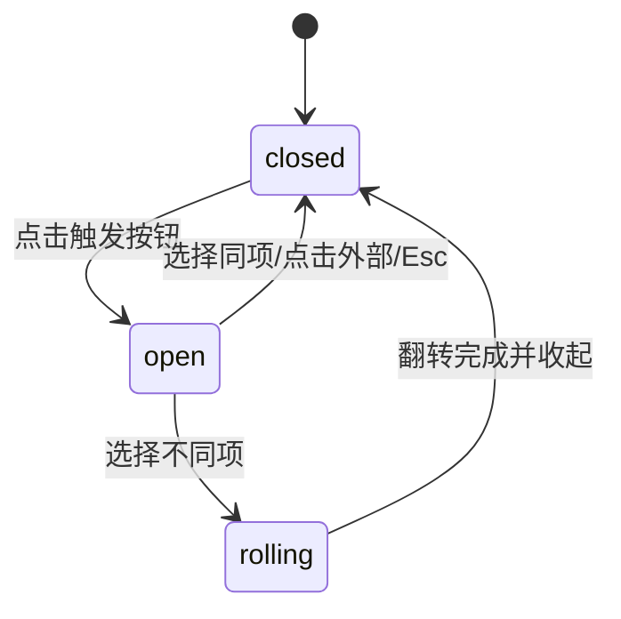

# Select · 原生感单选下拉菜单

经典紧凑型单选下拉组件。包含三大核心动效机制：

1. 方向感知的文案垂直滚轮翻转（Directional Roller Flip）：新旧选值切换时，计算选项前后索引差值，新项在下方时旧文案向上模糊离场（`.exit-up`）、新文案从下方升起淡入（`.enter-up`）；反之则执行反向垂直位移，营造极具触感的机械齿轮转动感。
2. 悬浮面板轻量级弹性升降：打开时面板在 150ms 内从 `scale(0.96)`、`translateY(-4px)` 弹性淡入，箭头顺时针旋转 180°；关闭时平滑反转退出。
3. 选项微高光与选中指示：当前选中行带柔和背景并显现描边对勾，支持全键盘方向键循环选择与失焦消除残留黑边。

## 原型清单

| 原型分组 | 原型元素 | 动效 / 状态变化 | 去向 |
| --- | --- | --- | --- |
| 触发按钮 | 触发胶囊 `button.trigger` | 悬停边框高亮、激活态轮廓、aria-expanded 状态切换 | 触发胶囊状态机 |
| 文本槽位 | 文案容器 `.value-wrapper` 与 `.value-item` | 切换时基于索引差值的上下滚轮位移与模糊（140ms） | 方向感知的文案垂直滚轮翻转 |
| 下拉指示 | 箭头图标 `.chevron` | 面板展开时旋转 180° | 箭头翻转过渡 |
| 弹出菜单 | 浮层 `.content` 与 `.viewport` | 150ms 缩放与位移淡入淡出 | 悬浮面板轻量级弹性升降 |
| 候选项行 | 选项单项 `.item` | 悬停微底色、选中项蓝色高亮与对勾指示图标 | 选项高光与选中指示 |
| 演示外壳 | 顶部主题切换按钮 `#themeBtn`、外部卡片外壳、提示说明文案 | — | 演示外壳，已删除 |

## 适用

- 枚举数量适中（3~10 项）的常规表单单选场景（如团队选择、语言切换、排序方式）。
- 追求细腻的微动效细节，选值切换时需要具备方向感的数字/文字滚轮翻转。
- 空间紧凑，无需嵌入复杂的搜索过滤输入框。

## 不适用

- 候选项超过 10 项且需要即时模糊搜索输入 → [combobox](combobox.md)
- 需要收集多项已选项的多选下拉框 → [multi-select](multi-select.md)
- 触发按钮直接膨胀变形为完整卡片浮层 → [morph-select](morph-select.md)
- 适合原地平铺展示的过滤药丸胶囊组 → [chip-group](chip-group.md)

## 状态机

| 状态 | 进入条件 | 视觉表现 | 退出到 |
| --- | --- | --- | --- |
| closed | 初始；或点击外部/按 Esc | 面板关闭（`opacity: 0, pointer-events: none`），箭头朝下 | open |
| open | 点击触发器 | 面板以 150ms 微缩与位移展开，箭头旋转 180° | closed / rolling |
| rolling | 选定不同索引的选项 | 当前文本沿指定方向退出，新文本从反向滑入淡入，耗时 140ms | closed |



## 最小 DOM

```html
<div class="select-root">
  <button type="button" class="select-trigger" role="combobox" aria-haspopup="listbox" aria-expanded="false" data-state="closed">
    <span class="select-value-wrapper">
      <span class="select-value-item">Design</span>
    </span>
    <span class="select-chevron" aria-hidden="true">
      <svg width="16" height="16" viewBox="0 0 24 24" fill="none" stroke="currentColor" stroke-width="2" stroke-linecap="round" stroke-linejoin="round">
        <path d="m6 9 6 6 6-6" />
      </svg>
    </span>
  </button>

  <div class="select-content" role="listbox" data-state="closed">
    <div class="select-viewport">
      <div class="select-item" role="option" data-value="Design" aria-selected="true">
        <span>Design</span>
        <span class="select-indicator" aria-hidden="true">
          <svg width="16" height="16" viewBox="0 0 24 24" fill="none" stroke="currentColor" stroke-width="2" stroke-linecap="round" stroke-linejoin="round">
            <polyline points="20 6 9 17 4 12" />
          </svg>
        </span>
      </div>
      <div class="select-item" role="option" data-value="Engineering" aria-selected="false">
        <span>Engineering</span>
        <span class="select-indicator" aria-hidden="true">
          <svg width="16" height="16" viewBox="0 0 24 24" fill="none" stroke="currentColor" stroke-width="2" stroke-linecap="round" stroke-linejoin="round">
            <polyline points="20 6 9 17 4 12" />
          </svg>
        </span>
      </div>
      <div class="select-item" role="option" data-value="Research" aria-selected="false">
        <span>Research</span>
        <span class="select-indicator" aria-hidden="true">
          <svg width="16" height="16" viewBox="0 0 24 24" fill="none" stroke="currentColor" stroke-width="2" stroke-linecap="round" stroke-linejoin="round">
            <polyline points="20 6 9 17 4 12" />
          </svg>
        </span>
      </div>
    </div>
  </div>
</div>
```

- `.select-root`：组件根容器，管理组件相对布局上下文。
- `.select-trigger`：原生按钮触发器，支持键盘可聚焦。
- `.select-value-wrapper`：文本滚轮遮罩视口，`overflow: hidden` 并保持单行行高。
- `.select-value-item`：单个文本节点，承载上下位移与模糊动画类。
- `.select-chevron`：指示下拉状态的箭头图标。
- `.select-content`：下拉面板，通过 `data-state="open"|"closed"` 控制显示。
- `.select-viewport`：选项滚动容器。
- `.select-item`：候选项单行，`aria-selected` 标识选中状态。
- `.select-indicator`：选中指示对勾图标。

## 参数

| 名称 | 值 | 用于 | 来源 |
| --- | --- | --- | --- |
| rollDuration | 140ms | 文案滚轮垂直位移与微模糊时长 | 原型 |
| rollEasing | cubic-bezier(0.16, 1, 0.3, 1) | 文案滚轮平滑阻尼曲线 | 原型 |
| rollTravelY | 8px | 滚轮进场与退场垂直行程 | 原型 |
| rollBlurPx | 2px | 滚轮运动时的微模糊程度 | 原型 |
| panelDuration | 150ms | 下拉面板淡入与位移时间 | 原型 |
| chevronRotate | 180deg | 箭头展开时的旋转角度 | 原型 |

## CSS

```css
.select-root {
  position: relative;
  display: inline-block;
  width: 100%;
  max-width: 280px;
  font-family: system-ui, -apple-system, sans-serif;
}

.select-trigger {
  display: flex;
  align-items: center;
  justify-content: space-between;
  width: 100%;
  height: 40px;
  padding: 0 12px;
  border: 1px solid #cbd5e1;
  border-radius: 8px;
  background: #ffffff;
  color: #0f172a;
  font: inherit;
  font-size: 14px;
  cursor: pointer;
  outline: none;
  transition: border-color 0.15s ease, box-shadow 0.15s ease;
}

.select-trigger:focus-visible {
  border-color: #3b82f6;
  box-shadow: 0 0 0 3px rgba(59, 130, 246, 0.15);
}

.select-value-wrapper {
  position: relative;
  display: inline-flex;
  align-items: center;
  height: 20px;
  overflow: hidden;
}

.select-value-item {
  display: inline-block;
  white-space: nowrap;
  transition: transform 140ms cubic-bezier(0.16, 1, 0.3, 1),
              opacity 140ms ease,
              filter 140ms ease;
}

.select-value-item.enter-up {
  animation: selectEnterUp 140ms cubic-bezier(0.16, 1, 0.3, 1) forwards;
}

.select-value-item.exit-up {
  position: absolute;
  top: 0;
  left: 0;
  animation: selectExitUp 140ms cubic-bezier(0.16, 1, 0.3, 1) forwards;
}

.select-value-item.enter-down {
  animation: selectEnterDown 140ms cubic-bezier(0.16, 1, 0.3, 1) forwards;
}

.select-value-item.exit-down {
  position: absolute;
  top: 0;
  left: 0;
  animation: selectExitDown 140ms cubic-bezier(0.16, 1, 0.3, 1) forwards;
}

@keyframes selectEnterUp {
  from { transform: translateY(8px); opacity: 0; filter: blur(2px); }
  to { transform: translateY(0); opacity: 1; filter: blur(0); }
}

@keyframes selectExitUp {
  from { transform: translateY(0); opacity: 1; filter: blur(0); }
  to { transform: translateY(-8px); opacity: 0; filter: blur(2px); }
}

@keyframes selectEnterDown {
  from { transform: translateY(-8px); opacity: 0; filter: blur(2px); }
  to { transform: translateY(0); opacity: 1; filter: blur(0); }
}

@keyframes selectExitDown {
  from { transform: translateY(0); opacity: 1; filter: blur(0); }
  to { transform: translateY(8px); opacity: 0; filter: blur(2px); }
}

.select-chevron {
  display: grid;
  place-items: center;
  color: #64748b;
  transition: transform 0.2s cubic-bezier(0.16, 1, 0.3, 1);
}

.select-trigger[data-state="open"] .select-chevron {
  transform: rotate(180deg);
}

.select-content {
  position: absolute;
  top: calc(100% + 4px);
  left: 0;
  right: 0;
  z-index: 50;
  overflow: hidden;
  border: 1px solid #e2e8f0;
  border-radius: 8px;
  background: #ffffff;
  box-shadow: 0 10px 25px -5px rgba(0, 0, 0, 0.1);
  opacity: 0;
  transform: translateY(-4px) scale(0.96);
  pointer-events: none;
  transition: opacity 150ms ease, transform 150ms ease;
}

.select-content[data-state="open"] {
  opacity: 1;
  transform: translateY(0) scale(1);
  pointer-events: auto;
}

.select-viewport {
  padding: 4px;
}

.select-item {
  display: flex;
  align-items: center;
  justify-content: space-between;
  height: 36px;
  padding: 0 10px;
  border-radius: 6px;
  color: #334155;
  font-size: 14px;
  cursor: pointer;
  user-select: none;
  transition: background-color 80ms ease, color 80ms ease;
}

.select-item:hover,
.select-item[data-highlight="true"] {
  background-color: #f1f5f9;
  color: #0f172a;
}

.select-item[aria-selected="true"] {
  background-color: #eff6ff;
  color: #2563eb;
  font-weight: 500;
}

.select-indicator {
  opacity: 0;
  color: #2563eb;
}

.select-item[aria-selected="true"] .select-indicator {
  opacity: 1;
}

@media (prefers-reduced-motion: reduce) {
  .select-trigger,
  .select-chevron,
  .select-content,
  .select-value-item {
    transition: none !important;
    animation: none !important;
  }
}
```

## JS

```js
export function createSelect(rootEl, options = {}) {
  const trigger = rootEl.querySelector('.select-trigger');
  const content = rootEl.querySelector('.select-content');
  const valueSlot = rootEl.querySelector('.select-value-wrapper');
  const items = Array.from(rootEl.querySelectorAll('.select-item'));

  let currentIndex = items.findIndex(item => item.getAttribute('aria-selected') === 'true');
  if (currentIndex === -1) currentIndex = 0;
  let isOpen = false;

  function renderValue(newIndex) {
    if (!valueSlot) return;
    const isDown = newIndex > currentIndex;
    const oldIndex = currentIndex;
    currentIndex = newIndex;

    const currentSpan = valueSlot.querySelector('.select-value-item');
    const targetItem = items[newIndex];
    const newText = targetItem ? targetItem.querySelector('span')?.textContent.trim() : '';

    const nextSpan = document.createElement('span');
    nextSpan.className = `select-value-item ${isDown ? 'enter-up' : 'enter-down'}`;
    nextSpan.textContent = newText;

    if (currentSpan) {
      currentSpan.className = `select-value-item ${isDown ? 'exit-up' : 'exit-down'}`;
      setTimeout(() => {
        if (currentSpan.parentNode) {
          currentSpan.parentNode.removeChild(currentSpan);
        }
      }, 140);
    }

    valueSlot.appendChild(nextSpan);

    items.forEach((item, idx) => {
      item.setAttribute('aria-selected', String(idx === currentIndex));
    });
  }

  function setOpen(open) {
    isOpen = open;
    if (trigger) {
      trigger.setAttribute('aria-expanded', String(open));
      trigger.setAttribute('data-state', open ? 'open' : 'closed');
    }
    if (content) {
      content.setAttribute('data-state', open ? 'open' : 'closed');
    }
    if (!open && trigger) {
      setTimeout(() => {
        try { trigger.blur(); } catch {}
      }, 10);
    }
  }

  function chooseOption(newIndex) {
    if (newIndex !== currentIndex) {
      renderValue(newIndex);
      const chosenValue = items[newIndex]?.getAttribute('data-value') || '';
      if (typeof options.onChange === 'function') {
        options.onChange(chosenValue);
      }
      rootEl.dispatchEvent(new CustomEvent('arc:select-change', {
        bubbles: true,
        detail: { value: chosenValue, index: newIndex }
      }));
    }
    setOpen(false);
  }

  const onTriggerClick = (e) => {
    e.stopPropagation();
    setOpen(!isOpen);
  };

  const onItemClick = (e) => {
    const item = e.target.closest('.select-item');
    if (!item) return;
    e.stopPropagation();
    const idx = items.indexOf(item);
    if (idx !== -1) chooseOption(idx);
  };

  const onKeyDown = (e) => {
    if (!isOpen) {
      if (e.key === 'ArrowDown' || e.key === 'ArrowUp' || e.key === 'Enter' || e.key === ' ') {
        e.preventDefault();
        setOpen(true);
      }
      return;
    }

    if (e.key === 'ArrowDown') {
      e.preventDefault();
      const next = (currentIndex + 1) % items.length;
      chooseOption(next);
      setOpen(true);
    } else if (e.key === 'ArrowUp') {
      e.preventDefault();
      const prev = (currentIndex - 1 + items.length) % items.length;
      chooseOption(prev);
      setOpen(true);
    } else if (e.key === 'Enter' || e.key === ' ') {
      e.preventDefault();
      setOpen(false);
    } else if (e.key === 'Escape') {
      e.preventDefault();
      setOpen(false);
      if (trigger) trigger.focus();
    }
  };

  const onDocClick = (e) => {
    if (!rootEl.contains(e.target)) {
      setOpen(false);
    }
  };

  if (trigger) trigger.addEventListener('click', onTriggerClick);
  if (content) content.addEventListener('click', onItemClick);
  rootEl.addEventListener('keydown', onKeyDown);
  document.addEventListener('pointerdown', onDocClick);

  return {
    getValue: () => items[currentIndex]?.getAttribute('data-value') || '',
    setValue: (val) => {
      const idx = items.findIndex(item => item.getAttribute('data-value') === val);
      if (idx !== -1) chooseOption(idx);
    },
    destroy: () => {
      if (trigger) trigger.removeEventListener('click', onTriggerClick);
      if (content) content.removeEventListener('click', onItemClick);
      rootEl.removeEventListener('keydown', onKeyDown);
      document.removeEventListener('pointerdown', onDocClick);
    }
  };
}
```

## 接入目标项目

- 状态来源：单选值受控，支持外部调用 `setValue(val)`。
- 尺寸策略：宽度继承外层或最大 280px，固定行高与遮罩容器防止文案滚动时破坏外层排版。
- 驱动方式：`createSelect(rootEl, { onChange: (val) => {} })`。

## 重入与清理

- 连续快速切换选项时，旧 span 动画在 140ms 超时后自动移除，防止 DOM 堆积。
- 卸载时彻底移除 `pointerdown` 及内部绑定。

## 减少动态效果

- 在 `prefers-reduced-motion: reduce` 下，禁用 keyframes 滚轮位移与模糊。
- 文字直接原地切换，面板直接显隐，保留无障碍提示。

## 焦点与键盘

- 触发按钮支持原生 Tab 聚焦。
- 方向键可在候选项之间循环选择，Esc 快速收起并归还焦点。
- 关闭时主动执行微延迟失焦（10ms blur），杜绝移动端和部分浏览器残留的粗黑外轮廓。

## 兼容回退

| 特性 | 不支持时 |
| --- | --- |
| CSS keyframes blur | 回退为基础 opacity 渐显渐隐 |
| Pointerdown | 回退为 `click` / `touchstart` |

## 验收清单

- [ ] 点击触发按钮，面板以 150ms 展开且箭头旋转 180°。
- [ ] 选择不同项时，文本以垂直方向感滚轮翻转，向上/向下位移与微模糊符合索引差。
- [ ] 选中项右侧显现对勾指示，选中行背景高亮。
- [ ] 点击组件外部或按 Esc 键，面板流畅收起并消除聚焦黑边。
- [ ] 开启减弱动态效果时，文本切换与面板开合直接落定。
