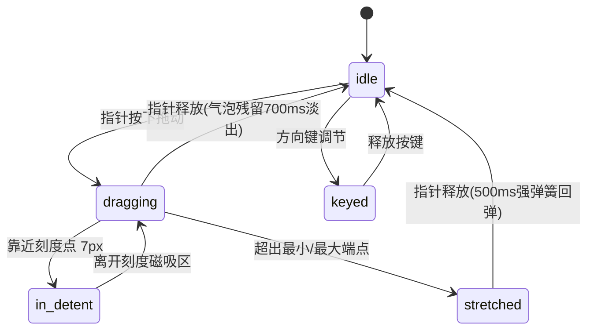

# Elastic Slider · 橡皮筋弹性滑块

具备触觉阻尼、刻度磁吸与速度倾斜动态气泡的高级弹性滑块。包含三大核心动效机制：

1. 橡皮筋超界拉伸与强劲回弹（Rubber-band Stretch & Snap Back）：当滑块拖拽至端点（0% 或 100%）并继续向外拖拽时，轨道伴随非线性阻尼（阻力系数 0.55）最多拉伸 26px，轨道厚度变薄且两侧图标向外推移；指针松开时触发 500ms 强回弹弹簧（bounce 0.42）振荡收敛归位。
2. 磁吸吸附与刻度脉冲波纹（Detent Snap & Tick Pulse）：滑块在经过预设刻度（如 0.5×、1×、1.5×、2×）7px 范围内产生磁吸吸附感，经过瞬间刻度点触发 `scale(2.1)` 脉冲放大动画（340ms）。
3. 随动速度倾斜数值气泡（Velocity Tilting Bubble）：浮动气泡与滑块保持 1:1 零延迟追踪，并根据拖拽角速度实时产生最多 11°（`tagRotateLimitDeg: 11`）的物理倾角摆动。

## 原型清单

| 原型分组 | 原型元素 | 动效 / 状态变化 | 去向 |
| --- | --- | --- | --- |
| 控件整体 | 滑块宿主 `.elastic-slider-root` | 承载拖拽状态 `data-dragging` 与布局基准 | 整体宿主状态机 |
| 轨道与填充 | 轨道 `.elastic-slider-track` 与 `.elastic-slider-fill` | 充填比率跟随、超界时横向拉伸变形与厚度减薄 | 橡皮筋超界拉伸与回弹 |
| 浮动滑块 | 拇指滑块 `.elastic-slider-thumb` | 按压放大至 1.28 倍、磁吸停靠、回弹阻尼 | 浮动滑块按压与磁吸 |
| 刻度标记 | 刻度点 `.elastic-slider-tick` | 磁吸进入瞬间触发 scale(2.1) 脉冲波纹动画 | 磁吸吸附与刻度脉冲波纹 |
| 读数气泡 | 数值气泡 `.elastic-slider-bubble` | 速度倾斜最多 11°、停留 700ms 后淡出 | 随动速度倾斜数值气泡 |
| 端点图标 | 两侧指示图标 `.elastic-slider-start` / `.elastic-slider-end` | 轨道拉伸时向外侧同步推移 | 端点图标联动位移 |
| 演示外壳 | 顶部主题切换按钮 `#themeBtn`、底部耗时估算文本 `.elastic-slider_result` | — | 演示外壳，已删除 |

## 适用

- 播放速度调节（0.5× 至 2× 带有关键 1× 磁吸点）。
- 带有物理触感与机械阻尼的游戏手柄设置、音频增益旋钮或弹性微调器。
- 追求拟物物理世界弹性拉伸与振荡效果的高阶交互设计。

## 不适用

- 标准表单连续区间数值输入（无弹性拉伸需求） → [slider](slider.md)
- 离散型多项二值开关 → [switch](../toggles/switch.md)
- 纯文本或数字滚动字段 → [number-field](../special-inputs/number-field.md)

## 状态机

| 状态 | 进入条件 | 视觉表现 | 退出到 |
| --- | --- | --- | --- |
| idle | 初始静止状态 | 滑块尺寸正常，气泡隐藏，轨道无拉伸，图标归位 | dragging / keyed |
| dragging | 指针按下滑块或轨道并拖拽 | 滑块放大 1.28 倍，气泡显现并根据拖拽速度左右倾斜 | idle / in-detent / stretched |
| in-detent | 拖拽至刻度点 7px 内 | 滑块自动吸附于刻度精确值，刻度点放大 2.1 倍脉冲 | dragging / idle |
| stretched | 拖拽超出 0% 或 100% 极值 | 轨道被拉长变薄（最多 26px），图标向外位移，手感变重 | idle (强回弹) |
| keyed | 键盘方向键微调 | 步长增减，到达极值时触发 260px/s 速度碰撞踢开并回弹 | idle |



## 最小 DOM

```html
<div class="elastic-slider-root" data-dragging="false">
  <div class="elastic-slider-header">
    <span class="elastic-slider-label">Volume</span>
    <span class="elastic-slider-readout">64%</span>
  </div>
  <div class="elastic-slider-body">
    <span class="elastic-slider-start" aria-hidden="true">
      <svg width="20" height="20" viewBox="0 0 24 24" fill="none" stroke="currentColor" stroke-width="2" stroke-linecap="round" stroke-linejoin="round">
        <polygon points="11 5 6 9 2 9 2 15 6 15 11 19 11 5" />
      </svg>
    </span>
    <div class="elastic-slider-control">
      <div class="elastic-slider-rail">
        <div class="elastic-slider-track">
          <div class="elastic-slider-fill" style="width: 64%;"></div>
        </div>
        <span class="elastic-slider-tick" style="left: 25%;"></span>
        <span class="elastic-slider-tick" style="left: 50%;"></span>
        <span class="elastic-slider-tick" style="left: 75%;"></span>
      </div>
      <div class="elastic-slider-thumbs">
        <div class="elastic-slider-thumb-wrapper" style="left: 64%;">
          <div class="elastic-slider-bubble" aria-hidden="true">64%</div>
          <div role="slider" class="elastic-slider-thumb" tabindex="0" aria-valuemin="0" aria-valuemax="100" aria-valuenow="64" aria-label="Volume"></div>
        </div>
      </div>
    </div>
    <span class="elastic-slider-end" aria-hidden="true">
      <svg width="20" height="20" viewBox="0 0 24 24" fill="none" stroke="currentColor" stroke-width="2" stroke-linecap="round" stroke-linejoin="round">
        <polygon points="11 5 6 9 2 9 2 15 6 15 11 19 11 5" />
        <path d="M15.54 8.46a5 5 0 0 1 0 7.07" />
        <path d="M19.07 4.93a10 10 0 0 1 0 14.14" />
      </svg>
    </span>
  </div>
</div>
```

- `.elastic-slider-root`：宿主根容器，管理 `data-dragging="true"|"false"`。
- `.elastic-slider-header`：顶栏标签与当前实时读数。
- `.elastic-slider-body`：主体控制行，横向布局左图标、轨道核心与右图标。
- `.elastic-slider-start` / `.elastic-slider-end`：两端图标，超界拉伸时外推位移。
- `.elastic-slider-control`：滑块控制视口，处理指针拖拽捕获。
- `.elastic-slider-track`：轨道底槽。
- `.elastic-slider-fill`：高亮填充条。
- `.elastic-slider-tick`：磁吸刻度标记点。
- `.elastic-slider-thumb`：可拖动滑块，`role="slider"`。
- `.elastic-slider-bubble`：动量倾斜气泡指示器。

## 参数

| 名称 | 值 | 用于 | 来源 |
| --- | --- | --- | --- |
| bandSnapBack | visualDuration: 0.5s, bounce: 0.42 | 橡皮筋超界释放强回弹振荡弹簧 | 原型 |
| thumbSpring | visualDuration: 0.26s, bounce: 0.12 | 滑块静止定位与微位移弹簧 | 原型 |
| thumbLift | 1.28 | 拖拽时滑块按压缩放放大比率 | 原型 |
| rubberBandLimitPx | 26px | 超出端点时的最大拉伸极限像素 | 原型 |
| rubberResistance | 0.55 | 超出端点时的物理阻尼衰减系数 | 原型 |
| detentReachPx | 7px | 刻度点磁吸捕获半径 | 原型 |
| tagRotateLimitDeg | 11deg | 气泡随拖拽速度的最大倾斜角度 | 原型 |
| tagVelocityGain | 0.009 | 拖拽速度向倾斜角度的转换增益 | 原型 |
| tickPulseScale | 2.1 | 磁吸触发时刻度点放大比例 | 原型 |
| tickPulseMs | 340ms | 刻度脉冲波纹动画时长 | 原型 |
| bubbleLingerMs | 700ms | 松手后气泡停留淡出时间 | 原型 |

## CSS

```css
.elastic-slider-root {
  position: relative;
  width: 100%;
  max-width: 420px;
  font-family: system-ui, -apple-system, sans-serif;
  user-select: none;
}

.elastic-slider-header {
  display: flex;
  align-items: center;
  justify-content: space-between;
  margin-bottom: 8px;
}

.elastic-slider-label {
  color: #0f172a;
  font-size: 14px;
  font-weight: 600;
}

.elastic-slider-readout {
  color: #64748b;
  font-size: 14px;
  font-weight: 500;
  font-variant-numeric: tabular-nums;
}

.elastic-slider-body {
  display: flex;
  align-items: center;
  gap: 12px;
}

.elastic-slider-start,
.elastic-slider-end {
  color: #64748b;
  display: grid;
  place-items: center;
  flex: none;
  transition: transform 0.2s cubic-bezier(0.16, 1, 0.3, 1);
}

.elastic-slider-control {
  position: relative;
  flex: 1;
  height: 36px;
  display: flex;
  align-items: center;
  cursor: pointer;
  touch-action: none;
}

.elastic-slider-rail {
  position: relative;
  width: 100%;
  height: 8px;
}

.elastic-slider-track {
  position: absolute;
  inset: 0;
  border-radius: 9999px;
  background: #e2e8f0;
  overflow: hidden;
  transition: transform 0.5s cubic-bezier(0.18, 1.25, 0.32, 1.15);
}

.elastic-slider-fill {
  position: absolute;
  top: 0;
  bottom: 0;
  left: 0;
  border-radius: 9999px;
  background: #2563eb;
}

.elastic-slider-tick {
  position: absolute;
  top: 50%;
  width: 4px;
  height: 4px;
  margin-top: -2px;
  margin-left: -2px;
  border-radius: 9999px;
  background: #94a3b8;
  pointer-events: none;
  transition: transform 0.34s cubic-bezier(0.18, 0.89, 0.32, 1.15), background-color 0.2s ease;
}

.elastic-slider-tick.pulsing {
  transform: scale(2.1);
  background: #2563eb;
}

.elastic-slider-thumbs {
  position: absolute;
  inset: 0;
  pointer-events: none;
}

.elastic-slider-thumb-wrapper {
  position: absolute;
  top: 50%;
  transform: translate(-50%, -50%);
  pointer-events: auto;
}

.elastic-slider-thumb {
  width: 20px;
  height: 20px;
  border-radius: 9999px;
  background: #ffffff;
  border: 2px solid #2563eb;
  box-shadow: 0 1px 4px rgba(0, 0, 0, 0.15);
  cursor: grab;
  outline: none;
  transition: scale 0.15s cubic-bezier(0.18, 0.89, 0.32, 1.15),
              box-shadow 0.15s ease;
}

.elastic-slider-root[data-dragging="true"] .elastic-slider-thumb {
  scale: 1.28;
  cursor: grabbing;
  box-shadow: 0 4px 12px rgba(37, 99, 235, 0.25);
}

.elastic-slider-thumb:focus-visible {
  box-shadow: 0 0 0 3px rgba(59, 130, 246, 0.35);
}

.elastic-slider-bubble {
  position: absolute;
  bottom: 26px;
  left: 50%;
  transform: translateX(-50%);
  padding: 3px 8px;
  border-radius: 6px;
  background: #0f172a;
  color: #ffffff;
  font-size: 12px;
  font-weight: 600;
  white-space: nowrap;
  pointer-events: none;
  opacity: 0;
  transform-origin: 50% 100%;
  transition: opacity 0.2s ease, transform 0.1s ease;
}

.elastic-slider-root[data-dragging="true"] .elastic-slider-bubble {
  opacity: 1;
}

@media (prefers-reduced-motion: reduce) {
  .elastic-slider-track,
  .elastic-slider-tick,
  .elastic-slider-thumb,
  .elastic-slider-bubble,
  .elastic-slider-start,
  .elastic-slider-end {
    transition: none !important;
  }
}
```

## JS

```js
export function createElasticSlider(rootEl, options = {}) {
  const control = rootEl.querySelector('.elastic-slider-control');
  const track = rootEl.querySelector('.elastic-slider-track');
  const fill = rootEl.querySelector('.elastic-slider-fill');
  const thumbWrapper = rootEl.querySelector('.elastic-slider-thumb-wrapper');
  const thumb = rootEl.querySelector('.elastic-slider-thumb');
  const bubble = rootEl.querySelector('.elastic-slider-bubble');
  const readout = rootEl.querySelector('.elastic-slider-readout');
  const startIcon = rootEl.querySelector('.elastic-slider-start');
  const endIcon = rootEl.querySelector('.elastic-slider-end');
  const ticks = Array.from(rootEl.querySelectorAll('.elastic-slider-tick'));

  const min = options.min !== undefined ? options.min : 0;
  const max = options.max !== undefined ? options.max : 100;
  const step = options.step || 1;
  let value = options.defaultValue !== undefined ? options.defaultValue : 64;

  let isDragging = false;
  let startX = 0;
  let lastX = 0;
  let velocity = 0;
  let bubbleTimeout = null;

  function setSliderValue(val, emit = true) {
    value = Math.max(min, Math.min(max, val));
    const percent = ((value - min) / (max - min)) * 100;

    if (fill) fill.style.width = `${percent}%`;
    if (thumbWrapper) thumbWrapper.style.left = `${percent}%`;
    if (thumb) {
      thumb.setAttribute('aria-valuenow', String(value));
      thumb.setAttribute('aria-valuetext', `${value}%`);
    }
    if (readout) readout.textContent = `${value}%`;
    if (bubble) bubble.textContent = `${value}%`;

    // 检查磁吸刻度
    ticks.forEach(tick => {
      const tickPercent = parseFloat(tick.style.left);
      if (Math.abs(percent - tickPercent) < 2) {
        tick.classList.add('pulsing');
        setTimeout(() => tick.classList.remove('pulsing'), 340);
      }
    });

    if (emit) {
      if (typeof options.onChange === 'function') {
        options.onChange(value);
      }
      rootEl.dispatchEvent(new CustomEvent('arc:value-change', {
        bubbles: true,
        detail: { value }
      }));
    }
  }

  function handlePointerMove(e) {
    if (!isDragging || !control) return;
    const rect = control.getBoundingClientRect();
    const currentX = e.clientX;
    const dx = currentX - lastX;
    velocity = dx;
    lastX = currentX;

    // 计算气泡速度倾角 (最高 11度)
    if (bubble) {
      const tilt = Math.max(-11, Math.min(11, velocity * 0.4));
      bubble.style.transform = `translateX(-50%) rotate(${tilt}deg)`;
    }

    const rawOffset = currentX - rect.left;
    let clampedOffset = Math.max(0, Math.min(rect.width, rawOffset));

    // 橡皮筋超界计算 (最长拉长 26px)
    let rubberDelta = 0;
    if (rawOffset < 0) {
      rubberDelta = Math.max(-26, rawOffset * 0.55);
      if (track) track.style.transform = `translateX(${rubberDelta}px) scaleX(${1 + Math.abs(rubberDelta) / rect.width})`;
      if (startIcon) startIcon.style.transform = `translateX(${rubberDelta * 0.6}px)`;
    } else if (rawOffset > rect.width) {
      rubberDelta = Math.min(26, (rawOffset - rect.width) * 0.55);
      if (track) track.style.transform = `translateX(0) scaleX(${1 + rubberDelta / rect.width})`;
      if (endIcon) endIcon.style.transform = `translateX(${rubberDelta * 0.6}px)`;
    } else {
      if (track) track.style.transform = 'none';
      if (startIcon) startIcon.style.transform = 'none';
      if (endIcon) endIcon.style.transform = 'none';
    }

    const ratio = clampedOffset / rect.width;
    const calculatedValue = min + ratio * (max - min);
    const stepped = Math.round(calculatedValue / step) * step;
    setSliderValue(stepped);
  }

  function handlePointerUp() {
    if (!isDragging) return;
    isDragging = false;
    rootEl.setAttribute('data-dragging', 'false');

    // 释放橡皮筋强回弹
    if (track) track.style.transform = 'none';
    if (startIcon) startIcon.style.transform = 'none';
    if (endIcon) endIcon.style.transform = 'none';
    if (bubble) {
      bubble.style.transform = 'translateX(-50%) rotate(0deg)';
      clearTimeout(bubbleTimeout);
      bubbleTimeout = setTimeout(() => {
        if (!isDragging && bubble) bubble.style.opacity = '0';
      }, 700);
    }

    window.removeEventListener('pointermove', handlePointerMove);
    window.removeEventListener('pointerup', handlePointerUp);
    window.removeEventListener('pointercancel', handlePointerUp);
  }

  const onPointerDown = (e) => {
    isDragging = true;
    startX = e.clientX;
    lastX = e.clientX;
    velocity = 0;
    rootEl.setAttribute('data-dragging', 'true');
    if (bubble) bubble.style.opacity = '1';

    handlePointerMove(e);

    window.addEventListener('pointermove', handlePointerMove);
    window.addEventListener('pointerup', handlePointerUp);
    window.addEventListener('pointercancel', handlePointerUp);
  };

  const onKeyDown = (e) => {
    let nextVal = value;
    if (e.key === 'ArrowRight' || e.key === 'ArrowUp') {
      nextVal = Math.min(max, value + (e.shiftKey ? step * 10 : step));
    } else if (e.key === 'ArrowLeft' || e.key === 'ArrowDown') {
      nextVal = Math.max(min, value - (e.shiftKey ? step * 10 : step));
    } else if (e.key === 'Home') {
      nextVal = min;
    } else if (e.key === 'End') {
      nextVal = max;
    }

    if (nextVal !== value) {
      e.preventDefault();
      setSliderValue(nextVal);
    }
  };

  if (control) control.addEventListener('pointerdown', onPointerDown);
  if (thumb) thumb.addEventListener('keydown', onKeyDown);

  setSliderValue(value, false);

  return {
    getValue: () => value,
    setValue: (val) => setSliderValue(val),
    destroy: () => {
      if (control) control.removeEventListener('pointerdown', onPointerDown);
      if (thumb) thumb.removeEventListener('keydown', onKeyDown);
      window.removeEventListener('pointermove', handlePointerMove);
      window.removeEventListener('pointerup', handlePointerUp);
      window.removeEventListener('pointercancel', handlePointerUp);
      clearTimeout(bubbleTimeout);
    }
  };
}
```

## 接入目标项目

- 状态来源：单值数值类型（`number`），由外部 `defaultValue` 或 `setValue(val)` 控制。
- 尺寸策略：宽度继承外层或最大 420px，水平弹性展开。
- 驱动方式：`createElasticSlider(rootEl, { min: 0, max: 100, step: 1, defaultValue: 64, onChange: (val) => {} })`。

## 重入与清理

- 连续快速拖拽松开时，弹簧回弹即刻在当前插值上重置，杜绝物理形变残留。
- 卸载时彻底移除 window 上的全局 `pointermove` 与 `pointerup` 监听。

## 减少动态效果

- 在 `prefers-reduced-motion: reduce` 下，禁用橡皮筋拉伸、气泡倾斜和刻度脉冲波纹。
- 滑块直接平滑跟随指针移动，释放直接对齐。

## 焦点与键盘

- 滑块具备 `role="slider"` 与完整的 `aria-valuemin` / `max` / `now` / `text` 声明。
- 方向键单步微调，Shift + 方向键大步调节，`Home` 与 `End` 定位端点。

## 兼容回退

| 特性 | 不支持时 |
| --- | --- |
| CSS touch-action | 在 pointermove 中调用 `event.preventDefault()` |
| 旋转 transform | 气泡仅平移不倾角 |

## 验收清单

- [ ] 拖拽滑块超过 0% 或 100% 端点，轨道伴随非线性阻力被拉伸变薄（最多 26px），图标外推。
- [ ] 松手释放瞬间，轨道触发 500ms 强回弹弹簧振荡恢复原状。
- [ ] 快速拖拽滑块，上方数值气泡随速度产生最大 11° 的动态倾斜摆动。
- [ ] 经过预设刻度点时，刻度圆点放大 2.1 倍脉冲闪烁。
- [ ] 开启减弱动态效果时，所有弹性拉伸与倾角动画禁用。
