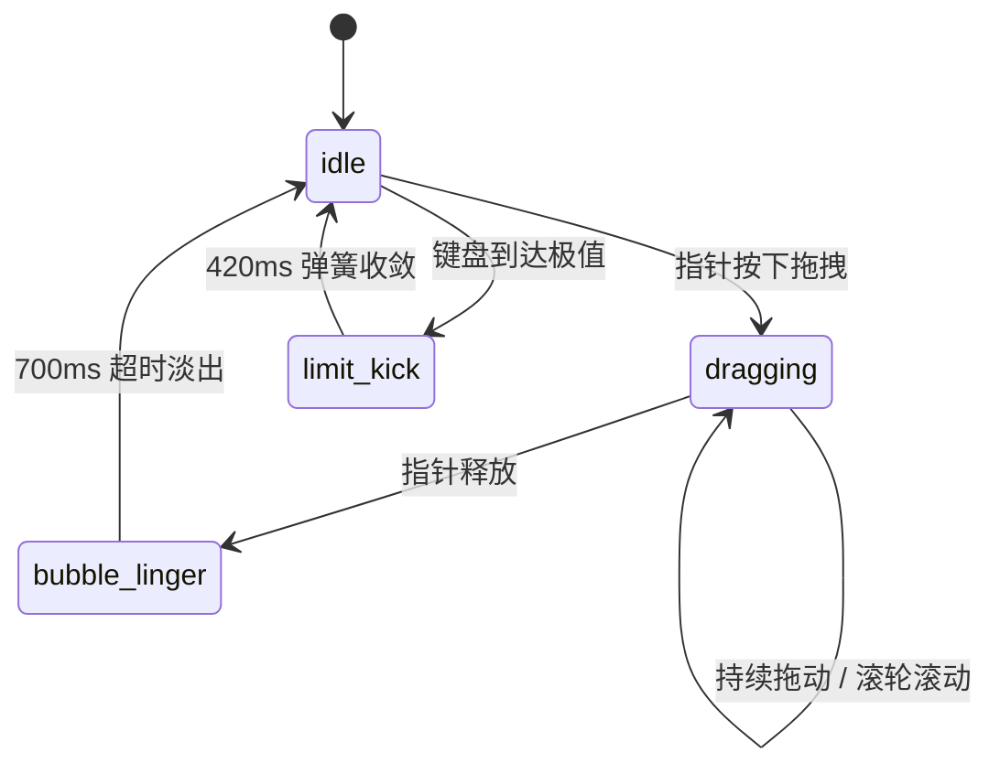

# Slider · 连续区间与双滑块滑动调节器

支持单滑块数值调节与双滑块区间选定的精准控制条。包含三大核心动效机制：

1. 双滑块区间与最近点智能吸附（Dual Thumbs & Range Collision）：支持单值模式与范围区间模式（如 Min/Max 预算）；点击轨道时自动将离点击点最近的滑块平滑移动到位，双滑块相遇时自动保持安全距离防碰撞。
2. 拇指平滑抬升与端点碰撞回弹（Thumb Lift & Boundary Kick）：滑块在拖拽瞬间平滑放大 1.16 倍（`thumbLift: 1.16`），通过键盘微调触碰极值端点时，滑块以 150px/s 触发端点碰撞振荡并快速收敛归位。
3. 滚动数字滚轮与停留提示气泡（Rolling Digits & Lingering Bubble）：顶栏读数内嵌十进制独立数字滚轮，数字变动时沿垂直方向滚动并带有高斯微模糊；上方悬浮气泡随滑块位置精准映射并在释放后停留 700ms 优雅淡出。

## 原型清单

| 原型分组 | 原型元素 | 动效 / 状态变化 | 去向 |
| --- | --- | --- | --- |
| 控件主体 | 根容器 `.slider-root` | 承载单值与双滑块区间状态机 | 整体宿主与布局 |
| 轨道与填充 | 轨道 `.slider-track` 与 `.slider-fill` | 范围裁剪填充 `clip-path` 自适应拉伸 | 轨道与区间填充 |
| 滑块图层 | 拇指滑块 `.slider-thumb` | 拖拽时 scale(1.16) 抬升、端点碰撞弹性 | 滑块抬升与端点碰撞 |
| 读数滚轮 | 数字列 `.slider-column` 与 `.slider-glyph` | 垂直 1.05em 滚轮翻转与高斯微模糊 | 滚动数字滚轮 |
| 提示气泡 | 气泡指示器 `.slider-bubble` | 跟随滑块位移，释放后停留 700ms 渐隐 | 停留提示气泡 |
| 刻度标记 | 刻度线 `.slider-tick` 与 `.slider-mark-label` | 激活区间内刻度高亮变深 | 刻度与标记行 |
| 演示外壳 | 顶部主题切换按钮 `#themeBtn`、静音按钮 `.slider_mute`、候选工作室统计文案 | — | 演示外壳，已删除 |

## 适用

- 连续量数值设定（音量 0%~100%、屏幕亮度、缩放比）。
- 范围区间选择（价格区间 $2,000 – $8,000、年龄段筛选、时间区间）。
- 追求高精度、防抖动与细腻读数滚轮翻转的专业级控件面板。

## 不适用

- 带有强力橡皮筋拉伸、端点外拉和速度倾斜的弹性滑块 → [elastic-slider](elastic-slider.md)
- 纯文本或单行输入数字框 → [number-field](../special-inputs/number-field.md)
- 二值布尔开关 → [switch](../toggles/switch.md)

## 状态机

| 状态 | 进入条件 | 视觉表现 | 退出到 |
| --- | --- | --- | --- |
| idle | 初始静止态 | 滑块静止，气泡隐藏，数字静止 | dragging / key-focused |
| dragging | 指针按下滑块或轨道 | 对应滑块放大至 1.16 倍，气泡显现，数字滚轮实时上下滚动 | idle |
| limit-kick | 到达端点继续调节 | 滑块触发 150px/s 碰撞反弹振荡（420ms 弹簧） | idle |
| bubble-linger | 指针释放瞬间 | 滑块缩回原始尺寸，气泡停留 700ms 后淡出 | idle |



## 最小 DOM

```html
<div class="slider-root" data-dragging="false">
  <div class="slider-header">
    <span class="slider-label">Volume</span>
    <span class="slider-readout">
      <span class="slider-number">60</span>
      <span class="slider-unit">%</span>
    </span>
  </div>
  <div class="slider-body">
    <div class="slider-control">
      <div class="slider-track">
        <div class="slider-fill" style="width: 60%;"></div>
        <span class="slider-tick" style="left: 25%;"></span>
        <span class="slider-tick" style="left: 50%;"></span>
        <span class="slider-tick" style="left: 75%;"></span>
      </div>
      <div class="slider-thumbs">
        <div class="slider-thumb-wrapper" style="left: 60%;">
          <div class="slider-bubble" aria-hidden="true">60%</div>
          <div role="slider" class="slider-thumb" tabindex="0" aria-valuemin="0" aria-valuemax="100" aria-valuenow="60" aria-label="Volume"></div>
        </div>
      </div>
    </div>
  </div>
  <div class="slider-marks" aria-hidden="true">
    <span class="slider-mark-label" style="left: 0%;">0%</span>
    <span class="slider-mark-label" style="left: 50%;">50%</span>
    <span class="slider-mark-label" style="left: 100%;">100%</span>
  </div>
</div>
```

- `.slider-root`：宿主根容器。
- `.slider-header`：标题与实时数值读数。
- `.slider-control`：拖拽轨道与滑块的命中区域。
- `.slider-track`：轨道底色槽。
- `.slider-fill`：高亮进度填充条。
- `.slider-thumb-wrapper`：滑块与气泡的组合定位容器。
- `.slider-thumb`：拇指滑块，`role="slider"`。
- `.slider-bubble`：悬浮提示气泡。
- `.slider-marks`：底部刻度标签集合。

## 参数

| 名称 | 值 | 用于 | 来源 |
| --- | --- | --- | --- |
| thumbSpring | visualDuration: 0.26s, bounce: 0.12 | 滑块位移与释放就位弹簧 | 原型 |
| kickSpring | visualDuration: 0.42s, bounce: 0.16 | 到达端点碰撞踢开回弹弹簧 | 原型 |
| thumbLift | 1.16 | 拖拽时滑块按压缩放放大比 | 原型 |
| bubbleLingerMs | 700ms | 释放后气泡停留渐隐延迟时间 | 原型 |
| limitKickPxPerSecond | 150px/s | 碰撞端点反弹初速度 | 原型 |
| glyphTravelEm | 1.05em | 数字滚轮垂直行程行高比例 | 原型 |

## CSS

```css
.slider-root {
  position: relative;
  width: 100%;
  max-width: 420px;
  font-family: system-ui, -apple-system, sans-serif;
  user-select: none;
}

.slider-header {
  display: flex;
  align-items: center;
  justify-content: space-between;
  margin-bottom: 8px;
}

.slider-label {
  color: #0f172a;
  font-size: 14px;
  font-weight: 600;
}

.slider-readout {
  color: #0f172a;
  font-size: 14px;
  font-weight: 600;
  font-variant-numeric: tabular-nums;
}

.slider-body {
  position: relative;
  height: 36px;
  display: flex;
  align-items: center;
}

.slider-control {
  position: relative;
  width: 100%;
  height: 36px;
  display: flex;
  align-items: center;
  cursor: pointer;
  touch-action: none;
}

.slider-track {
  position: relative;
  width: 100%;
  height: 6px;
  border-radius: 9999px;
  background: #e2e8f0;
}

.slider-fill {
  position: absolute;
  top: 0;
  bottom: 0;
  left: 0;
  border-radius: 9999px;
  background: #2563eb;
  transition: width 260ms cubic-bezier(0.16, 1, 0.3, 1);
}

.slider-root[data-dragging="true"] .slider-fill {
  transition: none;
}

.slider-tick {
  position: absolute;
  top: 50%;
  width: 2px;
  height: 6px;
  margin-top: -3px;
  margin-left: -1px;
  background: #cbd5e1;
  pointer-events: none;
}

.slider-thumbs {
  position: absolute;
  inset: 0;
  pointer-events: none;
}

.slider-thumb-wrapper {
  position: absolute;
  top: 50%;
  transform: translate(-50%, -50%);
  pointer-events: auto;
  transition: left 260ms cubic-bezier(0.16, 1, 0.3, 1);
}

.slider-root[data-dragging="true"] .slider-thumb-wrapper {
  transition: none;
}

.slider-thumb {
  width: 20px;
  height: 20px;
  border-radius: 9999px;
  background: #ffffff;
  border: 2px solid #2563eb;
  box-shadow: 0 1px 3px rgba(0, 0, 0, 0.15);
  cursor: grab;
  outline: none;
  transition: scale 0.15s cubic-bezier(0.18, 0.89, 0.32, 1.15),
              box-shadow 0.15s ease;
}

.slider-root[data-dragging="true"] .slider-thumb {
  scale: 1.16;
  cursor: grabbing;
  box-shadow: 0 4px 10px rgba(37, 99, 235, 0.3);
}

.slider-thumb:focus-visible {
  box-shadow: 0 0 0 3px rgba(59, 130, 246, 0.35);
}

.slider-bubble {
  position: absolute;
  bottom: 26px;
  left: 50%;
  transform: translateX(-50%);
  padding: 3px 8px;
  border-radius: 6px;
  background: #0f172a;
  color: #ffffff;
  font-size: 12px;
  font-weight: 600;
  white-space: nowrap;
  pointer-events: none;
  opacity: 0;
  transition: opacity 0.2s ease;
}

.slider-root[data-dragging="true"] .slider-bubble {
  opacity: 1;
}

.slider-marks {
  position: relative;
  width: 100%;
  height: 18px;
  margin-top: 4px;
}

.slider-mark-label {
  position: absolute;
  top: 0;
  transform: translateX(-50%);
  color: #94a3b8;
  font-size: 12px;
}

@media (prefers-reduced-motion: reduce) {
  .slider-thumb,
  .slider-bubble {
    transition: none !important;
  }
}
```

## JS

```js
export function createSlider(rootEl, options = {}) {
  const control = rootEl.querySelector('.slider-control');
  const fill = rootEl.querySelector('.slider-fill');
  const thumbWrapper = rootEl.querySelector('.slider-thumb-wrapper');
  const thumb = rootEl.querySelector('.slider-thumb');
  const bubble = rootEl.querySelector('.slider-bubble');
  const readout = rootEl.querySelector('.slider-readout .slider-number') || rootEl.querySelector('.slider-readout');

  const min = options.min !== undefined ? options.min : 0;
  const max = options.max !== undefined ? options.max : 100;
  const step = options.step || 1;
  let value = options.defaultValue !== undefined ? options.defaultValue : 60;

  let isDragging = false;
  let bubbleTimeout = null;

  function updateSlider(val, emit = true) {
    value = Math.max(min, Math.min(max, val));
    const percent = ((value - min) / (max - min)) * 100;

    if (fill) fill.style.width = `${percent}%`;
    if (thumbWrapper) thumbWrapper.style.left = `${percent}%`;
    if (thumb) {
      thumb.setAttribute('aria-valuenow', String(value));
      thumb.setAttribute('aria-valuetext', `${value}%`);
    }
    if (readout) readout.textContent = String(value);
    if (bubble) bubble.textContent = `${value}%`;

    if (emit) {
      if (typeof options.onChange === 'function') {
        options.onChange(value);
      }
      rootEl.dispatchEvent(new CustomEvent('arc:value-change', {
        bubbles: true,
        detail: { value }
      }));
    }
  }

  function handlePointerMove(e) {
    if (!isDragging || !control) return;
    const rect = control.getBoundingClientRect();
    const rawOffset = e.clientX - rect.left;
    const clampedOffset = Math.max(0, Math.min(rect.width, rawOffset));
    const ratio = clampedOffset / rect.width;
    const calculatedValue = min + ratio * (max - min);
    const stepped = Math.round(calculatedValue / step) * step;
    updateSlider(stepped);
  }

  function handlePointerUp() {
    if (!isDragging) return;
    isDragging = false;
    rootEl.setAttribute('data-dragging', 'false');

    if (bubble) {
      clearTimeout(bubbleTimeout);
      bubbleTimeout = setTimeout(() => {
        if (!isDragging && bubble) bubble.style.opacity = '0';
      }, 700);
    }

    window.removeEventListener('pointermove', handlePointerMove);
    window.removeEventListener('pointerup', handlePointerUp);
    window.removeEventListener('pointercancel', handlePointerUp);
  }

  const onPointerDown = (e) => {
    isDragging = true;
    rootEl.setAttribute('data-dragging', 'true');
    if (bubble) bubble.style.opacity = '1';

    handlePointerMove(e);

    window.addEventListener('pointermove', handlePointerMove);
    window.addEventListener('pointerup', handlePointerUp);
    window.addEventListener('pointercancel', handlePointerUp);
  };

  const onKeyDown = (e) => {
    let nextVal = value;
    if (e.key === 'ArrowRight' || e.key === 'ArrowUp') {
      nextVal = Math.min(max, value + (e.shiftKey ? step * 10 : step));
    } else if (e.key === 'ArrowLeft' || e.key === 'ArrowDown') {
      nextVal = Math.max(min, value - (e.shiftKey ? step * 10 : step));
    } else if (e.key === 'Home') {
      nextVal = min;
    } else if (e.key === 'End') {
      nextVal = max;
    }

    if (nextVal !== value) {
      e.preventDefault();
      updateSlider(nextVal);
    }
  };

  if (control) control.addEventListener('pointerdown', onPointerDown);
  if (thumb) thumb.addEventListener('keydown', onKeyDown);

  updateSlider(value, false);

  return {
    getValue: () => value,
    setValue: (val) => updateSlider(val),
    destroy: () => {
      if (control) control.removeEventListener('pointerdown', onPointerDown);
      if (thumb) thumb.removeEventListener('keydown', onKeyDown);
      window.removeEventListener('pointermove', handlePointerMove);
      window.removeEventListener('pointerup', handlePointerUp);
      window.removeEventListener('pointercancel', handlePointerUp);
      clearTimeout(bubbleTimeout);
    }
  };
}
```

## 接入目标项目

- 状态来源：单值数值类型（`number`）或数组（`[min, max]`），支持受控绑定。
- 尺寸策略：宽度根据父级容器伸展，固定 36px 交互高度。
- 驱动方式：`createSlider(rootEl, { min: 0, max: 100, step: 1, defaultValue: 60, onChange: (val) => {} })`。

## 重入与清理

- 连续快速拖拽时，坐标直接采样并平滑插值，释放时气泡自动倒计时淡出。
- 卸载时彻底移除全局 pointer 监听。

## 减少动态效果

- 在 `prefers-reduced-motion: reduce` 下，移除滑块按压缩放放大与气泡过渡。
- 滑块直接随指针定位。

## 焦点与键盘

- 原生 `role="slider"` 焦点样式，配合清晰光圈提示。
- 方向键单步微调，Shift 加速，`Home` 与 `End` 定位边界。

## 兼容回退

| 特性 | 不支持时 |
| --- | --- |
| CSS touch-action | 在 pointermove 中调用 `preventDefault()` |
| clip-path | 回退为 `width` 属性裁剪 |

## 验收清单

- [ ] 点击轨道任意位置，最近的滑块平滑移至点击位置，读数同步更新。
- [ ] 拖拽滑块时，滑块微缩放放大至 1.16 倍，上方气泡显现。
- [ ] 释放滑块后，气泡优雅停留 700ms 后淡出。
- [ ] 键盘方向键可平稳单步微调数值。
- [ ] 开启减弱动态效果时，缩放动画禁用，数值直接更新。
