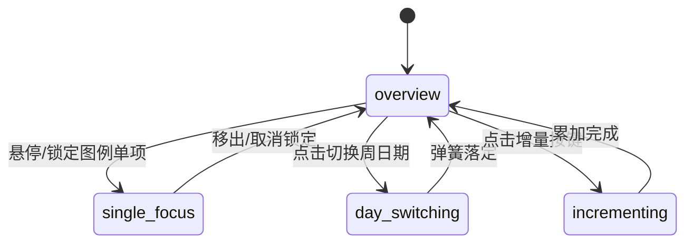

# Activity Rings · 活动同心圆环

用于多维度目标完成率追踪、习惯打卡与多指标统计的高质感同心刻度环与周记录联动组件。包含五大核心动效机制：

1. 三重同心圆环刻度遮罩与超额圈（Concentric SVG Ticks & Lap Masking）：三个同心活动环（如深度工作、写作、阅读），通过 SVG 遮罩（`mask`）与 `stroke-dasharray="progress 1"` 沿圆周精准填充刻度线，超过 100% 目标后自动展开内侧第二圈溢出进度（`lap`）。
2. 极坐标终止点发光游标臂（Orbital Marker Arm & Tip）：游标支臂根据当前浮点进度旋转角度（`transform: rotate(progress * 360deg)`），端点高亮游标精确停留在圆环进度的最前端。
3. 中心综合达成率计数器（Center Percentage Roll & Micro-Blur）：中心区域显示三项指标综合达成百分比，切换日期或增量累加时，数值以平滑弹簧阻尼推移，文字带 `translateY(6px) blur(2px)` 进场消散过渡。
4. 周视图微缩圆环行与滑动高光（Weekly Mini Rings & Gliding Highlight）：底部排布周一至周日的 7 天微缩同心圆环行，点击任意日期，高光胶囊背景平滑滑动（`visualDuration: 0.42s, bounce: 0.16`），主表盘动态重绘。
5. 快速增量模拟按钮反馈（Action Stepper Feedback）：提供 25 min、250 words、10 pages 快捷累加动作，按钮按压触感微缩，点击后实时推升周日数据并自适应重算圆盘。

## 原型清单

| 原型分组 | 原型元素 | 动效 / 状态变化 | 去向 |
| --- | --- | --- | --- |
| 宿主外框 | 统计面板卡片（`.activity-rings`） | 宽度断点响应式布局，管理圆盘与图例排列 | 最小 DOM / CSS |
| 圆环表盘 | SVG 同心刻度圆环（`.activity-rings-dial`） | SVG 刻度遮罩、超额环、旋转臂与光点 | 三重同心圆环刻度遮罩与超额圈 |
| 中心读数 | 表盘中央百分比（`.activity-rings-center`） | 综合完成率数值平滑滚动与微模糊切换 | 中心综合达成率计数器 |
| 数据图例 | 三项活动图例行（`.activity-rings-legend-row`） | 悬停/聚焦查看单项值，点击锁定当前展示指标 | 最小 DOM / CSS |
| 周视图 | 底部周一至周日按钮组（`.activity-rings-week`） | 微缩圆环、滑动高光胶囊（`dayHighlight`） | 周视图微缩圆环行与滑动高光 |
| 增量按键 | 底部快速增加数值按钮（`.activity-rings-action-btn`） | 按压微缩 0.97，数据累加动画 | 快速增量模拟按钮反馈 |
| 演示外壳 | 顶部主题切换按钮（`#themeBtn`）与顶栏 | 切换浅色/深色主题 | 演示外壳，已删除 |

## 适用

- 个人习惯追踪、健康运动三环、工作/学习/阅读多维度量化目标达成看板。
- 用户期望在同一界面内直观掌握每日三项指标进度，并能在周视图的历史记录中快速穿梭回溯。
- 需要支持超额完成（>100%）的视觉层叠表现与平滑的数值增长动画。

## 不适用

- 24 小时跨时区世界时钟与时区重叠盘 → [time-dial](time-dial.md)
- 滚轮式日期时间滚筒选择器 → [date-reel](date-reel.md)
- 紧凑多步骤浮动预约胶囊 → [booking-pill](booking-pill.md)

## 状态机

| 状态 | 进入条件 | 视觉表现 | 退出到 |
| --- | --- | --- | --- |
| overview | 默认状态；未悬停或锁定特定指标 | 中心显示三项指标综合达成百分比，三环同时高亮 | single-focus |
| single-focus | 鼠标悬停或点击锁定某项图例 | 未选中圆环与图例半透明淡化（opacity 0.25），中心显示选中项的具体数值与单位 | overview |
| day-switching | 点击底部周视图的另一天 | 高光胶囊滑向目标日期，主表盘三环与中心数字经 900ms 弹簧过渡到新日期数据 | overview / single-focus |
| incrementing | 点击底部 25min / 250words / 10pages | 对应环带惯性向前推进，数值实时累加更新 | overview / single-focus |



## 最小 DOM

```html
<div class="activity-rings" role="region" aria-label="Goals this week">
  <div class="activity-rings-layout">
    <!-- 中央同心圆环大表盘 -->
    <div class="activity-rings-dial-wrap">
      <div class="activity-rings-dial">
        <svg class="activity-rings-svg" viewBox="0 0 220 220" role="img" aria-label="Activity rings">
          <!-- 环 1：Deep work (外圈) -->
          <g class="activity-rings-ring" style="--ring-color: #6366f1;">
            <circle cx="110" cy="110" r="95" class="activity-rings-track"/>
            <circle cx="110" cy="110" r="95" class="activity-rings-arc activity-rings-arc-0" pathLength="1" stroke-dasharray="0.72 1"/>
          </g>
          <!-- 环 2：Writing (中圈) -->
          <g class="activity-rings-ring" style="--ring-color: #f59e0b;">
            <circle cx="110" cy="110" r="75" class="activity-rings-track"/>
            <circle cx="110" cy="110" r="75" class="activity-rings-arc activity-rings-arc-1" pathLength="1" stroke-dasharray="0.78 1"/>
          </g>
          <!-- 环 3：Reading (内圈) -->
          <g class="activity-rings-ring" style="--ring-color: #10b981;">
            <circle cx="110" cy="110" r="55" class="activity-rings-track"/>
            <circle cx="110" cy="110" r="55" class="activity-rings-arc activity-rings-arc-2" pathLength="1" stroke-dasharray="0.55 1"/>
          </g>
        </svg>

        <!-- 游标臂与光点 -->
        <div class="activity-rings-marker-arm activity-rings-arm-0" style="transform: rotate(259deg);">
          <span class="activity-rings-marker-dot"></span>
        </div>
        <div class="activity-rings-marker-arm activity-rings-arm-1" style="transform: rotate(280deg);">
          <span class="activity-rings-marker-dot"></span>
        </div>
        <div class="activity-rings-marker-arm activity-rings-arm-2" style="transform: rotate(198deg);">
          <span class="activity-rings-marker-dot"></span>
        </div>

        <!-- 表盘中心读数 -->
        <div class="activity-rings-center">
          <div class="activity-rings-center-inner">
            <span class="activity-rings-center-value">69%</span>
            <span class="activity-rings-center-label">of goals</span>
          </div>
        </div>
      </div>

      <!-- 右侧/下方图例 -->
      <div class="activity-rings-legend">
        <button type="button" class="activity-rings-legend-row" data-ring="0" aria-pressed="false" style="--ring-color: #6366f1;">
          <span class="activity-rings-legend-swatch"></span>
          <span class="activity-rings-legend-text">
            <span class="activity-rings-legend-title">Deep work</span>
            <span class="activity-rings-legend-sub">130 / 180 min</span>
          </span>
          <span class="activity-rings-legend-percent">72%</span>
        </button>
        <button type="button" class="activity-rings-legend-row" data-ring="1" aria-pressed="false" style="--ring-color: #f59e0b;">
          <span class="activity-rings-legend-swatch"></span>
          <span class="activity-rings-legend-text">
            <span class="activity-rings-legend-title">Writing</span>
            <span class="activity-rings-legend-sub">940 / 1,200 words</span>
          </span>
          <span class="activity-rings-legend-percent">78%</span>
        </button>
        <button type="button" class="activity-rings-legend-row" data-ring="2" aria-pressed="false" style="--ring-color: #10b981;">
          <span class="activity-rings-legend-swatch"></span>
          <span class="activity-rings-legend-text">
            <span class="activity-rings-legend-title">Reading</span>
            <span class="activity-rings-legend-sub">22 / 40 pages</span>
          </span>
          <span class="activity-rings-legend-percent">55%</span>
        </button>
      </div>
    </div>

    <!-- 底部一周 7 天微缩环 -->
    <div class="activity-rings-week" role="radiogroup" aria-label="Select day">
      <button type="button" role="radio" class="activity-rings-day-btn" data-day="0" aria-checked="false" aria-label="Monday">
        <span class="activity-rings-day-name">Mon</span>
      </button>
      <button type="button" role="radio" class="activity-rings-day-btn" data-day="1" aria-checked="false" aria-label="Tuesday">
        <span class="activity-rings-day-name">Tue</span>
      </button>
      <button type="button" role="radio" class="activity-rings-day-btn" data-day="2" aria-checked="false" aria-label="Wednesday">
        <span class="activity-rings-day-name">Wed</span>
      </button>
      <button type="button" role="radio" class="activity-rings-day-btn" data-day="3" aria-checked="false" aria-label="Thursday">
        <span class="activity-rings-day-name">Thu</span>
      </button>
      <button type="button" role="radio" class="activity-rings-day-btn" data-day="4" aria-checked="false" aria-label="Friday">
        <span class="activity-rings-day-name">Fri</span>
      </button>
      <button type="button" role="radio" class="activity-rings-day-btn" data-day="5" aria-checked="false" aria-label="Saturday">
        <span class="activity-rings-day-name">Sat</span>
      </button>
      <button type="button" role="radio" class="activity-rings-day-btn" data-day="6" aria-checked="true" aria-label="Sunday">
        <span class="activity-rings-day-name">Sun</span>
      </button>
    </div>

    <!-- 增量步进操作栏 -->
    <div class="activity-rings-actions">
      <button type="button" class="activity-rings-action-btn" data-add="0">+25 min</button>
      <button type="button" class="activity-rings-action-btn" data-add="1">+250 words</button>
      <button type="button" class="activity-rings-action-btn" data-add="2">+10 pages</button>
      <button type="button" class="activity-rings-action-btn activity-rings-btn-reset" aria-label="Reset week">Reset</button>
    </div>
  </div>
</div>
```

- `.activity-rings`：宿主容器。
- `.activity-rings-dial`：承载 SVG 圆环与极坐标游标臂。
- `.activity-rings-center`：中心综合数值滚动显示器。
- `.activity-rings-legend-row`：三项指标图例按钮，支持单项悬停高亮与锁定。
- `.activity-rings-week`：7 天单选组。
- `.activity-rings-actions`：快速累加活动量步进器。

## 参数

| 名称 | 值 | 用于 | 来源 |
| --- | --- | --- | --- |
| 表盘外圈半径 | `95px` | 外环 Deep work | 原型 |
| 表盘中圈半径 | `75px` | 中环 Writing | 原型 |
| 表盘内圈半径 | `55px` | 内环 Reading | 原型 |
| 刻度线粗细 | `12px` | 圆环 stroke-width | 原型 |
| 进度弹簧过渡时长 | `900ms` / `cubic-bezier(0.16, 1, 0.3, 1)` | 圆环推进动画 | 原型 |
| 日期胶囊滑动时长 | `420ms` / `cubic-bezier(0.16, 1, 0.3, 1)` | 周视图切换高光移动 | 原型 |
| 单项聚焦淡化透明度 | `0.22` | 非选中项淡化值 | 原型 |

## CSS

```css
.activity-rings {
  position: relative;
  width: 100%;
  max-width: 480px;
  margin-inline: auto;
  padding: 24px;
  background: #ffffff;
  border: 1px solid rgba(0, 0, 0, 0.08);
  border-radius: 28px;
  box-shadow: 0 10px 30px rgba(0, 0, 0, 0.05);
  color: #111;
  user-select: none;
}

.activity-rings-layout {
  display: grid;
  gap: 20px;
}

.activity-rings-dial-wrap {
  display: grid;
  grid-template-columns: 220px 1fr;
  align-items: center;
  gap: 20px;
}

.activity-rings-dial {
  position: relative;
  width: 220px;
  height: 220px;
  display: grid;
  place-items: center;
}

.activity-rings-svg {
  width: 100%;
  height: 100%;
  transform: rotate(-90deg);
}

.activity-rings-track {
  fill: none;
  stroke: rgba(0, 0, 0, 0.06);
  stroke-width: 12;
}

.activity-rings-arc {
  fill: none;
  stroke: var(--ring-color);
  stroke-width: 12;
  stroke-linecap: round;
  transition: stroke-dasharray 900ms cubic-bezier(0.16, 1, 0.3, 1);
}

.activity-rings-marker-arm {
  position: absolute;
  inset: 0;
  display: flex;
  justify-content: center;
  pointer-events: none;
  transition: transform 900ms cubic-bezier(0.16, 1, 0.3, 1);
}

.activity-rings-arm-0 .activity-rings-marker-dot {
  position: absolute;
  top: 10px;
  width: 10px;
  height: 10px;
  border-radius: 50%;
  background: #fff;
  box-shadow: 0 0 4px rgba(0, 0, 0, 0.3);
}

.activity-rings-arm-1 .activity-rings-marker-dot {
  position: absolute;
  top: 30px;
  width: 10px;
  height: 10px;
  border-radius: 50%;
  background: #fff;
  box-shadow: 0 0 4px rgba(0, 0, 0, 0.3);
}

.activity-rings-arm-2 .activity-rings-marker-dot {
  position: absolute;
  top: 50px;
  width: 10px;
  height: 10px;
  border-radius: 50%;
  background: #fff;
  box-shadow: 0 0 4px rgba(0, 0, 0, 0.3);
}

.activity-rings-center {
  position: absolute;
  display: grid;
  place-items: center;
  text-align: center;
  pointer-events: none;
}

.activity-rings-center-value {
  display: block;
  font-size: 1.75rem;
  font-weight: 700;
  line-height: 1;
}

.activity-rings-center-label {
  display: block;
  font-size: 0.75rem;
  color: #666;
  margin-top: 2px;
}

/* 图例列表 */
.activity-rings-legend {
  display: grid;
  gap: 8px;
}

.activity-rings-legend-row {
  display: flex;
  align-items: center;
  gap: 10px;
  padding: 8px 12px;
  border: 0;
  border-radius: 12px;
  background: #f8f8f8;
  cursor: pointer;
  outline: none;
  text-align: left;
  transition: background-color 160ms ease, opacity 240ms ease;
}

.activity-rings-legend-row:hover {
  background: #f0f0f0;
}

.activity-rings-legend-row[aria-pressed="true"] {
  background: #eef2ff;
  box-shadow: inset 0 0 0 1px #6366f1;
}

.activity-rings-legend-swatch {
  width: 10px;
  height: 10px;
  border-radius: 50%;
  background: var(--ring-color);
}

.activity-rings-legend-text {
  flex: 1;
  display: grid;
}

.activity-rings-legend-title {
  font-size: 0.875rem;
  font-weight: 600;
}

.activity-rings-legend-sub {
  font-size: 0.75rem;
  color: #777;
}

.activity-rings-legend-percent {
  font-size: 0.875rem;
  font-weight: 600;
  font-variant-numeric: tabular-nums;
}

/* 周视图 */
.activity-rings-week {
  display: flex;
  gap: 6px;
  background: #f5f5f5;
  padding: 4px;
  border-radius: 12px;
}

.activity-rings-day-btn {
  flex: 1;
  height: 36px;
  border: 0;
  border-radius: 8px;
  background: transparent;
  font-size: 0.8125rem;
  font-weight: 600;
  color: #666;
  cursor: pointer;
  outline: none;
  transition: background-color 160ms ease, color 160ms ease, box-shadow 160ms ease;
}

.activity-rings-day-btn[aria-checked="true"] {
  background: #fff;
  color: #111;
  box-shadow: 0 1px 3px rgba(0, 0, 0, 0.08);
}

/* 底部增量按钮 */
.activity-rings-actions {
  display: flex;
  gap: 8px;
}

.activity-rings-action-btn {
  flex: 1;
  height: 38px;
  border: 1px solid rgba(0, 0, 0, 0.08);
  border-radius: 999px;
  background: #fff;
  font-size: 0.8125rem;
  font-weight: 500;
  cursor: pointer;
  outline: none;
  transition: transform 120ms ease, background-color 160ms ease;
}

.activity-rings-action-btn:active {
  transform: scale(0.96);
}

.activity-rings-btn-reset {
  background: #fafafa;
  color: #888;
}

@media (max-width: 480px) {
  .activity-rings-dial-wrap {
    grid-template-columns: 1fr;
    justify-items: center;
  }
}

@media (prefers-reduced-motion: reduce) {
  .activity-rings-arc,
  .activity-rings-marker-arm,
  .activity-rings-day-btn,
  .activity-rings-action-btn {
    transition: none !important;
  }
}
```

## JS

```js
export function createActivityRings(el, options = {}) {
  const root = el;
  const arcs = [
    root.querySelector('.activity-rings-arc-0'),
    root.querySelector('.activity-rings-arc-1'),
    root.querySelector('.activity-rings-arc-2')
  ];
  const arms = [
    root.querySelector('.activity-rings-arm-0'),
    root.querySelector('.activity-rings-arm-1'),
    root.querySelector('.activity-rings-arm-2')
  ];
  const centerVal = root.querySelector('.activity-rings-center-value');
  const centerLbl = root.querySelector('.activity-rings-center-label');
  const legendRows = Array.from(root.querySelectorAll('.activity-rings-legend-row'));
  const dayBtns = Array.from(root.querySelectorAll('.activity-rings-day-btn'));
  const actionBtns = Array.from(root.querySelectorAll('.activity-rings-action-btn[data-add]'));
  const resetBtn = root.querySelector('.activity-rings-btn-reset');

  const goals = [180, 1200, 40];
  const labels = ['Deep work', 'Writing', 'Reading'];
  const units = ['min', 'words', 'pages'];

  const weekData = [
    [180, 1200, 32], // Mon
    [120, 860, 40],  // Tue
    [180, 1200, 18], // Wed
    [165, 1190, 40], // Thu
    [95, 540, 26],   // Fri
    [60, 300, 40],   // Sat
    [130, 940, 22]   // Sun (default)
  ];

  let currentDay = 6;
  let activeLockedIndex = null;
  let disposed = false;

  function renderDay(dayIdx) {
    currentDay = dayIdx;
    dayBtns.forEach((btn, i) => {
      btn.setAttribute('aria-checked', String(i === currentDay));
    });

    const values = weekData[currentDay];
    const progresses = values.map((v, i) => v / goals[i]);

    progresses.forEach((p, i) => {
      const arc = arcs[i];
      const arm = arms[i];
      if (arc) {
        arc.style.strokeDasharray = `${p} 1`;
      }
      if (arm) {
        const deg = Math.round(p * 360) - 90;
        arm.style.transform = `rotate(${deg}deg)`;
      }
    });

    legendRows.forEach((row, i) => {
      const v = values[i];
      const g = goals[i];
      const pct = Math.round((v / g) * 100);
      const sub = row.querySelector('.activity-rings-legend-sub');
      const perc = row.querySelector('.activity-rings-legend-percent');
      if (sub) sub.textContent = `${v} / ${g} ${units[i]}`;
      if (perc) perc.textContent = `${pct}%`;
    });

    updateCenter();
  }

  function updateCenter() {
    const values = weekData[currentDay];
    if (activeLockedIndex !== null) {
      const idx = activeLockedIndex;
      const v = values[idx];
      const g = goals[idx];
      centerVal.textContent = String(v);
      centerLbl.textContent = `${units[idx]} (${Math.round((v / g) * 100)}%)`;
    } else {
      const progresses = values.map((v, i) => Math.min(1, v / goals[i]));
      const avg = Math.round((progresses.reduce((a, b) => a + b, 0) / progresses.length) * 100);
      centerVal.textContent = `${avg}%`;
      centerLbl.textContent = 'of goals';
    }
  }

  function lockRing(idx) {
    if (activeLockedIndex === idx) {
      activeLockedIndex = null;
      legendRows.forEach(r => r.setAttribute('aria-pressed', 'false'));
      arcs.forEach(a => { if (a) a.style.opacity = '1'; });
    } else {
      activeLockedIndex = idx;
      legendRows.forEach((r, i) => {
        r.setAttribute('aria-pressed', String(i === idx));
      });
      arcs.forEach((a, i) => {
        if (a) a.style.opacity = i === idx ? '1' : '0.22';
      });
    }
    updateCenter();
  }

  function addAmount(ringIdx, amount) {
    if (disposed) return;
    weekData[currentDay][ringIdx] += amount;
    renderDay(currentDay);
  }

  function resetWeek() {
    weekData[6] = [130, 940, 22];
    renderDay(6);
  }

  dayBtns.forEach((btn, idx) => {
    btn.addEventListener('click', () => renderDay(idx));
  });

  legendRows.forEach((row, idx) => {
    row.addEventListener('click', () => lockRing(idx));
  });

  actionBtns.forEach(btn => {
    btn.addEventListener('click', () => {
      const ring = Number(btn.dataset.add);
      const increments = [25, 250, 10];
      addAmount(ring, increments[ring]);
    });
  });

  resetBtn?.addEventListener('click', resetWeek);

  renderDay(6);

  return {
    renderDay,
    addAmount,
    resetWeek,
    lockRing,
    destroy() {
      disposed = true;
    }
  };
}
```

## 接入目标项目

- 状态来源：目标数据由健康追踪、番茄钟、日常习惯应用模型提供（三项数值及历史周数据），外部可通过 `renderDay(dayIndex)` 与 `addAmount(ringIndex, delta)` 驱动更新。
- 尺寸策略：组件宽度自适应，在 280px–480px 内自然缩放；窄屏下表盘与图例由横向排布转为垂直单列。
- 驱动方式：
  ```js
  import { createActivityRings } from './activity-rings.js';
  const rings = createActivityRings(document.querySelector('.activity-rings'));
  // 外部更新
  rings.renderDay(2);
  // 卸载
  rings.destroy();
  ```

## 重入与清理

- 连续点击增量或快速切日：新计算的目标 dasharray 直接覆盖在当前 SVG 节点上，由 CSS 弹性过渡接续平滑推演，杜绝闪烁。
- 卸载销毁：`destroy()` 清理观察器并解除全部按钮监听。

## 减少动态效果

- 在 `prefers-reduced-motion: reduce` 环境下：
  - SVG 描边动画与游标臂旋转移除 `transition`，直接瞬时落定至目标弧长。
  - 周视图高光胶囊取消滑动动画，直接切换选中背景。

## 焦点与键盘

- 键盘可访问性：
  - 周视图 7 天按钮属于 `radiogroup`，支持键盘方向键单选漫游。
  - 图例行具备原生按钮语义，支持回车键或空格键锁定/取消单项指标查看。
- 屏幕阅读器语义：SVG 表盘具备清晰的 `aria-label` 摘要，图例按钮使用 `aria-pressed` 告知锁定状态。

## 兼容回退

| 特性 | 不支持时 |
| --- | --- |
| SVG `pathLength="1"` | 回退为手动计算周长 `2 * π * r` 并赋予绝对像素 `stroke-dasharray` |

## 验收清单

- [ ] 表盘外、中、内三圈分别清晰展示不同颜色刻度弧线，游标光点紧贴弧线末端。
- [ ] 点击底部周一至周日按钮，圆环平滑重绘至目标天数据，中心百分比同步滚动更新。
- [ ] 点击某项图例，非选中圆环半透明淡化，中心切换为该项的绝对数值与单位。
- [ ] 点击 "+25 min" 等累加按钮，对应圆环带惯性向顺时针推进，数值刷新。
- [ ] 点击 Reset 按钮，本周数据平滑归位至初始状态。
