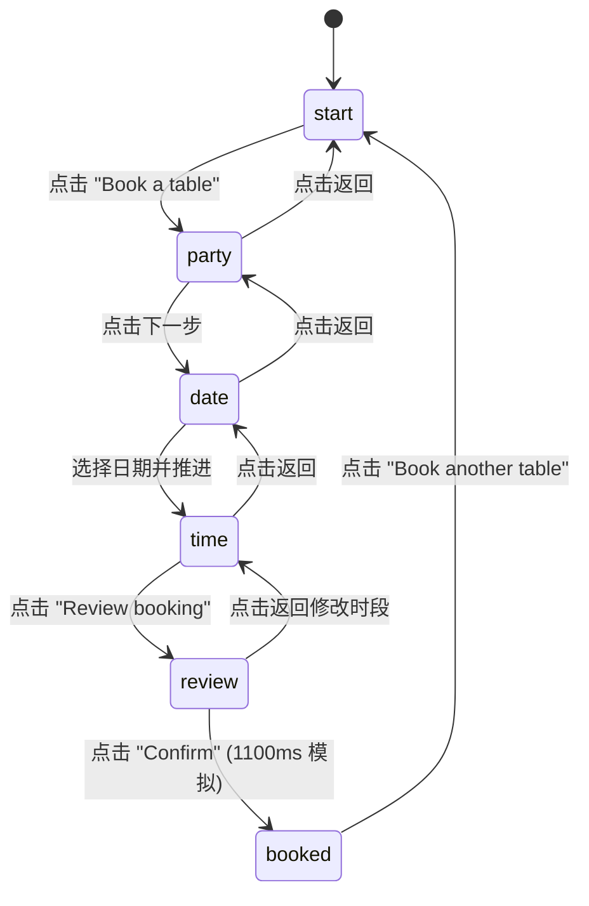

# Booking Pill · 浮动预约胶囊

用于餐厅订座、活动预约与时段订购的多步骤原地物理变形胶囊组件。包含五大核心动效机制：

1. 多步状态机与原地尺寸物理弹簧变型（In-place Surface Morphing & Physical Spring）：从紧凑的 164×52px "Book a table" 药丸按钮原地平滑展开至人数调节器、横向日期卷带、4 列时间槽位网格、带穿孔纹理的订座小票以及成功打勾收据。外壳尺寸采用物理弹簧（扩大 0.42 / 0.16，缩小 0.34 / 0.08，完成态 0.52 / 0.28），面板进出带 16px 位移与 4px 微模糊切换。
2. 个位与十位独立数字滚轮与单复数变形（Tabular Number Rolling & Plural Morph）：人数调节在 1–12 人范围步进，十位与个位数字随增减方向独立垂直翻滚（`translateY` 进出），"guest" 与 "guests" 复数后缀通过宽度与淡入淡出无缝补间。
3. 21 天惯性日期卷带与中心高光透镜（Momentum Date Strip & Center Lens）：横向排布 21 天日历条带（单元格宽 52px），支持指针拖拽、水平滚轮与键盘导航。拖出边缘具备 16% 弹性阻尼，释放时基于近 100ms 瞬时速度按惯性衰减投影并精准磁吸至居中单元格；中心高亮透镜通过反向同步偏移与裁切遮罩无缝高亮当前选中天。
4. 4 列时段槽位与滑动高光胶囊（Gliding Time Slot Highlight & Hash Availability）：时段按 4 列自适应网格展示，由哈希算法确定性模拟空闲与置灰态。选中时段的背景高光块（Highlight Pill）通过物理弹簧平滑滑动到位，容器尺寸改变时自动重测。
5. 穿孔订座票券与成功勾线生长（Perforated Ticket Morph & SVG Checkmark Draw）：审核步骤外壳展开为两侧具备 10px 缺口与虚线撕口的票券卡片；模拟确认耗时 1100ms，成功态绿色圆盘弹性弹出，SVG 对勾描边延迟 260ms 后在 360ms 内匀速生长绘出。

## 原型清单

| 原型分组 | 原型元素 | 动效 / 状态变化 | 去向 |
| --- | --- | --- | --- |
| 胶囊外壳 | 弹性外框容器（`.booking-pill-frame`） | 随面板内容自适应弹簧变形、按压缩放（0.96 / 0.97） | 多步状态机与原地尺寸物理弹簧变型 |
| 初始入口 | "Book a table" 药丸按钮（`.booking-pill-start`） | 点击后向右滑出，触发胶囊变形进入人数选择 | 最小 DOM / CSS |
| 人数步进 | 步进器与数字滚动（`.booking-pill-stepper`） | 1–12 人数调节，个位/十位数垂直滚动，单复数过渡 | 个位与十位独立数字滚轮与单复数变形 |
| 日期条带 | 横向 21 天滑块与透镜（`.booking-pill-slider`） | 惯性滑动、16% 越界弹性、最近单元格磁吸、透镜视差 | 21 天惯性日期卷带与中心高光透镜 |
| 时间网格 | 4 列时间单选槽位（`.booking-pill-slots`） | 确定性可用性过滤、滑动高光胶囊（Highlight Pill） | 4 列时段槽位与滑动高光胶囊 |
| 票券确认 | 穿孔小票与状态按钮（`.booking-pill-ticket`） | 虚线穿孔分割线、Booking… 加载态、1100ms 模拟提交 | 穿孔订座票券与成功勾线生长 |
| 成功凭证 | 打勾圆盘与回执（`.booking-pill-booked`） | 绿色圆盘弹性弹出（0.52 / 0.28），SVG 对勾描边绘出 | 穿孔订座票券与成功勾线生长 |
| 演示外壳 | 顶部主题切换按键与演示舞台 | 演示页面布局与深浅主题切换 | 演示外壳，已删除 |

## 适用

- 紧凑型桌面与移动端预约控件（如餐厅预订、预约咨询、试驾排期、理发沙龙预约）。
- 期望将多步骤填单流程整合在原位药丸胶囊内，避免跳转新页面或弹出笨重 Modal 的场景。
- 强调触感反馈与物理平滑连续变形的高端产品交互。

## 不适用

- 多指标个人目标追踪同心圆环盘 → [activity-rings](activity-rings.md)
- 3D 滚筒式多列滚轮日历时间选择器 → [date-reel](date-reel.md)
- 24 小时全球时区重叠盘与世界时钟 → [time-dial](time-dial.md)

## 状态机

组件包含 6 个连续步骤面板，支持单向推进与逐步回退（Escape / 返回按键）：

| 状态 | 触发条件 | 视觉表现 | 允许转移 |
| --- | --- | --- | --- |
| `start` | 初始状态或重置 | 尺寸 164×52px，展示日历图标与 "Book a table" | `party` |
| `party` | 点击开始按钮 | 外框扩展为人数选择栏，包含减/加按钮与滚动人数字段 | `start`, `date` |
| `date` | 人数确认后推进 | 外壳扩展至 420px，展示 21 天横向日期滑块与中心透镜 | `party`, `time` |
| `time` | 选定日期后推进 | 外壳自适应为 360px，展示 4 列时段网格与滑动高光块 | `date`, `review` |
| `review` | 选定时间后推进 | 外框变为具备左右缺口与虚线穿孔的卡片小票 | `time`, `booking`, `booked` |
| `booked` | 1100ms 模拟成功 | 尺寸微缩为 56px 高度收据条，绿色徽标与对勾生长动效 | `start` (再次预约) |



## 最小 DOM

```html
<div class="booking-pill" role="region" aria-label="Book a table">
  <div class="booking-pill-root">
    <div class="booking-pill-frame" tabindex="0">
      <span class="booking-pill-shadow" aria-hidden="true"></span>
      <div class="booking-pill-shape" role="group" aria-label="Book a table at Olea">
        <!-- 面板挂载容器：各步骤面板动态进入/退出 -->
        <div class="booking-pill-face" data-face="start">
          <button type="button" class="booking-pill-start">
            <svg class="booking-pill-icon" viewBox="0 0 24 24" width="18" height="18" fill="none" stroke="currentColor" stroke-width="2">
              <path d="M8 2v3M16 2v3M3 8h18M3 4a2 2 0 0 1 2-2h14a2 2 0 0 1 2 2v16a2 2 0 0 1-2 2H5a2 2 0 0 1-2-2V4zM8 13h.01M12 13h.01M16 13h.01M8 17h.01M12 17h.01M16 17h.01"/>
            </svg>
            Book a table
          </button>
        </div>
      </div>
    </div>
    <p class="booking-pill-sr-only" aria-live="polite"></p>
  </div>
</div>
```

## 参数

| 参数项 | 类型 | 默认值 | 说明 |
| --- | --- | --- | --- |
| `initialParty` | number | `2` | 初始订座就餐人数（范围 1–12） |
| `firstDay` | string | `'2026-09-21'` | 21 天滑动日历的首日 ISO 日期 |
| `closedDays` | string[] | `['2026-09-21', '2026-09-28', '2026-10-05']` | 餐厅闭店休息日列表（时段不可用） |
| `times` | string[] | `17:00..22:30 每 30 分钟` | 可选预约时段列表（12 个时段） |
| `confirmDelayMs` | number | `1100` | 模拟远程确认请求的延迟时长（ms） |
| `onBooked` | Function | `null` | 预约成功回调 `({ party, date, time }) => void` |

## CSS

```css
.booking-pill {
  --cell: 52px;
  --stub: 72px;
  --shape-radius: 30px;
  --pill-bg: rgba(255, 255, 255, 0.88);
  --pill-border: rgba(0, 0, 0, 0.08);
  --pill-accent: #111827;
  --pill-accent-fg: #ffffff;
  --pill-surface-muted: #f3f4f6;
  --pill-text: #111827;
  --pill-text-secondary: #6b7280;
  --pill-text-muted: #9ca3af;
  --pill-success: #10b981;
  --pill-danger: #ef4444;
  --pill-shadow: 0 20px 48px rgba(0, 0, 0, 0.11), 0 3px 10px rgba(0, 0, 0, 0.04);
  
  position: relative;
  display: flex;
  width: 100%;
  justify-content: center;
  align-items: flex-end;
  color: var(--pill-text);
  font-family: -apple-system, BlinkMacSystemFont, "Segoe UI", Roboto, Helvetica, Arial, sans-serif;
  user-select: none;
  -webkit-user-select: none;
}

.booking-pill-root {
  position: relative;
  display: flex;
  justify-content: center;
  align-items: flex-end;
  width: 100%;
}

.booking-pill-frame {
  position: relative;
  flex: none;
  width: 164px;
  height: 52px;
  outline: none;
  transform-origin: 50% 100%;
  transition: width 0.38s cubic-bezier(0.16, 1, 0.3, 1), height 0.38s cubic-bezier(0.16, 1, 0.3, 1), transform 0.18s ease;
}

.booking-pill-frame:focus-visible {
  outline: 2px solid var(--pill-accent);
  outline-offset: 4px;
}

.booking-pill-shadow {
  position: absolute;
  inset: 0;
  border-radius: var(--shape-radius);
  box-shadow: var(--pill-shadow);
  pointer-events: none;
}

.booking-pill-shape {
  position: relative;
  display: grid;
  width: 100%;
  height: 100%;
  overflow: clip;
  border-radius: var(--shape-radius);
  background: var(--pill-bg);
  box-shadow: inset 0 0 0 1px var(--pill-border);
  grid-template-columns: minmax(0, 1fr);
  grid-template-rows: minmax(0, 1fr);
  backdrop-filter: blur(24px) saturate(1.6);
  -webkit-backdrop-filter: blur(24px) saturate(1.6);
}

.booking-pill-face {
  box-sizing: border-box;
  grid-area: 1 / 1;
  align-self: end;
  justify-self: center;
  width: 100%;
  height: 100%;
  display: flex;
  align-items: center;
  justify-content: center;
  opacity: 1;
  filter: blur(0px);
  transform: none;
  transition: opacity 0.22s cubic-bezier(0.16, 1, 0.3, 1), transform 0.26s cubic-bezier(0.16, 1, 0.3, 1), filter 0.26s ease;
}

.booking-pill-face[inert] {
  pointer-events: none;
  opacity: 0;
  filter: blur(4px);
  transform: translateX(-10px) scale(0.97);
}

/* 初始启动按钮 */
.booking-pill-start {
  display: inline-flex;
  align-items: center;
  gap: 10px;
  height: 52px;
  padding: 0 24px 0 20px;
  border: 0;
  border-radius: 9999px;
  background: transparent;
  color: inherit;
  font: inherit;
  font-size: 15px;
  font-weight: 500;
  white-space: nowrap;
  cursor: pointer;
  transition: background-color 0.15s ease;
}

.booking-pill-start:hover {
  background: rgba(0, 0, 0, 0.04);
}

.booking-pill-icon {
  color: var(--pill-accent);
}

/* 通用圆形按钮 */
.booking-pill-round {
  display: grid;
  place-items: center;
  width: 44px;
  height: 44px;
  flex: none;
  padding: 0;
  border: 0;
  border-radius: 50%;
  background: var(--pill-surface-muted);
  color: var(--pill-text);
  cursor: pointer;
  transition: background-color 0.16s ease, transform 0.14s ease, opacity 0.16s ease;
}

.booking-pill-round[data-size="sm"] {
  width: 36px;
  height: 36px;
}

.booking-pill-round[data-tone="primary"] {
  background: var(--pill-accent);
  color: var(--pill-accent-fg);
}

.booking-pill-round:hover:not([aria-disabled="true"]) {
  background: rgba(0, 0, 0, 0.08);
}

.booking-pill-round[data-tone="primary"]:hover:not([aria-disabled="true"]) {
  background: #000000;
}

.booking-pill-round[aria-disabled="true"] {
  opacity: 0.35;
  cursor: default;
}

.booking-pill-round:active:not([aria-disabled="true"]) {
  transform: scale(0.88);
}

/* 主要操作长药丸按钮 */
.booking-pill-primary {
  display: flex;
  align-items: center;
  justify-content: center;
  flex: 1;
  height: 44px;
  padding: 0 18px;
  border: 0;
  border-radius: 9999px;
  background: var(--pill-accent);
  color: var(--pill-accent-fg);
  font: inherit;
  font-size: 14px;
  font-weight: 500;
  cursor: pointer;
  white-space: nowrap;
  transition: background-color 0.16s ease, transform 0.14s ease, opacity 0.16s ease;
}

.booking-pill-primary:hover:not([aria-disabled="true"]) {
  background: #000000;
}

.booking-pill-primary:active:not([aria-disabled="true"]) {
  transform: scale(0.97);
}

.booking-pill-primary[aria-disabled="true"] {
  background: var(--pill-surface-muted);
  color: var(--pill-text-muted);
  cursor: default;
}

/* 人数选择面 */
.booking-pill-row {
  display: flex;
  align-items: center;
  gap: 8px;
  padding: 8px;
  width: max-content;
}

.booking-pill-stepper {
  display: flex;
  align-items: center;
  gap: 4px;
}

.booking-pill-count {
  display: inline-flex;
  min-width: 104px;
  justify-content: center;
}

.booking-pill-count-ink {
  display: inline-flex;
  align-items: baseline;
  gap: 6px;
}

.booking-pill-count-word {
  display: inline-flex;
  font-size: 14px;
  color: var(--pill-text-secondary);
}

.booking-pill-roll {
  display: inline-flex;
  font-size: 20px;
  font-weight: 600;
  font-variant-numeric: tabular-nums;
  line-height: 1.2;
}

/* 日期选择面 */
.booking-pill-date-face {
  display: grid;
  width: min(420px, calc(100vw - 32px));
  gap: 4px;
  padding: 8px;
}

.booking-pill-bar {
  display: grid;
  align-items: center;
  gap: 8px;
  grid-template-columns: 44px minmax(0, 1fr) 44px;
}

.booking-pill-title {
  text-align: center;
  font-size: 15px;
  font-weight: 500;
  white-space: nowrap;
  overflow: hidden;
  text-overflow: ellipsis;
}

.booking-pill-slider {
  position: relative;
  outline: none;
}

.booking-pill-track {
  position: relative;
  height: 60px;
  overflow: hidden;
  mask-image: linear-gradient(90deg, transparent, #000 14%, #000 86%, transparent);
  -webkit-mask-image: linear-gradient(90deg, transparent, #000 14%, #000 86%, transparent);
}

.booking-pill-strip {
  display: flex;
  width: max-content;
  padding-inline: calc(50% - var(--cell) / 2);
  cursor: grab;
  touch-action: pan-y;
  transition: transform 0.25s cubic-bezier(0.16, 1, 0.3, 1);
}

.booking-pill-strip:active {
  cursor: grabbing;
}

.booking-pill-cell {
  display: grid;
  place-content: center;
  justify-items: center;
  width: var(--cell);
  height: 60px;
  flex: none;
  gap: 2px;
}

.booking-pill-cell-top {
  font-size: 12px;
  color: var(--pill-text-muted);
}

.booking-pill-cell-day {
  font-size: 17px;
  font-weight: 500;
  font-variant-numeric: tabular-nums;
}

.booking-pill-cell[data-closed] .booking-pill-cell-day {
  color: var(--pill-text-muted);
  text-decoration: line-through;
}

.booking-pill-lens {
  position: absolute;
  inset: 0;
  background: var(--pill-accent);
  color: var(--pill-accent-fg);
  clip-path: inset(4px calc(50% - var(--cell) / 2) round 16px);
  pointer-events: none;
}

.booking-pill-lens .booking-pill-cell-top {
  color: inherit;
  opacity: 0.75;
}

.booking-pill-lens .booking-pill-cell-day {
  color: inherit;
}

/* 时间槽位网格面 */
.booking-pill-panel {
  display: grid;
  width: min(360px, calc(100vw - 32px));
  gap: 12px;
  padding: 8px 10px 10px;
}

.booking-pill-heading {
  display: grid;
  justify-items: center;
  text-align: center;
}

.booking-pill-heading-title {
  font-size: 15px;
  font-weight: 500;
}

.booking-pill-heading-sub {
  font-size: 13px;
  color: var(--pill-text-secondary);
}

.booking-pill-slots {
  position: relative;
  display: grid;
  grid-template-columns: repeat(4, minmax(0, 1fr));
  gap: 6px;
}

.booking-pill-highlight {
  position: absolute;
  top: 0;
  left: 0;
  border-radius: 14px;
  background: var(--pill-accent);
  pointer-events: none;
  transition: transform 0.28s cubic-bezier(0.16, 1, 0.3, 1), width 0.28s ease, height 0.28s ease;
}

.booking-pill-highlight[data-hidden] {
  visibility: hidden;
}

.booking-pill-slot {
  position: relative;
  height: 40px;
  padding: 0;
  border: 0;
  border-radius: 14px;
  background: transparent;
  box-shadow: inset 0 0 0 1px var(--pill-border);
  color: var(--pill-text);
  font: inherit;
  font-size: 13px;
  font-weight: 500;
  font-variant-numeric: tabular-nums;
  cursor: pointer;
  transition: color 0.16s ease, box-shadow 0.16s ease;
}

.booking-pill-slot[aria-checked="true"] {
  color: var(--pill-accent-fg);
  box-shadow: inset 0 0 0 1px transparent;
}

.booking-pill-slot[aria-disabled="true"] {
  color: var(--pill-text-muted);
  box-shadow: inset 0 0 0 1px rgba(0, 0, 0, 0.04);
  cursor: default;
  text-decoration: line-through;
}

/* 订座票券小票面 */
.booking-pill-ticket {
  display: grid;
  width: min(340px, calc(100vw - 32px));
}

.booking-pill-ticket-main {
  display: grid;
  gap: 16px;
  padding: 20px 22px 18px;
}

.booking-pill-venue-name {
  font-size: 20px;
  font-weight: 600;
}

.booking-pill-venue-detail {
  font-size: 13px;
  color: var(--pill-text-secondary);
}

.booking-pill-facts {
  display: grid;
  grid-template-columns: minmax(0, 1.4fr) repeat(2, minmax(0, 1fr));
  gap: 12px;
  margin: 0;
}

.booking-pill-fact dt {
  font-size: 12px;
  color: var(--pill-text-muted);
}

.booking-pill-fact dd {
  margin: 0;
  font-size: 15px;
  font-weight: 500;
  white-space: nowrap;
}

.booking-pill-stub {
  position: relative;
  display: flex;
  align-items: center;
  height: var(--stub);
  gap: 8px;
  padding: 0 14px;
}

.booking-pill-perforation {
  position: absolute;
  top: -1px;
  left: 16px;
  right: 16px;
  border-top: 2px dashed rgba(0, 0, 0, 0.16);
}

/* 成功完成凭证面 */
.booking-pill-booked {
  display: flex;
  align-items: center;
  width: max-content;
  height: 56px;
  gap: 12px;
  padding: 0 12px;
}

.booking-pill-mark {
  position: relative;
  display: grid;
  place-items: center;
  width: 32px;
  height: 32px;
  flex: none;
  color: #ffffff;
}

.booking-pill-mark-disc {
  position: absolute;
  inset: 0;
  border-radius: 50%;
  background: var(--pill-success);
  transform: scale(1);
  transition: transform 0.4s cubic-bezier(0.16, 1, 0.3, 1);
}

.booking-pill-mark svg {
  position: relative;
}

.booking-pill-booked-text {
  display: grid;
  line-height: 1.25;
}

.booking-pill-booked-title {
  font-size: 14px;
  font-weight: 500;
}

.booking-pill-booked-detail {
  font-size: 12px;
  color: var(--pill-text-secondary);
}

.booking-pill-sr-only {
  position: absolute;
  width: 1px;
  height: 1px;
  overflow: hidden;
  clip: rect(0 0 0 0);
  white-space: nowrap;
}

/* 减少动态效果 */
@media (prefers-reduced-motion: reduce) {
  .booking-pill-frame,
  .booking-pill-face,
  .booking-pill-strip,
  .booking-pill-highlight,
  .booking-pill-round,
  .booking-pill-primary {
    transition: none !important;
  }
}
```

## JS

```js
export function createBookingPill(root, options = {}) {
  const initialParty = options.initialParty ?? 2;
  const firstDay = options.firstDay ?? '2026-09-21';
  const closedSet = new Set(options.closedDays ?? ['2026-09-21', '2026-09-28', '2026-10-05']);
  const confirmDelayMs = options.confirmDelayMs ?? 1100;
  const onBooked = options.onBooked ?? null;

  const weekdays = ['Sunday', 'Monday', 'Tuesday', 'Wednesday', 'Thursday', 'Friday', 'Saturday'];
  const months = ['January', 'February', 'March', 'April', 'May', 'June', 'July', 'August', 'September', 'October', 'November', 'December'];
  
  const [startYear, startMonth, startDayNum] = firstDay.split('-').map(Number);
  const days = Array.from({ length: 21 }, (_, i) => {
    const d = new Date(Date.UTC(startYear, startMonth - 1, startDayNum + i));
    return {
      iso: d.toISOString().slice(0, 10),
      weekday: d.getUTCDay(),
      day: d.getUTCDate(),
      month: d.getUTCMonth()
    };
  });

  const times = Array.from({ length: 12 }, (_, i) => {
    const hour = 17 + Math.floor(i / 2);
    const minute = i % 2 ? '30' : '00';
    return `${hour}:${minute}`;
  });

  function isAvailable(dateIso, timeStr, numParty) {
    if (closedSet.has(dateIso)) return false;
    const text = `${dateIso} ${timeStr}`;
    let hash = 2166136261;
    for (let i = 0; i < text.length; i++) {
      hash = Math.imul(hash ^ text.charCodeAt(i), 16777619);
    }
    return (hash >>> 0) / 4294967296 > 0.14 + 0.045 * numParty;
  }

  const frame = root.querySelector('.booking-pill-frame');
  const shape = root.querySelector('.booking-pill-shape');
  const srOnly = root.querySelector('.booking-pill-sr-only');

  let currentStep = 'start';
  let party = initialParty;
  let dateIndex = 1;
  let chosenTime = '19:30';
  let status = 'idle';
  let confirmTimer = null;
  let disposed = false;

  function fullDate(d) {
    return `${weekdays[d.weekday]}, ${months[d.month]} ${d.day}`;
  }

  function shortDate(d) {
    return `${weekdays[d.weekday].slice(0, 3)}, ${months[d.month].slice(0, 3)} ${d.day}`;
  }

  function formatTime(t) {
    const [h, m] = t.split(':').map(Number);
    return `${h % 12 || 12}:${String(m || 0).padStart(2, '0')} ${h < 12 ? 'AM' : 'PM'}`;
  }

  function getFreeTimes() {
    return times.filter(t => isAvailable(days[dateIndex].iso, t, party));
  }

  function getSelectedTime() {
    const free = getFreeTimes();
    if (chosenTime && free.includes(chosenTime)) return chosenTime;
    return free[0] || null;
  }

  function announce(msg) {
    if (srOnly) srOnly.textContent = msg;
  }

  // 尺寸映射表
  const sizeMap = {
    start: { w: '164px', h: '52px' },
    party: { w: '260px', h: '60px' },
    date: { w: '420px', h: '124px' },
    time: { w: '360px', h: '248px' },
    review: { w: '340px', h: '210px' },
    booked: { w: '310px', h: '56px' }
  };

  function renderFace(step) {
    if (disposed) return;
    const targetSize = sizeMap[step] || { w: '164px', h: '52px' };
    if (frame) {
      frame.style.width = targetSize.w;
      frame.style.height = targetSize.h;
    }

    let faceHtml = '';
    if (step === 'start') {
      faceHtml = `
        <div class="booking-pill-face" data-face="start">
          <button type="button" class="booking-pill-start">
            <svg class="booking-pill-icon" viewBox="0 0 24 24" width="18" height="18" fill="none" stroke="currentColor" stroke-width="2">
              <path d="M8 2v3M16 2v3M3 8h18M3 4a2 2 0 0 1 2-2h14a2 2 0 0 1 2 2v16a2 2 0 0 1-2 2H5a2 2 0 0 1-2-2V4zM8 13h.01M12 13h.01M16 13h.01M8 17h.01M12 17h.01M16 17h.01"/>
            </svg>
            Book a table
          </button>
        </div>`;
    } else if (step === 'party') {
      faceHtml = `
        <div class="booking-pill-face booking-pill-row" data-face="party">
          <button type="button" class="booking-pill-round" aria-label="Back">
            <svg viewBox="0 0 24 24" width="18" height="18" fill="none" stroke="currentColor" stroke-width="2"><path d="m12 19-7-7 7-7M19 12H5"/></svg>
          </button>
          <div class="booking-pill-stepper" role="group" aria-label="Party size">
            <button type="button" class="booking-pill-round" data-size="sm" aria-label="Fewer guests" ${party <= 1 ? 'aria-disabled="true"' : ''}>
              <svg viewBox="0 0 24 24" width="16" height="16" fill="none" stroke="currentColor" stroke-width="2"><path d="M5 12h14"/></svg>
            </button>
            <div class="booking-pill-count">
              <div class="booking-pill-count-ink">
                <span class="booking-pill-roll">${party}</span>
                <span class="booking-pill-count-word">guest${party > 1 ? 's' : ''}</span>
              </div>
            </div>
            <button type="button" class="booking-pill-round" data-size="sm" aria-label="More guests" ${party >= 12 ? 'aria-disabled="true"' : ''}>
              <svg viewBox="0 0 24 24" width="16" height="16" fill="none" stroke="currentColor" stroke-width="2"><path d="M5 12h14M12 5v14"/></svg>
            </button>
          </div>
          <button type="button" class="booking-pill-round" data-tone="primary" aria-label="Next, choose a date">
            <svg viewBox="0 0 24 24" width="18" height="18" fill="none" stroke="currentColor" stroke-width="2"><path d="M5 12h14M12 5l7 7-7 7"/></svg>
          </button>
        </div>`;
    } else if (step === 'date') {
      const selectedDay = days[dateIndex];
      const cellsHtml = days.map((d, i) => {
        const closed = closedSet.has(d.iso);
        return `
          <div class="booking-pill-cell" data-index="${i}" ${closed ? 'data-closed="true"' : ''}>
            <span class="booking-pill-cell-top">${weekdays[d.weekday].slice(0, 3)}</span>
            <span class="booking-pill-cell-day">${d.day}</span>
          </div>`;
      }).join('');

      faceHtml = `
        <div class="booking-pill-face booking-pill-date-face" data-face="date">
          <div class="booking-pill-bar">
            <button type="button" class="booking-pill-round" aria-label="Back to party size">
              <svg viewBox="0 0 24 24" width="18" height="18" fill="none" stroke="currentColor" stroke-width="2"><path d="m12 19-7-7 7-7M19 12H5"/></svg>
            </button>
            <span class="booking-pill-title">${fullDate(selectedDay)}</span>
            <button type="button" class="booking-pill-round" data-tone="primary" aria-label="Next, choose a time">
              <svg viewBox="0 0 24 24" width="18" height="18" fill="none" stroke="currentColor" stroke-width="2"><path d="M5 12h14M12 5l7 7-7 7"/></svg>
            </button>
          </div>
          <div class="booking-pill-slider" role="slider" tabindex="0" aria-label="Date">
            <div class="booking-pill-track">
              <div class="booking-pill-strip" style="transform: translateX(${-52 * dateIndex}px);">
                ${cellsHtml}
              </div>
              <div class="booking-pill-lens" aria-hidden="true">
                <div class="booking-pill-strip" style="transform: translateX(${-52 * dateIndex}px);">
                  ${cellsHtml}
                </div>
              </div>
            </div>
          </div>
        </div>`;
    } else if (step === 'time') {
      const selectedDay = days[dateIndex];
      const free = getFreeTimes();
      const currentSelectedTime = getSelectedTime();

      const slotsHtml = times.map((t, i) => {
        const available = free.includes(t);
        const checked = t === currentSelectedTime;
        return `
          <button type="button" role="radio" class="booking-pill-slot" data-slot="${t}" aria-checked="${checked}" ${!available ? 'aria-disabled="true"' : ''}>
            ${formatTime(t)}
          </button>`;
      }).join('');

      faceHtml = `
        <div class="booking-pill-face booking-pill-panel" data-face="time">
          <div class="booking-pill-bar">
            <button type="button" class="booking-pill-round" aria-label="Back to dates">
              <svg viewBox="0 0 24 24" width="18" height="18" fill="none" stroke="currentColor" stroke-width="2"><path d="m12 19-7-7 7-7M19 12H5"/></svg>
            </button>
            <div class="booking-pill-heading">
              <span class="booking-pill-heading-title">${fullDate(selectedDay)}</span>
              <span class="booking-pill-heading-sub">${party} guests · ${free.length} free</span>
            </div>
            <span></span>
          </div>
          <div class="booking-pill-slots" role="radiogroup" aria-label="Time">
            <div class="booking-pill-highlight" data-hidden="true"></div>
            ${slotsHtml}
          </div>
          <button type="button" class="booking-pill-primary booking-pill-review-btn" ${!currentSelectedTime ? 'aria-disabled="true"' : ''}>
            Review booking
          </button>
        </div>`;
    } else if (step === 'review') {
      const activeTime = getSelectedTime();
      faceHtml = `
        <div class="booking-pill-face booking-pill-ticket" data-face="review">
          <div class="booking-pill-ticket-main">
            <div class="booking-pill-venue">
              <div class="booking-pill-venue-name">Olea Restaurant</div>
              <div class="booking-pill-venue-detail">432 Octavia Street, San Francisco</div>
            </div>
            <dl class="booking-pill-facts">
              <div class="booking-pill-fact">
                <dt>Date</dt>
                <dd>${shortDate(days[dateIndex])}</dd>
              </div>
              <div class="booking-pill-fact">
                <dt>Time</dt>
                <dd>${activeTime ? formatTime(activeTime) : 'N/A'}</dd>
              </div>
              <div class="booking-pill-fact">
                <dt>Guests</dt>
                <dd>${party}</dd>
              </div>
            </dl>
          </div>
          <div class="booking-pill-stub">
            <span class="booking-pill-perforation" aria-hidden="true"></span>
            <button type="button" class="booking-pill-round" aria-label="Change time">
              <svg viewBox="0 0 24 24" width="18" height="18" fill="none" stroke="currentColor" stroke-width="2"><path d="m12 19-7-7 7-7M19 12H5"/></svg>
            </button>
            <button type="button" class="booking-pill-primary booking-pill-confirm-btn">
              ${status === 'sending' ? 'Booking…' : 'Confirm booking'}
            </button>
          </div>
        </div>`;
    } else if (step === 'booked') {
      const activeTime = getSelectedTime();
      faceHtml = `
        <div class="booking-pill-face booking-pill-booked" data-face="booked">
          <span class="booking-pill-mark" aria-hidden="true">
            <span class="booking-pill-mark-disc"></span>
            <svg width="18" height="18" viewBox="0 0 18 18" fill="none">
              <path d="M4 9.4l3.2 3.1L14 5.8" stroke="currentColor" stroke-width="2.2" stroke-linecap="round" stroke-linejoin="round"/>
            </svg>
          </span>
          <div class="booking-pill-booked-text">
            <span class="booking-pill-booked-title">Table for ${party} booked</span>
            <span class="booking-pill-booked-detail">${shortDate(days[dateIndex])} at ${activeTime ? formatTime(activeTime) : ''}</span>
          </div>
          <button type="button" class="booking-pill-round" data-size="sm" aria-label="Book another table">
            <svg viewBox="0 0 24 24" width="16" height="16" fill="none" stroke="currentColor" stroke-width="2"><path d="M3 12a9 9 0 1 0 9-9 9.75 9.75 0 0 0-6.74 2.74L3 8M3 3v5h5"/></svg>
          </button>
        </div>`;
    }

    if (shape) {
      shape.innerHTML = faceHtml;
    }

    // 后续绑定与微调
    bindFaceEvents(step);
  }

  function updateSlotHighlight() {
    const slotsWrap = shape?.querySelector('.booking-pill-slots');
    const highlight = shape?.querySelector('.booking-pill-highlight');
    if (!slotsWrap || !highlight) return;

    const activeSlot = slotsWrap.querySelector(`.booking-pill-slot[data-slot="${chosenTime}"]`);
    if (activeSlot && activeSlot.getAttribute('aria-disabled') !== 'true') {
      highlight.removeAttribute('data-hidden');
      highlight.style.transform = `translate(${activeSlot.offsetLeft}px, ${activeSlot.offsetTop}px)`;
      highlight.style.width = `${activeSlot.offsetWidth}px`;
      highlight.style.height = `${activeSlot.offsetHeight}px`;
    } else {
      highlight.setAttribute('data-hidden', 'true');
    }
  }

  function bindFaceEvents(step) {
    if (step === 'start') {
      const startBtn = shape?.querySelector('.booking-pill-start');
      startBtn?.addEventListener('click', () => go('party'));
    } else if (step === 'party') {
      const backBtn = shape?.querySelector('[aria-label="Back"]');
      const fewerBtn = shape?.querySelector('[aria-label="Fewer guests"]');
      const moreBtn = shape?.querySelector('[aria-label="More guests"]');
      const nextBtn = shape?.querySelector('[aria-label="Next, choose a date"]');

      backBtn?.addEventListener('click', () => go('start'));
      fewerBtn?.addEventListener('click', () => {
        if (party > 1) {
          party--;
          renderFace('party');
        }
      });
      moreBtn?.addEventListener('click', () => {
        if (party < 12) {
          party++;
          renderFace('party');
        }
      });
      nextBtn?.addEventListener('click', () => go('date'));
    } else if (step === 'date') {
      const backBtn = shape?.querySelector('[aria-label="Back to party size"]');
      const nextBtn = shape?.querySelector('[aria-label="Next, choose a time"]');
      const strip = shape?.querySelector('.booking-pill-strip');
      const slider = shape?.querySelector('.booking-pill-slider');

      backBtn?.addEventListener('click', () => go('party'));
      nextBtn?.addEventListener('click', () => go('time'));

      strip?.addEventListener('click', (e) => {
        const cell = e.target.closest('.booking-pill-cell');
        if (cell && cell.dataset.index !== undefined) {
          dateIndex = Number(cell.dataset.index);
          renderFace('date');
        }
      });

      slider?.addEventListener('keydown', (e) => {
        if (e.key === 'ArrowRight' && dateIndex < 20) {
          dateIndex++;
          renderFace('date');
        } else if (e.key === 'ArrowLeft' && dateIndex > 0) {
          dateIndex--;
          renderFace('date');
        } else if (e.key === 'Enter') {
          go('time');
        }
      });
    } else if (step === 'time') {
      const backBtn = shape?.querySelector('[aria-label="Back to dates"]');
      const reviewBtn = shape?.querySelector('.booking-pill-review-btn');
      const slotBtns = shape?.querySelectorAll('.booking-pill-slot');

      backBtn?.addEventListener('click', () => go('date'));
      reviewBtn?.addEventListener('click', () => {
        if (getSelectedTime()) go('review');
      });

      slotBtns?.forEach(slot => {
        slot.addEventListener('click', () => {
          if (slot.getAttribute('aria-disabled') === 'true') return;
          chosenTime = slot.dataset.slot;
          slotBtns.forEach(s => s.setAttribute('aria-checked', s === slot ? 'true' : 'false'));
          updateSlotHighlight();
        });
      });

      setTimeout(updateSlotHighlight, 20);
    } else if (step === 'review') {
      const backBtn = shape?.querySelector('[aria-label="Change time"]');
      const confirmBtn = shape?.querySelector('.booking-pill-confirm-btn');

      backBtn?.addEventListener('click', () => {
        if (status !== 'sending') go('time');
      });

      confirmBtn?.addEventListener('click', () => {
        if (status === 'sending') return;
        status = 'sending';
        confirmBtn.textContent = 'Booking…';
        announce('Booking in progress');
        confirmTimer = setTimeout(() => {
          if (disposed) return;
          status = 'idle';
          announce(`Booked a table for ${party} at Olea on ${fullDate(days[dateIndex])}`);
          if (typeof onBooked === 'function') {
            onBooked({ party, date: days[dateIndex].iso, time: getSelectedTime() });
          }
          go('booked');
        }, confirmDelayMs);
      });
    } else if (step === 'booked') {
      const anotherBtn = shape?.querySelector('[aria-label="Book another table"]');
      anotherBtn?.addEventListener('click', () => go('start'));
    }
  }

  function go(step) {
    if (disposed) return;
    currentStep = step;
    renderFace(step);
  }

  // 键盘快捷键监听
  function handleKeyDown(e) {
    if (e.key === 'Escape' && status !== 'sending') {
      if (currentStep === 'party') go('start');
      else if (currentStep === 'date') go('party');
      else if (currentStep === 'time') go('date');
      else if (currentStep === 'review') go('time');
    }
  }

  root.addEventListener('keydown', handleKeyDown);

  // 初始化展示
  renderFace('start');

  return {
    go,
    setParty(num) {
      party = Math.min(12, Math.max(1, Math.round(num)));
      renderFace(currentStep);
    },
    setDateIndex(idx) {
      dateIndex = Math.min(20, Math.max(0, Math.round(idx)));
      renderFace(currentStep);
    },
    chooseTime(t) {
      chosenTime = t;
      renderFace(currentStep);
    },
    destroy() {
      disposed = true;
      if (confirmTimer) clearTimeout(confirmTimer);
      root.removeEventListener('keydown', handleKeyDown);
    }
  };
}
```

## 接入目标项目

- 状态来源：预订业务模块提供可用时段、起止日期与预订提交接口，外部可通过 `createBookingPill(root, { initialParty, onBooked })` 接入。
- 尺寸策略：组件外框根据当前面自适应变型，在 164px（初始药丸）与 420px（日期选择条）之间连续弹簧缩放。
- 驱动方式：
  ```js
  import { createBookingPill } from './booking-pill.js';
  const pill = createBookingPill(document.querySelector('.booking-pill'), {
    initialParty: 4,
    onBooked: (res) => console.log('Booking confirmed:', res)
  });
  // 卸载
  pill.destroy();
  ```

## 重入与清理

- 连续步骤切换：步进切换复用外层 `.booking-pill-shape` 容器，动画过程中新内容替换当前面，清除正在执行的超时计时器。
- 卸载销毁：`destroy()` 清理确认延迟计时器 `confirmTimer`，移除全局键盘事件监听。

## 减少动态效果

- 在 `prefers-reduced-motion: reduce` 环境下：
  - 外壳宽高过渡与面板位移动画移除 `transition`，直接瞬时到位。
  - 日期卷带取消弹性位移与惯性滑动，以静态方式呈现居中选中。
  - 时间槽位高光块直接跳转目标按钮坐标。

## 焦点与键盘

- 键盘可访问性：
  - 支持 `Escape` 键在步骤间逆向回退。
  - 日期选择条具备 `role="slider"`，支持左右方向键调整选中日期，Enter 键快捷进入时间选择。
  - 时间网格具备 `role="radiogroup"`，时段槽位具备 `role="radio"`。
- 屏幕阅读器语义：底部具备 `aria-live="polite"` 提示区，动态播报订座人数与预约完成回执。

## 兼容回退

| 特性 | 不支持时 |
| --- | --- |
| `backdrop-filter: blur(...)` | 回退为高不透明度纯色表面底色（`#ffffff` 或 `#1f2937`） |
| `clip-path: inset(...)` | 透镜降级为常规边框高光覆盖层 |

## 验收清单

- [ ] 点击 "Book a table" 原位平滑扩展为人数选择栏。
- [ ] 人数步进器在 1–12 之间增减，数字与 "guest(s)" 单复数实时滚动刷新。
- [ ] 日期面板展示 21 天日历卷带，点击或键盘可切换日期，中心高亮透镜居中对齐。
- [ ] 时间网格展示 4 列时段，可用状态精准计算，点击时段高光胶囊平滑滑动。
- [ ] 审核步骤展现票券齿纹与明细，点击 Confirm 模拟 1100ms 加载并展示成功打勾收据。
- [ ] `destroy()` 完整清理事件监听与异步计时器。
