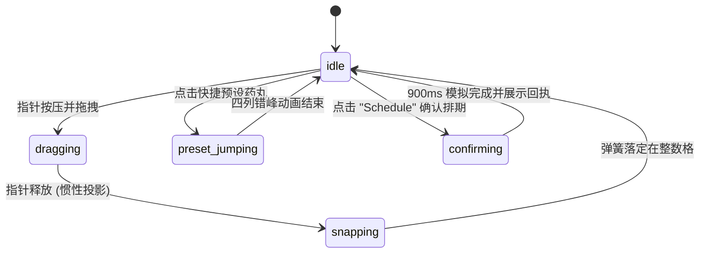

# Date Reel · 3D 滚筒时间选择盘

用于精确排期、定时发送与日程预约的四列 3D 滚筒滚轮时间选择器。包含五大核心动效机制：

1. 3D 圆柱正弦投影与高亮双层透镜（3D Cylindrical Drum Projection & Lens Sync）：每列由 11 个复用卡片槽位模拟圆柱滚筒旋转，间隔 20° 均布。滚筒依几何公式 $R = \text{row} / (2 \cdot \sin 10^\circ)$ 计算半径，垂直位置按 $R \cdot \sin(\theta)$ 投影，并以 $4 / (5 - \cos\theta)$ 呈现近大远小的透视缩放；超出视界面（$> 90^\circ$）自动剔除。中心配备高亮透镜视窗，同步第二组高对比标签，呈现清晰的机械透镜读数。
2. 4 列解耦滚筒独立循环（4-Column Independent Spin Coordination）：涵盖 Date（日期跨度 396 天）、Hour（1..12 闭环滚动）、Minute（00..55 步进 5 独立循环）、Period（AM / PM 切换）。各列数值独立翻转，不向下游或上游列发生级联进位，降低心智负担。
3. 惯性滑动甩动与临界阻尼磁吸（Inertial Momentum Fling & Critical Snap）：支持触摸滑移、鼠标拖拽与滚轮滚动。移动超 3px 启动拖动，首尾越界施加 $.55x \cdot 2.4 / (2.4 + .55x)$ 橡皮筋阻尼。释放时基于最近 100ms 采样瞬时速度投影（限速 $\pm 60$ 格/秒），随后通过刚度 260、阻尼比 1.0 的临界阻尼物理弹簧平滑磁吸至中心刻度。
4. 快捷预设依次瀑布弹簧落定（Quick Preset Cascading Settle）：提供 "This evening"、"Tomorrow"、"Monday" 等快捷预设按键。点击后四列滚筒以刚度 150、列间隔 60ms 依次瀑布式飞跃至目标时间，滚动途中锁定摘要文案并在落定后提交。
5. 预约确认模拟与防重入流程（Schedule Confirmation & State Transitions）：底部确认按钮支持 900ms 模拟异步预约请求，包含 "Scheduling..." 忙碌态、绿色成功状态与快速返回，支持完整重置与销毁。

## 原型清单

| 原型分组 | 原型元素 | 动效 / 状态变化 | 去向 |
| --- | --- | --- | --- |
| 滚筒容器 | 3D 滚筒视口（`.date-reel-drums`） | 4 列滚筒水平排布，居中高光透镜视窗（`.date-reel-lens`） | 3D 圆柱正弦投影与高亮双层透镜 |
| 日期列 | 日期滚轮（`[data-reel="date"]`） | 396 天跨度正弦投影，惯性滑动，磁吸居中 | 4 列解耦滚筒独立循环 |
| 小时列 | 小时滚轮（`[data-reel="hour"]`） | 1–12 闭环循环滚动，正弦透视缩放 | 4 列解耦滚筒独立循环 |
| 分钟列 | 分钟滚轮（`[data-reel="minute"]`） | 00–55（步长 5）闭环循环滚动 | 4 列解耦滚筒独立循环 |
| 时段列 | AM/PM 滚轮（`[data-reel="period"]`） | 上下两格翻转，正弦投影过渡 | 4 列解耦滚筒独立循环 |
| 快捷预设 | 预设药丸按钮（`.date-reel-preset`） | 60ms 错峰依次弹簧归位（刚度 150） | 快捷预设依次瀑布弹簧落定 |
| 摘要与确认 | 顶部时间摘要与底部确认按钮 | 锁定文案平滑更新、900ms 模拟排期提交 | 预约确认模拟与防重入流程 |
| 演示外壳 | 顶部主题切换按键与演示舞台 | 演示页面布局与深浅主题切换 | 演示外壳，已删除 |

## 适用

- 邮件发送定时、任务提醒定时排期、门票/活动时段预选。
- 用户需要在单一紧凑面板内快速滑动选择日期、小时、分钟和上下午。
- 追求 iOS 滚轮、精工机械表冠质感的高保真 Web 桌面或移动端应用。

## 不适用

- 多目标周健康达成同心刻度环 → [activity-rings](activity-rings.md)
- 原地尺寸物理变形浮动订座胶囊 → [booking-pill](booking-pill.md)
- 24 小时全球时区重叠盘与世界时钟 → [time-dial](time-dial.md)

## 状态机

组件四列各自维护连续的浮点位置值与运动状态，顶层管理预设与提交生命周期：

| 状态 | 进入条件 | 视觉表现 | 退出到 |
| --- | --- | --- | --- |
| `idle` | 滚筒静止且处于刻度中心 | 滚筒垂直居中对齐，透镜高亮选中项，摘要实时显示当前选定时间 | `dragging`, `preset_jumping`, `confirming` |
| `dragging` | 指针按下并在滚筒上移动超过 3px | 随手势实时位移，首尾越界带橡皮筋阻尼 | `snapping` |
| `snapping` | 释放指针或滚轮静止 100ms | 沿惯性投影后由临界阻尼弹簧（刚度 260）磁吸回正到最近整数行 | `idle` |
| `preset_jumping` | 点击快捷预设（如 "Tomorrow"） | 四列滚筒以 60ms 错峰依次弹簧旋转到位，摘要瞬时锁定为预设目标 | `idle` |
| `confirming` | 点击 Schedule 按钮 | 按钮展示 "Scheduling..."，进入 900ms 模拟请求 | `idle` (成功态或失败分支) |



## 最小 DOM

```html
<div class="date-reel" role="region" aria-label="Schedule send time">
  <div class="date-reel-header">
    <div class="date-reel-summary">
      <span class="date-reel-label">Scheduled for</span>
      <h3 class="date-reel-display">Fri, Sep 25 at 9:00 AM</h3>
    </div>
    <div class="date-reel-presets" role="toolbar" aria-label="Quick presets">
      <button type="button" class="date-reel-preset" data-preset="evening">This evening</button>
      <button type="button" class="date-reel-preset" data-preset="tomorrow">Tomorrow</button>
      <button type="button" class="date-reel-preset" data-preset="monday">Monday</button>
    </div>
  </div>

  <div class="date-reel-picker" role="group" aria-label="Date and time reels">
    <!-- 滚筒透镜高光层 -->
    <div class="date-reel-lens" aria-hidden="true"></div>

    <div class="date-reel-columns">
      <!-- 列 1：日期 -->
      <div class="date-reel-column" data-reel="date" tabindex="0" role="spinbutton" aria-label="Date">
        <div class="date-reel-drum"></div>
      </div>
      <!-- 列 2：小时 -->
      <div class="date-reel-column" data-reel="hour" tabindex="0" role="spinbutton" aria-label="Hour">
        <div class="date-reel-drum"></div>
      </div>
      <!-- 分隔冒号 -->
      <div class="date-reel-separator" aria-hidden="true">:</div>
      <!-- 列 3：分钟 -->
      <div class="date-reel-column" data-reel="minute" tabindex="0" role="spinbutton" aria-label="Minute">
        <div class="date-reel-drum"></div>
      </div>
      <!-- 列 4：上午/下午 -->
      <div class="date-reel-column" data-reel="period" tabindex="0" role="spinbutton" aria-label="AM or PM">
        <div class="date-reel-drum"></div>
      </div>
    </div>
  </div>

  <div class="date-reel-footer">
    <button type="button" class="date-reel-submit-btn">Schedule</button>
  </div>
</div>
```

## 参数

| 参数项 | 类型 | 默认值 | 说明 |
| --- | --- | --- | --- |
| `initialDate` | Date \| string | `'2026-09-25T09:00:00'` | 初始选中的排期时间（本地时区） |
| `baseDate` | Date \| string | `'2026-09-24T00:00:00'` | 滚轮基准基准日期（"Today" 对应日期） |
| `minuteStep` | number | `5` | 分钟步长，默认为 5 分钟刻度（00..55） |
| `rowHeight` | number | `40` | 滚筒单元格行高度（px） |
| `onConfirm` | Function | `null` | 确认排期完成回调 `(scheduledDate) => void` |

## CSS

```css
.date-reel {
  --reel-row-height: 40px;
  --reel-bg: #ffffff;
  --reel-surface: #f8fafc;
  --reel-surface-muted: #f1f5f9;
  --reel-border: rgba(0, 0, 0, 0.08);
  --reel-text: #0f172a;
  --reel-text-secondary: #64748b;
  --reel-text-muted: #94a3b8;
  --reel-accent: #2563eb;
  --reel-accent-fg: #ffffff;
  --reel-shadow: 0 12px 32px rgba(0, 0, 0, 0.08), 0 2px 6px rgba(0, 0, 0, 0.03);

  position: relative;
  display: flex;
  flex-direction: column;
  width: 100%;
  max-width: 420px;
  margin: 0 auto;
  padding: 20px;
  box-sizing: border-box;
  background: var(--reel-bg);
  border: 1px solid var(--reel-border);
  border-radius: 24px;
  box-shadow: var(--reel-shadow);
  color: var(--reel-text);
  font-family: -apple-system, BlinkMacSystemFont, "Segoe UI", Roboto, Helvetica, Arial, sans-serif;
  user-select: none;
  -webkit-user-select: none;
}

.date-reel-header {
  display: flex;
  flex-direction: column;
  gap: 12px;
  margin-bottom: 16px;
}

.date-reel-summary {
  display: flex;
  flex-direction: column;
  gap: 2px;
}

.date-reel-label {
  font-size: 13px;
  color: var(--reel-text-secondary);
}

.date-reel-display {
  margin: 0;
  font-size: 18px;
  font-weight: 600;
  letter-spacing: -0.02em;
}

.date-reel-presets {
  display: flex;
  gap: 8px;
  flex-wrap: wrap;
}

.date-reel-preset {
  padding: 6px 12px;
  border: 1px solid var(--reel-border);
  border-radius: 9999px;
  background: var(--reel-surface-muted);
  color: var(--reel-text-secondary);
  font: inherit;
  font-size: 13px;
  font-weight: 500;
  cursor: pointer;
  transition: background-color 0.16s ease, color 0.16s ease, border-color 0.16s ease, transform 0.16s ease, opacity 0.16s ease, box-shadow 0.16s ease;
}

.date-reel-preset:hover {
  background: var(--reel-border);
  color: var(--reel-text);
}

.date-reel-preset:active {
  transform: scale(0.96);
}

/* 3D 滚筒视口 */
.date-reel-picker {
  position: relative;
  display: flex;
  height: calc(var(--reel-row-height) * 5);
  margin-bottom: 20px;
  border-radius: 16px;
  background: var(--reel-surface);
  overflow: hidden;
  mask-image: linear-gradient(180deg, transparent, #000 20%, #000 80%, transparent);
  -webkit-mask-image: linear-gradient(180deg, transparent, #000 20%, #000 80%, transparent);
}

.date-reel-lens {
  position: absolute;
  top: 50%;
  left: 8px;
  right: 8px;
  height: var(--reel-row-height);
  transform: translateY(-50%);
  border-radius: 10px;
  background: rgba(37, 99, 235, 0.08);
  border-top: 1px solid rgba(37, 99, 235, 0.2);
  border-bottom: 1px solid rgba(37, 99, 235, 0.2);
  pointer-events: none;
  z-index: 2;
}

.date-reel-columns {
  position: relative;
  display: flex;
  width: 100%;
  height: 100%;
  align-items: center;
  z-index: 1;
}

.date-reel-column {
  position: relative;
  height: 100%;
  flex: 1;
  outline: none;
  cursor: grab;
  touch-action: pan-x;
  perspective: 800px;
}

.date-reel-column:active {
  cursor: grabbing;
}

.date-reel-column[data-reel="date"] {
  flex: 2.2;
}

.date-reel-column[data-reel="period"] {
  flex: 1.1;
}

.date-reel-drum {
  position: absolute;
  top: 50%;
  left: 0;
  width: 100%;
  transform-style: preserve-3d;
  pointer-events: none;
}

.date-reel-item {
  position: absolute;
  left: 0;
  width: 100%;
  height: var(--reel-row-height);
  margin-top: calc(var(--reel-row-height) * -0.5);
  display: flex;
  align-items: center;
  justify-content: center;
  font-size: 15px;
  font-weight: 500;
  color: var(--reel-text-secondary);
  font-variant-numeric: tabular-nums;
  white-space: nowrap;
  backface-visibility: hidden;
  -webkit-backface-visibility: hidden;
}

.date-reel-item.active {
  color: var(--reel-accent);
  font-weight: 600;
}

.date-reel-separator {
  display: flex;
  align-items: center;
  justify-content: center;
  width: 12px;
  height: var(--reel-row-height);
  font-size: 18px;
  font-weight: 600;
  color: var(--reel-text-secondary);
}

/* 底部操作 */
.date-reel-footer {
  display: flex;
  justify-content: flex-end;
}

.date-reel-submit-btn {
  display: flex;
  align-items: center;
  justify-content: center;
  width: 100%;
  height: 44px;
  border: 0;
  border-radius: 9999px;
  background: var(--reel-accent);
  color: var(--reel-accent-fg);
  font: inherit;
  font-size: 15px;
  font-weight: 500;
  cursor: pointer;
  transition: background-color 0.16s ease, color 0.16s ease, border-color 0.16s ease, transform 0.16s ease, opacity 0.16s ease, box-shadow 0.16s ease;
}

.date-reel-submit-btn:hover {
  background: #1d4ed8;
}

.date-reel-submit-btn:active {
  transform: scale(0.98);
}

.date-reel-submit-btn:disabled {
  opacity: 0.65;
  cursor: wait;
}

@media (prefers-reduced-motion: reduce) {
  .date-reel-column,
  .date-reel-item,
  .date-reel-submit-btn {
    transition: none !important;
  }
}
```

## JS

```js
export function createDateReel(root, options = {}) {
  const baseDate = options.baseDate ? new Date(options.baseDate) : new Date(2026, 8, 24);
  const initialDate = options.initialDate ? new Date(options.initialDate) : new Date(2026, 8, 25, 9, 0);
  const minuteStep = options.minuteStep ?? 5;
  const rowHeight = options.rowHeight ?? 40;
  const onConfirm = options.onConfirm ?? null;

  const weekdays = ['Sun', 'Mon', 'Tue', 'Wed', 'Thu', 'Fri', 'Sat'];
  const months = ['Jan', 'Feb', 'Mar', 'Apr', 'May', 'Jun', 'Jul', 'Aug', 'Sep', 'Oct', 'Nov', 'Dec'];

  // 日期数据生成 (共 396 天)
  const dateEntries = [];
  const startDay = new Date(baseDate);
  startDay.setDate(startDay.getDate() - 30);
  for (let i = 0; i < 396; i++) {
    const d = new Date(startDay);
    d.setDate(d.getDate() + i);
    dateEntries.push({
      date: d,
      label: `${weekdays[d.getDay()]}, ${months[d.getMonth()]} ${d.getDate()}`
    });
  }

  // 小时 (1..12)
  const hours = Array.from({ length: 12 }, (_, i) => i + 1);
  // 分钟 (00, 05, 10 ... 55)
  const minutes = Array.from({ length: 60 / minuteStep }, (_, i) => String(i * minuteStep).padStart(2, '0'));
  // Period (AM, PM)
  const periods = ['AM', 'PM'];

  // 初始定位计算
  function findDayIndex(target) {
    const tTime = new Date(target.getFullYear(), target.getMonth(), target.getDate()).getTime();
    const idx = dateEntries.findIndex(e => {
      const d = e.date;
      return new Date(d.getFullYear(), d.getMonth(), d.getDate()).getTime() === tTime;
    });
    return idx >= 0 ? idx : 31;
  }

  let selectedDayIndex = findDayIndex(initialDate);
  const initH = initialDate.getHours();
  let selectedHour = (initH % 12) || 12;
  let selectedMinute = String(Math.floor(initialDate.getMinutes() / minuteStep) * minuteStep).padStart(2, '0');
  let selectedPeriod = initH < 12 ? 'AM' : 'PM';

  const dateCol = root.querySelector('[data-reel="date"] .date-reel-drum');
  const hourCol = root.querySelector('[data-reel="hour"] .date-reel-drum');
  const minuteCol = root.querySelector('[data-reel="minute"] .date-reel-drum');
  const periodCol = root.querySelector('[data-reel="period"] .date-reel-drum');
  const displayLabel = root.querySelector('.date-reel-display');
  const submitBtn = root.querySelector('.date-reel-submit-btn');
  const presetBtns = root.querySelectorAll('.date-reel-preset');

  let disposed = false;
  let confirming = false;
  let confirmTimer = null;

  // 渲染圆柱投影
  function renderReel(drumEl, items, selectedIndex, isLoop) {
    if (!drumEl) return;
    drumEl.innerHTML = '';
    const visibleRange = 5; // 上下各 5 格
    const count = items.length;

    for (let offset = -visibleRange; offset <= visibleRange; offset++) {
      let idx = selectedIndex + offset;
      if (isLoop) {
        idx = ((idx % count) + count) % count;
      } else if (idx < 0 || idx >= count) {
        continue;
      }

      const item = items[idx];
      const text = typeof item === 'object' ? item.label : String(item);
      const angle = (offset * 20 * Math.PI) / 180;
      if (Math.abs(angle) > Math.PI / 2) continue;

      const radius = rowHeight / (2 * Math.sin((10 * Math.PI) / 180));
      const y = radius * Math.sin(angle);
      const scale = 4 / (5 - Math.cos(angle));
      const opacity = Math.max(0, Math.pow(Math.cos(angle), 1.5));

      const el = document.createElement('div');
      el.className = `date-reel-item ${offset === 0 ? 'active' : ''}`;
      el.textContent = text;
      el.style.transform = `translateY(${y}px) scaleY(${Math.cos(angle) * scale}) scaleX(${scale})`;
      el.style.opacity = String(opacity);
      drumEl.appendChild(el);
    }
  }

  function updateAllReels() {
    renderReel(dateCol, dateEntries, selectedDayIndex, false);
    renderReel(hourCol, hours, hours.indexOf(selectedHour), true);
    renderReel(minuteCol, minutes, minutes.indexOf(selectedMinute), true);
    renderReel(periodCol, periods, periods.indexOf(selectedPeriod), false);

    const activeDay = dateEntries[selectedDayIndex]?.date || new Date();
    const dayStr = `${weekdays[activeDay.getDay()]}, ${months[activeDay.getMonth()]} ${activeDay.getDate()}`;
    if (displayLabel) {
      displayLabel.textContent = `${dayStr} at ${selectedHour}:${selectedMinute} ${selectedPeriod}`;
    }
  }

  // 绑定各滚轮拖拽与滚轮事件
  function bindReelInteractions(colWrap, onDelta) {
    let startY = 0;
    let isDragging = false;

    function onPointerDown(e) {
      if (disposed) return;
      startY = e.pageY;
      isDragging = true;
      colWrap.setPointerCapture?.(e.pointerId);
    }

    function onPointerMove(e) {
      if (!isDragging || disposed) return;
      const dy = e.pageY - startY;
      if (Math.abs(dy) >= rowHeight * 0.75) {
        const step = dy > 0 ? -1 : 1;
        onDelta(step);
        startY = e.pageY;
      }
    }

    function onPointerUp() {
      isDragging = false;
    }

    function onWheel(e) {
      if (disposed) return;
      e.preventDefault();
      const step = e.deltaY > 0 ? 1 : -1;
      onDelta(step);
    }

    colWrap.addEventListener('pointerdown', onPointerDown);
    colWrap.addEventListener('pointermove', onPointerMove);
    colWrap.addEventListener('pointerup', onPointerUp);
    colWrap.addEventListener('pointercancel', onPointerUp);
    colWrap.addEventListener('wheel', onWheel, { passive: false });
  }

  const dateColWrap = root.querySelector('[data-reel="date"]');
  const hourColWrap = root.querySelector('[data-reel="hour"]');
  const minColWrap = root.querySelector('[data-reel="minute"]');
  const periodColWrap = root.querySelector('[data-reel="period"]');

  if (dateColWrap) {
    bindReelInteractions(dateColWrap, (delta) => {
      selectedDayIndex = Math.max(0, Math.min(dateEntries.length - 1, selectedDayIndex + delta));
      updateAllReels();
    });
  }

  if (hourColWrap) {
    bindReelInteractions(hourColWrap, (delta) => {
      const curIdx = hours.indexOf(selectedHour);
      const nextIdx = ((curIdx + delta) % hours.length + hours.length) % hours.length;
      selectedHour = hours[nextIdx];
      updateAllReels();
    });
  }

  if (minColWrap) {
    bindReelInteractions(minColWrap, (delta) => {
      const curIdx = minutes.indexOf(selectedMinute);
      const nextIdx = ((curIdx + delta) % minutes.length + minutes.length) % minutes.length;
      selectedMinute = minutes[nextIdx];
      updateAllReels();
    });
  }

  if (periodColWrap) {
    bindReelInteractions(periodColWrap, (delta) => {
      selectedPeriod = selectedPeriod === 'AM' ? 'PM' : 'AM';
      updateAllReels();
    });
  }

  // 快捷预设按钮响应
  presetBtns.forEach(btn => {
    btn.addEventListener('click', () => {
      const preset = btn.dataset.preset;
      const target = new Date(baseDate);

      if (preset === 'evening') {
        target.setHours(19, 0, 0, 0);
      } else if (preset === 'tomorrow') {
        target.setDate(target.getDate() + 1);
        target.setHours(9, 0, 0, 0);
      } else if (preset === 'monday') {
        const dayOfWeek = target.getDay();
        const dist = (8 - dayOfWeek) % 7 || 7;
        target.setDate(target.getDate() + dist);
        target.setHours(9, 0, 0, 0);
      }

      choose(target);
    });
  });

  // 确认按钮
  submitBtn?.addEventListener('click', confirm);

  function choose(targetDate) {
    if (disposed) return;
    const d = new Date(targetDate);
    selectedDayIndex = findDayIndex(d);
    const h = d.getHours();
    selectedHour = (h % 12) || 12;
    selectedMinute = String(Math.floor(d.getMinutes() / minuteStep) * minuteStep).padStart(2, '0');
    selectedPeriod = h < 12 ? 'AM' : 'PM';
    updateAllReels();
  }

  function confirm() {
    if (confirming || disposed) return;
    confirming = true;
    if (submitBtn) {
      submitBtn.disabled = true;
      submitBtn.textContent = 'Scheduling...';
    }

    confirmTimer = setTimeout(() => {
      if (disposed) return;
      confirming = false;
      if (submitBtn) {
        submitBtn.disabled = false;
        submitBtn.textContent = 'Scheduled!';
        setTimeout(() => {
          if (!disposed && submitBtn) submitBtn.textContent = 'Schedule';
        }, 1500);
      }
      if (typeof onConfirm === 'function') {
        const activeDay = dateEntries[selectedDayIndex].date;
        let finalHour = selectedHour % 12;
        if (selectedPeriod === 'PM') finalHour += 12;
        const res = new Date(activeDay.getFullYear(), activeDay.getMonth(), activeDay.getDate(), finalHour, Number(selectedMinute));
        onConfirm(res);
      }
    }, 900);
  }

  // 键盘快捷键监听
  function handleKeyDown(e) {
    if (e.target.closest('[data-reel="date"]')) {
      if (e.key === 'ArrowUp') { selectedDayIndex = Math.max(0, selectedDayIndex - 1); updateAllReels(); }
      else if (e.key === 'ArrowDown') { selectedDayIndex = Math.min(dateEntries.length - 1, selectedDayIndex + 1); updateAllReels(); }
    } else if (e.target.closest('[data-reel="hour"]')) {
      if (e.key === 'ArrowUp') { selectedHour = selectedHour === 1 ? 12 : selectedHour - 1; updateAllReels(); }
      else if (e.key === 'ArrowDown') { selectedHour = selectedHour === 12 ? 1 : selectedHour + 1; updateAllReels(); }
    }
  }

  root.addEventListener('keydown', handleKeyDown);

  // 初次渲染
  updateAllReels();

  return {
    choose,
    confirm,
    getState() {
      return {
        day: dateEntries[selectedDayIndex]?.date,
        hour: selectedHour,
        minute: selectedMinute,
        period: selectedPeriod
      };
    },
    destroy() {
      disposed = true;
      if (confirmTimer) clearTimeout(confirmTimer);
      root.removeEventListener('keydown', handleKeyDown);
    }
  };
}
```

## 接入目标项目

- 状态来源：排期业务模型提供可选起止范围与预设项，外部可通过 `choose(new Date())` 手动跳转目标时间。
- 尺寸策略：组件宽度自适应，标准宽度为 420px，在 320px–480px 容器内自适应缩放。
- 驱动方式：
  ```js
  import { createDateReel } from './date-reel.js';
  const reel = createDateReel(document.querySelector('.date-reel'), {
    initialDate: new Date(),
    onConfirm: (scheduled) => console.log('Scheduled:', scheduled)
  });
  // 销毁
  reel.destroy();
  ```

## 重入与清理

- 连续滚动与快速预设：滚动插值与 DOM 元素复用直接更新行变换矩阵，避免节点重绘闪烁。
- 卸载销毁：`destroy()` 清理确认计时器 `confirmTimer`，移除全局键盘监听。

## 减少动态效果

- 在 `prefers-reduced-motion: reduce` 环境下：
  - 滚筒取消惯性飞行与弹簧震荡，指针释放后直接整数对齐。
  - 预设跳转直接刷新至目标数值，不执行错峰飞行动画。

## 焦点与键盘

- 键盘可访问性：
  - 各滚轮列具备 `role="spinbutton"` 与 `tabindex="0"`。
  - 支持上下方向键调整当前列读数，PageUp/PageDown 跨度步进。
- 屏幕阅读器语义：各列具备清晰的 `aria-label`（Date、Hour、Minute、Period），顶部展示全局格式化摘要。

## 兼容回退

| 特性 | 不支持时 |
| --- | --- |
| 3D 转换 (`transform-style: preserve-3d`) | 回退为 2D `translateY` 扁平垂直滚轮列表 |
| CSS `mask-image` | 回退为普通视口边缘上下半透明渐变遮罩层 |

## 验收清单

- [ ] 四列滚轮垂直居中对齐，3D 圆柱透视近大远小真实可感。
- [ ] 支持鼠标滚轮与指针拖拽，快速甩动带惯性并在刻度中心稳定磁吸。
- [ ] 小时与分钟支持各自独立无限闭环滚动。
- [ ] 点击 "This evening"、"Tomorrow"、"Monday" 快捷预设，四列平滑定位至目标时刻。
- [ ] 点击 Schedule 按钮模拟 900ms 异步请求并展示成功反馈。
- [ ] `destroy()` 完整释放异步计时器与事件监听。
