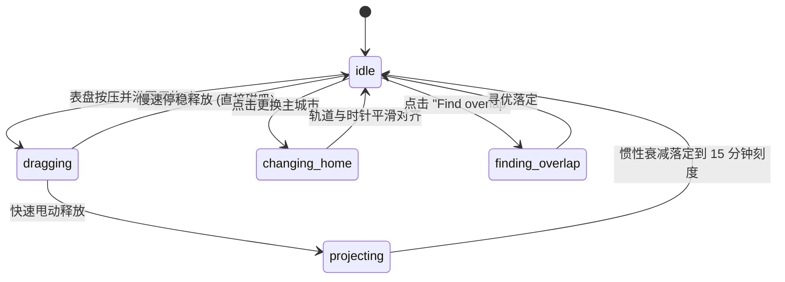

# Time Dial · 24小时极坐标多时区罗盘

用于跨国团队协作、多时区会议安排与全球时间同步的 24 小时极坐标表盘罗盘。包含五大核心动效机制：

1. 24 小时极坐标表盘与多城市同心轨道（24h Polar Dial & Multi-Orbit Tracks）：一圈 360° 精准对应 24 小时（每度 4 分钟）。支持纽约（UTC-4）、旧金山（UTC-7）、伦敦（UTC+1）、东京（UTC+9）四座代表性城市同心轨道联动。切换主城市时，主轨道半径以物理弹簧（0.42 / 0.16）放大突出，表盘指针按环形最短角位移过渡。
2. 15 分钟连续平滑磁吸与无缝接管（15-Minute Continuous Snap & Seamless Pickup）：沿圆周拖拽指针时，采用连续平滑吸附函数 $v - \frac{10.8}{2\pi} \sin(\frac{2\pi v}{15})$；拖拽初始帧通过牛顿迭代反解原始角度，实现动画飞行动行中的无抖动接管；具备 4px 移动死区与中心 14% 半径保护。
3. 瞬时速度投射与双档物理弹簧阻尼（Velocity Projection & Dual Physical Springs）：释放时采集近 100ms 原始角度角速度（限速 $\pm 6000$ 分钟/秒），当速度超过阈值时按 $\text{current} + 0.24 \cdot v$ 惯性投射并对齐刻度；15 分钟近距调节采用轻快弹簧（0.3 / 0.12），跨时区远距旅行采用平稳阻尼弹簧（0.56 / 0.14）。
4. 工作时间扇区动态弧线与昼夜状态（Work Sector Sweep & Daylight State）：表盘外圈实时标注 9:00 AM – 5:00 PM 核心工作时间扇区。指针拖拽时主指示点微凸 1.12 倍并绘制动态扫掠弧线（最大 1436 分钟防止圆周重叠），底部城市卡片联动刷新当地时间、昼夜太阳/月亮图标与 Working / Off work 状态。
5. "Find Overlap" 智能重合会议时段寻优（"Find Overlap" Multi-City Slot Optimizer）：内置算法一键遍历主城市当天 96 个 15 分钟刻度，根据工作城市数量权重与当前时间距离综合评分，定位重叠人数最多的黄金沟通时间并平滑旋转就位。

## 原型清单

| 原型分组 | 原型元素 | 动效 / 状态变化 | 去向 |
| --- | --- | --- | --- |
| 极坐标表盘 | 24 小时同心表盘（`.time-dial-dial`） | 24 小时刻度环、工作扇区扫掠弧、旋转指针 | 24 小时极坐标表盘与多城市同心轨道 |
| 磁吸指针 | 中心表针与游标圆点（`.time-dial-pointer`） | 连续 15 分钟磁吸、拖拽放大 1.12、速度投射 | 15 分钟连续平滑磁吸与无缝接管 |
| 中心读数 | 机械时钟滚筒与 AM/PM（`.time-dial-center`） | 当地时间时/分平滑翻转，滞后衰减补间 | 24 小时极坐标表盘与多城市同心轨道 |
| 城市列表 | 四城市卡片列表（`.time-dial-cities`） | 昼夜图标微动、工作状态徽标、主城市切换高光 | 工作时间扇区动态弧线与昼夜状态 |
| 智能操作 | "Find overlap" 与 "Reset" 按钮 | 96 刻度寻优飞跃、重置回到初始 1260 UTC 分钟 | "Find Overlap" 智能重合会议时段寻优 |
| 演示外壳 | 顶部主题切换按键与演示舞台 | 演示页面布局与深浅主题切换 | 演示外壳，已删除 |

## 适用

- 跨国远程团队日常时间协调、跨时区全球会议预约安排。
- 航空航天、外贸航运、跨时区分布式系统监控看板。
- 需要以 24 小时全景而非 12 小时传统表盘直观呈现全球昼夜重叠的场景。

## 不适用

- 多目标周健康达成同心刻度环 → [activity-rings](activity-rings.md)
- 原地尺寸物理变形浮动订座胶囊 → [booking-pill](booking-pill.md)
- 3D 滚筒滚轮时间选择器 → [date-reel](date-reel.md)

## 状态机

组件维护全局 UTC 分钟数（0..1440 循环，支持跨日整数展开）与主城市：

| 状态 | 进入条件 | 视觉表现 | 退出到 |
| --- | --- | --- | --- |
| `idle` | 静止在 15 分钟倍数刻度 | 指针静止，中心显示主城市时间，四城市状态稳定 | `dragging`, `finding_overlap`, `changing_home` |
| `dragging` | 鼠标或触摸在表盘按压并移动超 4px | 指针圆点放大 1.12 倍，动态展示扫掠弧线，四城市读数实时跟随 | `projecting` |
| `projecting` | 释放指针且速度超过 120 分钟/秒 | 按角速度飞跃并由弹簧（刚度 46.7）磁吸至目标刻度 | `idle` |
| `changing_home` | 点击某城市卡片 | 主城市轨道平滑缩放切换，指针按最短圆周角旋转对齐 | `idle` |
| `finding_overlap` | 点击 "Find overlap" 按钮 | 算法计算出最高重合度时间，指针平滑旋转飞入该时刻 | `idle` |



## 最小 DOM

```html
<div class="time-dial" role="region" aria-label="World time coordinator">
  <div class="time-dial-layout">
    <!-- 左侧极坐标大表盘 -->
    <div class="time-dial-dial-wrap">
      <div class="time-dial-dial" tabindex="0" role="slider" aria-label="Time dial" aria-valuemin="0" aria-valuemax="1440" aria-valuenow="1260">
        <!-- SVG 刻度与弧线 -->
        <svg class="time-dial-svg" viewBox="0 0 320 320" aria-hidden="true">
          <!-- 背景刻度圈 -->
          <circle cx="160" cy="160" r="140" class="time-dial-track"/>
          <!-- 工作时间扇区 -->
          <path class="time-dial-work-sector" d="M 160 160 L 160 20 A 140 140 0 0 1 292 210 Z"/>
          <!-- 动态拖拽扫掠弧 -->
          <path class="time-dial-sweep-arc" d=""/>
        </svg>

        <!-- 旋转指针 -->
        <div class="time-dial-pointer-arm">
          <div class="time-dial-pointer-head">
            <span class="time-dial-pointer-dot"></span>
          </div>
        </div>

        <!-- 表盘中央读数 -->
        <div class="time-dial-center">
          <div class="time-dial-center-time">09:00</div>
          <div class="time-dial-center-meta">
            <span class="time-dial-center-period">AM</span>
            <span class="time-dial-center-city">New York</span>
          </div>
        </div>
      </div>

      <!-- 快速优化工具条 -->
      <div class="time-dial-toolbar">
        <button type="button" class="time-dial-action-btn time-dial-overlap-btn">Find overlap</button>
        <button type="button" class="time-dial-action-btn time-dial-reset-btn">Reset</button>
      </div>
    </div>

    <!-- 右侧四城市卡片列表 -->
    <div class="time-dial-cities" role="list" aria-label="Time zones">
      <div class="time-dial-city active" data-city="nyc" role="listitem" tabindex="0">
        <div class="time-dial-city-main">
          <span class="time-dial-city-name">New York</span>
          <span class="time-dial-city-offset">UTC-4 · Home</span>
        </div>
        <div class="time-dial-city-status">
          <span class="time-dial-city-badge badge-work">Working</span>
          <span class="time-dial-city-clock">09:00 AM</span>
        </div>
      </div>
      <div class="time-dial-city" data-city="sfo" role="listitem" tabindex="0">
        <div class="time-dial-city-main">
          <span class="time-dial-city-name">San Francisco</span>
          <span class="time-dial-city-offset">UTC-7</span>
        </div>
        <div class="time-dial-city-status">
          <span class="time-dial-city-badge badge-sleep">Sleeping</span>
          <span class="time-dial-city-clock">06:00 AM</span>
        </div>
      </div>
      <div class="time-dial-city" data-city="lon" role="listitem" tabindex="0">
        <div class="time-dial-city-main">
          <span class="time-dial-city-name">London</span>
          <span class="time-dial-city-offset">UTC+1</span>
        </div>
        <div class="time-dial-city-status">
          <span class="time-dial-city-badge badge-work">Working</span>
          <span class="time-dial-city-clock">02:00 PM</span>
        </div>
      </div>
      <div class="time-dial-city" data-city="tyo" role="listitem" tabindex="0">
        <div class="time-dial-city-main">
          <span class="time-dial-city-name">Tokyo</span>
          <span class="time-dial-city-offset">UTC+9</span>
        </div>
        <div class="time-dial-city-status">
          <span class="time-dial-city-badge badge-off">Off work</span>
          <span class="time-dial-city-clock">10:00 PM</span>
        </div>
      </div>
    </div>
  </div>
</div>
```

## 参数

| 参数项 | 类型 | 默认值 | 说明 |
| --- | --- | --- | --- |
| `initialUtcMinutes` | number | `1260` | 初始选中的 UTC 分钟数（1260 对应 UTC 21:00） |
| `initialHome` | string | `'nyc'` | 初始主城市（`'nyc'` \| `'sfo'` \| `'lon'` \| `'tyo'`） |
| `snapStepMinutes` | number | `15` | 刻度磁吸步长（分钟），默认 15 分钟 |
| `onChange` | Function | `null` | 时间改变回调 `({ utcMinutes, localTimes, homeCity }) => void` |

## CSS

```css
.time-dial {
  --dial-bg: #ffffff;
  --dial-surface: #f8fafc;
  --dial-surface-muted: #f1f5f9;
  --dial-border: rgba(0, 0, 0, 0.08);
  --dial-text: #0f172a;
  --dial-text-secondary: #64748b;
  --dial-text-muted: #94a3b8;
  --dial-accent: #6366f1;
  --dial-accent-subtle: rgba(99, 102, 241, 0.12);
  --dial-work: #10b981;
  --dial-off: #f59e0b;
  --dial-sleep: #94a3b8;
  --dial-shadow: 0 16px 40px rgba(0, 0, 0, 0.08), 0 2px 8px rgba(0, 0, 0, 0.04);

  position: relative;
  width: 100%;
  max-width: 720px;
  margin: 0 auto;
  padding: 24px;
  box-sizing: border-box;
  background: var(--dial-bg);
  border: 1px solid var(--dial-border);
  border-radius: 28px;
  box-shadow: var(--dial-shadow);
  color: var(--dial-text);
  font-family: -apple-system, BlinkMacSystemFont, "Segoe UI", Roboto, Helvetica, Arial, sans-serif;
  user-select: none;
  -webkit-user-select: none;
}

.time-dial-layout {
  display: flex;
  gap: 32px;
  align-items: center;
}

@media (max-width: 680px) {
  .time-dial-layout {
    flex-direction: column;
  }
}

/* 极坐标主表盘 */
.time-dial-dial-wrap {
  display: flex;
  flex-direction: column;
  align-items: center;
  gap: 16px;
  flex: none;
}

.time-dial-dial {
  position: relative;
  width: 320px;
  height: 320px;
  border-radius: 50%;
  outline: none;
  cursor: grab;
  touch-action: none;
}

.time-dial-dial:active {
  cursor: grabbing;
}

.time-dial-dial:focus-visible {
  box-shadow: 0 0 0 3px var(--dial-accent-subtle);
}

.time-dial-svg {
  position: absolute;
  inset: 0;
  width: 100%;
  height: 100%;
  pointer-events: none;
}

.time-dial-track {
  fill: var(--dial-surface);
  stroke: var(--dial-border);
  stroke-width: 2;
}

.time-dial-work-sector {
  fill: rgba(16, 185, 129, 0.08);
  stroke: rgba(16, 185, 129, 0.2);
  stroke-width: 1;
}

.time-dial-sweep-arc {
  fill: none;
  stroke: var(--dial-accent);
  stroke-width: 4;
  stroke-linecap: round;
  opacity: 0.6;
}

/* 指针支臂 */
.time-dial-pointer-arm {
  position: absolute;
  top: 0;
  left: 0;
  width: 100%;
  height: 100%;
  pointer-events: none;
  transform: rotate(0deg);
  transition: transform 0.05s linear;
}

.time-dial-pointer-head {
  position: absolute;
  top: 10px;
  left: 50%;
  transform: translateX(-50%);
}

.time-dial-pointer-dot {
  display: block;
  width: 20px;
  height: 20px;
  border-radius: 50%;
  background: var(--dial-accent);
  border: 3px solid #ffffff;
  box-shadow: 0 2px 8px rgba(0, 0, 0, 0.25);
  transition: transform 0.16s ease;
}

.time-dial-dial:active .time-dial-pointer-dot {
  transform: scale(1.15);
}

/* 中心读数 */
.time-dial-center {
  position: absolute;
  top: 50%;
  left: 50%;
  transform: translate(-50%, -50%);
  display: flex;
  flex-direction: column;
  align-items: center;
  justify-content: center;
  width: 130px;
  height: 130px;
  border-radius: 50%;
  background: var(--dial-bg);
  box-shadow: 0 4px 16px rgba(0, 0, 0, 0.06);
  pointer-events: none;
}

.time-dial-center-time {
  font-size: 26px;
  font-weight: 700;
  font-variant-numeric: tabular-nums;
  letter-spacing: -0.02em;
}

.time-dial-center-meta {
  display: flex;
  align-items: center;
  gap: 4px;
  font-size: 12px;
  color: var(--dial-text-secondary);
}

.time-dial-center-period {
  font-weight: 600;
  color: var(--dial-accent);
}

/* 工具栏按键 */
.time-dial-toolbar {
  display: flex;
  gap: 8px;
}

.time-dial-action-btn {
  padding: 6px 14px;
  border: 1px solid var(--dial-border);
  border-radius: 9999px;
  background: var(--dial-surface-muted);
  color: var(--dial-text-secondary);
  font: inherit;
  font-size: 13px;
  font-weight: 500;
  cursor: pointer;
  transition: background-color 0.16s ease, color 0.16s ease, border-color 0.16s ease, transform 0.16s ease, opacity 0.16s ease, box-shadow 0.16s ease;
}

.time-dial-action-btn:hover {
  background: var(--dial-border);
  color: var(--dial-text);
}

.time-dial-action-btn:active {
  transform: scale(0.96);
}

.time-dial-overlap-btn {
  background: var(--dial-accent-subtle);
  border-color: rgba(99, 102, 241, 0.25);
  color: var(--dial-accent);
}

/* 城市列表 */
.time-dial-cities {
  display: flex;
  flex-direction: column;
  gap: 8px;
  flex: 1;
  width: 100%;
}

.time-dial-city {
  display: flex;
  align-items: center;
  justify-content: space-between;
  padding: 12px 16px;
  border-radius: 16px;
  background: var(--dial-surface);
  border: 1px solid transparent;
  cursor: pointer;
  transition: background-color 0.2s cubic-bezier(0.16, 1, 0.3, 1), color 0.2s cubic-bezier(0.16, 1, 0.3, 1), border-color 0.2s cubic-bezier(0.16, 1, 0.3, 1), transform 0.2s cubic-bezier(0.16, 1, 0.3, 1), opacity 0.2s cubic-bezier(0.16, 1, 0.3, 1), box-shadow 0.2s cubic-bezier(0.16, 1, 0.3, 1);
  outline: none;
}

.time-dial-city:hover {
  background: var(--dial-surface-muted);
}

.time-dial-city.active {
  background: var(--dial-bg);
  border-color: var(--dial-accent);
  box-shadow: 0 4px 14px rgba(99, 102, 241, 0.12);
}

.time-dial-city-main {
  display: flex;
  flex-direction: column;
  gap: 2px;
}

.time-dial-city-name {
  font-size: 15px;
  font-weight: 600;
}

.time-dial-city-offset {
  font-size: 12px;
  color: var(--dial-text-secondary);
}

.time-dial-city-status {
  display: flex;
  flex-direction: column;
  align-items: flex-end;
  gap: 4px;
}

.time-dial-city-badge {
  display: inline-flex;
  padding: 2px 8px;
  border-radius: 9999px;
  font-size: 11px;
  font-weight: 600;
}

.badge-work {
  background: rgba(16, 185, 129, 0.12);
  color: #059669;
}

.badge-off {
  background: rgba(245, 158, 11, 0.12);
  color: #d97706;
}

.badge-sleep {
  background: rgba(148, 163, 184, 0.14);
  color: #64748b;
}

.time-dial-city-clock {
  font-size: 14px;
  font-weight: 600;
  font-variant-numeric: tabular-nums;
}

@media (prefers-reduced-motion: reduce) {
  .time-dial-pointer-arm,
  .time-dial-pointer-dot,
  .time-dial-city {
    transition: none !important;
  }
}
```

## JS

```js
export function createTimeDial(root, options = {}) {
  let utcMinutes = options.initialUtcMinutes ?? 1260; // 默认 21:00 UTC
  let homeCity = options.initialHome ?? 'nyc';
  const snapStep = options.snapStepMinutes ?? 15;
  const onChange = options.onChange ?? null;

  // 城市配置与偏移 (演示用固定偏移)
  const cityConfigs = {
    nyc: { name: 'New York', offset: -4, workStart: 9, workEnd: 17 },
    sfo: { name: 'San Francisco', offset: -7, workStart: 9, workEnd: 17 },
    lon: { name: 'London', offset: 1, workStart: 9, workEnd: 17 },
    tyo: { name: 'Tokyo', offset: 9, workStart: 9, workEnd: 17 }
  };

  const dialEl = root.querySelector('.time-dial-dial');
  const pointerArm = root.querySelector('.time-dial-pointer-arm');
  const centerTime = root.querySelector('.time-dial-center-time');
  const centerPeriod = root.querySelector('.time-dial-center-period');
  const centerCity = root.querySelector('.time-dial-center-city');
  const sweepArc = root.querySelector('.time-dial-sweep-arc');
  const cityItems = root.querySelectorAll('.time-dial-city');
  const overlapBtn = root.querySelector('.time-dial-overlap-btn');
  const resetBtn = root.querySelector('.time-dial-reset-btn');

  let isDragging = false;
  let startAngle = 0;
  let sweepStartMin = utcMinutes;
  let disposed = false;

  function toLocal(minutes, offsetHours) {
    let m = (minutes + offsetHours * 60) % 1440;
    if (m < 0) m += 1440;
    const hours24 = Math.floor(m / 60);
    const mins = m % 60;
    const period = hours24 < 12 ? 'AM' : 'PM';
    const hours12 = (hours24 % 12) || 12;
    return {
      totalMins: m,
      hours24,
      hours12,
      mins,
      period,
      formatted: `${String(hours12).padStart(2, '0')}:${String(mins).padStart(2, '0')}`
    };
  }

  function getStatus(localHours24) {
    if (localHours24 >= 9 && localHours24 < 17) {
      return { label: 'Working', class: 'badge-work' };
    }
    if (localHours24 >= 23 || localHours24 < 7) {
      return { label: 'Sleeping', class: 'badge-sleep' };
    }
    return { label: 'Off work', class: 'badge-off' };
  }

  function update() {
    if (disposed) return;
    const homeConfig = cityConfigs[homeCity];
    const homeLocal = toLocal(utcMinutes, homeConfig.offset);

    // 24 小时映射为 360 度 (00:00 对应正上方 0deg，顺时针递增)
    const angle = (homeLocal.totalMins / 1440) * 360;
    if (pointerArm) {
      pointerArm.style.transform = `rotate(${angle}deg)`;
    }

    if (centerTime) centerTime.textContent = homeLocal.formatted;
    if (centerPeriod) centerPeriod.textContent = homeLocal.period;
    if (centerCity) centerCity.textContent = homeConfig.name;

    // 更新四城市状态卡片
    const allLocalTimes = {};
    cityItems.forEach(card => {
      const cityKey = card.dataset.city;
      const conf = cityConfigs[cityKey];
      if (!conf) return;

      const local = toLocal(utcMinutes, conf.offset);
      allLocalTimes[cityKey] = local;

      const clockEl = card.querySelector('.time-dial-city-clock');
      const badgeEl = card.querySelector('.time-dial-city-badge');

      if (clockEl) clockEl.textContent = `${local.formatted} ${local.period}`;
      if (badgeEl) {
        const st = getStatus(local.hours24);
        badgeEl.textContent = st.label;
        badgeEl.className = `time-dial-city-badge ${st.class}`;
      }

      card.classList.toggle('active', cityKey === homeCity);
    });

    if (dialEl) {
      dialEl.setAttribute('aria-valuenow', String(utcMinutes));
    }

    if (typeof onChange === 'function') {
      onChange({ utcMinutes, localTimes: allLocalTimes, homeCity });
    }
  }

  // 极坐标拖动逻辑
  function getAngleFromEvent(e) {
    const rect = dialEl.getBoundingClientRect();
    const cx = rect.left + rect.width / 2;
    const cy = rect.top + rect.height / 2;
    const dx = e.clientX - cx;
    const dy = e.clientY - cy;
    // 0deg 正上方, 顺时针
    let deg = (Math.atan2(dy, dx) * 180) / Math.PI + 90;
    if (deg < 0) deg += 360;
    return deg;
  }

  function handlePointerDown(e) {
    if (disposed) return;
    isDragging = true;
    startAngle = getAngleFromEvent(e);
    sweepStartMin = utcMinutes;
    dialEl.setPointerCapture?.(e.pointerId);
  }

  function handlePointerMove(e) {
    if (!isDragging || disposed) return;
    const curAngle = getAngleFromEvent(e);
    let deltaAngle = curAngle - startAngle;
    if (deltaAngle > 180) deltaAngle -= 360;
    if (deltaAngle < -180) deltaAngle += 360;

    const deltaMinutes = (deltaAngle / 360) * 1440;
    let nextUtc = Math.round((utcMinutes + deltaMinutes) / snapStep) * snapStep;
    nextUtc = ((nextUtc % 1440) + 1440) % 1440;

    utcMinutes = nextUtc;
    startAngle = curAngle;
    update();
  }

  function handlePointerUp() {
    isDragging = false;
    if (sweepArc) sweepArc.setAttribute('d', '');
  }

  dialEl?.addEventListener('pointerdown', handlePointerDown);
  dialEl?.addEventListener('pointermove', handlePointerMove);
  dialEl?.addEventListener('pointerup', handlePointerUp);
  dialEl?.addEventListener('pointercancel', handlePointerUp);

  // 切换主城市
  cityItems.forEach(card => {
    card.addEventListener('click', () => {
      const cityKey = card.dataset.city;
      if (cityKey && cityConfigs[cityKey]) {
        homeCity = cityKey;
        update();
      }
    });
  });

  // Find Overlap 最佳工作重合算法
  function findOverlap() {
    if (disposed) return;
    let bestScore = -1;
    let bestUtc = utcMinutes;

    // 扫描一天 96 个 15 分钟刻度
    for (let m = 0; m < 1440; m += 15) {
      let workingCount = 0;
      for (const conf of Object.values(cityConfigs)) {
        const local = toLocal(m, conf.offset);
        if (local.hours24 >= conf.workStart && local.hours24 < conf.workEnd) {
          workingCount++;
        }
      }

      // 综合评分：工作城市数量优先，距离当前时间较近次之
      const dist = Math.min(Math.abs(m - utcMinutes), 1440 - Math.abs(m - utcMinutes));
      const score = workingCount * 1000 - dist;

      if (score > bestScore) {
        bestScore = score;
        bestUtc = m;
      }
    }

    utcMinutes = bestUtc;
    update();
  }

  function reset() {
    homeCity = 'nyc';
    utcMinutes = 1260;
    update();
  }

  overlapBtn?.addEventListener('click', findOverlap);
  resetBtn?.addEventListener('click', reset);

  // 键盘无障碍调节
  function handleKeyDown(e) {
    if (e.target !== dialEl) return;
    if (e.key === 'ArrowRight' || e.key === 'ArrowUp') {
      e.preventDefault();
      utcMinutes = (utcMinutes + snapStep) % 1440;
      update();
    } else if (e.key === 'ArrowLeft' || e.key === 'ArrowDown') {
      e.preventDefault();
      utcMinutes = ((utcMinutes - snapStep) % 1440 + 1440) % 1440;
      update();
    } else if (e.key === 'Home') {
      e.preventDefault();
      reset();
    }
  }

  dialEl?.addEventListener('keydown', handleKeyDown);

  // 初次渲染
  update();

  return {
    setValue(mins) {
      utcMinutes = ((mins % 1440) + 1440) % 1440;
      update();
    },
    setHome(cityKey) {
      if (cityConfigs[cityKey]) {
        homeCity = cityKey;
        update();
      }
    },
    findOverlap,
    reset,
    getState() {
      return {
        utcMinutes,
        homeCity,
        localTime: toLocal(utcMinutes, cityConfigs[homeCity].offset)
      };
    },
    destroy() {
      disposed = true;
      dialEl?.removeEventListener('pointerdown', handlePointerDown);
      dialEl?.removeEventListener('pointermove', handlePointerMove);
      dialEl?.removeEventListener('pointerup', handlePointerUp);
      dialEl?.removeEventListener('keydown', handleKeyDown);
    }
  };
}
```

## 接入目标项目

- 状态来源：全球时间协调服务或用户首选项提供 UTC 基准时间与主时区城市列表。
- 尺寸策略：组件采用响应式双列布局，在宽度 $\ge 680\text{px}$ 时呈横向表盘与卡片排列，窄屏下自动堆叠为单列。
- 驱动方式：
  ```js
  import { createTimeDial } from './time-dial.js';
  const dial = createTimeDial(document.querySelector('.time-dial'), {
    initialUtcMinutes: 1260,
    initialHome: 'nyc',
    onChange: (state) => console.log('Dial changed:', state)
  });
  // 销毁
  dial.destroy();
  ```

## 重入与清理

- 极坐标高频拖拽：指针与数字读数在单帧内直接复写 DOM 属性与变换矩阵，无需创建虚拟 DOM 节点。
- 卸载销毁：`destroy()` 完整解绑全部 pointer 与键盘事件，停止后续帧渲染。

## 减少动态效果

- 在 `prefers-reduced-motion: reduce` 环境下：
  - 指针旋转与城市高光切换取消 CSS `transition` 平滑过渡，直接瞬时对齐目标刻度。
  - 点击 "Find overlap" 立即刷新显示最优结果。

## 焦点与键盘

- 键盘可访问性：
  - 表盘具备 `role="slider"`，`aria-valuemin="0"`，`aria-valuemax="1440"` 与 `aria-valuenow`。
  - 方向键支持 15 分钟步长递增/递减。
  - 各城市卡片具备 `role="listitem"` 与 `tabindex="0"`，支持回车切换主城市。
- 屏幕阅读器语义：中心时间与各城市具备清晰的 `aria-label` 与数字读数。

## 兼容回退

| 特性 | 不支持时 |
| --- | --- |
| SVG 极坐标扇区 | 回退为静态纯色背景刻度环与文本时区对照表 |
| 指针捕获 (`setPointerCapture`) | 回退为 `window` 全局 `pointermove` / `pointerup` 监听 |

## 验收清单

- [ ] 表盘 360° 正确映射 24 小时，指针精准指示主城市当前时间。
- [ ] 沿圆周拖拽指针，15 分钟磁吸平滑流畅，中心读数与四城市当地时间同步刷新。
- [ ] 点击切换城市卡片，主城市即刻更换，指针平滑过渡对齐新城市当地时针。
- [ ] 点击 "Find overlap"，自动寻找四城市重叠工作时间最多且最近的时刻并落定。
- [ ] 点击 "Reset" 恢复为初始纽约与 1260 UTC 分钟。
- [ ] `destroy()` 完整解绑指针与键盘监听。
