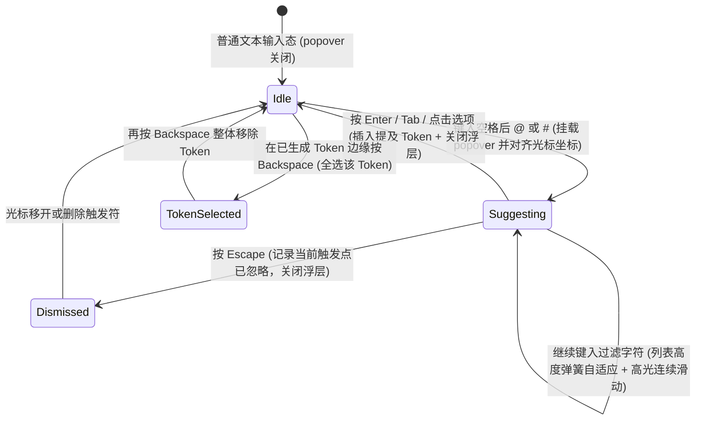

# Mention Input · 富交互提及输入框

基于真实原生 `<textarea>` 与 1:1 同步背景镜像层（Backdrop Mirror）构建的 `@人物` 与 `#频道` 提及输入组件。在完全保留浏览器原生输入法合成、选区与撤销栈（Undo）的前提下，实现正文中提及胶囊高亮与跟随光标坐标的建议浮层。涵盖四大核心机制：

1. 透明文本域与背景镜像高亮（Transparent Textarea & Backdrop Mirror）：上层 `<textarea>` 设为文字透明（`color: transparent; caret-color: var(--foreground)`）处理全部编辑行为；下层 `.mention-input-backdrop` 共享完全一致的字体与折行度量，将已识别的提及区间包裹为带底色的 `.mention-input-token`（区分 `data-kind="person|channel"`），并在触发词起始处插入隐形 `<span data-anchor>` 供精确测量光标像素坐标。
2. 光标坐标跟随与自适应高度浮层（Caret-Anchored Adaptive Popover）：输入 `@` 或 `#` 触发检索时，`.mention-input-popover` 读取 `data-anchor` 的 `offsetLeft`/`offsetTop` 定位在触发词正下方（底部空间不足时自动翻转至上方 `data-above`），浮层高度通过 `ResizeObserver` 监听内部列表高度并平滑弹簧伸缩。
3. 列表重建下的连续滑动高光（Continuous Gliding Highlight Across Rebuilds）：当用户继续输入过滤字符导致候选列表 DOM 重建时，`.mention-input-highlight` 继承重建前的 `translateY` 与 `height` 状态，平滑滑向新列表的第一项，消除列表刷新时的闪烁跳变。
4. 原子化提及选区与两步退格（Atomic Token Selection & Backspace）：当光标尝试移入已生成的提及词内部时自动跳至词首或词尾；在提及词末尾按 `Backspace` 时，第一步先将该提及词完整选中高亮，再按一次才整体删除。

## 原型清单

| 原型分组 | 原型元素 | 动效 / 状态变化 | 去向 |
| --- | --- | --- | --- |
| 社交发布器舞台 | 根容器 `.mention-input-root` | 相对定位基准，挂载输入区与建议浮层 | 最小 DOM |
| 社交发布器舞台 | 自适应高度字段框 `.mention-input-field` | 聚焦边框高亮，高度随文本折行（1～5 行）平滑弹簧过渡 | 透明文本域与背景镜像高亮 |
| 社交发布器舞台 | 背景镜像层 `.mention-input-backdrop` | 同步滚动偏移 `translateY(-scrollTop)`，渲染 `.mention-input-token` 与定位锚点 | 透明文本域与背景镜像高亮 |
| 社交发布器舞台 | 透明文本域 `.mention-input-textarea` | `role="combobox"`，承载原生光标、选区、IME 合成与原子化跳过逻辑 | 原子化提及选区与两步退格 |
| 社交发布器舞台 | 建议浮层 `.mention-input-popover` | 跟随 `@`/`#` 坐标以 `translateY(±4px) scale(0.96)` 出入场，高度平滑自适应 | 光标坐标跟随与自适应高度浮层 |
| 社交发布器舞台 | 选项列表与滑动高光 `.mention-input-list` / `.mention-input-highlight` | 渲染头像/频道图标与匹配高亮 `<mark>`，高光胶囊跨过滤重建连续滑动 | 列表重建下的连续滑动高光 |
| 社交发布器舞台 | 读屏实时计数 `[aria-live="polite"]` | 播报当前匹配的候选人或频道数量 | 无障碍与无动画 |
| — | 底部演示工具栏（`@`/`#` 快捷按钮、通知人数提示、`Post` 按钮）与 `#themeBtn` | 演示外壳 | 演示外壳，已删除 |

## 适用

- 团队协作评论框、工单讨论区、社交动态发布器、AI Prompt 模板变量引用（`@文件` / `#上下文`）。
- 需要轻量级富文本标记高亮，但拒绝引入重量级 ContentEditable 富文本编辑器框架的场景。

## 不适用

- 独立于正文之外的纯标签胶囊集合输入 → [tag-input](tag-input.md)
- 无提及语法的普通多行文本域 → [textarea](../text-fields/textarea.md)
- 顶部搜索框下拉建议 → [expanding-search](../text-fields/expanding-search.md)

## 状态机



| 状态 | 进入条件 | 视觉表现 | 退出到 |
| --- | --- | --- | --- |
| Idle | 常规打字或未触发 `@`/`#` | 镜像层渲染普通文本与已有 `.mention-input-token`，无浮层 | Suggesting / TokenSelected |
| Suggesting | 光标前存在合法 `@query` 或 `#query` | 锚点下方弹出 `.mention-input-popover`，随输入实时过滤并伸缩高度 | Idle / Dismissed |
| Dismissed | 浮层打开时按 `Escape` | 浮层以 `scale(0.96)` 淡出，同一触发位置不再自动弹出 | Idle |
| TokenSelected | 在提及词末尾按 `Backspace` | 原生选区自动扩展覆盖整个 `@Name` 词组，准备整体删除 | Idle |

## 动效参数

| 机制 | 属性 / 技术 | 持续时间 / 参数 | 缓动函数 | 说明 |
| --- | --- | --- | --- | --- |
| 输入框多行高度自适应 | `height` (`.mention-input-field`) | 240ms | `cubic-bezier(.22,1,.36,1)` | 在 `minRows` (1) 与 `maxRows` (5) 之间平滑伸缩 |
| 建议浮层入场 | `opacity`, `transform: translateY(±4px) scale(0.96)` | 260ms | `cubic-bezier(.16,1,.3,1)` | 以触发字符左侧 `14px` 为 `transform-origin` 弹出 |
| 建议浮层退场 | `opacity`, `transform: translateY(±4px) scale(0.96)` | 126ms | `cubic-bezier(.22,1,.36,1)` | 快速收缩卸载 |
| 浮层高度自适应 | `height` (`.mention-input-popover`) | 220ms | `cubic-bezier(.22,1,.36,1)` | 候选数量变化时平滑过渡面板高度 |
| 选项高光滑动 | `transform: translateY(...)`, `height` | 300ms (微弹性 `bounce: 0.1`) | `cubic-bezier(.16,1,.3,1)` | 键盘上下移动或列表过滤重建时连续滑行 |

## 变量契约

### 依赖的全局/主题变量

| 变量名 | 默认值（浅色） | 暗色值 | 作用 |
| --- | --- | --- | --- |
| `--radius-control` | `1.125rem` (18px) | `1.125rem` (18px) | 输入框与浮层圆角 |
| `--border` | `oklch(93.5% 0 0)` | `oklch(29% 0 0)` | 默认边框色 |
| `--border-strong` | `oklch(82% 0 0)` | `oklch(40% 0 0)` | 聚焦态边框色 |
| `--foreground` | `oklch(22% 0 0)` | `oklch(96% 0 0)` | 正文与光标颜色 |
| `--surface` | `oklch(100% 0 0)` | `oklch(21.5% 0 0)` | 输入框背景色 |
| `--surface-raised` | `oklch(100% 0 0)` | `oklch(24% 0 0)` | 建议浮层背景色 |
| `--accent-subtle` | `oklch(33% 0 0 / .1)` | `oklch(80% 0 0 / .13)` | `@人物` 提及胶囊背景色 |
| `--accent-strong` | `oklch(22% 0 0)` | `oklch(91% 0 0)` | `@人物` 提及胶囊文字色 |
| `--shadow-floating` | `0 20px 48px oklch(0% 0 0/.105)` | `0 22px 55px oklch(0% 0 0/.34)` | 建议浮层阴影 |

## 结构与语义

```html
<div class="mention-input-root" data-max-rows="5" data-max-suggestions="6">
  <div class="mention-input-field" style="height: 46px;">
    <div class="mention-input-backdrop" aria-hidden="true">&#8203;</div>
    <textarea
      class="mention-input-textarea"
      placeholder="Share an update, @ to mention"
      rows="1"
      spellcheck="true"
      role="combobox"
      aria-label="Write an update"
      aria-autocomplete="list"
      aria-haspopup="listbox"
      aria-expanded="false"
    ></textarea>
  </div>
  <span class="mention-input-sr-only" aria-live="polite"></span>
</div>
```

## 样式实现

```css
.mention-input-root {
  position: relative;
  width: 100%;
  color: var(--foreground, #1c1c1c);
}

.mention-input-field {
  position: relative;
  box-sizing: content-box;
  overflow: hidden;
  border: 1px solid var(--border, #ebebeb);
  border-radius: var(--radius-control, 18px);
  background: var(--surface, #ffffff);
  transition:
    border-color 160ms cubic-bezier(0.22, 1, 0.36, 1),
    height 220ms cubic-bezier(0.22, 1, 0.36, 1);
}

.mention-input-field[data-focused] {
  border-color: var(--border-strong, #d1d1d1);
}

/* 镜像层与真实文本域必须保持 100% 相同的字体与盒模型度量 */
.mention-input-backdrop,
.mention-input-textarea {
  box-sizing: border-box;
  width: 100%;
  margin: 0;
  padding: 11px 14px;
  border: 0;
  font: inherit;
  font-size: 1rem;
  line-height: 24px;
  overflow-wrap: break-word;
  white-space: pre-wrap;
  word-break: break-word;
  tab-size: 4;
}

.mention-input-backdrop {
  position: absolute;
  top: 0;
  left: 0;
  color: var(--foreground, #1c1c1c);
  pointer-events: none;
  will-change: transform;
}

.mention-input-textarea {
  position: absolute;
  inset: 0;
  height: 100%;
  display: block;
  resize: none;
  overflow-y: auto;
  background: transparent;
  color: transparent;
  -webkit-text-fill-color: transparent;
  caret-color: var(--foreground, #1c1c1c);
  outline: none;
  scrollbar-width: none;
}

.mention-input-textarea::-webkit-scrollbar {
  display: none;
}

.mention-input-textarea::placeholder {
  color: var(--text-muted, #717171);
  -webkit-text-fill-color: var(--text-muted, #717171);
  opacity: 1;
}

.mention-input-token {
  margin: 0 -3px;
  padding: 1px 3px;
  border-radius: 6px;
  background: var(--accent-subtle, rgba(0, 0, 0, 0.08));
  color: var(--accent-strong, #1c1c1c);
  box-decoration-break: clone;
  -webkit-box-decoration-break: clone;
}

.mention-input-token[data-kind="channel"] {
  background: color-mix(in oklab, var(--foreground, #1c1c1c) 7%, transparent);
  color: var(--foreground, #1c1c1c);
}

.mention-input-popover {
  position: absolute;
  z-index: 30;
  width: 272px;
  max-width: 100%;
  overflow: hidden;
  border: 1px solid var(--border, #ebebeb);
  border-radius: 18px;
  background: var(--surface-raised, #ffffff);
  box-shadow: 0 20px 48px rgba(0, 0, 0, 0.12);
  transition: height 220ms cubic-bezier(0.22, 1, 0.36, 1);
}

.mention-input-popover[data-above] {
  translate: 0 -100%;
}

.mention-input-popover-body {
  padding: 6px;
}

.mention-input-list {
  position: relative;
  display: grid;
  margin: 0;
  padding: 0;
  list-style: none;
}

.mention-input-highlight {
  position: absolute;
  top: 0;
  right: 0;
  left: 0;
  border-radius: 12px;
  background: color-mix(in oklab, var(--foreground, #1c1c1c) 6.5%, transparent);
  pointer-events: none;
  transition:
    transform 240ms cubic-bezier(0.16, 1, 0.3, 1),
    height 240ms cubic-bezier(0.16, 1, 0.3, 1);
}

.mention-input-option {
  position: relative;
  display: flex;
  min-width: 0;
  align-items: center;
  gap: 10px;
  padding: 7px 10px 7px 8px;
  border-radius: 12px;
  cursor: pointer;
  font-size: 0.875rem;
}

.mention-input-avatar {
  display: grid;
  width: 28px;
  height: 28px;
  flex: none;
  place-items: center;
  border-radius: 50%;
  background: var(--surface-muted, #f5f5f5);
  font-size: 0.75rem;
  font-weight: 500;
}

.mention-input-option-text {
  display: grid;
  min-width: 0;
  flex: 1;
}

.mention-input-option-label {
  overflow: hidden;
  font-weight: 500;
  text-overflow: ellipsis;
  white-space: nowrap;
}

.mention-input-option-meta {
  overflow: hidden;
  color: var(--text-muted, #717171);
  font-size: 0.75rem;
  text-overflow: ellipsis;
  white-space: nowrap;
}

.mention-input-sr-only {
  position: absolute;
  width: 1px;
  height: 1px;
  overflow: hidden;
  clip-path: inset(50%);
  white-space: nowrap;
}

@media (prefers-reduced-motion: reduce) {
  .mention-input-field,
  .mention-input-popover,
  .mention-input-highlight {
    transition: none !important;
  }
}
```

## 交互实现

```javascript
const DEFAULT_PEOPLE = [
  { id: 'maya', name: 'Maya Lin', role: 'Design Systems' },
  { id: 'liam', name: 'Liam Chen', role: 'Frontend Infrastructure' },
  { id: 'elena', name: 'Elena Rostova', role: 'Product Management' }
];

const DEFAULT_CHANNELS = [
  { id: 'release', name: 'release', description: 'Launch coordination' },
  { id: 'design', name: 'design-crit', description: 'UI reviews & motion' }
];

function findTrigger(text, caret, mentions) {
  for (let i = caret - 1; i >= 0 && i >= caret - 48; i--) {
    const ch = text[i];
    if (ch === '\n') return null;
    if (ch !== '@' && ch !== '#') continue;
    if (i > 0 && !/[\s([{"']/.test(text[i - 1])) return null;
    if (mentions.some(m => i >= m.start && i < m.end)) return null;
    const kind = ch === '@' ? 'person' : 'channel';
    const query = text.slice(i + 1, caret);
    const validShape = kind === 'person' ? /^[^\s@#]*( [^\s@#]*)?$/ : /^[^\s@#]*$/;
    return validShape.test(query) ? { kind, start: i, query } : null;
  }
  return null;
}

function reconcileMentions(prevText, prevMentions, nextText, caretHint) {
  let prefix = 0;
  const maxP = Math.min(prevText.length, nextText.length, Math.max(0, caretHint));
  while (prefix < maxP && prevText[prefix] === nextText[prefix]) prefix++;
  let suffix = 0;
  while (
    suffix < prevText.length - prefix &&
    suffix < nextText.length - prefix &&
    prevText[prevText.length - 1 - suffix] === nextText[nextText.length - 1 - suffix]
  ) {
    suffix++;
  }
  const oldEnd = prevText.length - suffix;
  const delta = nextText.length - prevText.length;
  return prevMentions
    .flatMap(m => {
      if (m.end <= prefix) return [m];
      if (m.start >= oldEnd) return [{ ...m, start: m.start + delta, end: m.end + delta }];
      return [];
    })
    .filter(m => nextText.slice(m.start, m.end) === (m.kind === 'person' ? '@' : '#') + m.label);
}

/**
 * 绑定富交互 @提及 / #频道输入框
 * @param {HTMLElement} rootEl - .mention-input-root 容器
 */
export function setupMentionInput(rootEl, { people = DEFAULT_PEOPLE, channels = DEFAULT_CHANNELS } = {}) {
  const area = rootEl.querySelector('.mention-input-textarea');
  const field = rootEl.querySelector('.mention-input-field');
  const backdrop = rootEl.querySelector('.mention-input-backdrop');
  const live = rootEl.querySelector('[aria-live]');

  let state = { text: '', mentions: [] };
  let lastCaret = 0;
  let caret = 0;
  let focused = false;
  let trigger = null;
  let suggestions = [];
  let active = 0;
  let dismissedStart = null;
  let open = false;
  let panel = null;
  let panelBody = null;
  let highlight = null;
  let pendingMention = null;
  const prefersReduced = window.matchMedia('(prefers-reduced-motion: reduce)').matches;

  function fitHeight() {
    const style = getComputedStyle(backdrop);
    const line = parseFloat(style.lineHeight) || 24;
    const pad = (parseFloat(style.paddingTop) || 11) + (parseFloat(style.paddingBottom) || 11);
    const minH = line * 1 + pad;
    const maxH = line * 5 + pad;
    const target = Math.min(maxH, Math.max(minH, backdrop.offsetHeight));
    field.style.height = `${target}px`;
  }

  function renderMirror() {
    const frag = document.createDocumentFragment();
    const markAt = open && trigger ? trigger.start : -1;

    function appendSlice(from, to) {
      if (markAt >= from && markAt < to) {
        const marker = document.createElement('span');
        marker.dataset.anchor = '';
        frag.append(state.text.slice(from, markAt), marker, state.text.slice(markAt, to));
      } else {
        frag.append(state.text.slice(from, to));
      }
    }

    let pos = 0;
    for (const m of state.mentions) {
      appendSlice(pos, m.start);
      const tok = document.createElement('span');
      tok.className = 'mention-input-token';
      tok.dataset.kind = m.kind;
      tok.textContent = state.text.slice(m.start, m.end);
      frag.append(tok);
      pos = m.end;
    }
    appendSlice(pos, state.text.length);
    frag.append('\u200b');
    backdrop.replaceChildren(frag);
    backdrop.style.transform = `translateY(${-area.scrollTop}px)`;
    fitHeight();
  }

  function placePopover() {
    const marker = backdrop.querySelector('[data-anchor]');
    if (!panel || !marker) return;
    const line = 24;
    const x = Math.max(0, Math.min(field.offsetLeft + marker.offsetLeft - 10, rootEl.offsetWidth - 272));
    const top = field.offsetTop + marker.offsetTop - area.scrollTop;
    panel.style.left = `${x}px`;
    panel.style.top = `${top + line + 6}px`;
  }

  function syncActiveHighlight() {
    if (!panelBody) return;
    const rows = [...panelBody.querySelectorAll('[role="option"]')];
    rows.forEach((r, idx) => r.setAttribute('aria-selected', String(idx === active)));
    const current = rows[active];
    if (current && highlight) {
      highlight.style.transform = `translateY(${current.offsetTop}px)`;
      highlight.style.height = `${current.offsetHeight}px`;
      area.setAttribute('aria-activedescendant', current.id);
    }
  }

  function renderPopover() {
    if (!open) {
      if (panel) {
        const closingPanel = panel;
        panel = panelBody = highlight = null;
        if (!prefersReduced) {
          const outAnim = closingPanel.animate(
            [{ opacity: 1, transform: 'none' }, { opacity: 0, transform: 'translateY(-4px) scale(0.96)' }],
            { duration: 140, easing: 'cubic-bezier(0.4, 0, 1, 1)' }
          );
          outAnim.onfinish = () => closingPanel.remove();
        } else {
          closingPanel.remove();
        }
      }
      return;
    }
    if (!panel) {
      panel = document.createElement('div');
      panel.className = 'mention-input-popover';
      panelBody = document.createElement('div');
      panelBody.className = 'mention-input-popover-body';
      panel.append(panelBody);
      panel.addEventListener('mousedown', e => e.preventDefault());
      rootEl.append(panel);
      if (!prefersReduced) {
        panel.animate(
          [{ opacity: 0, transform: 'translateY(-4px) scale(0.96)' }, { opacity: 1, transform: 'none' }],
          { duration: 220, easing: 'cubic-bezier(0.16, 1, 0.3, 1)' }
        );
      }
    }

    panelBody.innerHTML = '';
    if (suggestions.length > 0) {
      const ul = document.createElement('ul');
      ul.className = 'mention-input-list';
      ul.id = 'mention-native-list';
      ul.setAttribute('role', 'listbox');
      highlight = document.createElement('li');
      highlight.className = 'mention-input-highlight';
      highlight.setAttribute('aria-hidden', 'true');
      ul.append(highlight);

      suggestions.forEach((s, idx) => {
        const li = document.createElement('li');
        li.className = 'mention-input-option';
        li.id = `mention-opt-${idx}`;
        li.dataset.index = String(idx);
        li.setAttribute('role', 'option');
        li.innerHTML = `
          <span class="mention-input-avatar" aria-hidden="true">${s.kind === 'person' ? s.item.name[0] : '#'}</span>
          <span class="mention-input-option-text">
            <span class="mention-input-option-label">${s.item.name}</span>
            <span class="mention-input-option-meta">${s.item.role || s.item.description || ''}</span>
          </span>
        `;
        li.addEventListener('pointermove', () => {
          if (active !== idx) {
            active = idx;
            syncActiveHighlight();
          }
        });
        li.addEventListener('click', () => chooseSuggestion(s));
        ul.append(li);
      });
      panelBody.append(ul);
    } else {
      const empty = document.createElement('p');
      empty.className = 'mention-input-empty';
      empty.textContent = `No matches for "${trigger.query}"`;
      panelBody.append(empty);
    }

    panel.style.height = `${panelBody.offsetHeight}px`;
    placePopover();
    syncActiveHighlight();
  }

  function update() {
    trigger = caret === null ? null : findTrigger(state.text, caret, state.mentions);
    if (dismissedStart !== null && trigger?.start !== dismissedStart) dismissedStart = null;
    const q = trigger?.query.toLowerCase().trim() || '';
    const pool = trigger?.kind === 'person' ? people : channels;
    suggestions = trigger
      ? pool
          .filter(item => !q || item.name.toLowerCase().includes(q))
          .map(item => ({ kind: trigger.kind, item }))
      : [];
    active = Math.min(active, Math.max(0, suggestions.length - 1));
    open = focused && Boolean(trigger) && trigger.start !== dismissedStart && suggestions.length > 0;

    area.setAttribute('aria-expanded', String(open));
    if (live) live.textContent = open ? `${suggestions.length} suggestions` : '';
    renderMirror();
    renderPopover();
  }

  function chooseSuggestion(s) {
    if (!s || !trigger) return;
    const prefixSym = s.kind === 'person' ? '@' : '#';
    const tokenStr = `${prefixSym}${s.item.name}`;
    const from = trigger.start;
    const to = caret;
    pendingMention = { kind: s.kind, id: s.item.id, label: s.item.name, start: from, end: from + tokenStr.length };

    const inserted = `${tokenStr} `;
    area.value = state.text.slice(0, from) + inserted + state.text.slice(to);
    const nextCaret = from + inserted.length;
    area.setSelectionRange(nextCaret, nextCaret);
    onInput();
  }

  function onInput() {
    const nextText = area.value;
    const nextMentions = reconcileMentions(state.text, state.mentions, nextText, lastCaret);
    if (pendingMention) {
      nextMentions.push(pendingMention);
      pendingMention = null;
    }
    nextMentions.sort((a, b) => a.start - b.start);
    state = { text: nextText, mentions: nextMentions };
    lastCaret = area.selectionStart;
    caret = area.selectionStart;
    update();
  }

  area.addEventListener('focus', () => {
    focused = true;
    field.dataset.focused = 'true';
    caret = area.selectionStart;
    update();
  });

  area.addEventListener('blur', () => {
    focused = false;
    delete field.dataset.focused;
    update();
  });

  area.addEventListener('input', onInput);

  area.addEventListener('keydown', e => {
    lastCaret = area.selectionStart;
    if (open) {
      if (e.key === 'ArrowDown' || e.key === 'ArrowUp') {
        e.preventDefault();
        const step = e.key === 'ArrowDown' ? 1 : -1;
        active = (active + step + suggestions.length) % suggestions.length;
        syncActiveHighlight();
        return;
      }
      if (e.key === 'Enter' || e.key === 'Tab') {
        e.preventDefault();
        chooseSuggestion(suggestions[active]);
        return;
      }
      if (e.key === 'Escape') {
        e.preventDefault();
        dismissedStart = trigger?.start ?? null;
        update();
        return;
      }
    }
    // 原子化两步退格：在提及词末尾按 Backspace 先全选该词
    if (e.key === 'Backspace' && area.selectionStart === area.selectionEnd) {
      const pos = area.selectionStart;
      const hit = state.mentions.find(m => pos > m.start && pos <= m.end);
      if (hit) {
        e.preventDefault();
        area.setSelectionRange(hit.start, hit.end);
      }
    }
  });

  update();

  return { chooseSuggestion, getState: () => state };
}
```

## 无障碍与无动画

1. **Combobox 角色与虚拟焦点（`aria-activedescendant`）**：
   - `<textarea>` 声明 `role="combobox"`、`aria-autocomplete="list"` 与 `aria-haspopup="listbox"`。
   - 建议浮层弹出时真实焦点始终留在 `<textarea>` 中，上下方向键切换候选项时通过 `aria-activedescendant` 指向高亮项 ID，并通过 `[aria-live="polite"]` 通报候选数量。
2. **Reduced Motion 降级**：
   - 在 `prefers-reduced-motion: reduce` 下，跳过浮层弹出缩放、高度补间与高光胶囊滑动缓动。

## 踩坑与微调

1. **WebKit 透明文本颜色继承问题**：
   - 在 Safari/Chrome 中，仅设置 `color: transparent` 有时在选区或输入法下划线时仍会露出重影，必须同时加上 `-webkit-text-fill-color: transparent;`，并在 `::placeholder` 上显式重置 `-webkit-text-fill-color: var(--text-muted)`。
2. **跨行提及胶囊的圆角断裂**：
   - 当一个较长的 `@Maya Lin` 恰好在行尾折成两行时，普通背景框在折行处会变成直角切口。在 `.mention-input-token` 上声明 `box-decoration-break: clone; -webkit-box-decoration-break: clone;` 可确保折行后的每一段都拥有完整的圆角与内边距。

## 验收清单

- [x] 原生 `<textarea>` 透明叠加于 `.mention-input-backdrop` 之上，度量 100% 同步。
- [x] 镜像层内置 `<span data-anchor>` 精确测量 `@`/`#` 触发字符的像素坐标以对齐浮层。
- [x] 选择候选项后自动插入提及文本并在镜像层渲染 `.mention-input-token` 高亮胶囊。
- [x] 浮层支持键盘上下导航、回车/Tab 上屏与 Escape 关闭。
- [x] 在已生成提及词末尾按 `Backspace` 先全选该提及词，再按一次整体删除。
- [x] 完整支持多行高度自适应与 `prefers-reduced-motion` 降级。
