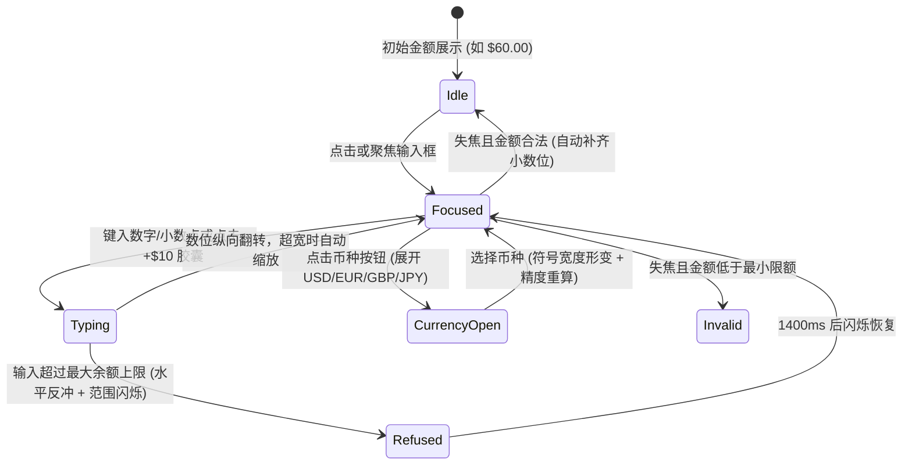

# Money Input · 货币金额输入框

支持最小货币单位（Minor Units）精确换算、千分位与小数幽灵占位镜像、币种动态切换与自适应缩放的金融级金额输入组件。涵盖四大核心机制：

1. 镜像字符列与小数幽灵占位（Mirror Columns & Ghost Fraction）：真实 `<input>` 透明覆盖并保留原生光标与千分位跳过退格；下方 `.money-input-mirror` 按位权渲染字符列，未输入的小数位以 `data-ghost` 半透明预占位，数值变动时变更位沿纵向 `translateY(±0.55em) + blur(4px)` 翻转。
2. 货币符号宽度补间与超宽自适应缩放（Symbol Width Morph & Auto-Fit Scale）：切换币种（如 USD `$`、EUR `€`、JPY `¥`）时，符号容器通过隐藏 `.money-input-symbol-sizer` 测量目标宽度并弹簧过渡；当输入大额数字超出可用宽度时，`.money-input-group` 自动按 `Math.min(1, available / size)` 平滑缩小字号比例。
3. 币种选择器与滑动高光（Currency Listbox & Gliding Highlight）：右侧币种按钮展开浮层菜单，箭头旋转 180°，内部选项高光胶囊通过 `translateY` 与 `height` 弹簧跟随指针/键盘。
4. 快捷加额胶囊与超限水平反冲（Quick-Add Chips & Limit Refusal Kick）：底部提供 `+$10`、`+$50` 等快捷加额按钮；当输入或加额超出账户上限时，金额组触发水平弹簧反冲（`kick`），且额度范围文本 `.money-input-range` 闪现琥珀警示色。

## 原型清单

| 原型分组 | 原型元素 | 动效 / 状态变化 | 去向 |
| --- | --- | --- | --- |
| 支付卡片舞台 | 字段容器 `.money-input-field` | 网格布局，承载金额控制框、快捷栏与提示槽 | 最小 DOM |
| 支付卡片舞台 | 金额控制框 `.money-input-control` | 76px 高度大尺寸面板，响应悬停、`data-focused` 与 `data-invalid` 边框色 | 样式实现 |
| 支付卡片舞台 | 金额缩放组 `.money-input-group` | 超出容器宽度时自动 `scale(...)` 缩小；越界时水平弹簧反冲 | 货币符号宽度补间与超宽自适应缩放 |
| 支付卡片舞台 | 货币符号 `.money-input-symbol` | 切换币种时宽度弹簧补间，字符纵向微模糊翻转 | 货币符号宽度补间与超宽自适应缩放 |
| 支付卡片舞台 | 镜像数位列 `.money-input-mirror` / `.money-input-column` | 整数位、千分位逗号与 `data-ghost` 幽灵小数位按位翻转 | 镜像字符列与小数幽灵占位 |
| 支付卡片舞台 | 透明输入框 `.money-input-input` | `role="spinbutton"`，处理光标映射、千分位退格穿透与粘贴清洗 | 交互实现 |
| 支付卡片舞台 | 币种切换按钮与浮层 `.money-input-currency-button` / `.money-input-menu` | 展开/收起币种列表，同步切换小数精度（如 JPY 0 位小数） | 币种选择器与滑动高光 |
| 支付卡片舞台 | 快捷加额栏 `.money-input-toolbar` / `.money-input-chip` | 点击累加对应额度，按下缩放 `scale(0.96)`，达上限时置灰 | 快捷加额胶囊与超限水平反冲 |
| 支付卡片舞台 | 额度范围提示 `.money-input-range` | 越界拦截时触发 `data-flash="true"` 琥珀色高亮 1400ms | 快捷加额胶囊与超限水平反冲 |
| 支付卡片舞台 | 消息提示插槽 `.money-input-message-slot` | 失焦校验失败时切换为错误提示并自适应高度 | 交互实现 |
| — | 外层支付演示卡片 `header`（头像/收款人）与底部 `Pay` 按钮 | 演示外壳 | 演示外壳，已删除 |
| — | 顶栏独立主题切换器 `#themeBtn` | 演示外壳 | 演示外壳，已删除 |

## 适用

- 转账汇款、充值提现、打赏捐赠、报价出价、预算设定等对金额精度与多币种格式有严格要求的场景。
- 需要大字号高视觉冲击力展示金额，同时兼顾快捷加额与键入体验的金融表单。

## 不适用

- 普通整数/小数步进调节（如人数、件数、字号） → [number-field](number-field.md)
- 国际电话号码与区号输入 → [phone-input](phone-input.md)
- 普通单行文本输入 → [input](../text-fields/input.md)

## 状态机



| 状态 | 进入条件 | 视觉表现 | 退出到 |
| --- | --- | --- | --- |
| Idle | 初始状态或合法失焦后 | 小数位补齐（如 `60.00`），无幽灵位，边框为 `--border-strong` | Focused / CurrencyOpen |
| Focused | 输入框获得焦点 | 外壳标记 `data-focused`，边框变为 `--foreground`，显示原生光标 | Typing / Idle / Invalid |
| Typing | 键入或点击快捷胶囊 | 未填小数位呈半透明 `data-ghost`，变动数位沿增减方向纵向微模糊跳入 | Focused / Refused |
| Refused | 尝试输入或累加超过上限 | 拒绝写入，`.money-input-group` 水平反冲，`range` 闪现 `--warning` | Focused |
| CurrencyOpen | 点击右侧币种按钮 | 弹出 `.money-input-menu`，选中新币种后符号宽度与小数精度同步切换 | Focused / Idle |
| Invalid | 失焦后金额小于最小限额 | 外壳标记 `data-invalid`，边框变红，底部提示槽切换为 `role="alert"` | Focused |

## 动效参数

| 机制 | 属性 / 技术 | 持续时间 / 参数 | 缓动函数 | 说明 |
| --- | --- | --- | --- | --- |
| 数位变更翻转 | `opacity`, `transform: translateY(±0.55em)`, `filter: blur(4px)` | 260ms | `cubic-bezier(.22,1,.36,1)` | 金额增大从下往上翻入，减小从上往下翻入 |
| 货币符号切换 | `width` 弹簧 + 字符 `translateY(0.4em) + blur(4px)` | 260ms | `cubic-bezier(.16,1,.3,1)` | 适应 `$` 与 `¥`/`€` 的不同字宽 |
| 超宽自适应缩放 | `transform: scale(...)` (`transform-origin: 0 50%`) | 240ms | `cubic-bezier(.22,1,.36,1)` | 保持长数字完整显示在框内不截断 |
| 越界水平反冲 | `transform: translateX` | 280ms | 弹簧衰减复位 | 超出上限时给出弹性阻拦反馈 |
| 币种菜单出入场 | `opacity`, `transform: translateY(-2px) scale(0.97)`, `filter: blur(2px)` | 入场 220ms / 退场 120ms | `cubic-bezier(.22,1,.36,1)` | 浮层缩放微模糊过渡 |
| 快捷胶囊按压 | `transform: scale(0.96)` | 按下 100ms / 释放 580ms | `--ease-spring` | 物理弹性按压反馈 |

## 变量契约

### 依赖的全局/主题变量

| 变量名 | 默认值（浅色） | 暗色值 | 作用 |
| --- | --- | --- | --- |
| `--radius-panel` | `1.625rem` (26px) | `1.625rem` (26px) | 金额主控制框与下拉菜单圆角 |
| `--radius-pill` | `9999px` | `9999px` | 币种按钮与快捷加额胶囊圆角 |
| `--text-3xl` | `2.25rem` (36px) | `2.25rem` (36px) | 金额大号展示字号 |
| `--border-strong` | `oklch(82% 0 0)` | `oklch(40% 0 0)` | 静态边框色 |
| `--foreground` | `oklch(22% 0 0)` | `oklch(96% 0 0)` | 金额主色与激活边框色 |
| `--text-muted` | `oklch(59% 0 0)` | `oklch(64% 0 0)` | 幽灵位基色与说明文字色 |
| `--warning` | `oklch(58% .18 75)` | `oklch(83% .17 80)` | 超限闪烁警示色 |
| `--danger` | `oklch(54% .21 25)` | `oklch(76% .2 25)` | 校验失败边框与错误文本色 |

### 组件私有变量

| 变量名 | 默认值 | 作用 |
| --- | --- | --- |
| `--money-input-height` | `76px` | 金额控制框总高度 |
| `--feather` | `0.18em` | 数位列上下边缘渐变遮罩羽化距离 |

## 结构与语义

```html
<div class="money-input-field">
  <label for="money-amount" class="money-input-label">Amount</label>
  <div class="money-input-control">
    <div class="money-input-amount-wrap">
      <div class="money-input-group">
        <span class="money-input-symbol" aria-hidden="true">
          <span class="money-input-symbol-sizer">$</span>
          <span class="money-input-symbol-glyph">$</span>
        </span>
        <span class="money-input-number">
          <span class="money-input-mirror" aria-hidden="true"></span>
          <input
            id="money-amount"
            class="money-input-input"
            type="text"
            role="spinbutton"
            inputmode="decimal"
            autocomplete="off"
            spellcheck="false"
            aria-describedby="money-range money-hint"
            aria-valuenow="60"
            aria-valuetext="$60.00"
            aria-valuemin="1"
            aria-valuemax="2480"
            value="60.00"
          />
        </span>
      </div>
    </div>
    <div class="money-input-menu-anchor">
      <button
        type="button"
        class="money-input-currency-button"
        aria-haspopup="listbox"
        aria-expanded="false"
        aria-controls="money-currencies"
        aria-label="Currency, US Dollar"
      >
        <span class="money-input-code">USD</span>
        <span class="money-input-chevron" aria-hidden="true">
          <svg width="16" height="16" viewBox="0 0 24 24" fill="none" stroke="currentColor" stroke-width="1.75" stroke-linecap="round" stroke-linejoin="round">
            <path d="m6 9 6 6 6-6" />
          </svg>
        </span>
      </button>
    </div>
  </div>

  <div class="money-input-toolbar">
    <div class="money-input-chips" role="group" aria-label="Quick add">
      <button type="button" class="money-input-chip" data-add="10">+$10</button>
      <button type="button" class="money-input-chip" data-add="50">+$50</button>
      <button type="button" class="money-input-chip" data-add="100">+$100</button>
    </div>
    <span id="money-range" class="money-input-range">$1.00 to $2,480.00</span>
  </div>

  <span class="money-input-message-slot">
    <span id="money-hint" class="money-input-hint">Arrow keys step by 1, Shift by 10</span>
  </span>
  <input type="hidden" name="amount" value="6000" />
  <span class="money-input-sr-only" role="status" aria-live="polite"></span>
</div>
```

## 样式实现

```css
.money-input-field {
  display: grid;
  min-width: 0;
}

.money-input-label {
  justify-self: start;
  margin-bottom: 0.5rem;
  color: var(--foreground, #1c1c1c);
  font-size: 0.875rem;
  font-weight: 500;
}

.money-input-control {
  position: relative;
  display: flex;
  min-width: 0;
  height: var(--money-input-height, 76px);
  box-sizing: border-box;
  align-items: center;
  gap: 0.5rem;
  padding: 0 8px 0 18px;
  border: 1px solid var(--border-strong, #d1d1d1);
  border-radius: var(--radius-panel, 26px);
  background: var(--surface, #ffffff);
  transition: border-color 160ms cubic-bezier(0.22, 1, 0.36, 1);
}

.money-input-control[data-focused] {
  border-color: var(--foreground, #1c1c1c);
}

.money-input-control[data-invalid] {
  border-color: var(--danger, #e53e3e);
}

.money-input-amount-wrap {
  position: relative;
  display: flex;
  min-width: 0;
  height: 100%;
  flex: 1;
  align-items: center;
  overflow: hidden;
  cursor: text;
}

.money-input-group {
  display: inline-flex;
  flex: none;
  align-items: baseline;
  transform-origin: 0 50%;
  white-space: nowrap;
  color: var(--foreground, #1c1c1c);
  font-size: var(--text-3xl, 2.25rem);
  font-weight: 500;
  line-height: 1.2;
  letter-spacing: -0.03em;
  font-variant-numeric: tabular-nums;
  transition: transform 200ms cubic-bezier(0.22, 1, 0.36, 1);
}

.money-input-symbol {
  position: relative;
  display: inline-block;
  margin-right: 0.06em;
  color: var(--text-secondary, #525252);
  white-space: pre;
  transition: width 240ms cubic-bezier(0.16, 1, 0.3, 1);
}

.money-input-symbol-sizer {
  position: absolute;
  top: 0;
  left: 0;
  visibility: hidden;
  white-space: pre;
}

.money-input-symbol-glyph {
  display: inline-block;
  white-space: pre;
}

.money-input-number {
  position: relative;
  display: inline-flex;
}

.money-input-mirror {
  display: inline-flex;
}

.money-input-input {
  position: absolute;
  z-index: 1;
  top: 0;
  left: 0;
  width: calc(100% + 0.5em);
  height: 100%;
  margin: 0;
  padding: 0;
  border: 0;
  background: transparent;
  color: transparent;
  caret-color: var(--foreground, #1c1c1c);
  font: inherit;
  font-variant-numeric: inherit;
  letter-spacing: inherit;
  line-height: inherit;
  outline: none;
}

.money-input-column {
  --feather: 0.18em;
  position: relative;
  display: inline-block;
  overflow-y: clip;
  margin-block: calc(var(--feather) * -1);
  padding-block: var(--feather);
  transition: color 240ms cubic-bezier(0.22, 1, 0.36, 1);
}

.money-input-column[data-ghost] {
  color: color-mix(in oklab, var(--text-muted, #717171) 55%, transparent);
}

.money-input-sizer {
  visibility: hidden;
  white-space: pre;
}

.money-input-glyph {
  position: absolute;
  inset: var(--feather) 0;
  text-align: center;
  white-space: pre;
}

.money-input-menu-anchor {
  position: relative;
  flex: none;
}

.money-input-currency-button {
  display: inline-flex;
  height: 36px;
  align-items: center;
  gap: 4px;
  padding: 0 8px 0 12px;
  border: 0;
  border-radius: 9999px;
  background: transparent;
  color: var(--foreground, #1c1c1c);
  cursor: pointer;
  font: inherit;
  font-size: 0.875rem;
  font-weight: 500;
}

.money-input-currency-button:hover {
  background: var(--surface-muted, #f5f5f5);
}

.money-input-menu {
  position: absolute;
  z-index: 30;
  top: calc(100% + 24px);
  right: -8px;
  width: 240px;
  padding: 6px;
  border: 1px solid var(--border, #ebebeb);
  border-radius: var(--radius-panel, 26px);
  background: var(--surface, #ffffff);
  box-shadow: 0 20px 48px rgba(0, 0, 0, 0.12);
}

.money-input-option {
  display: flex;
  min-height: 36px;
  align-items: center;
  gap: 10px;
  padding: 0 10px;
  border-radius: 14px;
  cursor: pointer;
  font-size: 0.875rem;
}

.money-input-option:hover,
.money-input-option[aria-selected="true"] {
  background: var(--surface-muted, #f5f5f5);
}

.money-input-toolbar {
  display: flex;
  flex-wrap: wrap;
  align-items: center;
  justify-content: space-between;
  gap: 0.5rem 0.75rem;
  padding-top: 0.75rem;
}

.money-input-chips {
  display: flex;
  gap: 6px;
}

.money-input-chip {
  height: 30px;
  padding: 0 12px;
  border: 1px solid var(--border, #ebebeb);
  border-radius: 9999px;
  background: var(--surface, #ffffff);
  color: var(--text-secondary, #525252);
  cursor: pointer;
  font-size: 0.75rem;
  font-weight: 500;
  transition: transform 100ms cubic-bezier(0.22, 1, 0.36, 1);
}

.money-input-chip:active {
  transform: scale(0.96);
}

.money-input-range {
  color: var(--text-muted, #717171);
  font-size: 0.75rem;
  font-variant-numeric: tabular-nums;
  transition: color 240ms cubic-bezier(0.22, 1, 0.36, 1);
}

.money-input-range[data-flash] {
  color: var(--warning, #d97706);
}

.money-input-hint {
  display: block;
  padding-top: 0.5rem;
  font-size: 0.75rem;
  color: var(--text-muted, #717171);
}

.money-input-error {
  display: block;
  padding-top: 0.5rem;
  font-size: 0.75rem;
  color: var(--danger, #e53e3e);
}

.money-input-sr-only {
  position: absolute;
  width: 1px;
  height: 1px;
  overflow: hidden;
  clip-path: inset(50%);
  white-space: nowrap;
}

@media (prefers-reduced-motion: reduce) {
  .money-input-group,
  .money-input-symbol,
  .money-input-chip {
    transition: none !important;
  }
}
```

## 交互实现

```javascript
/**
 * 绑定货币金额输入框
 * @param {HTMLElement} fieldEl - .money-input-field 元素
 */
export function setupMoneyInput(fieldEl) {
  const input = fieldEl.querySelector('.money-input-input');
  const control = fieldEl.querySelector('.money-input-control');
  const group = fieldEl.querySelector('.money-input-group');
  const wrap = fieldEl.querySelector('.money-input-amount-wrap');
  const mirror = fieldEl.querySelector('.money-input-mirror');
  const symbol = fieldEl.querySelector('.money-input-symbol');
  const symbolSizer = symbol.querySelector('.money-input-symbol-sizer');
  const symbolGlyph = symbol.querySelector('.money-input-symbol-glyph');
  const currencyBtn = fieldEl.querySelector('.money-input-currency-button');
  const anchor = fieldEl.querySelector('.money-input-menu-anchor');
  const chipsContainer = fieldEl.querySelector('.money-input-chips');
  const rangeEl = fieldEl.querySelector('.money-input-range');
  const hiddenInput = fieldEl.querySelector('input[type="hidden"]');

  const currencies = {
    USD: { symbol: '$', digits: 2, maxMinor: 248000, minMinor: 100, adds: [10, 50, 100] },
    EUR: { symbol: '€', digits: 2, maxMinor: 112050, minMinor: 100, adds: [10, 50, 100] },
    JPY: { symbol: '¥', digits: 0, maxMinor: 88000, minMinor: 100, adds: [1000, 5000] }
  };

  let code = 'USD';
  let draft = '60.00';
  let minor = 6000;
  let focused = false;
  let menu = null;
  const columns = new Map();
  const prefersReduced = window.matchMedia('(prefers-reduced-motion: reduce)').matches;

  function toMinor(val, digits = currencies[code].digits) {
    if (!val) return null;
    const [whole, frac = ''] = val.split('.');
    return Number(whole || 0) * Math.pow(10, digits) + Number(frac.padEnd(digits, '0').slice(0, digits) || 0);
  }

  function fromMinor(val, digits = currencies[code].digits) {
    if (val === null) return '';
    const str = String(Math.round(Math.abs(val))).padStart(digits + 1, '0');
    return digits ? str.slice(0, -digits) + '.' + str.slice(-digits) : str;
  }

  function formatDisplay() {
    if (!draft) return '';
    const [whole, frac] = draft.split('.');
    const grouped = whole.replace(/\B(?=(\d{3})+(?!\d))/g, ',');
    return frac === undefined ? grouped : `${grouped}.${frac}`;
  }

  function paintMirror(instant = false, direction = 1) {
    const cfg = currencies[code];
    const [whole = '', frac] = draft ? draft.split('.') : [];
    const text = whole || '0';
    const parts = [];

    [...text].forEach((ch, idx) => {
      const place = text.length - 1 - idx;
      parts.push({ key: 'i' + place, char: ch, ghost: !whole });
      if (place > 0 && place % 3 === 0) {
        parts.push({ key: 'g' + place, char: ',', ghost: !whole });
      }
    });

    if (cfg.digits > 0) {
      parts.push({ key: 'd', char: '.', ghost: frac === undefined });
      for (let i = 0; i < cfg.digits; i++) {
        parts.push({
          key: 'f' + i,
          char: frac?.[i] ?? '0',
          ghost: frac === undefined || i >= frac.length
        });
      }
    }

    for (const part of parts) {
      let col = columns.get(part.key);
      if (!col) {
        const node = document.createElement('span');
        node.className = 'money-input-column';
        const sizer = document.createElement('span');
        sizer.className = 'money-input-sizer';
        sizer.textContent = part.char;
        const glyph = document.createElement('span');
        glyph.className = 'money-input-glyph';
        glyph.textContent = part.char;
        node.append(sizer, glyph);
        col = { node, char: part.char };
        columns.set(part.key, col);
      }
      if (col.char !== part.char) {
        col.node.firstElementChild.textContent = part.char;
        col.node.lastElementChild.textContent = part.char;
        if (!instant && !prefersReduced) {
          col.node.lastElementChild.animate(
            [
              { opacity: 0, transform: `translateY(${direction * 0.55}em)`, filter: 'blur(4px)' },
              { opacity: 1, transform: 'translateY(0)', filter: 'none' }
            ],
            { duration: 260, easing: 'cubic-bezier(0.22, 1, 0.36, 1)' }
          );
        }
      }
      col.char = part.char;
      col.node.toggleAttribute('data-ghost', part.ghost);
      mirror.append(col.node);
    }

    for (const [k, col] of columns) {
      if (!parts.some(p => p.key === k)) {
        columns.delete(k);
        col.node.remove();
      }
    }

    // 超宽自动缩放
    const avail = wrap.clientWidth;
    const needed = group.offsetWidth;
    if (avail && needed) {
      const ratio = Math.min(1, avail / needed);
      group.style.transform = ratio < 1 ? `scale(${ratio})` : 'none';
    }
  }

  function refresh(instant = false, direction = 1) {
    const cfg = currencies[code];
    minor = toMinor(draft);
    input.value = formatDisplay();
    if (hiddenInput) hiddenInput.value = minor === null ? '' : String(minor);
    input.setAttribute('aria-valuenow', minor === null ? '0' : String(minor / Math.pow(10, cfg.digits)));

    currencyBtn.querySelector('.money-input-code').textContent = code;
    if (symbolSizer.textContent !== cfg.symbol) {
      symbolSizer.textContent = cfg.symbol;
      symbolGlyph.textContent = cfg.symbol;
      symbol.style.width = symbolSizer.offsetWidth + 'px';
    }

    paintMirror(instant, direction);
  }

  function refuse() {
    rangeEl.dataset.flash = 'true';
    setTimeout(() => delete rangeEl.dataset.flash, 1400);
    if (!prefersReduced) {
      group.animate(
        [
          { transform: 'translateX(0)' },
          { transform: 'translateX(6px)' },
          { transform: 'translateX(-4px)' },
          { transform: 'translateX(0)' }
        ],
        { duration: 280, easing: 'ease-out' }
      );
    }
  }

  function addMinor(deltaMinor) {
    const cfg = currencies[code];
    const from = minor ?? 0;
    let next = from + deltaMinor;
    if (next > cfg.maxMinor) {
      refuse();
      next = cfg.maxMinor;
    }
    draft = fromMinor(next);
    refresh(false, 1);
  }

  function selectCurrency(nextCode) {
    if (!currencies[nextCode]) return;
    code = nextCode;
    const cfg = currencies[code];
    const [whole = '0', frac] = draft.split('.');
    draft = cfg.digits === 0 ? whole : frac !== undefined ? `${whole}.${frac.slice(0, cfg.digits)}` : fromMinor(toMinor(whole));
    if (menu) {
      menu.remove();
      menu = null;
      currencyBtn.setAttribute('aria-expanded', 'false');
    }
    refresh(false, 1);
  }

  currencyBtn.addEventListener('click', () => {
    if (menu) {
      menu.remove();
      menu = null;
      currencyBtn.setAttribute('aria-expanded', 'false');
      return;
    }
    menu = document.createElement('div');
    menu.className = 'money-input-menu';
    menu.setAttribute('role', 'listbox');
    Object.keys(currencies).forEach(c => {
      const opt = document.createElement('div');
      opt.className = 'money-input-option';
      opt.dataset.code = c;
      opt.setAttribute('role', 'option');
      opt.setAttribute('aria-selected', String(c === code));
      opt.textContent = `${currencies[c].symbol} ${c}`;
      opt.addEventListener('click', () => selectCurrency(c));
      menu.append(opt);
    });
    anchor.append(menu);
    currencyBtn.setAttribute('aria-expanded', 'true');
  });

  chipsContainer.querySelectorAll('.money-input-chip').forEach(btn => {
    btn.addEventListener('click', () => {
      const addVal = Number(btn.dataset.add || 10);
      addMinor(addVal * Math.pow(10, currencies[code].digits));
    });
  });

  input.addEventListener('focus', () => {
    focused = true;
    control.dataset.focused = 'true';
  });

  input.addEventListener('blur', () => {
    focused = false;
    delete control.dataset.focused;
    draft = fromMinor(toMinor(draft));
    refresh();
  });

  input.addEventListener('input', () => {
    const cfg = currencies[code];
    const cleaned = input.value.replace(/[^\d.]/g, '');
    const [w = '', f] = cleaned.split('.');
    const nextDraft = cfg.digits && f !== undefined ? `${w}.${f.slice(0, cfg.digits)}` : w;
    const nextMinor = toMinor(nextDraft);
    if (nextMinor !== null && nextMinor > cfg.maxMinor) {
      refuse();
      input.value = formatDisplay();
      return;
    }
    const prev = minor ?? 0;
    draft = nextDraft;
    refresh(true, (nextMinor ?? 0) >= prev ? 1 : -1);
  });

  refresh(true);

  return { addMinor, selectCurrency, getMinor: () => minor };
}
```

## 无障碍与无动画

1. **双轨表单值与读屏支持**：
   - 视觉层使用千分位格式化字符串（如 `1,250.00`），同时维护 `<input type="hidden" name="amount">` 存储无浮点误差的最小整数单位（如美分 `125000`）。
   - `input` 声明 `role="spinbutton"`，实时更新 `aria-valuenow` 与自然语言 `aria-valuetext="$60.00"`。
2. **Reduced Motion 降级**：
   - 在 `prefers-reduced-motion: reduce` 下，禁用数位翻转模糊、符号宽度缓动与超限水平抖动，仅保留 `data-flash` 颜色警示。

## 踩坑与微调

1. **千分位逗号退格卡死问题**：
   - 当输入框显示 `1,000` 且光标位于逗号右侧时，普通 `Backspace` 会删掉逗号而数值不变，导致光标看似“卡住”。必须在 `keydown` 中拦截逗号处的 `Backspace`/`Delete`，直接跳过逗号删除前一位有效数字。
2. **字距微调导致光标错位**：
   - 真实透明 `<input>` 与下方 `.money-input-mirror` 必须共享完全一致的 `font-variant-numeric: tabular-nums` 与 `font-kerning: none`，否则多位数字后原生光标会与镜像字符发生偏移。

## 验收清单

- [x] 采用最小货币单位（minor units）整数存储，杜绝 IEEE 754 浮点数精度误差。
- [x] 镜像数位列支持未填小数位 `data-ghost` 半透明预占位。
- [x] 切换币种（如 USD → JPY）自动调整货币符号宽度与小数位数。
- [x] 快捷加额胶囊与输入越界时触发水平反冲与 `data-flash` 警示。
- [x] 大额数字超出容器宽度时自动按比例 `scale()` 缩放。
- [x] 完整支持 `prefers-reduced-motion` 降级。
