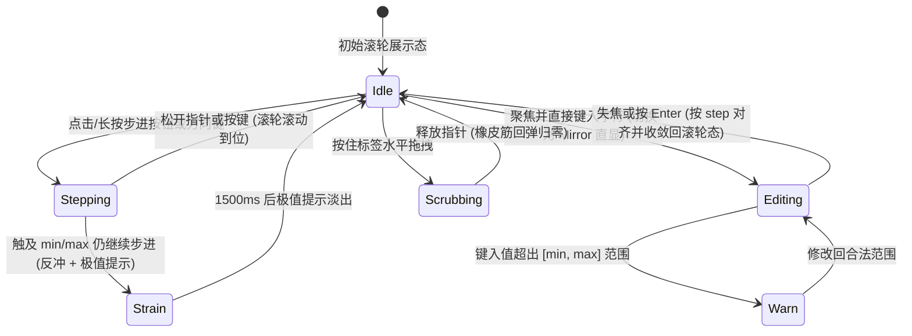

# Number Field · 数字步进输入框

集成分位数字滚轮（Odometer）、长按指数加速步进、标签横向拖拽微调（Scrubbing）与越界物理反冲的数值输入控件。涵盖四大核心机制：

1. 按位独立滚轮与动态位宽（Digit Odometer Columns & Width Morph）：每个数位对应独立的 0–9 循环滚轮列（`.number-field-column`），上下遮罩羽化（`mask-image`）；位数增减时新数位以 `scale(0.6) + blur(4px)` 入场，移除数位平滑收缩宽度至 0，同时整体数值组通过 FLIP 补偿位移防止居中跳动。
2. 长按指数级加速步进（Exponential Hold Acceleration）：按住加减按钮或上下方向键时，步进间隔按 `Math.max(40, 150 * 0.86^count)` 指数级缩短，实现从精细单步到快速连跳的顺滑手感。
3. 边界物理反冲与按钮微颤（Boundary Strain Kick & Shake）：触及 `min` 或 `max` 极值继续施力时，数值组沿纵向产生弹簧速度反冲（`kick`），对应步进按钮触发水平衰减微颤，并在顶部弹出 `Max/Min` 极值提示。
4. 标签拖拽微调与超界阻尼（Label Scrubbing & Rubberband）：支持按住带 `data-scrub` 的标签水平拖拽改值，超出极值后按对数阻尼公式产生橡皮筋拉伸位移。

## 原型清单

| 原型分组 | 原型元素 | 动效 / 状态变化 | 去向 |
| --- | --- | --- | --- |
| 官方数字框舞台 | 字段容器 `.number-field-field` | 支持 `data-size="sm\|md\|lg"` 三种尺寸变量契约 | 变量契约 |
| 官方数字框舞台 | 头部栏 `.number-field-head` / `.number-field-label` | 承载标题与动态挂载的极值提示 `.number-field-limit`；支持水平拖拽微调 | 标签拖拽微调与超界阻尼 |
| 官方数字框舞台 | 控制外壳 `.number-field-control` | 聚焦、悬停、越界警告（`data-warn`）与极值施力（`data-strain`）边框过渡 | 样式实现 |
| 官方数字框舞台 | 步进按钮 `.number-field-step` | 悬停发亮、按下图标缩小 `scale(0.82)`、长按指数加速、触界水平微颤 | 长按指数级加速步进 |
| 官方数字框舞台 | 数值包裹层 `.number-field-value` | 位数变化时 FLIP 横向平滑居中补偿；触界时纵向弹簧反冲 | 按位独立滚轮与动态位宽 |
| 官方数字框舞台 | 滚轮展示层 `.number-field-display` / `.number-field-column` | 展示态 0–9 独立滚轮滚动；直接键入时切换为 `.number-field-mirror` | 按位独立滚轮与动态位宽 |
| 官方数字框舞台 | 透明输入框 `.number-field-input` | `role="spinbutton"`，承载真实焦点、选区与光标，编辑态透明叠加 | 结构与语义 |
| 官方数字框舞台 | 前后缀容器 `.number-field-affix` | 动态复数后缀（如 `seat` / `seats`）跟随数值切换 | 交互实现 |
| 官方数字框舞台 | 消息提示插槽 `.number-field-message-slot` | 底部说明文案逐词微模糊更新与高度自适应 | 交互实现 |
| — | 顶栏独立主题切换器 `#themeBtn` 与 `.demo-status` | 演示外壳 | 演示外壳，已删除 |

## 适用

- 席位数量、许可证配额、商品购买数量、时长/字号调节等有明确上下界与步进增量的数值输入。
- 需要兼顾“点击/长按微调”与“直接键盘输入精确数字”的高频参数面板。

## 不适用

- 涉及币种切换、小数分位幽灵占位与金额上限拦截的支付输入 → [money-input](money-input.md)
- 电话号码或区号格式化输入 → [phone-input](phone-input.md)
- 普通文本或无加减步进诉求的编号输入 → [input](../text-fields/input.md)

## 状态机



| 状态 | 进入条件 | 视觉表现 | 退出到 |
| --- | --- | --- | --- |
| Idle | 初始或编辑提交后 | 显示滚轮列 `.number-field-display`，原生 input 文字透明 | Stepping / Editing / Scrubbing |
| Stepping | 点击/长按 `-`、`+` 或按上下键 | 滚轮列按方向滚动，长按时速度指数加快，按钮图标缩放至 `0.82` | Idle / Strain |
| Strain | 在 `min`/`max` 处继续同向步进 | 数值组纵向反冲，禁用态按钮闪现警示色并水平微颤，顶部浮现 `Max/Min` | Idle |
| Editing | 用户直接键入数字 | 隐藏滚轮列，显示等宽镜像文本 `.number-field-mirror` 与真实光标 | Warn / Idle |
| Warn | 编辑态数值越界（低于下界延迟 700ms 触发） | 外壳标记 `data-warn`，边框与背景泛琥珀色，顶部显示 `Max/Min` | Editing / Idle |
| Scrubbing | 拖拽 `label[data-scrub]` | 边框高亮，数值随位移步进，越界时产生水平橡皮筋阻尼位移 | Idle |

## 动效参数

| 机制 | 属性 / 技术 | 持续时间 / 参数 | 缓动函数 | 说明 |
| --- | --- | --- | --- | --- |
| 数字滚轮滚动 | `transform: translateY(...)` | 弹簧 `stiffness: 320, damping: 32` | 物理弹簧补间 | 0–9 环形最短路径或指定方向滚动 |
| 新增数位入场 | `opacity`, `transform: scale(0.6) translateY(0.3em)`, `filter: blur(4px)` | 420ms | `cubic-bezier(.22,1,.36,1)` | 位数增加（如 9 → 10）时新列弹入 |
| 移除数位退场 | `width` 弹簧至 0 + `opacity: 1 -> 0` | 160ms | `cubic-bezier(.22,1,.36,1)` | 位数减少（如 10 → 9）时平滑收拢 |
| 长按加速步进 | `setTimeout` 递归 | 首跳 400ms，后续 `max(40, 150 * 0.86^n)` ms | 指数衰减间隔 | 按住越久跳动越快，最高 25 次/秒 |
| 触界纵向反冲 | `transform: translateY` | 速度脉冲 `±130px/s`（连续触发叠加至 1.88 倍） | 弹簧复位 | 给死边界提供物理碰撞反馈 |
| 触界按钮摇晃 | `transform: translateX` (WAAPI) | 320ms (`[0, -2.5px, 2.5px, -1.5px, 1px, 0]`) | `ease-out` | 提示当前方向已达极值 |
| 按钮按下缩放 | `svg { transform: scale(0.82) }` | 按下 90ms / 释放 580ms | 按下 `--ease-standard` / 释放 `--ease-spring` | 步进按钮图标弹性按压 |

## 变量契约

### 依赖的全局/主题变量

| 变量名 | 默认值（浅色） | 暗色值 | 作用 |
| --- | --- | --- | --- |
| `--control-height-md` | `2.75rem` (44px) | `2.75rem` (44px) | 默认尺寸控件高度 |
| `--control-height-sm` | `2.25rem` (36px) | `2.25rem` (36px) | 小号尺寸控件高度 |
| `--radius-control` | `1.125rem` (18px) | `1.125rem` (18px) | 外壳圆角 |
| `--border` | `oklch(93.5% 0 0)` | `oklch(29% 0 0)` | 默认边框色 |
| `--border-strong` | `oklch(82% 0 0)` | `oklch(40% 0 0)` | 悬停边框色 |
| `--foreground` | `oklch(22% 0 0)` | `oklch(96% 0 0)` | 主文本与聚焦边框色 |
| `--surface` | `oklch(100% 0 0)` | `oklch(21.5% 0 0)` | 控件背景色 |
| `--surface-muted` | `oklch(97.8% 0 0)` | `oklch(26% 0 0)` | 步进按钮悬停底色 |
| `--warning` | `oklch(58% .18 75)` | `oklch(83% .17 80)` | 越界警告与极值提示基色 |

### 组件私有变量

| 变量名 | 默认值 | 作用 |
| --- | --- | --- |
| `--nf-height` | `var(--control-height-md)` | 控制框高度（`sm` 为 36px，`lg` 为 50px） |
| `--nf-step` | `34px` | 左右步进按钮宽高（`sm` 为 28px，`lg` 为 40px） |
| `--nf-inset` | `3px` | 控制框内边距 |
| `--nf-width` | `var(--number-field-width, 196px)` | 控件总宽度 |
| `--nf-limit` | `color-mix(in oklab, var(--warning) 72%, var(--foreground))` | 极值提示与触界高亮色 |

## 结构与语义

```html
<div class="number-field-field" data-size="md" data-step="1">
  <div class="number-field-head">
    <label for="nf-seats" class="number-field-label" data-scrub>Seats</label>
  </div>
  <div class="number-field-control">
    <button type="button" class="number-field-step" aria-controls="nf-seats" aria-label="Decrease Seats">
      <span class="number-field-icon">
        <svg width="16" height="16" viewBox="0 0 24 24" fill="none" stroke="currentColor" stroke-width="1.75" stroke-linecap="round" stroke-linejoin="round" aria-hidden="true">
          <path d="M5 12h14" />
        </svg>
      </span>
    </button>
    <div class="number-field-value-wrap">
      <span class="number-field-value">
        <span class="number-field-affix"></span>
        <span class="number-field-number">
          <span class="number-field-display" aria-hidden="true"></span>
          <input
            id="nf-seats"
            class="number-field-input"
            type="text"
            role="spinbutton"
            inputmode="numeric"
            autocomplete="off"
            spellcheck="false"
            aria-valuenow="8"
            aria-valuetext="8 seats"
            aria-valuemin="1"
            aria-valuemax="10"
            value="8"
          />
        </span>
        <span class="number-field-affix"> seats</span>
      </span>
    </div>
    <button type="button" class="number-field-step" aria-controls="nf-seats" aria-label="Increase Seats">
      <span class="number-field-icon">
        <svg width="16" height="16" viewBox="0 0 24 24" fill="none" stroke="currentColor" stroke-width="1.75" stroke-linecap="round" stroke-linejoin="round" aria-hidden="true">
          <path d="M5 12h14" />
          <path d="M12 5v14" />
        </svg>
      </span>
    </button>
  </div>
  <span class="number-field-sr-only" aria-live="polite" aria-atomic="true"></span>
</div>
```

## 样式实现

```css
.number-field-field {
  --nf-height: var(--control-height-md, 44px);
  --nf-step: 34px;
  --nf-inset: 3px;
  --nf-text: 1rem;
  --nf-width: var(--number-field-width, 196px);
  --nf-limit: color-mix(in oklab, var(--warning, #d97706) 72%, var(--foreground, #1c1c1c));
  display: grid;
  min-width: 0;
}

.number-field-field[data-size="sm"] {
  --nf-height: var(--control-height-sm, 36px);
  --nf-step: 28px;
  --nf-text: 0.875rem;
  --nf-width: var(--number-field-width, 164px);
}

.number-field-head {
  display: flex;
  width: min(100%, var(--nf-width));
  align-items: baseline;
  justify-content: space-between;
  gap: 0.75rem;
  margin-bottom: 0.5rem;
}

.number-field-label {
  color: var(--foreground, #1c1c1c);
  font-size: 0.875rem;
  font-weight: 500;
  line-height: 1.4;
}

.number-field-label[data-scrub] {
  cursor: ew-resize;
  touch-action: pan-y;
  user-select: none;
}

.number-field-limit {
  flex: none;
  color: var(--nf-limit);
  font-size: 0.75rem;
  font-weight: 500;
  font-variant-numeric: tabular-nums;
  white-space: nowrap;
}

.number-field-control {
  display: flex;
  align-items: center;
  width: min(100%, var(--nf-width));
  min-height: var(--nf-height);
  box-sizing: border-box;
  gap: 2px;
  border: 1px solid var(--border, #ebebeb);
  border-radius: var(--radius-control, 18px);
  padding: var(--nf-inset);
  background: var(--surface, #ffffff);
  transition:
    border-color 160ms cubic-bezier(0.22, 1, 0.36, 1),
    background-color 240ms cubic-bezier(0.22, 1, 0.36, 1);
}

@media (hover: hover) and (pointer: fine) {
  .number-field-control:hover {
    border-color: var(--border-strong, #d1d1d1);
  }
}

.number-field-control[data-scrubbing],
.number-field-control:has(input:focus) {
  border-color: var(--foreground, #1c1c1c);
}

.number-field-control[data-warn] {
  border-color: color-mix(in oklab, var(--warning, #d97706) 65%, var(--border, #ebebeb));
  background: color-mix(in oklab, var(--warning, #d97706) 5%, var(--surface, #ffffff));
}

.number-field-step {
  display: grid;
  width: var(--nf-step);
  height: var(--nf-step);
  flex: 0 0 var(--nf-step);
  place-items: center;
  border: 0;
  border-radius: calc(var(--radius-control, 18px) - var(--nf-inset) - 1px);
  padding: 0;
  background: transparent;
  color: var(--text-secondary, #525252);
  cursor: pointer;
  user-select: none;
  transition:
    background-color 160ms cubic-bezier(0.22, 1, 0.36, 1),
    color 160ms cubic-bezier(0.22, 1, 0.36, 1),
    opacity 240ms cubic-bezier(0.22, 1, 0.36, 1);
}

.number-field-icon {
  display: grid;
  place-items: center;
}

.number-field-icon svg {
  transition: transform 580ms cubic-bezier(0.16, 1, 0.3, 1);
}

@media (hover: hover) and (pointer: fine) {
  .number-field-step:hover:not(:disabled, [aria-disabled="true"]) {
    background: var(--surface-muted, #f5f5f5);
    color: var(--foreground, #1c1c1c);
  }
}

.number-field-step:is(:active, [data-pressed]):not(:disabled, [aria-disabled="true"]) {
  background: color-mix(in oklab, var(--foreground, #1c1c1c) 10%, var(--surface, #ffffff));
  color: var(--foreground, #1c1c1c);
}

.number-field-step:is(:active, [data-pressed]):not(:disabled, [aria-disabled="true"]) svg {
  transform: scale(0.82);
  transition: transform 90ms cubic-bezier(0.22, 1, 0.36, 1);
}

.number-field-step[aria-disabled="true"] {
  opacity: 0.32;
  cursor: not-allowed;
}

.number-field-control[data-strain="max"] .number-field-step[aria-disabled="true"]:last-child,
.number-field-control[data-strain="min"] .number-field-step[aria-disabled="true"]:first-child {
  opacity: 0.6;
  color: var(--nf-limit);
}

.number-field-value-wrap {
  position: relative;
  display: flex;
  min-width: 0;
  flex: 1;
  align-self: stretch;
  align-items: center;
  justify-content: center;
  cursor: text;
}

.number-field-value {
  display: inline-flex;
  align-items: center;
  white-space: nowrap;
  color: var(--foreground, #1c1c1c);
  font-size: var(--nf-text);
  font-weight: 500;
  line-height: 1.4;
  font-variant-numeric: tabular-nums;
}

.number-field-affix {
  display: inline-flex;
  color: var(--text-secondary, #525252);
  font-weight: 400;
  white-space: pre;
}

.number-field-number {
  position: relative;
  display: inline-grid;
  align-items: center;
}

.number-field-display {
  display: inline-flex;
  grid-area: 1 / 1;
}

.number-field-display[data-hidden] {
  position: absolute;
  top: 0;
  left: 0;
  visibility: hidden;
}

.number-field-mirror {
  grid-area: 1 / 1;
  white-space: pre;
}

.number-field-input {
  position: absolute;
  z-index: 1;
  top: 0;
  left: 0;
  width: calc(100% + 1em);
  height: 100%;
  margin: 0;
  border: 0;
  padding: 0;
  background: transparent;
  color: transparent;
  caret-color: var(--foreground, #1c1c1c);
  font: inherit;
  font-variant-numeric: inherit;
  outline: none;
}

.number-field-column {
  --feather: 0.2em;
  position: relative;
  display: inline-block;
  overflow-x: visible;
  overflow-y: clip;
  margin-block: calc(var(--feather) * -1);
  padding-block: var(--feather);
  mask-image: linear-gradient(
    to bottom,
    transparent,
    #000 calc(var(--feather) * 1.5),
    #000 calc(100% - var(--feather) * 1.5),
    transparent
  );
}

.number-field-sizer {
  visibility: hidden;
}

.number-field-glyph {
  position: absolute;
  inset: var(--feather) 0;
  text-align: center;
}

.number-field-sr-only {
  position: absolute;
  width: 1px;
  height: 1px;
  overflow: hidden;
  clip-path: inset(50%);
  white-space: nowrap;
}

@media (prefers-reduced-motion: reduce) {
  .number-field-control,
  .number-field-step,
  .number-field-icon svg {
    transition: none !important;
    transform: none !important;
  }
}
```

## 交互实现

```javascript
/**
 * 创建单个 0-9 循环滚轮列
 */
function createDigitWheel(host, initialDigit, prefersReduced) {
  const sizer = document.createElement('span');
  sizer.className = 'number-field-sizer';
  sizer.textContent = '0';
  host.append(sizer);

  const glyphs = Array.from({ length: 10 }, (_, d) => {
    const g = document.createElement('span');
    g.className = 'number-field-glyph';
    g.textContent = String(d);
    host.append(g);
    return g;
  });

  let pos = initialDigit;
  const stepEm = 1.05;

  function paint(val) {
    const wrapped = ((val % 10) + 10) % 10;
    glyphs.forEach((g, d) => {
      let delta = d - wrapped;
      if (delta > 5) delta -= 10;
      if (delta < -5) delta += 10;
      const visible = Math.abs(delta) < 1.5;
      g.style.visibility = visible ? 'visible' : 'hidden';
      g.style.opacity = visible ? String(Math.max(0, 1 - Math.abs(delta) * 0.85)) : '0';
      g.style.transform = delta === 0 ? 'none' : `translateY(${delta * stepEm}em)`;
    });
  }

  paint(pos);

  return {
    set(nextDigit, direction = 1, instant = false) {
      let delta = nextDigit - (((pos % 10) + 10) % 10);
      if (direction > 0 && delta < 0) delta += 10;
      if (direction < 0 && delta > 0) delta -= 10;
      const from = pos;
      const to = pos + delta;
      pos = to;

      if (instant || prefersReduced || delta === 0) {
        paint(to);
        return;
      }

      const start = performance.now();
      const duration = 280;
      function frame(now) {
        const t = Math.min(1, (now - start) / duration);
        const eased = 1 - Math.pow(1 - t, 3);
        paint(from + (to - from) * eased);
        if (t < 1) requestAnimationFrame(frame);
      }
      requestAnimationFrame(frame);
    }
  };
}

/**
 * 绑定数字步进输入框
 * @param {HTMLElement} fieldEl - .number-field-field 元素
 */
export function setupNumberField(fieldEl) {
  const input = fieldEl.querySelector('.number-field-input');
  const control = fieldEl.querySelector('.number-field-control');
  const group = fieldEl.querySelector('.number-field-value');
  const display = fieldEl.querySelector('.number-field-display');
  const numberWrap = fieldEl.querySelector('.number-field-number');
  const head = fieldEl.querySelector('.number-field-head');
  const label = head.querySelector('.number-field-label');
  const live = fieldEl.querySelector('[aria-live]');
  const buttons = [...control.querySelectorAll('.number-field-step')];

  const min = Number(input.getAttribute('aria-valuemin') ?? 0);
  const max = Number(input.getAttribute('aria-valuemax') ?? 100);
  const step = Number(fieldEl.dataset.step) || 1;
  const prefersReduced = window.matchMedia('(prefers-reduced-motion: reduce)').matches;

  let current = Number(input.value) || min;
  let lastShown = current;
  let editing = false;
  let draft = '';
  let holdTimer = 0;
  let noteNode = null;
  let noteTimer = 0;
  let mirror = null;
  const columns = new Map();

  function syncDigits(value, instant = false) {
    const str = String(value);
    const keys = [];
    [...str].forEach((ch, idx) => {
      const place = str.length - 1 - idx;
      const key = /\d/.test(ch) ? 'i' + place : 's' + idx;
      keys.push(key);
      let col = columns.get(key);
      if (!col) {
        const node = document.createElement('span');
        node.className = /\d/.test(ch) ? 'number-field-column' : 'number-field-symbol';
        display.append(node);
        col = {
          node,
          digit: /\d/.test(ch),
          value: ch,
          wheel: /\d/.test(ch) ? createDigitWheel(node, Number(ch), prefersReduced) : null
        };
        if (!col.digit) node.textContent = ch;
        columns.set(key, col);
      } else if (col.digit && ch !== col.value) {
        col.wheel.set(Number(ch), value >= lastShown ? 1 : -1, instant);
      }
      col.value = ch;
      display.append(col.node);
    });

    for (const [key, col] of columns) {
      if (!keys.includes(key)) {
        columns.delete(key);
        col.node.remove();
      }
    }
    lastShown = value;
  }

  function showLimitNote(edge) {
    clearTimeout(noteTimer);
    if (edge) {
      if (!noteNode) {
        noteNode = document.createElement('span');
        noteNode.className = 'number-field-limit';
        head.append(noteNode);
      }
      noteNode.textContent = edge > 0 ? `Max ${max}` : `Min ${min}`;
      noteTimer = setTimeout(() => {
        noteNode?.remove();
        noteNode = null;
      }, 1500);
    }
  }

  function render(instant = false) {
    display.toggleAttribute('data-hidden', editing);
    if (editing) {
      if (!mirror) {
        mirror = document.createElement('span');
        mirror.className = 'number-field-mirror';
        mirror.setAttribute('aria-hidden', 'true');
        numberWrap.insertBefore(mirror, input);
      }
      mirror.textContent = draft;
    } else {
      mirror?.remove();
      mirror = null;
    }

    syncDigits(current, instant || editing);
    input.value = editing ? draft : String(current);
    input.setAttribute('aria-valuenow', String(current));

    buttons[0].toggleAttribute('aria-disabled', current <= min);
    if (current <= min) buttons[0].setAttribute('aria-disabled', 'true');
    else buttons[0].removeAttribute('aria-disabled');

    if (current >= max) buttons[1].setAttribute('aria-disabled', 'true');
    else buttons[1].removeAttribute('aria-disabled');
  }

  function strain(edge) {
    control.dataset.strain = edge > 0 ? 'max' : 'min';
    setTimeout(() => delete control.dataset.strain, 420);
    showLimitNote(edge);
    if (!prefersReduced) {
      group.animate(
        [
          { transform: 'translateY(0)' },
          { transform: `translateY(${-edge * 4}px)` },
          { transform: 'translateY(0)' }
        ],
        { duration: 240, easing: 'cubic-bezier(0.22, 1, 0.36, 1)' }
      );
      const targetBtnIcon = buttons[edge > 0 ? 1 : 0].firstElementChild;
      targetBtnIcon?.animate(
        [
          { transform: 'translateX(0)' },
          { transform: 'translateX(-2.5px)' },
          { transform: 'translateX(2.5px)' },
          { transform: 'translateX(-1.5px)' },
          { transform: 'translateX(0)' }
        ],
        { duration: 320, easing: 'ease-out' }
      );
    }
  }

  function commit(next, source = 'button') {
    const clamped = Math.min(max, Math.max(min, next));
    const edge = Math.sign(next - clamped);
    if (edge) {
      strain(edge);
      if (live) live.textContent = `${clamped}, ${edge > 0 ? 'maximum' : 'minimum'}`;
    } else if (clamped !== current && live) {
      live.textContent = String(clamped);
    }
    const changed = clamped !== current;
    current = clamped;
    render();
    if (changed) {
      input.dispatchEvent(new CustomEvent('arc:value-change', { bubbles: true, detail: { value: current } }));
    }
    return changed;
  }

  function stopHold() {
    clearTimeout(holdTimer);
    holdTimer = 0;
    buttons.forEach(b => b.removeAttribute('data-pressed'));
  }

  function startHold(direction, source = 'button') {
    stopHold();
    if (editing) {
      editing = false;
      const parsed = Number(draft);
      if (!Number.isNaN(parsed)) current = Math.min(max, Math.max(min, parsed));
    }
    if (source === 'button') buttons[direction > 0 ? 1 : 0].dataset.pressed = 'true';
    let count = 0;
    const moved = commit(current + direction * step, source);
    const tick = () => {
      const ok = commit(current + direction * step, source);
      holdTimer = setTimeout(tick, ok ? Math.max(40, 150 * Math.pow(0.86, ++count)) : 240);
    };
    holdTimer = setTimeout(tick, moved ? 400 : 360);
  }

  buttons.forEach((btn, idx) => {
    const dir = idx === 0 ? -1 : 1;
    btn.addEventListener('pointerdown', e => {
      if (e.button === 0) startHold(dir, 'button');
    });
    ['pointerup', 'pointerleave', 'pointercancel'].forEach(ev => btn.addEventListener(ev, stopHold));
    btn.addEventListener('mousedown', e => e.preventDefault());
    btn.addEventListener('click', e => {
      if (e.detail === 0) commit(current + dir * step, 'button');
    });
  });

  input.addEventListener('input', () => {
    draft = input.value.replace(/[^\d.-]/g, '');
    editing = true;
    const parsed = Number(draft);
    if (draft !== '' && !Number.isNaN(parsed) && parsed >= min && parsed <= max) {
      current = parsed;
    }
    render(true);
  });

  input.addEventListener('keydown', e => {
    if (e.key === 'ArrowUp' || e.key === 'ArrowDown') {
      e.preventDefault();
      const dir = e.key === 'ArrowUp' ? 1 : -1;
      const mult = e.shiftKey ? 10 : 1;
      commit(current + dir * step * mult, 'key');
    } else if (e.key === 'Enter') {
      e.preventDefault();
      if (editing) {
        const parsed = Number(draft);
        editing = false;
        commit(Number.isNaN(parsed) ? current : parsed, 'type');
      }
    }
  });

  input.addEventListener('blur', () => {
    stopHold();
    if (editing) {
      const parsed = Number(draft);
      editing = false;
      commit(Number.isNaN(parsed) ? current : parsed, 'type');
    }
  });

  syncDigits(current, true);
  render(true);

  return { commit, getValue: () => current };
}
```

## 无障碍与无动画

1. **Spinbutton 角色与极值同步**：
   - 输入框声明 `role="spinbutton"`、`inputmode="numeric"`，并实时同步 `aria-valuenow`、`aria-valuemin`、`aria-valuemax` 及自然语言 `aria-valuetext`。
   - 步进按钮在到达极值时使用 `aria-disabled="true"` 而非原生 `disabled`，从而保留按压触界时的物理反冲（`strain`）与读屏器焦点可达性。
2. **Reduced Motion 降级**：
   - 当启用 `prefers-reduced-motion: reduce` 时，数字滚轮直接瞬时跳变，跳过纵向反冲与按钮水平摇晃，仅保留 `.number-field-limit` 文字提示与颜色反馈。

## 踩坑与微调

1. **滚轮展示态与直接键入的光标对齐**：
   - 滚轮列由多层绝对定位的 `.number-field-glyph` 构成，无法直接承载原生输入光标。因此平时将 `input` 设为 `color: transparent; caret-color: var(--foreground)`，用户一旦键入字符进入 `editing` 状态，立即隐藏滚轮列并渲染 1:1 等宽的 `.number-field-mirror`，失焦或按回车后再收敛回滚轮态。
2. **数位按数学位权（Place Value）复用**：
   - columns 字典必须按位权（个位 `i0`、十位 `i1`、百位 `i2`）作为 Key，而非按字符串下标。否则从 `9` 变为 `10` 时，原本的个位会错误变成十位。

## 验收清单

- [x] 按位权（`i0`, `i1`）独立复用 0–9 滚轮列，上下边缘具备渐变羽化遮罩。
- [x] 支持长按加减按钮的指数衰减加速步进（`150 * 0.86^n`）。
- [x] 触及 `min`/`max` 极值继续点击时触发纵向反冲、按钮微颤与顶部 `Max/Min` 提示。
- [x] 直接键入时无缝切换为 Mirror 直显态，失焦收敛并对齐步长。
- [x] 完整支持键盘上下键（含 Shift 10 倍步进）与 `prefers-reduced-motion`。
