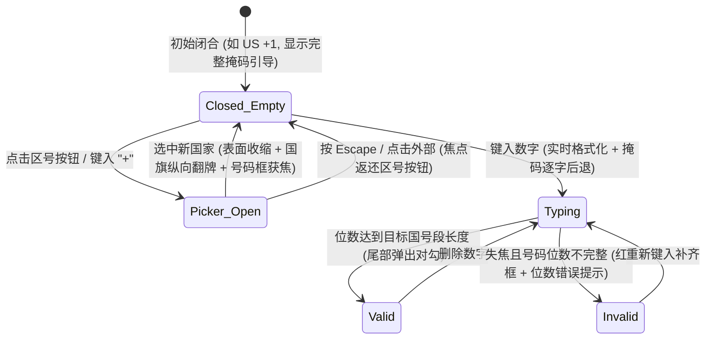

# Phone Input · 国际电话号码输入框

集成单表面几何形变（Single-Surface Morphing）国家区号选择器、实时号段格式化与未填位掩码引导的电话号码输入组件。涵盖四大核心机制：

1. 单表面几何形变区号选择器（Single-Surface Morphing Country Picker）：左侧区号锚点内的 `.phone-input-shape` 平时收缩为与触发器同宽（如 86px × 42px）的圆角胶囊；点击展开时，同一 DOM 表面通过 WAAPI 同步补间 `width`（至整个输入框宽度 340px）、`height`（至含列表总高度）与 `borderRadius`，顶部原位交叉淡化为搜索框，底部浮现国家列表。
2. 实时掩码引导与非数字退格穿透（Live Pattern Guide & Mask-Aware Caret）：输入框底层对齐 `.phone-input-guide`，以透明的 `.phone-input-guide-typed` 撑开已输入部分，右侧露出浅灰色剩余示例掩码（如 `(201) 555-0123`）；按 `Backspace` 遇到括号或空格时自动穿透删除前一位数字。
3. 国旗/区号方向性翻牌与 `+` 键智能唤醒（Directional Country Flip & `+` Trigger）：切换国家时，新旧国旗与区号按字母表先后顺序沿纵向 `translateY(±4px)` 交替；在号码框键入 `+` 或粘贴含国际区号的字符串（如 `+44 7400 123456`）时自动识别切换国家或唤醒区号检索。
4. 合法状态对勾弹出（Valid Checkmark Pop）：当号码位数完全匹配目标国家的号段规则时，尾部弹出 `.phone-input-valid` 对勾图标（`scale(0.6) + blur(2px) -> 1`），同时向 `<input type="hidden">` 写入标准 E.164 格式号码。

## 原型清单

| 原型分组 | 原型元素 | 动效 / 状态变化 | 去向 |
| --- | --- | --- | --- |
| 手机验证舞台 | 字段根容器 `.phone-input-field` | 维护 `data-open` 层级提升与 `--pi-panel-w` 宽度变量 | 变量契约 |
| 手机验证舞台 | 主控制框 `.phone-input-control` | 44px 高度外壳，响应悬停、聚焦与 `data-invalid` 边框色 | 样式实现 |
| 手机验证舞台 | 宽度测量锚点 `.phone-input-anchor` / `.phone-input-measure` | 隐藏测量当前国旗+区号文本宽度，平滑过渡左侧槽位宽度 | 单表面几何形变区号选择器 |
| 手机验证舞台 | 单表面形变层 `.phone-input-shape` | 闭合态为区号胶囊，展开态同步拉伸 `width`/`height`/`borderRadius` 并浮起阴影 | 单表面几何形变区号选择器 |
| 手机验证舞台 | 顶部盖板 `.phone-input-lid` | 承载闭合态 `.phone-input-trigger`、展开态 `.phone-input-search-row` 与旋转箭头 | 单表面几何形变区号选择器 |
| 手机验证舞台 | 国旗区号层 `.phone-input-slot` / `.phone-input-layer` | 切换国家时按字母序方向执行 `translateY(±4px)` 翻牌过渡 | 国旗/区号方向性翻牌与 `+` 键智能唤醒 |
| 手机验证舞台 | 国家列表面板 `.phone-input-list-face` / `.phone-input-options` | 展开时从 `translateY(-4px)` 淡入，内置滑动高光胶囊 `.phone-input-highlight` | 单表面几何形变区号选择器 |
| 手机验证舞台 | 号码输入与掩码层 `.phone-input-number` / `.phone-input-guide` | 实时格式化本地号段，动态裁剪剩余未输入示例掩码 | 实时掩码引导与非数字退格穿透 |
| 手机验证舞台 | 合法状态图标 `.phone-input-valid` | 号码位数合规时以 `scale(0.6) + blur(2px) -> 1` 弹出对勾 | 合法状态对勾弹出 |
| 手机验证舞台 | 消息提示插槽 `.phone-input-message-slot` | 失焦校验不完整时平滑展开具体位数要求提示 | 交互实现 |
| — | 底部演示提交按钮 `Send code` 与顶栏 `#themeBtn` | 演示外壳 | 演示外壳，已删除 |

## 适用

- 手机号登录、双因素短信验证（2FA）、国际收货人联系电话、跨国客户资料录入。
- 需要自动处理各国不同号段格式、支持输入 `+` 快速检索区号并输出标准 E.164 格式的表单。

## 不适用

- 货币金额与币种切换 → [money-input](money-input.md)
- 纯数字加减步进输入 → [number-field](number-field.md)
- 常规无掩码单行文本输入 → [input](../text-fields/input.md)

## 状态机



| 状态 | 进入条件 | 视觉表现 | 退出到 |
| --- | --- | --- | --- |
| Closed_Empty | 初始或清空号码 | `.phone-input-shape` 收缩在左侧，右侧显示完整浅灰示例掩码 | Picker_Open / Typing |
| Picker_Open | 点击区号触发器或按 `+` | `.phone-input-shape` 拉伸覆盖全宽并向下展开列表，顶部切换为搜索框 | Closed_Empty / Typing |
| Typing | 在号码框输入数字 | 已输入数字格式化显示，掩码仅显示剩余未填位 | Valid / Invalid / Picker_Open |
| Valid | 号码长度符合当前国别规则 | 右侧弹出 `.phone-input-valid` 对勾，隐藏域写入 `+12015550123` | Typing |
| Invalid | 失焦且号码未输完 | 控制框标记 `data-invalid` 变红，底部提示槽切换为具体位数要求 | Typing |

## 动效参数

| 机制 | 属性 / 技术 | 持续时间 | 缓动函数 | 说明 |
| --- | --- | --- | --- | --- |
| 单表面展开形变 | `width`, `height`, `borderRadius` | 280ms (`openMs`) | `cubic-bezier(.22,1,.36,1)` | 闭合态胶囊平滑膨胀为完整下拉卡片 |
| 单表面收起形变 | `width`, `height`, `borderRadius` | 200ms (`closeMs`) | `cubic-bezier(.22,1,.36,1)` | 快速利落收拢回左侧锚点尺寸 |
| 区号锚点宽度自适应 | `width` (`.phone-input-anchor`) | 180ms | `cubic-bezier(.22,1,.36,1)` | 切换 `+1` 与 `+886` 时右侧号码框平滑让位 |
| 国旗区号纵向翻牌 | `opacity`, `transform: translateY(±4px)` | 离场 100ms / 入场 180ms | `cubic-bezier(.22,1,.36,1)` | 按国家字母表顺序决定上下翻动方向 |
| 列表选项高光滑动 | `transform: translateY(...)`, `height` | 160ms | `cubic-bezier(.22,1,.36,1)` | 键盘或鼠标移动时高光背景跟随 |
| 合法对勾入场/退场 | `opacity`, `transform: scale(0.6)`, `filter: blur(2px)` | 入场 240ms / 退场 100ms | `cubic-bezier(.16,1,.3,1)` | 号码合规时弹性浮现 |

## 变量契约

### 依赖的全局/主题变量

| 变量名 | 默认值（浅色） | 暗色值 | 作用 |
| --- | --- | --- | --- |
| `--control-height-md` | `2.75rem` (44px) | `2.75rem` (44px) | 输入框基准高度 |
| `--radius-control` | `1.125rem` (18px) | `1.125rem` (18px) | 外壳与展开面板圆角 |
| `--border` | `oklch(93.5% 0 0)` | `oklch(29% 0 0)` | 分隔竖线与展开面板边框色 |
| `--border-strong` | `oklch(82% 0 0)` | `oklch(40% 0 0)` | 主控制框静态边框色 |
| `--foreground` | `oklch(22% 0 0)` | `oklch(96% 0 0)` | 文本与聚焦高亮色 |
| `--surface` | `oklch(100% 0 0)` | `oklch(21.5% 0 0)` | 闭合态背景色 |
| `--surface-raised` | `oklch(100% 0 0)` | `oklch(24% 0 0)` | 展开态浮层背景色 |
| `--shadow-floating` | `0 20px 48px oklch(0% 0 0/.105)` | `0 22px 55px oklch(0% 0 0/.34)` | 展开态浮层投影 |
| `--danger` | `oklch(54% .21 25)` | `oklch(76% .2 25)` | 号码位数错误边框与文本色 |

### 组件私有变量

| 变量名 | 默认值 | 作用 |
| --- | --- | --- |
| `--pi-h` | `var(--control-height-md, 44px)` | 控制框基准高度 |
| `--pi-panel-w` | `340px` | 展开后面板目标宽度（由 JS 动态同步为控制框宽度） |

## 结构与语义

```html
<div class="phone-input-field" style="--pi-panel-w: 340px;">
  <label for="phone-number" class="phone-input-label">Mobile number</label>
  <div class="phone-input-control">
    <div class="phone-input-anchor">
      <span class="phone-input-trigger phone-input-measure" aria-hidden="true">
        <span class="phone-input-flag">🇺🇸</span>
        <span class="phone-input-dial">+1</span>
      </span>
      <div class="phone-input-shape">
        <div class="phone-input-lid">
          <button
            type="button"
            class="phone-input-trigger"
            aria-haspopup="listbox"
            aria-expanded="false"
            aria-controls="phone-country-list"
            aria-label="Country, United States +1"
          >
            <span class="phone-input-slot">
              <span class="phone-input-layer" data-current-country>
                <span class="phone-input-flag" aria-hidden="true">🇺🇸</span>
                <span class="phone-input-dial">+1</span>
              </span>
            </span>
          </button>
          <div class="phone-input-search-row" inert style="opacity: 0;">
            <input
              class="phone-input-search"
              type="text"
              role="combobox"
              aria-label="Search countries or calling codes"
              aria-expanded="false"
              aria-controls="phone-country-list"
              placeholder="Country or code"
              autocomplete="off"
              spellcheck="false"
            />
            <button type="button" class="phone-input-close-hit" aria-label="Close country list"></button>
          </div>
          <span class="phone-input-chevron" aria-hidden="true">
            <svg width="16" height="16" viewBox="0 0 24 24" fill="none" stroke="currentColor" stroke-width="1.75" stroke-linecap="round" stroke-linejoin="round">
              <path d="m6 9 6 6 6-6" />
            </svg>
          </span>
        </div>
        <div class="phone-input-list-face" inert aria-hidden="true" style="opacity: 0;">
          <div class="phone-input-scroll">
            <div id="phone-country-list" class="phone-input-options" role="listbox" aria-label="Countries"></div>
          </div>
        </div>
      </div>
    </div>

    <div class="phone-input-number-wrap">
      <span class="phone-input-guide" aria-hidden="true">
        <span class="phone-input-guide-typed"></span>(201) 555-0123
      </span>
      <input
        id="phone-number"
        class="phone-input-number"
        type="tel"
        inputmode="tel"
        autocomplete="tel"
        aria-describedby="phone-hint"
      />
    </div>
  </div>
  <span class="phone-input-message-slot">
    <span id="phone-hint" class="phone-input-hint">Type + to search by calling code</span>
  </span>
  <input type="hidden" name="phone" value="" />
  <span class="phone-input-sr-only" role="status" aria-live="polite"></span>
</div>
```

## 样式实现

```css
.phone-input-field {
  --pi-h: var(--control-height-md, 44px);
  --pi-panel-w: 340px;
  position: relative;
  display: grid;
  min-width: 0;
}

.phone-input-field[data-open] {
  z-index: 30;
}

.phone-input-label {
  margin-bottom: 0.5rem;
  color: var(--foreground, #1c1c1c);
  font-size: 0.875rem;
  font-weight: 500;
}

.phone-input-control {
  position: relative;
  display: flex;
  min-width: 0;
  height: var(--pi-h);
  box-sizing: border-box;
  border: 1px solid var(--border-strong, #d1d1d1);
  border-radius: var(--radius-control, 18px);
  background: var(--surface, #ffffff);
  transition: border-color 160ms cubic-bezier(0.22, 1, 0.36, 1);
}

.phone-input-control:has(.phone-input-number:focus) {
  border-color: var(--foreground, #1c1c1c);
}

.phone-input-control[data-invalid] {
  border-color: var(--danger, #e53e3e);
}

.phone-input-anchor {
  position: relative;
  flex: none;
  height: 100%;
  transition: width 180ms cubic-bezier(0.22, 1, 0.36, 1);
}

.phone-input-anchor::after {
  content: "";
  position: absolute;
  top: 10px;
  right: 0;
  bottom: 10px;
  width: 1px;
  background: var(--border, #ebebeb);
  transition: opacity 160ms cubic-bezier(0.22, 1, 0.36, 1);
}

.phone-input-field[data-open] .phone-input-anchor::after {
  opacity: 0;
}

/* 单表面几何形变核心层 */
.phone-input-shape {
  position: absolute;
  z-index: 2;
  top: 0;
  left: 0;
  overflow: clip;
  background: var(--surface, #ffffff);
  border-radius: 17px;
  transition:
    box-shadow 480ms cubic-bezier(0.22, 1, 0.36, 1),
    background-color 160ms cubic-bezier(0.22, 1, 0.36, 1);
}

.phone-input-field[data-open] .phone-input-shape {
  translate: -1px -1px;
  background: var(--surface-raised, #ffffff);
  box-shadow: 0 20px 48px rgba(0, 0, 0, 0.12);
  border: 1px solid var(--border, #ebebeb);
}

.phone-input-lid {
  position: absolute;
  z-index: 1;
  top: 0;
  right: 0;
  left: 0;
  height: calc(var(--pi-h) - 2px);
}

.phone-input-trigger {
  box-sizing: border-box;
  display: flex;
  height: calc(var(--pi-h) - 2px);
  align-items: center;
  padding: 0 36px 0 12px;
  font-size: 0.875rem;
  font-weight: 500;
  white-space: nowrap;
}

.phone-input-lid .phone-input-trigger {
  position: absolute;
  inset: 3px auto 3px 3px;
  width: calc(100% - 6px);
  height: auto;
  border: 0;
  border-radius: calc(var(--radius-control, 18px) - 4px);
  background: transparent;
  color: var(--foreground, #1c1c1c);
  cursor: pointer;
}

.phone-input-measure {
  visibility: hidden;
  pointer-events: none;
  width: max-content;
}

.phone-input-slot {
  position: relative;
  display: block;
  height: 100%;
  flex: 1;
}

.phone-input-slot[data-hidden] {
  opacity: 0;
}

.phone-input-layer {
  position: absolute;
  inset: 0;
  display: flex;
  align-items: center;
  gap: 6px;
}

.phone-input-dial {
  font-variant-numeric: tabular-nums;
}

.phone-input-chevron {
  position: absolute;
  top: 50%;
  right: 12px;
  display: grid;
  width: 16px;
  height: 16px;
  margin-top: -8px;
  place-items: center;
  color: var(--text-muted, #717171);
  pointer-events: none;
  transition: transform 240ms cubic-bezier(0.22, 1, 0.36, 1);
}

.phone-input-search-row {
  position: absolute;
  inset: 0;
  display: flex;
  align-items: center;
  gap: 0.5rem;
  padding: 0 2px 0 13px;
}

.phone-input-search-row[inert] {
  pointer-events: none;
}

.phone-input-search {
  min-width: 0;
  height: 100%;
  flex: 1;
  border: 0;
  background: transparent;
  color: var(--foreground, #1c1c1c);
  font: inherit;
  font-size: 0.875rem;
  outline: none;
}

.phone-input-close-hit {
  width: 36px;
  height: 36px;
  border: 0;
  border-radius: 9999px;
  background: transparent;
  cursor: pointer;
}

.phone-input-list-face {
  position: absolute;
  top: calc(var(--pi-h) - 2px);
  left: 0;
  box-sizing: border-box;
  width: var(--pi-panel-w);
  padding: 0 6px 6px;
}

.phone-input-scroll {
  max-height: 240px;
  overflow-y: auto;
  padding-top: 6px;
}

.phone-input-option {
  display: flex;
  min-height: 36px;
  align-items: center;
  gap: 10px;
  padding: 0 10px;
  border-radius: 14px;
  cursor: pointer;
  font-size: 0.875rem;
}

.phone-input-option:hover,
.phone-input-option[aria-selected="true"] {
  background: var(--surface-muted, #f5f5f5);
}

.phone-input-number-wrap {
  position: relative;
  display: flex;
  min-width: 0;
  flex: 1;
  align-items: center;
}

.phone-input-number,
.phone-input-guide {
  box-sizing: border-box;
  padding: 0 36px 0 12px;
  font-family: inherit;
  font-size: 0.875rem;
  font-variant-numeric: tabular-nums;
  line-height: 1.4;
}

.phone-input-number {
  position: relative;
  z-index: 1;
  width: 100%;
  height: 100%;
  border: 0;
  background: transparent;
  color: var(--foreground, #1c1c1c);
  outline: none;
}

.phone-input-guide {
  position: absolute;
  inset: 0;
  display: flex;
  align-items: center;
  overflow: hidden;
  color: color-mix(in oklab, var(--text-muted, #717171) 72%, transparent);
  pointer-events: none;
  white-space: pre;
}

.phone-input-guide-typed {
  visibility: hidden;
}

.phone-input-valid {
  position: absolute;
  z-index: 1;
  top: 50%;
  right: 12px;
  display: grid;
  width: 18px;
  height: 18px;
  margin-top: -9px;
  place-items: center;
  color: var(--success, #38a169);
}

.phone-input-sr-only {
  position: absolute;
  width: 1px;
  height: 1px;
  overflow: hidden;
  clip-path: inset(50%);
  white-space: nowrap;
}

@media (prefers-reduced-motion: reduce) {
  .phone-input-anchor,
  .phone-input-shape,
  .phone-input-chevron {
    transition: none !important;
  }
}
```

## 交互实现

```javascript
const COUNTRIES = [
  { iso: 'US', flag: '🇺🇸', name: 'United States', dial: '1', pattern: '(###) ###-####', example: '2015550123', length: 10 },
  { iso: 'GB', flag: '🇬🇧', name: 'United Kingdom', dial: '44', pattern: '#### ######', example: '7400123456', length: 10 },
  { iso: 'CN', flag: '🇨🇳', name: 'China', dial: '86', pattern: '### #### ####', example: '13123456789', length: 11 },
  { iso: 'JP', flag: '🇯🇵', name: 'Japan', dial: '81', pattern: '##-####-####', example: '9012345678', length: 10 }
];

function applyPattern(digits, pattern) {
  let out = '';
  let idx = 0;
  for (const ch of pattern) {
    if (idx >= digits.length) break;
    out += ch === '#' ? digits[idx++] : ch;
  }
  return out + digits.slice(idx);
}

/**
 * 绑定国际电话号码输入框与单表面形变选择器
 * @param {HTMLElement} rootEl - .phone-input-field 元素
 */
export function setupPhoneInput(rootEl) {
  const control = rootEl.querySelector('.phone-input-control');
  const anchor = rootEl.querySelector('.phone-input-anchor');
  const shape = rootEl.querySelector('.phone-input-shape');
  const measure = rootEl.querySelector('.phone-input-measure');
  const trigger = rootEl.querySelector('button.phone-input-trigger');
  const slot = rootEl.querySelector('.phone-input-slot');
  const searchRow = rootEl.querySelector('.phone-input-search-row');
  const search = rootEl.querySelector('.phone-input-search');
  const closeHit = rootEl.querySelector('.phone-input-close-hit');
  const chevron = rootEl.querySelector('.phone-input-chevron');
  const face = rootEl.querySelector('.phone-input-list-face');
  const options = rootEl.querySelector('.phone-input-options');
  const numberInput = rootEl.querySelector('.phone-input-number');
  const numberWrap = rootEl.querySelector('.phone-input-number-wrap');
  const guide = rootEl.querySelector('.phone-input-guide');
  const guideTyped = rootEl.querySelector('.phone-input-guide-typed');
  const hiddenInput = rootEl.querySelector('input[type="hidden"]');

  let country = COUNTRIES[0];
  let digits = '';
  let open = false;
  let query = '';
  let validBadge = null;
  const prefersReduced = window.matchMedia('(prefers-reduced-motion: reduce)').matches;

  function syncGeometry(immediate = false) {
    const panelW = control.offsetWidth || 340;
    rootEl.style.setProperty('--pi-panel-w', panelW + 'px');
    const triggerW = measure.offsetWidth || 86;
    const lidH = (control.clientHeight || 42);
    const targetW = (open ? Math.max(triggerW, panelW) : triggerW) + 'px';
    const targetH = (open ? lidH + 2 + face.offsetHeight : lidH) + 'px';

    anchor.style.width = triggerW + 'px';

    if (!immediate && !prefersReduced) {
      shape.animate(
        [
          { width: getComputedStyle(shape).width, height: getComputedStyle(shape).height },
          { width: targetW, height: targetH }
        ],
        { duration: open ? 280 : 200, easing: 'cubic-bezier(0.22, 1, 0.36, 1)' }
      );
    }
    shape.style.width = targetW;
    shape.style.height = targetH;
  }

  function renderCountry(prevCountry) {
    measure.innerHTML = `<span class="phone-input-flag">${country.flag}</span><span class="phone-input-dial">+${country.dial}</span>`;
    trigger.setAttribute('aria-label', `Country, ${country.name} +${country.dial}`);

    const layer = document.createElement('span');
    layer.className = 'phone-input-layer';
    layer.innerHTML = `<span class="phone-input-flag" aria-hidden="true">${country.flag}</span><span class="phone-input-dial">+${country.dial}</span>`;

    const old = slot.lastElementChild;
    if (old && prevCountry && prevCountry.iso !== country.iso && !prefersReduced) {
      const dir = country.name.localeCompare(prevCountry.name) >= 0 ? 1 : -1;
      old.animate(
        [{ opacity: 1, transform: 'none' }, { opacity: 0, transform: `translateY(${-dir * 4}px)` }],
        { duration: 100 }
      ).finished.then(() => old.remove()).catch(() => old.remove());
      layer.animate(
        [{ opacity: 0, transform: `translateY(${dir * 4}px)` }, { opacity: 1, transform: 'none' }],
        { duration: 180 }
      );
    } else {
      old?.remove();
    }
    slot.append(layer);
    syncGeometry();
  }

  function renderNumber() {
    digits = digits.slice(0, country.length);
    const formatted = applyPattern(digits, country.pattern);
    numberInput.value = formatted;
    if (hiddenInput) hiddenInput.value = digits ? `+${country.dial}${digits}` : '';

    guideTyped.textContent = formatted;
    while (guide.childNodes.length > 1) guide.lastChild.remove();
    if (digits.length < country.example.length) {
      const fullExample = applyPattern(digits + country.example.slice(digits.length), country.pattern);
      if (fullExample.startsWith(formatted)) {
        guide.append(fullExample.slice(formatted.length));
      }
    }

    const isValid = digits.length === country.length;
    if (isValid && !validBadge) {
      validBadge = document.createElement('span');
      validBadge.className = 'phone-input-valid';
      validBadge.setAttribute('aria-hidden', 'true');
      validBadge.textContent = '✓';
      numberWrap.append(validBadge);
      if (!prefersReduced) {
        validBadge.animate(
          [{ opacity: 0, transform: 'scale(0.6)', filter: 'blur(2px)' }, { opacity: 1, transform: 'none', filter: 'blur(0)' }],
          { duration: 220 }
        );
      }
    } else if (!isValid && validBadge) {
      validBadge.remove();
      validBadge = null;
    }
  }

  function renderOptions() {
    options.innerHTML = '';
    const q = query.trim().toLowerCase().replace(/^\+/, '');
    const list = COUNTRIES.filter(
      c => !q || c.name.toLowerCase().includes(q) || c.dial.startsWith(q) || c.iso.toLowerCase().includes(q)
    );
    list.forEach(entry => {
      const row = document.createElement('div');
      row.className = 'phone-input-option';
      row.dataset.iso = entry.iso;
      row.setAttribute('role', 'option');
      row.setAttribute('aria-selected', String(entry.iso === country.iso));
      row.innerHTML = `<span class="phone-input-flag">${entry.flag}</span><span class="phone-input-name">${entry.name}</span><span class="phone-input-meta">+${entry.dial}</span>`;
      row.addEventListener('click', () => pickCountry(entry));
      options.append(row);
    });
    syncGeometry();
  }

  function setMode(nextOpen, focusTarget = null) {
    if (open === nextOpen) return;
    open = nextOpen;
    rootEl.toggleAttribute('data-open', open);
    slot.toggleAttribute('data-hidden', open);
    trigger.inert = open;
    trigger.setAttribute('aria-expanded', String(open));
    searchRow.inert = !open;
    searchRow.style.opacity = open ? '1' : '0';
    face.inert = !open;
    face.style.opacity = open ? '1' : '0';
    if (open) face.removeAttribute('aria-hidden');
    else face.setAttribute('aria-hidden', 'true');
    chevron.style.transform = `rotate(${open ? 180 : 0}deg)`;

    syncGeometry();
    if (focusTarget === 'search') search.focus();
    else if (focusTarget === 'number') numberInput.focus();
    else if (focusTarget === 'trigger') trigger.focus();
  }

  function pickCountry(entry) {
    const prev = country;
    country = entry;
    renderCountry(prev);
    renderNumber();
    setMode(false, 'number');
  }

  trigger.addEventListener('click', () => {
    if (open) setMode(false, 'trigger');
    else {
      query = search.value = '';
      renderOptions();
      setMode(true, 'search');
    }
  });

  closeHit.addEventListener('click', () => setMode(false, 'trigger'));

  search.addEventListener('input', () => {
    query = search.value;
    renderOptions();
  });

  search.addEventListener('keydown', e => {
    if (e.key === 'Escape') {
      e.preventDefault();
      setMode(false, 'trigger');
    } else if (e.key === 'Enter') {
      e.preventDefault();
      const firstIso = options.querySelector('.phone-input-option')?.dataset.iso;
      const found = COUNTRIES.find(c => c.iso === firstIso);
      if (found) pickCountry(found);
    }
  });

  numberInput.addEventListener('keydown', e => {
    if (e.key === '+') {
      e.preventDefault();
      query = search.value = '+';
      renderOptions();
      setMode(true, 'search');
    }
  });

  numberInput.addEventListener('input', () => {
    digits = numberInput.value.replace(/\D/g, '');
    renderNumber();
  });

  renderCountry(null);
  renderOptions();
  renderNumber();
  syncGeometry(true);

  return { pickCountry, setMode, getE164: () => hiddenInput?.value };
}
```

## 无障碍与无动画

1. **模式切换与焦点原子转移（Focus & Inert Synchrony）**：
   - 在展开区号列表的同一同步调用栈内，将 `trigger.inert = true`、`searchRow.inert = false` 并立即调用 `search.focus()`；收起选中后立即将焦点转交 `numberInput.focus()`，防止 `focusout` 事件误判导致浮层闪退。
2. **Reduced Motion 降级**：
   - 启用 `prefers-reduced-motion: reduce` 时，跳过 `.phone-input-shape` 的宽高补间动画与国旗翻牌位移，尺寸与显隐直接一步到位。

## 踩坑与微调

1. **单表面形变 vs 独立浮层**：
   - 传统做法是点击按钮后在下方挂载一个独立的 `div.dropdown`，会产生按钮与浮层割裂的视觉断层。本组件让 `.phone-input-shape` 本身既是闭合态的按钮背景，又是展开态的浮层卡片，通过同时补间 `width`、`height` 与 `borderRadius`，实现极高质感的无缝膨胀。
2. **掩码引导的字体等宽对齐**：
   - `.phone-input-number` 与底层的 `.phone-input-guide` 必须完全一致地设置 `font-variant-numeric: tabular-nums`、相同的 `padding` 与 `letter-spacing`，否则已输入的透明占位文字 `.phone-input-guide-typed` 宽度会与输入框真实文字错位，导致掩码与输入字符重叠。

## 验收清单

- [x] 单表面 `.phone-input-shape` 同步补间 `width`、`height`、`borderRadius` 展开为国家列表。
- [x] 底层 `.phone-input-guide` 实时裁剪并显示未输入位的灰色掩码引导。
- [x] 切换国家时国旗与区号按字母序执行方向性纵向翻牌，锚点宽度平滑自适应。
- [x] 在号码框按 `+` 自动打开区号选择器并填入 `+` 进行区号检索。
- [x] 号码位数合规时弹出 `.phone-input-valid` 对勾并同步 E.164 隐藏域。
- [x] 完整支持 `prefers-reduced-motion` 降级。
