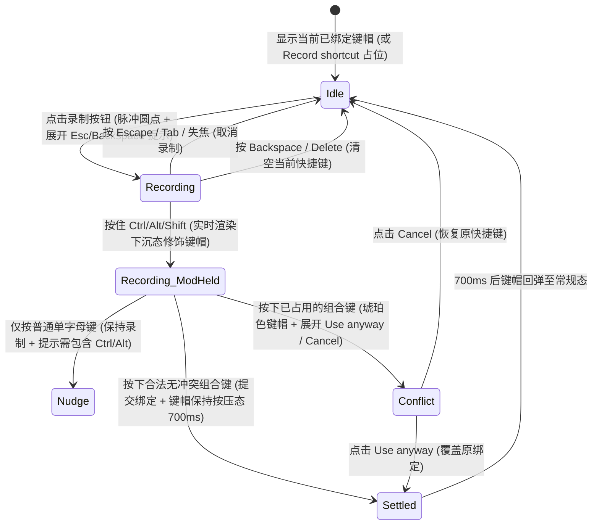

# Shortcut Recorder · 键盘快捷键录制器

结合物理键帽按压动效、实时修饰键预览、同键位复用 FLIP 位移与冲突拦截决策的快捷键绑定组件。涵盖四大核心机制：

1. 物理键帽槽位复用与 FLIP 横向重排（Physical Keycap Reuse & FLIP Shift）：每个键帽 `.shortcut-recorder-chip-slot` 以物理按键 ID（`data-key="mod|shift|k"`）为唯一标识复用；录制或修改组合键时，保留的键帽通过 FLIP `translate` 平滑横移，新增键帽按 `index * 35ms` 交错弹入（`translateY(4px) scale(0.72) + blur(2px) -> 1`），移除键帽转为 `position: absolute` 缩小淡出。
2. 录制态脉冲指示与修饰键实时按压（Recording Pulse Dot & Live Modifier Press）：进入录制态（`data-state="recording"`）时，左侧浮现呼吸闪烁圆点 `.shortcut-recorder-dot`；按住 `Ctrl`/`Alt`/`Shift`/`⌘` 时实时渲染处于下沉按压态（`data-pressed`：`translateY(1px)` 且底部边框由 `2px` 压扁为 `1px`）的键帽；成功录入主键后保持 `700ms` 落定按压高亮再回弹。
3. 修饰键缺失引导与快捷键冲突拦截（Modifier Nudge & Conflict Resolution）：若用户仅按下单字母键（无修饰键且非 F1–F12），不退出录制态，底部平滑展开提示“Include Ctrl or Alt”；若录入的组合键已被其他功能占用或属系统保留键，进入 `data-state="conflict"`，键帽转为琥珀警示色（`data-tone="warning"`），并在下方消息槽提供 `Use anyway`（强制覆盖）与 `Cancel` 操作。
4. 可搜索快捷键参考表与全局按键同步（Searchable Reference Sheet & Live Key Highlight）：配套参考列表支持按名称或键名（含 `cmd`/`opt` 别名）实时过滤，分组与行高通过 `ResizeObserver` 弹簧折叠；在页面任意位置按下物理按键时，列表中对应 `<kbd>` 实时同步下沉高亮。

## 原型清单

| 原型分组 | 原型元素 | 动效 / 状态变化 | 去向 |
| --- | --- | --- | --- |
| 快捷键设置舞台 | 录制字段容器 `.shortcut-recorder-field` | 网格布局，承载标签、录制控制框、自适应消息槽与读屏状态 | 最小 DOM |
| 快捷键设置舞台 | 录制控制外壳 `.shortcut-recorder-control` | 切换 `data-state="idle\|recording\|conflict"` 边框与底色过渡 | 样式实现 |
| 快捷键设置舞台 | 录制主按钮 `.shortcut-recorder-recorder` | 点击进入录制（`aria-pressed="true"`），监听组合键、Esc 取消与退格清空 | 交互实现 |
| 快捷键设置舞台 | 键帽行与脉冲点 `.shortcut-recorder-row` / `.shortcut-recorder-dot` | 承载呼吸脉冲圆点、键帽槽位与空状态占位符 | 录制态脉冲指示与修饰键实时按压 |
| 快捷键设置舞台 | 物理键帽 `.shortcut-recorder-chip-slot` / `.shortcut-recorder-kbd` | 3D 底部厚边框键帽，按压时下沉 `translateY(1px)`，增删时 FLIP 交错过渡 | 物理键帽槽位复用与 FLIP 横向重排 |
| 快捷键设置舞台 | 尾部动作按钮 `.shortcut-recorder-actions` / `.shortcut-recorder-action` | 动态浮现 `Reset`（恢复默认）与 `Clear`（清空）图标按钮 | 交互实现 |
| 快捷键设置舞台 | 自适应消息提示槽 `.shortcut-recorder-message-slot` | 展开录制提示、修饰键缺失引导或冲突 `Use anyway / Cancel` 决策栏 | 修饰键缺失引导与快捷键冲突拦截 |
| 快捷键参考面板 | 可搜索快捷键列表 `.shortcut-recorder-list` / `.shortcut-recorder-groups` | 搜索过滤时分组与条目高度平滑弹簧收展；全局按键时匹配行高亮、无关行变暗 | 可搜索快捷键参考表与全局按键同步 |
| — | 演示顶栏 Mac/Windows 平台切换按钮组与顶栏 `#themeBtn` | 演示外壳 | 演示外壳，已删除 |

## 适用

- 桌面级 Web 应用、IDE、设计工具、效率软件的自定义快捷键设置面板。
- 需要防止用户误绑单字母键或覆盖已有快捷键，并提供直观物理键帽反馈的命令配置器。

## 不适用

- 文本标签或关键词词组录入 → [tag-input](tag-input.md)
- 普通文本或搜索关键词输入 → [search-field](../text-fields/search-field.md)
- 原地文本标题编辑 → [inline-edit](../text-fields/inline-edit.md)

## 状态机



| 状态 | 进入条件 | 视觉表现 | 退出到 |
| --- | --- | --- | --- |
| Idle | 初始或录制完成后 | 显示常规立体键帽，右侧按需显示“恢复默认”与“清空”按钮 | Recording |
| Recording | 点击 `.shortcut-recorder-recorder` | 边框变为主色，左侧显示呼吸圆点 `.shortcut-recorder-dot` 与 `Press keys` | Recording_ModHeld / Idle |
| Recording_ModHeld | 录制中按住修饰键 | 实时显示处于 `data-pressed` 下沉状态的修饰键帽 | Nudge / Conflict / Settled |
| Nudge | 录制中按下无修饰键的单字母 | 底部提示槽切换为 `Include Ctrl or Alt`，继续等待合法输入 | Recording_ModHeld / Idle |
| Conflict | 录入的组合键与其他项冲突 | `data-state="conflict"`，键帽呈琥珀色，底部展开冲突项名称与 `Use anyway` / `Cancel` | Settled / Idle |
| Settled | 成功提交新快捷键 | 新键帽保持 `data-pressed` 按压高亮 700ms 后平滑回弹 | Idle |

## 动效参数

| 机制 | 属性 / 技术 | 持续时间 / 参数 | 缓动函数 | 说明 |
| --- | --- | --- | --- | --- |
| 键帽新增入场 | `opacity`, `transform: translateY(4px) scale(0.72)`, `filter: blur(2px)` | 260ms（交错 `index * 35ms`） | `cubic-bezier(.22,1,.36,1)` | 录制完成或多键渲染时依次弹入 |
| 键帽移除退场 | `opacity: 1 -> 0`, `transform: scale(0.8)`, `filter: blur(2px)` | 100ms | `cubic-bezier(.22,1,.36,1)` | 转为绝对定位后快速消失 |
| 复用键帽 FLIP 横移 | `translate: <dx>px 0 -> 0px 0` | 260ms | `cubic-bezier(.22,1,.36,1)` | 相同修饰键在新旧组合间平滑移动 |
| 键帽物理按压 | `transform: translateY(1px)`, `border-bottom-width: 2px -> 1px` | 按下 90ms / 释放 580ms | 按下线性 / 释放 `--ease-spring` | 模拟真实机械键帽下沉与回弹 |
| 录制圆点呼吸 | `opacity: 1 -> 0.35 -> 1` | 1400ms 循环 | `ease-in-out` | 指示当前正在监听键盘输入 |
| 消息提示槽展开 | `height` + 文本 `translateY(0.35em) + blur(4px)` | 240ms | `cubic-bezier(.22,1,.36,1)` | 平滑展开或收起冲突/引导提示 |

## 变量契约

### 依赖的全局/主题变量

| 变量名 | 默认值（浅色） | 暗色值 | 作用 |
| --- | --- | --- | --- |
| `--control-height-md` | `2.75rem` (44px) | `2.75rem` (44px) | 录制控制框基准高度 |
| `--radius-control` | `1.125rem` (18px) | `1.125rem` (18px) | 控制框圆角 |
| `--border-strong` | `oklch(82% 0 0)` | `oklch(40% 0 0)` | 控制框与键帽立体边框色 |
| `--foreground` | `oklch(22% 0 0)` | `oklch(96% 0 0)` | 键帽文本与激活边框色 |
| `--surface` | `oklch(100% 0 0)` | `oklch(21.5% 0 0)` | 控制框背景色 |
| `--surface-raised` | `oklch(100% 0 0)` | `oklch(24% 0 0)` | 键帽表面凸起背景色 |
| `--accent` | `oklch(33% 0 0)` | `oklch(80% 0 0)` | 录制态边框与脉冲圆点色 |
| `--accent-subtle` | `oklch(33% 0 0 / .1)` | `oklch(80% 0 0 / .13)` | 键帽按压态背景色 |
| `--warning` | `oklch(58% .18 75)` | `oklch(83% .17 80)` | 快捷键冲突边框与琥珀色键帽基色 |

## 结构与语义

```html
<div class="shortcut-recorder-field" data-binding="open-command">
  <span id="sr-label-1" class="shortcut-recorder-label">Open command menu</span>
  <div class="shortcut-recorder-control" data-state="idle">
    <button
      id="sr-btn-1"
      type="button"
      class="shortcut-recorder-recorder"
      aria-labelledby="sr-label-1 sr-btn-1"
      aria-pressed="false"
    >
      <span class="shortcut-recorder-sr-only">Control K</span>
      <span class="shortcut-recorder-row" aria-hidden="true">
        <span class="shortcut-recorder-chip-slot" data-key="mod">
          <kbd class="shortcut-recorder-kbd" data-size="md">Ctrl</kbd>
        </span>
        <span class="shortcut-recorder-chip-slot" data-key="k">
          <kbd class="shortcut-recorder-kbd" data-size="md">K</kbd>
        </span>
      </span>
    </button>
    <span class="shortcut-recorder-actions">
      <button type="button" class="shortcut-recorder-action" data-action="clear" aria-label="Clear shortcut">
        <svg width="16" height="16" viewBox="0 0 24 24" fill="none" stroke="currentColor" stroke-width="1.75" stroke-linecap="round" stroke-linejoin="round" aria-hidden="true">
          <path d="M18 6 6 18" /><path d="m6 6 12 12" />
        </svg>
      </button>
    </span>
  </div>
  <span class="shortcut-recorder-sr-only" role="status" aria-live="polite"></span>
</div>
```

## 样式实现

```css
.shortcut-recorder-field {
  display: grid;
  min-width: 0;
}

.shortcut-recorder-label {
  justify-self: start;
  margin-bottom: 0.5rem;
  color: var(--foreground, #1c1c1c);
  font-size: 0.875rem;
  font-weight: 500;
}

.shortcut-recorder-control {
  position: relative;
  display: flex;
  min-width: 0;
  height: var(--control-height-md, 44px);
  box-sizing: border-box;
  align-items: center;
  border: 1px solid var(--border-strong, #d1d1d1);
  border-radius: var(--radius-control, 18px);
  background: var(--surface, #ffffff);
  transition:
    border-color 160ms cubic-bezier(0.22, 1, 0.36, 1),
    background-color 160ms cubic-bezier(0.22, 1, 0.36, 1);
}

.shortcut-recorder-control[data-state="recording"] {
  border-color: var(--accent, #1c1c1c);
  background: color-mix(in oklab, var(--accent, #1c1c1c) 4%, var(--surface, #ffffff));
}

.shortcut-recorder-control[data-state="conflict"] {
  border-color: var(--warning, #d97706);
}

.shortcut-recorder-recorder {
  display: flex;
  min-width: 0;
  height: 100%;
  flex: 1;
  align-items: center;
  padding: 0 6px 0 9px;
  border: 0;
  border-radius: var(--radius-control, 18px);
  background: transparent;
  color: var(--foreground, #1c1c1c);
  cursor: pointer;
  font: inherit;
  text-align: left;
  outline: none;
}

.shortcut-recorder-row {
  position: relative;
  display: flex;
  min-width: 0;
  align-items: center;
  gap: 4px;
}

.shortcut-recorder-chip-slot {
  display: inline-flex;
}

/* 3D 物理键帽 */
.shortcut-recorder-kbd {
  display: inline-grid;
  min-width: 26px;
  height: 26px;
  box-sizing: border-box;
  place-items: center;
  padding: 0 7px 1px;
  border: 1px solid var(--border-strong, #d1d1d1);
  border-bottom-width: 2px;
  border-radius: 8px;
  background: var(--surface-raised, #ffffff);
  color: var(--foreground, #1c1c1c);
  font-size: 0.75rem;
  font-weight: 500;
  line-height: 1;
  font-variant-numeric: tabular-nums;
  white-space: nowrap;
  transition:
    transform 580ms cubic-bezier(0.16, 1, 0.3, 1),
    border-color 160ms cubic-bezier(0.22, 1, 0.36, 1),
    background-color 160ms cubic-bezier(0.22, 1, 0.36, 1),
    border-bottom-width 160ms cubic-bezier(0.22, 1, 0.36, 1);
}

.shortcut-recorder-kbd[data-pressed] {
  transform: translateY(1px);
  border-color: color-mix(in oklab, var(--accent, #1c1c1c) 55%, var(--border-strong, #d1d1d1));
  border-bottom-width: 1px;
  background: var(--accent-subtle, rgba(0, 0, 0, 0.08));
  transition-duration: 90ms;
}

.shortcut-recorder-kbd[data-tone="warning"] {
  border-color: color-mix(in oklab, var(--warning, #d97706) 55%, var(--border-strong, #d1d1d1));
  background: color-mix(in oklab, var(--warning, #d97706) 12%, var(--surface-raised, #ffffff));
}

.shortcut-recorder-placeholder {
  padding-left: 3px;
  color: var(--text-muted, #717171);
  font-size: 0.875rem;
  white-space: nowrap;
}

.shortcut-recorder-dot {
  width: 7px;
  height: 7px;
  flex: none;
  margin: 0 6px 0 3px;
  border-radius: 50%;
  background: var(--accent, #1c1c1c);
  animation: sr-pulse 1.4s ease-in-out infinite;
}

@keyframes sr-pulse {
  50% { opacity: 0.35; }
}

.shortcut-recorder-actions {
  display: flex;
  flex: none;
  align-items: center;
  gap: 2px;
  padding-right: 4px;
}

.shortcut-recorder-action {
  display: grid;
  width: 32px;
  height: 32px;
  place-items: center;
  padding: 0;
  border: 0;
  border-radius: 12px;
  background: transparent;
  color: var(--text-muted, #717171);
  cursor: pointer;
}

.shortcut-recorder-action:hover {
  background: var(--surface-muted, #f5f5f5);
  color: var(--foreground, #1c1c1c);
}

.shortcut-recorder-message-slot {
  position: relative;
  overflow: hidden;
}

.shortcut-recorder-message {
  display: flex;
  flex-wrap: wrap;
  align-items: baseline;
  justify-content: space-between;
  gap: 2px 0.75rem;
  padding-top: 0.5rem;
  font-size: 0.75rem;
  color: var(--text-muted, #717171);
}

.shortcut-recorder-message-actions {
  display: inline-flex;
  gap: 0.75rem;
}

.shortcut-recorder-link {
  padding: 0;
  border: 0;
  background: none;
  color: var(--foreground, #1c1c1c);
  cursor: pointer;
  font: inherit;
  font-weight: 500;
  text-decoration: underline;
}

.shortcut-recorder-sr-only {
  position: absolute;
  width: 1px;
  height: 1px;
  overflow: hidden;
  clip-path: inset(50%);
  white-space: nowrap;
}

@media (prefers-reduced-motion: reduce) {
  .shortcut-recorder-control,
  .shortcut-recorder-kbd {
    transition: none !important;
  }
  .shortcut-recorder-dot {
    animation: none !important;
  }
}
```

## 交互实现

```javascript
const KEY_LABELS = {
  mod: 'Ctrl',
  alt: 'Alt',
  shift: 'Shift',
  meta: 'Win'
};

function parseKeyEvent(e) {
  const mods = [];
  if (e.ctrlKey || e.metaKey) mods.push('mod');
  if (e.altKey) mods.push('alt');
  if (e.shiftKey) mods.push('shift');

  const ignore = ['Control', 'Alt', 'Shift', 'Meta', 'OS', 'CapsLock'];
  const key = ignore.includes(e.key)
    ? ''
    : /^Key[A-Z]$/.test(e.code)
    ? e.code.slice(3).toLowerCase()
    : e.key.length === 1
    ? e.key.toLowerCase()
    : e.key.toLowerCase();

  return { mods, key, full: key ? [...mods, key].join('+') : '' };
}

function tokensFromShortcut(shortcut) {
  if (!shortcut) return [];
  return shortcut.split('+').filter(Boolean).map(id => ({
    id,
    label: KEY_LABELS[id] || id.toUpperCase()
  }));
}

/**
 * 绑定键盘快捷键录制器
 * @param {HTMLElement} fieldEl - .shortcut-recorder-field 元素
 * @param {Object} options - { initial: 'mod+k', conflicts: { 'mod+n': 'Create issue' } }
 */
export function setupShortcutRecorder(fieldEl, { initial = 'mod+k', conflicts = {} } = {}) {
  const control = fieldEl.querySelector('.shortcut-recorder-control');
  const button = fieldEl.querySelector('.shortcut-recorder-recorder');
  const row = fieldEl.querySelector('.shortcut-recorder-row');
  const actions = fieldEl.querySelector('.shortcut-recorder-actions');
  const srReader = button.querySelector('.shortcut-recorder-sr-only');
  const live = fieldEl.querySelector('[role="status"]');

  let current = initial;
  let recording = false;
  let liveMods = [];
  let pendingConflict = null;
  let nudgeText = '';
  let settled = false;
  let settleTimer = 0;
  let msgSlot = null;
  const prefersReduced = window.matchMedia('(prefers-reduced-motion: reduce)').matches;

  function renderCaps() {
    const activeShortcut = pendingConflict
      ? pendingConflict.shortcut
      : recording
      ? liveMods.join('+')
      : current;
    const tokens = tokensFromShortcut(activeShortcut);
    const prevMap = new Map([...row.children].map(c => [c.dataset.key, c]));
    const wanted = new Set();

    if (recording) {
      let dot = prevMap.get('dot');
      if (!dot) {
        dot = document.createElement('span');
        dot.className = 'shortcut-recorder-dot';
        dot.dataset.key = 'dot';
      }
      row.append(dot);
      wanted.add(dot);
    }

    tokens.forEach((tok, idx) => {
      let slot = prevMap.get(tok.id);
      const isFresh = !slot;
      if (!slot) {
        slot = document.createElement('span');
        slot.className = 'shortcut-recorder-chip-slot';
        slot.dataset.key = tok.id;
        const kbd = document.createElement('kbd');
        kbd.className = 'shortcut-recorder-kbd';
        kbd.dataset.size = 'md';
        slot.append(kbd);
      }
      const kbd = slot.firstElementChild;
      kbd.textContent = tok.label;
      kbd.toggleAttribute('data-pressed', recording || (settled && !pendingConflict));
      if (pendingConflict) kbd.dataset.tone = 'warning';
      else delete kbd.dataset.tone;

      row.append(slot);
      wanted.add(slot);

      if (isFresh && !prefersReduced) {
        slot.animate(
          [
            { opacity: 0, transform: 'translateY(4px) scale(0.72)', filter: 'blur(2px)' },
            { opacity: 1, transform: 'none', filter: 'blur(0)' }
          ],
          { duration: 260, delay: recording ? 0 : idx * 35 }
        );
      }
    });

    if (!tokens.length) {
      let ph = prevMap.get('placeholder');
      if (!ph) {
        ph = document.createElement('span');
        ph.className = 'shortcut-recorder-placeholder';
        ph.dataset.key = 'placeholder';
      }
      ph.textContent = recording ? 'Press keys' : 'Record shortcut';
      row.append(ph);
      wanted.add(ph);
    }

    for (const old of prevMap.values()) {
      if (!wanted.has(old)) old.remove();
    }

    if (srReader) {
      srReader.textContent = recording ? 'Recording' : activeShortcut || 'Record shortcut';
    }
  }

  function renderMessage() {
    const hasMsg = recording || Boolean(nudgeText) || Boolean(pendingConflict);
    if (!hasMsg) {
      msgSlot?.remove();
      msgSlot = null;
      return;
    }
    if (!msgSlot) {
      msgSlot = document.createElement('div');
      msgSlot.className = 'shortcut-recorder-message-slot';
      fieldEl.insertBefore(msgSlot, live);
    }
    msgSlot.innerHTML = '';
    const msg = document.createElement('div');
    msg.className = 'shortcut-recorder-message';

    if (pendingConflict) {
      msg.dataset.tone = 'warning';
      msg.innerHTML = `
        <span class="shortcut-recorder-message-text">Already used by <strong class="shortcut-recorder-strong">${pendingConflict.label}</strong></span>
        <span class="shortcut-recorder-message-actions">
          <button type="button" class="shortcut-recorder-link" data-act="use">Use anyway</button>
          <button type="button" class="shortcut-recorder-link" data-act="cancel">Cancel</button>
        </span>
      `;
      msg.querySelector('[data-act="use"]').addEventListener('click', () => {
        commit(pendingConflict.shortcut);
        button.focus();
      });
      msg.querySelector('[data-act="cancel"]').addEventListener('click', () => {
        pendingConflict = null;
        render();
        button.focus();
      });
    } else {
      msg.dataset.tone = 'hint';
      msg.textContent = nudgeText || 'Esc to cancel, Backspace to clear';
    }
    msgSlot.append(msg);
  }

  function render() {
    control.dataset.state = recording ? 'recording' : pendingConflict ? 'conflict' : 'idle';
    button.setAttribute('aria-pressed', String(recording));
    renderCaps();
    renderMessage();

    actions.innerHTML = '';
    if (!recording && current && !pendingConflict) {
      const clearBtn = document.createElement('button');
      clearBtn.type = 'button';
      clearBtn.className = 'shortcut-recorder-action';
      clearBtn.dataset.action = 'clear';
      clearBtn.setAttribute('aria-label', 'Clear shortcut');
      clearBtn.textContent = '×';
      clearBtn.addEventListener('click', () => {
        commit('');
        button.focus();
      });
      actions.append(clearBtn);
    }
  }

  function commit(nextShortcut) {
    recording = false;
    liveMods = [];
    pendingConflict = null;
    nudgeText = '';
    current = nextShortcut;
    clearTimeout(settleTimer);
    settled = Boolean(nextShortcut);
    if (settled) {
      settleTimer = setTimeout(() => {
        settled = false;
        render();
      }, 700);
    }
    if (live) live.textContent = nextShortcut ? `Shortcut set to ${nextShortcut}` : 'Shortcut cleared';
    render();
    fieldEl.dispatchEvent(new CustomEvent('arc:shortcut-change', { bubbles: true, detail: { value: current } }));
  }

  function startRecording() {
    recording = true;
    liveMods = [];
    pendingConflict = null;
    nudgeText = '';
    if (live) live.textContent = 'Recording. Press the new shortcut, or Escape to cancel.';
    render();
  }

  button.addEventListener('click', () => {
    if (recording) {
      recording = false;
      nudgeText = '';
      render();
    } else {
      startRecording();
    }
  });

  button.addEventListener('keydown', e => {
    if (!recording) {
      if ((e.key === 'Backspace' || e.key === 'Delete') && current) {
        e.preventDefault();
        commit('');
      }
      return;
    }
    if (e.key === 'Tab' && !e.ctrlKey && !e.altKey && !e.shiftKey && !e.metaKey) {
      recording = false;
      render();
      return;
    }
    e.preventDefault();
    e.stopPropagation();

    const isBare = !e.ctrlKey && !e.altKey && !e.shiftKey && !e.metaKey;
    if (isBare && e.key === 'Escape') {
      recording = false;
      nudgeText = '';
      render();
      return;
    }
    if (isBare && (e.key === 'Backspace' || e.key === 'Delete')) {
      commit('');
      return;
    }

    const parsed = parseKeyEvent(e);
    if (!parsed.key) {
      liveMods = parsed.mods;
      render();
      return;
    }

    const hasMainMod = parsed.mods.some(m => ['mod', 'alt', 'meta'].includes(m));
    if (!hasMainMod && !/^f\d{1,2}$/.test(parsed.key)) {
      nudgeText = 'Include Ctrl or Alt';
      liveMods = parsed.mods;
      render();
      return;
    }

    recording = false;
    liveMods = [];
    if (conflicts[parsed.full] && parsed.full !== current) {
      pendingConflict = { shortcut: parsed.full, label: conflicts[parsed.full] };
      render();
      return;
    }
    commit(parsed.full);
  });

  button.addEventListener('keyup', e => {
    if (recording) {
      liveMods = parseKeyEvent(e).mods;
      render();
    }
  });

  button.addEventListener('blur', () => {
    if (recording) {
      recording = false;
      nudgeText = '';
      render();
    }
  });

  render();

  return { startRecording, commit, getShortcut: () => current };
}
```

## 无障碍与无动画

1. **双层语义与读屏播报**：
   - 视觉键帽行 `.shortcut-recorder-row` 设为 `aria-hidden="true"`，按钮内通过 `.shortcut-recorder-sr-only` 提供完整拼写（如 `Control K` 而非零散的 `Ctrl` + `K`），避免屏幕阅读器逐个字母生硬朗读。
   - 录制态中保持单键 Tab 逃生通道（裸按 `Tab` 立即退出录制并允许焦点正常流向下一控件，避免形成键盘陷阱）。
2. **Reduced Motion 降级**：
   - 在 `prefers-reduced-motion: reduce` 下，关闭录制圆点的呼吸闪烁动画，跳过键帽交错缩放模糊与 FLIP 横向过渡。

## 踩坑与微调

1. **物理按键位置（`event.code`）与字符映射（`event.key`）冲突**：
   - 在 macOS 上按下 `Option + N` 时，`event.key` 会变成特殊重音符号 `˜` 而非 `'n'`。必须优先使用物理键码 `event.code`（如 `/^Key([A-Z])$/` 提取字母，`/Digit(\d)/` 提取数字），才能准确识别物理组合键。
2. **Meta（Command/Win）键释放吞键问题**：
   - 在 macOS 上按住 `⌘ Command` 再按其他键随后松开时，系统常常不派发主键的 `keyup` 事件。在全局监听 `keyup` 时一旦检测到 `Meta` 释放，必须一并清理所有非修饰键的按压集合。

## 验收清单

- [x] 物理键帽按 `data-key` 复用 DOM 槽位，具备 3D 底边下沉按压反馈（`data-pressed`）。
- [x] 录制态展示呼吸脉冲圆点，实时映射当前按住的修饰键。
- [x] 拦截裸按单字母键并展开 `Include Ctrl or Alt` 引导提示。
- [x] 检测到快捷键已被占用时进入 `conflict` 状态，展示琥珀色键帽并提供 `Use anyway / Cancel` 决策。
- [x] 保留裸按 `Tab` 退出录制机制，杜绝键盘焦点陷阱。
- [x] 完整支持 `prefers-reduced-motion` 降级。
