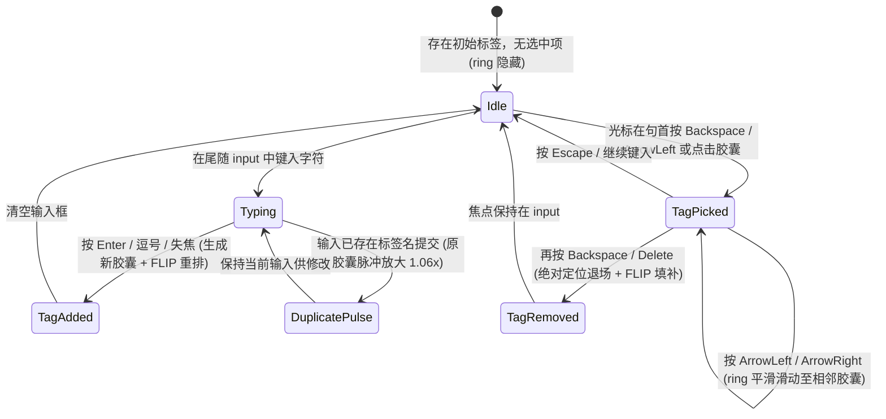

# Tag Input · 多标签胶囊输入框

将已添加标签保持为真实 DOM 胶囊元素，结合共享选中高亮环、两步式安全退格删除与 FLIP 换行重排的复合输入组件。涵盖四大核心机制：

1. 共享高亮环平滑跟随（Shared Pick Ring Gliding）：容器内常驻单一 `.tag-input-ring` 元素；当用户点击标签或用左右方向键/首次退格切换选中标签时，高亮环通过 `translate`、`width` 与 `height` 物理弹簧在胶囊间平滑游走与缩放。
2. 两步式安全退格与重复脉冲提示（Two-Step Backspace & Duplicate Pulse）：当光标位于输入框最左侧（`selectionStart === 0`）按 `Backspace` 时，第一步仅选中末尾标签并浮现高亮环，第二步再按 `Backspace`/`Delete` 才真正删除，防止误删；若尝试添加已存在的同名标签，已有标签原地触发 `scale(1) -> scale(1.06) -> scale(1)` 脉冲提示。
3. 绝对定位离场与 FLIP 布局重排（Absolute Exit & FLIP Reflow）：删除标签时，被删节点立即脱离文档流转为 `position: absolute` 并以 `scale(0.9) + blur(2px)` 退场；其余标签与输入框通过 FLIP（First-Last-Invert-Play）平滑滑动填补空缺。
4. 多行容器高度自适应弹簧（Adaptive Row Height Spring）：当标签折行或删减回缩导致行数变化时，外层 `.tag-input-control` 通过 `ResizeObserver` 监听内部 `.tag-input-content` 的高度并平滑补间 `height`。

## 原型清单

| 原型分组 | 原型元素 | 动效 / 状态变化 | 去向 |
| --- | --- | --- | --- |
| 官方标签框舞台 | 字段容器 `.tag-input-field` | 网格布局，承载标签、控制框与提示槽 | 最小 DOM |
| 官方标签框舞台 | 控制外壳 `.tag-input-control` | 聚焦边框高亮，高度随内部折行平滑弹簧伸缩 | 多行容器高度自适应弹簧 |
| 官方标签框舞台 | 流式内容区 `.tag-input-content` | `flex-wrap: wrap` 容纳胶囊与尾随 `input` | 结构与语义 |
| 官方标签框舞台 | 共享选中高亮环 `.tag-input-ring` | 首次显现时 `scale(0.9) -> 1` 淡入，切换选中标签时平滑滑动对齐位置与尺寸 | 共享高亮环平滑跟随 |
| 官方标签框舞台 | 标签胶囊 `.tag-input-tag` | 新增时 `scale(0.9) + blur(4px)` 入场；删除时绝对定位淡出；重复时 `scale(1.06)` 脉冲 | 绝对定位离场与 FLIP 布局重排 |
| 官方标签框舞台 | 胶囊移除按钮 `.tag-input-tag button` | 悬停发亮，按下缩放 `scale(0.96)`，点击直接移除该胶囊 | 样式实现 |
| 官方标签框舞台 | 尾随输入框 `input` | 处理文本键入、`Enter`/`,` 提交、方向键游走与两步退格 | 两步式安全退格与重复脉冲提示 |
| 官方标签框舞台 | 空状态占位符 `.tag-input-placeholder` | 当既无标签又无输入文本时以 `translateY(0.3em) + blur(4px)` 浮现 | 交互实现 |
| 官方标签框舞台 | 消息提示插槽 `.tag-input-message-slot` | 底部操作说明与无障碍 `aria-live` 实时播报 | 无障碍与无动画 |
| — | 顶栏独立主题切换器 `#themeBtn` 与 `.demo-status` | 演示外壳 | 演示外壳，已删除 |

## 适用

- 文章标签、项目分类、技能词条、收件人列表、过滤条件词组等多值集合输入。
- 需要支持键盘全流程无鼠标操作（方向键回溯、两步退格防误删）的高效录入场景。

## 不适用

- 在大段自然语言正文中穿插 `@人物` 或 `#频道` 提及 → [mention-input](mention-input.md)
- 键盘快捷键组合录制 → [shortcut-recorder](shortcut-recorder.md)
- 普通单行文本输入 → [input](../text-fields/input.md)

## 状态机



| 状态 | 进入条件 | 视觉表现 | 退出到 |
| --- | --- | --- | --- |
| Idle | 初始状态或取消选中后 | 胶囊正常排列，`.tag-input-ring` 隐藏（`opacity: 0`） | Typing / TagPicked |
| Typing | 在输入框键入文字 | 若原本有选中胶囊则自动取消选中，隐藏占位符 | TagAdded / DuplicatePulse |
| TagAdded | 按 `Enter`、`,` 或失焦 | 新胶囊以 `scale(0.9) + blur(4px) -> 1` 弹入，输入框推向右侧或下一行 | Idle |
| DuplicatePulse | 提交的标签忽略大小写已存在 | 目标胶囊执行 360ms `scale(1) -> scale(1.06) -> scale(1)` 脉冲，不重复添加 | Typing |
| TagPicked | 句首按 `Backspace`/`ArrowLeft` 或点击胶囊 | 目标胶囊标记 `data-picked`，`.tag-input-ring` 浮现或平滑滑动覆盖该胶囊 | TagPicked / TagRemoved / Idle |
| TagRemoved | 选中状态下按 `Backspace` 或点击 `×` | 被删胶囊脱离流并缩小模糊淡出，剩余元素 FLIP 滑入新位置 | Idle |

## 动效参数

| 机制 | 属性 / 技术 | 持续时间 / 参数 | 缓动函数 | 说明 |
| --- | --- | --- | --- | --- |
| 新增胶囊入场 | `opacity`, `transform: scale(0.9)`, `filter: blur(4px)` | 420ms | `cubic-bezier(.22,1,.36,1)` | 柔和清晰化弹入 |
| 移除胶囊退场 | `opacity: 1 -> 0`, `transform: scale(0.9)`, `filter: blur(2px)` | 120ms | `cubic-bezier(.22,1,.36,1)` | 转为绝对定位后快速消散 |
| 重复胶囊脉冲 | `transform: scale(1) -> scale(1.06) -> scale(1)` | 360ms | `cubic-bezier(.65,0,.35,1)` | 提示用户该标签已在列表中 |
| 共享高亮环滑动 | `translate`, `width`, `height` | 240ms | `cubic-bezier(.16,1,.3,1)` | 在不同宽度的胶囊间无缝形变移动 |
| 高亮环显隐 | `opacity`, `scale(0.9 -> 1)` | 显现 260ms / 隐藏 120ms | `cubic-bezier(.22,1,.36,1)` | 首次选中浮现与取消选中收起 |
| FLIP 邻位重排 | `transform: translate(dx, dy) -> none` | 240ms | `cubic-bezier(.22,1,.36,1)` | 增删标签或换行时平滑过渡位置 |
| 容器高度自适应 | `height` (`.tag-input-control`) | 240ms | `cubic-bezier(.22,1,.36,1)` | 折行或收拢时外壳高度平滑过渡 |

## 变量契约

### 依赖的全局/主题变量

| 变量名 | 默认值（浅色） | 暗色值 | 作用 |
| --- | --- | --- | --- |
| `--control-height-md` | `2.75rem` (44px) | `2.75rem` (44px) | 单行初始最小高度基准 |
| `--radius-control` | `1.125rem` (18px) | `1.125rem` (18px) | 外层控制框圆角 |
| `--radius-pill` | `9999px` | `9999px` | 标签胶囊与高亮环圆角 |
| `--border` | `oklch(93.5% 0 0)` | `oklch(29% 0 0)` | 控制框与胶囊静态边框色 |
| `--foreground` | `oklch(22% 0 0)` | `oklch(96% 0 0)` | 文本与聚焦边框色 |
| `--surface` | `oklch(100% 0 0)` | `oklch(21.5% 0 0)` | 控制框背景色 |
| `--surface-muted` | `oklch(97.8% 0 0)` | `oklch(26% 0 0)` | 标签胶囊默认底色 |
| `--accent` | `oklch(33% 0 0)` | `oklch(80% 0 0)` | 选中高亮环边框色 |
| `--accent-subtle` | `oklch(33% 0 0 / .1)` | `oklch(80% 0 0 / .13)` | 选中高亮环填充底色 |

## 结构与语义

```html
<div class="tag-input-field">
  <label for="tag-input-el">Project tags</label>
  <div class="tag-input-control">
    <div class="tag-input-content">
      <span class="tag-input-ring" aria-hidden="true"></span>
      <span class="tag-input-tag" data-tag="release">
        <span class="tag-input-tag-label">release</span>
        <button type="button" aria-label="Remove release">
          <svg width="14" height="14" viewBox="0 0 24 24" fill="none" stroke="currentColor" stroke-width="2" stroke-linecap="round" stroke-linejoin="round" aria-hidden="true">
            <path d="M18 6 6 18" /><path d="m6 6 12 12" />
          </svg>
        </button>
      </span>
      <span class="tag-input-tag" data-tag="web">
        <span class="tag-input-tag-label">web</span>
        <button type="button" aria-label="Remove web">
          <svg width="14" height="14" viewBox="0 0 24 24" fill="none" stroke="currentColor" stroke-width="2" stroke-linecap="round" stroke-linejoin="round" aria-hidden="true">
            <path d="M18 6 6 18" /><path d="m6 6 12 12" />
          </svg>
        </button>
      </span>
      <input id="tag-input-el" type="text" aria-describedby="tag-input-desc" value="" />
    </div>
  </div>
  <span class="tag-input-sr-only" aria-live="polite"></span>
  <span class="tag-input-message-slot">
    <span id="tag-input-desc" class="tag-input-hint">
      Press Enter to add a tag. Press Backspace twice to remove the last one.
    </span>
  </span>
</div>
```

## 样式实现

```css
.tag-input-field {
  display: grid;
  width: 100%;
  min-width: 0;
}

.tag-input-field label {
  margin-bottom: 0.5rem;
  font-size: 0.875rem;
  font-weight: 500;
  color: var(--foreground, #1c1c1c);
}

.tag-input-control {
  box-sizing: content-box;
  overflow: hidden;
  border: 1px solid var(--border, #ebebeb);
  border-radius: var(--radius-control, 18px);
  background: var(--surface, #ffffff);
  transition:
    border-color 160ms cubic-bezier(0.22, 1, 0.36, 1),
    height 240ms cubic-bezier(0.22, 1, 0.36, 1);
}

.tag-input-control:focus-within {
  border-color: var(--foreground, #1c1c1c);
}

.tag-input-content {
  position: relative;
  display: flex;
  flex-wrap: wrap;
  align-items: center;
  align-content: flex-start;
  gap: 6px;
  min-height: 42px;
  box-sizing: border-box;
  padding: 7px;
  cursor: text;
}

.tag-input-tag {
  position: relative;
  display: inline-flex;
  align-items: center;
  gap: 3px;
  min-height: 28px;
  box-sizing: border-box;
  border: 1px solid var(--border, #ebebeb);
  border-radius: var(--radius-pill, 9999px);
  padding: 0 4px 0 9px;
  background: var(--surface-muted, #f5f5f5);
  color: var(--foreground, #1c1c1c);
  font-size: 0.875rem;
  white-space: nowrap;
  cursor: default;
}

.tag-input-tag-label,
.tag-input-tag button {
  position: relative;
  z-index: 2;
}

.tag-input-tag button {
  display: grid;
  width: 22px;
  height: 22px;
  place-items: center;
  border: 0;
  border-radius: 50%;
  background: transparent;
  color: var(--text-secondary, #525252);
  cursor: pointer;
  padding: 0;
  transition:
    background-color 160ms cubic-bezier(0.22, 1, 0.36, 1),
    color 160ms cubic-bezier(0.22, 1, 0.36, 1),
    transform 100ms cubic-bezier(0.22, 1, 0.36, 1);
}

.tag-input-tag button:hover {
  background: var(--surface, #ffffff);
  color: var(--foreground, #1c1c1c);
}

.tag-input-tag button:active {
  transform: scale(0.96);
}

.tag-input-content input {
  flex: 1 1 100px;
  min-width: 80px;
  min-height: 28px;
  box-sizing: border-box;
  border: 0;
  padding: 0 5px;
  background: transparent;
  color: var(--foreground, #1c1c1c);
  font: inherit;
  font-size: 0.875rem;
  outline: none;
}

/* 共享选中高亮环 */
.tag-input-ring {
  position: absolute;
  top: 0;
  left: 0;
  z-index: 1;
  box-sizing: border-box;
  border: 1px solid var(--accent, #1c1c1c);
  border-radius: var(--radius-pill, 9999px);
  background: var(--accent-subtle, rgba(0, 0, 0, 0.08));
  opacity: 0;
  pointer-events: none;
  transition:
    translate 240ms cubic-bezier(0.16, 1, 0.3, 1),
    width 240ms cubic-bezier(0.16, 1, 0.3, 1),
    height 240ms cubic-bezier(0.16, 1, 0.3, 1),
    opacity 160ms cubic-bezier(0.22, 1, 0.36, 1);
}

.tag-input-hint {
  display: block;
  padding-top: 0.5rem;
  color: var(--text-muted, #717171);
  font-size: 0.75rem;
}

.tag-input-sr-only {
  position: absolute;
  width: 1px;
  height: 1px;
  overflow: hidden;
  clip-path: inset(50%);
  white-space: nowrap;
}

@media (prefers-reduced-motion: reduce) {
  .tag-input-control,
  .tag-input-ring,
  .tag-input-tag button {
    transition: none !important;
  }
}
```

## 交互实现

```javascript
/**
 * 绑定多标签胶囊输入框
 * @param {HTMLElement} fieldEl - .tag-input-field 容器
 */
export function setupTagInput(fieldEl) {
  const control = fieldEl.querySelector('.tag-input-control');
  const content = fieldEl.querySelector('.tag-input-content');
  const input = content.querySelector('input');
  const ring = content.querySelector('.tag-input-ring');
  const live = fieldEl.querySelector('[aria-live]');

  let tags = [...content.querySelectorAll('[data-tag]')].map(n => n.dataset.tag);
  const nodes = new Map([...content.querySelectorAll('[data-tag]')].map(n => [n.dataset.tag, n]));
  let active = null;
  const prefersReduced = window.matchMedia('(prefers-reduced-motion: reduce)').matches;

  function announce(msg) {
    if (live) live.textContent = msg;
  }

  function placeRing() {
    const target = active === null ? null : nodes.get(active);
    for (const [t, node] of nodes) {
      node.toggleAttribute('data-picked', t === active);
    }
    if (!target) {
      ring.style.opacity = '0';
      return;
    }
    ring.style.translate = `${target.offsetLeft}px ${target.offsetTop}px`;
    ring.style.width = `${target.offsetWidth}px`;
    ring.style.height = `${target.offsetHeight}px`;
    ring.style.opacity = '1';
  }

  function pick(tag) {
    active = tag;
    placeRing();
    if (tag !== null) {
      announce(`${tag} selected. Press Backspace to remove it.`);
    }
  }

  function wireTag(node, tag) {
    node.addEventListener('mousedown', e => {
      if (!e.target.closest('button')) e.preventDefault();
    });
    node.addEventListener('click', e => {
      if (!e.target.closest('button')) {
        pick(active === tag ? null : tag);
        input.focus();
      }
    });
    node.querySelector('button')?.addEventListener('click', () => removeTag(tag));
  }

  for (const [t, node] of nodes) {
    wireTag(node, t);
  }

  function render() {
    // 记录 FLIP 初始位置
    const beforeBoxes = new Map();
    [...nodes.values(), input].forEach(el => {
      beforeBoxes.set(el, el.getBoundingClientRect());
    });

    // 处理被移除的标签
    for (const [t, node] of nodes) {
      if (!tags.includes(t)) {
        nodes.delete(t);
        const box = beforeBoxes.get(node);
        const parentBox = content.getBoundingClientRect();
        Object.assign(node.style, {
          position: 'absolute',
          left: `${box.left - parentBox.left}px`,
          top: `${box.top - parentBox.top}px`,
          width: `${box.width}px`
        });
        node.removeAttribute('data-tag');
        node.inert = true;
        if (prefersReduced) {
          node.remove();
        } else {
          node.animate(
            [
              { opacity: 1, transform: 'scale(1)', filter: 'none' },
              { opacity: 0, transform: 'scale(0.9)', filter: 'blur(2px)' }
            ],
            { duration: 120 }
          ).finished.then(() => node.remove()).catch(() => node.remove());
        }
      }
    }

    // 处理新增标签与顺序
    tags.forEach(t => {
      let node = nodes.get(t);
      if (!node) {
        node = document.createElement('span');
        node.className = 'tag-input-tag';
        node.dataset.tag = t;
        node.innerHTML = `
          <span class="tag-input-tag-label">${t}</span>
          <button type="button" aria-label="Remove ${t}">
            <svg width="14" height="14" viewBox="0 0 24 24" fill="none" stroke="currentColor" stroke-width="2" stroke-linecap="round" stroke-linejoin="round" aria-hidden="true">
              <path d="M18 6 6 18"/><path d="m6 6 12 12"/>
            </svg>
          </button>
        `;
        wireTag(node, t);
        nodes.set(t, node);
        if (!prefersReduced) {
          node.animate(
            [
              { opacity: 0, transform: 'scale(0.9)', filter: 'blur(4px)' },
              { opacity: 1, transform: 'none', filter: 'none' }
            ],
            { duration: 420, easing: 'cubic-bezier(0.22, 1, 0.36, 1)' }
          );
        }
      }
      content.insertBefore(node, input);
    });

    // 执行 FLIP 动画
    if (!prefersReduced) {
      [...nodes.values(), input].forEach(el => {
        const prev = beforeBoxes.get(el);
        if (!prev) return;
        const curr = el.getBoundingClientRect();
        const dx = prev.left - curr.left;
        const dy = prev.top - curr.top;
        if (Math.abs(dx) > 0.5 || Math.abs(dy) > 0.5) {
          el.animate(
            [{ transform: `translate(${dx}px, ${dy}px)` }, { transform: 'none' }],
            { duration: 240, easing: 'cubic-bezier(0.22, 1, 0.36, 1)' }
          );
        }
      });
    }

    control.style.height = `${content.offsetHeight}px`;
    placeRing();
  }

  function addTag(rawText = input.value) {
    const val = rawText.trim();
    if (!val) return false;
    const existing = tags.find(t => t.toLowerCase() === val.toLowerCase());
    if (existing) {
      const targetNode = nodes.get(existing);
      if (targetNode && !prefersReduced) {
        targetNode.animate(
          [{ transform: 'scale(1)' }, { transform: 'scale(1.06)' }, { transform: 'scale(1)' }],
          { duration: 360, easing: 'cubic-bezier(0.65, 0, 0.35, 1)' }
        );
      }
      announce(`${existing} is already added`);
      return false;
    }
    tags.push(val);
    input.value = '';
    active = null;
    render();
    announce(`Added ${val}`);
    input.dispatchEvent(new CustomEvent('arc:tags-change', { bubbles: true, detail: { value: [...tags] } }));
    return true;
  }

  function removeTag(tag) {
    tags = tags.filter(t => t !== tag);
    active = null;
    render();
    announce(`Removed ${tag}`);
    input.focus();
    input.dispatchEvent(new CustomEvent('arc:tags-change', { bubbles: true, detail: { value: [...tags] } }));
  }

  input.addEventListener('input', () => {
    active = null;
    placeRing();
  });

  input.addEventListener('keydown', e => {
    if (e.isComposing) return;
    const atStart = input.selectionStart === 0 && input.selectionEnd === 0;
    const idx = active === null ? tags.length : tags.indexOf(active);

    if (e.key === 'Enter' || e.key === ',') {
      e.preventDefault();
      addTag();
    } else if ((e.key === 'Backspace' || e.key === 'Delete') && active !== null) {
      e.preventDefault();
      removeTag(active);
    } else if (e.key === 'Backspace' && atStart && tags.length > 0) {
      e.preventDefault();
      pick(tags[tags.length - 1]);
    } else if (e.key === 'ArrowLeft' && (atStart || active !== null) && idx > 0) {
      e.preventDefault();
      pick(tags[idx - 1]);
    } else if (e.key === 'ArrowRight' && active !== null) {
      e.preventDefault();
      pick(tags[idx + 1] ?? null);
    } else if (e.key === 'Escape' && active !== null) {
      e.preventDefault();
      pick(null);
    }
  });

  input.addEventListener('blur', () => {
    addTag();
    pick(null);
  });

  content.addEventListener('click', e => {
    if (e.target === content) input.focus();
  });

  control.style.height = `${content.offsetHeight}px`;

  return { addTag, removeTag, pick, getTags: () => [...tags] };
}
```

## 无障碍与无动画

1. **焦点持续保持与屏幕阅读器播报**：
   - 在通过方向键或首次 `Backspace` 选中胶囊（`TagPicked`）时，真实 DOM 焦点始终保留在尾随 `<input>` 上，无需将焦点切入单个胶囊再切回，从而允许用户随时继续打字取消选中。
   - 每次选中、添加、重复拦截或删除均通过 `[aria-live="polite"]` 播报（如 `web selected. Press Backspace to remove it.`）。
2. **Reduced Motion 降级**：
   - 启用 `prefers-reduced-motion: reduce` 时，移除胶囊直接从 DOM 卸载，跳过 FLIP 位移、入场微模糊与重复脉冲动画，高亮环瞬时定位。

## 踩坑与微调

1. **离场节点干扰 FLIP 测量**：
   - 删除标签时，如果在播放 120ms 退场动画期间仍让被删胶囊留在普通 Flex 文档流中，右侧标签会等 120ms 后才突然跳过去。必须在删除瞬间读取其 `getBoundingClientRect()` 并设为 `position: absolute`，使其立即让出 Flex 空间，随后对其余节点执行 FLIP 测量。
2. **IME 中文输入法回车冲突**：
   - 监听 `Enter` 添加标签时，必须检查 `if (event.isComposing) return;`，防止用户在拼音输入法选词按回车时误将未完成的拼音直接提交为标签。

## 验收清单

- [x] 共享单一 `.tag-input-ring` 在不同标签间平滑过渡位置与宽高。
- [x] 句首按 `Backspace` 执行两步式删除（第一次选中高亮，第二次移除）。
- [x] 支持 `ArrowLeft`/`ArrowRight` 在已添加标签间游走切换选中态。
- [x] 添加重复标签时触发原胶囊 `scale(1.06)` 脉冲反馈并阻止重复插入。
- [x] 删除标签时脱离文档流淡出，其余元素与输入框通过 FLIP 平滑重排。
- [x] 完整支持 IME 合成态保护与 `prefers-reduced-motion` 降级。
