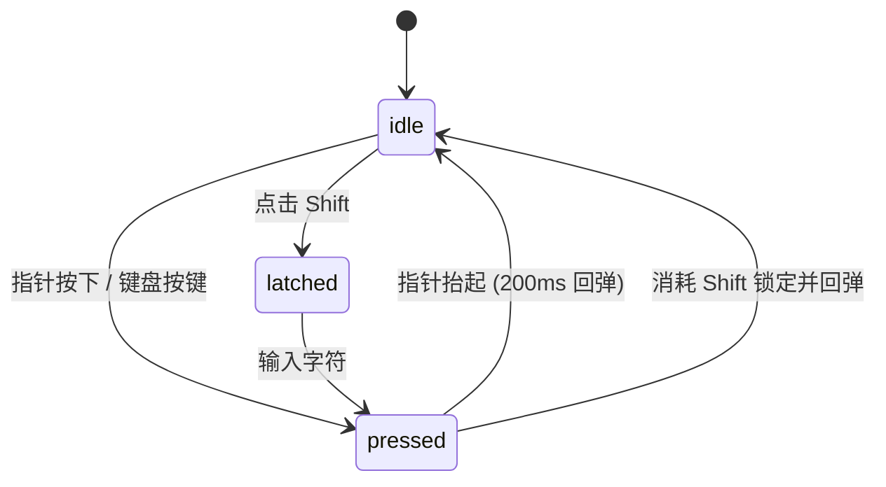

# Keycap Keyboard · 机械键帽虚拟键盘

拟真机械键帽交互键盘。核心动效机制包括：

1. **分层立体键帽行程物理学**：包含发光层（glow）、底座（housing）、活动键帽（cap）与凹入键面（face）；行程按容器宽度计算为 `clamp(2px, 0.085 * keySize, 4.5px)`，按下下沉 92% 并瞬间点亮径向光晕，松开时经 200ms 超调弹性曲线回弹归位。
2. **状态锁定与单次 Shift 锁存**：虚拟 Shift 键触发单次锁存下沉 50% 行程，输入下一个字符后自动解除锁定；实体键盘状态同步高亮按键。
3. **字形渐进流式追加与光标闪烁**：只读输出区新字符以 140ms 微模糊淡入，打字时保持光标常亮 600ms，静止后恢复 1060ms 步进闪烁。

## 原型清单

| 原型分组 | 原型元素 | 动效 / 状态变化 | 去向 |
| --- | --- | --- | --- |
| — | 键盘底板 `.keycap-keyboard_plate__xCZM9` | 响应式网格布局，布局形变动画 | `.keycap-plate` |
| — | 立体键帽 `.keycap-keyboard_key__jMmN5` | 按压下沉 92%、Shift 锁存 50%、径向光晕渐亮渐隐、字符着色 | `.keycap-key` |
| — | 文本输出槽 `.keycap-keyboard_output__Htx8B` | 自动翻卷、新字符 140ms 模糊入场、输入时 600ms 光标常亮 | `.keycap-output` |
| — | 布局切换栏 `.keycap-keyboard_segment__ENKc3` | 紧凑与字母布局切换滑块 | 接入目标项目（可选项） |
| — | 顶栏、外观切换 `#themeBtn`、舞台画布 | — | 演示外壳，已删除 |

## 适用

- 虚拟按键输入器、安全密码键盘或创意数字输入板。
- 需要极高质感的拟真机械触感按键反馈。
- 教学演示、快捷键录制或可视化键盘映射面板。

## 不适用

- 大段多行富文本排版与光标选择编辑 → [typewriter-terminal](typewriter-terminal.md)
- 滚轮数字与金融金额翻滚刷新 → [slot-text](slot-text.md)
- 粒子吹散聚合特效文字 → [sand-text](sand-text.md)
- 独立常规触发按钮 → [action-button](../buttons/action-button.md)

## 状态机

| 状态 | 进入条件 | 视觉表现 | 退出到 |
| --- | --- | --- | --- |
| idle | 初始；手指松开释放 | 键帽处于顶端基准面，光晕熄灭，光标周期闪烁 | pressed / latched |
| pressed | pointerdown 或实体按键按下 | 键帽在 35ms 内下沉 92% 行程，径向光晕点亮，字符变色 | idle / latched |
| latched | Shift 键触发锁定 | 键帽维持 50% 下沉行程，背景色微浸染 | idle / pressed |
| typing | 产生字符输入 | 字符 140ms 淡入，光标持续点亮 600ms | idle |



## 最小 DOM

```html
<div class="keycap-keyboard" data-layout="compact">
  <div class="keycap-output" role="textbox" aria-readonly="true" aria-multiline="true" aria-label="输入文本" tabindex="0">
    <p class="keycap-text">
      <span class="keycap-placeholder">Type anything...</span>
      <span class="keycap-caret" aria-hidden="true"></span>
    </p>
  </div>
  <div class="keycap-plate" role="group" aria-label="按键面板">
    <div class="keycap-row">
      <button type="button" class="keycap-key" data-keycap="Q" data-code="KeyQ" aria-label="Q" style="--w: 1;">
        <span class="keycap-glow" aria-hidden="true"></span>
        <span class="keycap-housing" aria-hidden="true"></span>
        <span class="keycap-cap" aria-hidden="true">
          <span class="keycap-face"><span class="keycap-legend">Q</span></span>
        </span>
      </button>
      <button type="button" class="keycap-key" data-keycap="W" data-code="KeyW" aria-label="W" style="--w: 1;">
        <span class="keycap-glow" aria-hidden="true"></span>
        <span class="keycap-housing" aria-hidden="true"></span>
        <span class="keycap-cap" aria-hidden="true">
          <span class="keycap-face"><span class="keycap-legend">W</span></span>
        </span>
      </button>
      <button type="button" class="keycap-key" data-keycap="E" data-code="KeyE" aria-label="E" style="--w: 1;">
        <span class="keycap-glow" aria-hidden="true"></span>
        <span class="keycap-housing" aria-hidden="true"></span>
        <span class="keycap-cap" aria-hidden="true">
          <span class="keycap-face"><span class="keycap-legend">E</span></span>
        </span>
      </button>
      <button type="button" class="keycap-key" data-keycap="R" data-code="KeyR" aria-label="R" style="--w: 1;">
        <span class="keycap-glow" aria-hidden="true"></span>
        <span class="keycap-housing" aria-hidden="true"></span>
        <span class="keycap-cap" aria-hidden="true">
          <span class="keycap-face"><span class="keycap-legend">R</span></span>
        </span>
      </button>
      <button type="button" class="keycap-key" data-keycap="T" data-code="KeyT" aria-label="T" style="--w: 1;">
        <span class="keycap-glow" aria-hidden="true"></span>
        <span class="keycap-housing" aria-hidden="true"></span>
        <span class="keycap-cap" aria-hidden="true">
          <span class="keycap-face"><span class="keycap-legend">T</span></span>
        </span>
      </button>
      <button type="button" class="keycap-key" data-keycap="Delete" data-code="Backspace" data-action="backspace" data-corner="true" aria-label="Delete" style="--w: 1.5;">
        <span class="keycap-glow" aria-hidden="true"></span>
        <span class="keycap-housing" aria-hidden="true"></span>
        <span class="keycap-cap" aria-hidden="true">
          <span class="keycap-face"><span class="keycap-legend">⌫</span></span>
        </span>
      </button>
    </div>
    <div class="keycap-row">
      <button type="button" class="keycap-key" data-keycap="Shift" data-code="ShiftLeft" data-action="shift" data-corner="true" aria-label="Shift" style="--w: 1.5;">
        <span class="keycap-glow" aria-hidden="true"></span>
        <span class="keycap-housing" aria-hidden="true"></span>
        <span class="keycap-cap" aria-hidden="true">
          <span class="keycap-face"><span class="keycap-legend">⇧</span></span>
        </span>
      </button>
      <button type="button" class="keycap-key" data-keycap="A" data-code="KeyA" aria-label="A" style="--w: 1;">
        <span class="keycap-glow" aria-hidden="true"></span>
        <span class="keycap-housing" aria-hidden="true"></span>
        <span class="keycap-cap" aria-hidden="true">
          <span class="keycap-face"><span class="keycap-legend">A</span></span>
        </span>
      </button>
      <button type="button" class="keycap-key" data-keycap="S" data-code="KeyS" aria-label="S" style="--w: 1;">
        <span class="keycap-glow" aria-hidden="true"></span>
        <span class="keycap-housing" aria-hidden="true"></span>
        <span class="keycap-cap" aria-hidden="true">
          <span class="keycap-face"><span class="keycap-legend">S</span></span>
        </span>
      </button>
      <button type="button" class="keycap-key" data-keycap="D" data-code="KeyD" aria-label="D" style="--w: 1;">
        <span class="keycap-glow" aria-hidden="true"></span>
        <span class="keycap-housing" aria-hidden="true"></span>
        <span class="keycap-cap" aria-hidden="true">
          <span class="keycap-face"><span class="keycap-legend">D</span></span>
        </span>
      </button>
      <button type="button" class="keycap-key" data-keycap="Space" data-code="Space" data-value=" " aria-label="Space" style="--w: 2.5;">
        <span class="keycap-glow" aria-hidden="true"></span>
        <span class="keycap-housing" aria-hidden="true"></span>
        <span class="keycap-cap" aria-hidden="true">
          <span class="keycap-face"><span class="keycap-legend">Space</span></span>
        </span>
      </button>
      <button type="button" class="keycap-key" data-keycap="Return" data-code="Enter" data-action="enter" data-accent="true" aria-label="Return" style="--w: 1.5;">
        <span class="keycap-glow" aria-hidden="true"></span>
        <span class="keycap-housing" aria-hidden="true"></span>
        <span class="keycap-cap" aria-hidden="true">
          <span class="keycap-face"><span class="keycap-legend">↵</span></span>
        </span>
      </button>
    </div>
  </div>
</div>
```

- `.keycap-keyboard`：宿主容器，定义宽度容器查询与键盘整体尺寸参数。
- `.keycap-output`：输出文本框，包含只读换行容器与闪烁光标。
- `.keycap-plate`：键盘底盘，负责定位键帽行与内边距。
- `.keycap-key`：单个立体键帽按钮，支持宽度单位 `--w`。
- `.keycap-glow`：按压时发散的径向光晕。
- `.keycap-housing`：键帽轴座槽位。
- `.keycap-cap`：随按压产生 Z 轴位移的键帽实体。
- `.keycap-face` 与 `.keycap-legend`：内嵌凹面与字符标识。

## 参数

| 名称 | 值 | 用于 | 来源 |
| --- | --- | --- | --- |
| keySize | `min(54px, calc((100cqw - 24px) / 10))` | 键帽基准宽高单位 | 原型 |
| travel | `clamp(2px, calc(var(--u) * 0.085), 4.5px)` | 键帽总行程深度 | 原型 |
| pressedTravelFactor | `0.92` | 按压下沉行程比例（92%） | 原型 |
| latchedTravelFactor | `0.5` | Shift 锁定行程比例（50%） | 原型 |
| press duration | `35ms` | 按压下潜过渡时间 | 原型 |
| press easing | `cubic-bezier(.2, .8, .2, 1)` | 按压曲线 | 原型 |
| release duration | `200ms` | 释放回弹过渡时间 | 原型 |
| release easing | `cubic-bezier(.25, 1.55, .5, 1)` | 释放超调弹性曲线 | 原型 |
| tint enter / exit | `40ms / 600ms` | 按压着色进入与消退时间 | 原型 |
| glow enter / exit | `40ms / 700ms` | 径向光晕进入与淡出时间 | 原型 |
| character duration | `140ms` | 字符入场微模糊淡入时长 | 原型 |
| caret period | `1060ms` | 光标步进闪烁周期 | 原型 |
| caret typing hold | `600ms` | 打字时保持常亮不闪烁的等待时间 | 原型 |

## CSS

```css
.keycap-keyboard {
  --board: #f5f5f5;
  --board-edge: rgba(0, 0, 0, 0.07);
  --cap-top: #ffffff;
  --cap-bottom: #f2f2f2;
  --cap-edge: rgba(0, 0, 0, 0.09);
  --face-top: #f7f7f7;
  --face-bottom: #ffffff;
  --housing: #d6d6d6;
  --legend: #404040;
  --legend-soft: #737373;
  --shade: rgba(0, 0, 0, 0.1);
  --glow: rgba(0, 0, 0, 0.15);
  --tint: rgba(0, 0, 0, 0.04);
  --accent: #2563eb;
  --foreground: #171717;
  display: grid;
  width: 100%;
  max-width: 760px;
  gap: 16px;
  margin-inline: auto;
  user-select: none;
  -webkit-user-select: none;
  container-type: inline-size;
}

@media (prefers-color-scheme: dark) {
  .keycap-keyboard {
    --board: #1c1c1c;
    --board-edge: rgba(255, 255, 255, 0.08);
    --cap-top: #333333;
    --cap-bottom: #2b2b2b;
    --cap-edge: rgba(255, 255, 255, 0.08);
    --face-top: #2c2c2c;
    --face-bottom: #363636;
    --housing: #141414;
    --legend: #e5e5e5;
    --legend-soft: #a3a3a3;
    --shade: rgba(0, 0, 0, 0.4);
    --glow: rgba(255, 255, 255, 0.15);
    --tint: rgba(255, 255, 255, 0.05);
    --foreground: #f5f5f5;
  }
}

.keycap-output {
  display: flex;
  height: 54px;
  align-items: center;
  justify-content: center;
  overflow: hidden;
  border-radius: 8px;
  background: var(--board);
  border: 1px solid var(--board-edge);
  font-family: ui-monospace, SFMono-Regular, monospace;
  font-size: 1.25rem;
  color: var(--foreground);
  cursor: text;
}

.keycap-text {
  margin: 0;
  padding: 0 12px;
  white-space: pre-wrap;
  display: inline-flex;
  align-items: center;
}

.keycap-placeholder {
  color: var(--legend-soft);
}

.keycap-char {
  animation: keycap-char-arrive 0.14s cubic-bezier(0.22, 1, 0.36, 1) both;
}

.keycap-caret {
  display: inline-block;
  width: 2px;
  height: 1.2em;
  margin-left: 2px;
  border-radius: 1px;
  background: var(--accent);
  animation: keycap-blink 1.06s steps(1) infinite;
}

.keycap-output[data-typing] .keycap-caret {
  animation: none;
}

@keyframes keycap-char-arrive {
  0% { opacity: 0; filter: blur(2px); transform: translateY(2px); }
  100% { opacity: 1; filter: blur(0); transform: translateY(0); }
}

@keyframes keycap-blink {
  50% { opacity: 0; }
}

.keycap-plate {
  --pad: clamp(8px, 2.5cqw, 16px);
  --units: 8;
  --u: min(54px, calc((100cqw - var(--pad) * 2 - 2px) / (var(--units) + (var(--units) - 1) * 0.14)));
  --gap: calc(var(--u) * 0.14);
  --travel: clamp(2px, calc(var(--u) * 0.085), 4.5px);
  --r: calc(var(--u) * 0.2);
  display: grid;
  justify-content: center;
  gap: var(--gap);
  padding: var(--pad);
  border: 1px solid var(--board-edge);
  border-radius: calc(var(--r) + var(--pad));
  background: var(--board);
  box-shadow: 0 1px 3px var(--shade);
}

.keycap-row {
  display: flex;
  justify-content: center;
  gap: var(--gap);
}

.keycap-key {
  position: relative;
  width: calc(var(--u) * var(--w, 1) + var(--gap) * (var(--w, 1) - 1));
  height: calc(var(--u) + var(--travel));
  flex: none;
  padding: 0;
  border: 0;
  background: none;
  cursor: pointer;
  touch-action: manipulation;
  outline: none;
}

.keycap-glow {
  position: absolute;
  inset: calc(var(--u) * -0.22);
  border-radius: calc(var(--r) * 2);
  background: radial-gradient(closest-side, var(--glow), transparent);
  opacity: 0;
  transition: opacity 0.7s cubic-bezier(0.22, 1, 0.36, 1);
  pointer-events: none;
}

.keycap-housing {
  position: absolute;
  inset: var(--travel) 0 0;
  border-radius: var(--r);
  background: var(--housing);
  box-shadow: 0 1px 2px var(--shade), 0 calc(var(--travel) * 0.8) calc(var(--travel) * 2) var(--shade);
}

.keycap-cap {
  position: absolute;
  inset: 0 0 var(--travel);
  border-radius: var(--r);
  background: linear-gradient(to bottom, var(--cap-top), var(--cap-bottom));
  box-shadow: inset 0 0 0 1px var(--cap-edge), inset 0 calc(var(--u) * -0.07) 0 var(--shade);
  transition: transform 0.2s cubic-bezier(0.25, 1.55, 0.5, 1);
  will-change: transform;
}

.keycap-cap::after {
  position: absolute;
  inset: 0;
  border-radius: inherit;
  background: var(--tint);
  content: "";
  opacity: 0;
  transition: opacity 0.6s cubic-bezier(0.22, 1, 0.36, 1);
}

.keycap-face {
  position: absolute;
  z-index: 1;
  inset: calc(var(--u) * 0.05) calc(var(--u) * 0.09) calc(var(--u) * 0.15);
  display: grid;
  place-items: center;
  border-radius: calc(var(--r) * 0.78);
  background: linear-gradient(to bottom, var(--face-top), var(--face-bottom));
  box-shadow: inset 0 1px 1.5px var(--shade), inset 0 -1px 0 rgba(255, 255, 255, 0.5);
}

.keycap-legend {
  display: grid;
  place-items: center;
  color: var(--legend);
  font-family: ui-monospace, SFMono-Regular, monospace;
  font-size: clamp(11px, calc(var(--u) * 0.32), 16px);
  font-weight: 500;
  line-height: 1;
  transition: color 0.4s cubic-bezier(0.22, 1, 0.36, 1);
}

.keycap-key[data-corner] .keycap-face {
  place-items: end start;
  padding: calc(var(--u) * 0.1) calc(var(--u) * 0.13);
}

.keycap-key[data-corner] .keycap-legend {
  color: var(--legend-soft);
  font-size: clamp(9px, calc(var(--u) * 0.22), 12px);
}

.keycap-key[data-accent] {
  --cap-top: var(--accent);
  --cap-bottom: color-mix(in srgb, var(--accent) 85%, black);
  --face-top: var(--accent);
  --face-bottom: color-mix(in srgb, var(--accent) 90%, white);
}

.keycap-key[data-accent] .keycap-legend {
  color: #ffffff;
}

.keycap-key[data-pressed] .keycap-cap {
  transform: translate3d(0, calc(var(--travel) * 0.92), 0);
  transition: transform 35ms cubic-bezier(0.2, 0.8, 0.2, 1);
}

.keycap-key[data-latched] .keycap-cap {
  transform: translate3d(0, calc(var(--travel) * 0.5), 0);
}

.keycap-key[data-latched] .keycap-cap::after,
.keycap-key[data-pressed] .keycap-cap::after {
  opacity: 1;
  transition-duration: 40ms;
}

.keycap-key[data-pressed] .keycap-glow {
  opacity: 1;
  transition: opacity 40ms linear;
}

.keycap-key[data-latched] .keycap-legend,
.keycap-key[data-pressed] .keycap-legend {
  color: var(--foreground);
  transition-duration: 40ms;
}

@media (prefers-reduced-motion: reduce) {
  .keycap-cap,
  .keycap-key[data-latched] .keycap-cap,
  .keycap-key[data-pressed] .keycap-cap {
    transform: none !important;
    transition: none !important;
  }
  .keycap-caret,
  .keycap-char {
    animation: none !important;
  }
  .keycap-glow {
    transition-duration: 0.2s;
  }
}
```

## JS

```js
export function createKeycapKeyboard(el, options = {}) {
  const output = el.querySelector('.keycap-output');
  const textEl = el.querySelector('.keycap-text');
  const caret = textEl?.querySelector('.keycap-caret');
  const plate = el.querySelector('.keycap-plate');

  let text = options.initialText || '';
  let latched = false;
  let typingTimer = null;
  const keyNodes = new Map();

  // 索引现有键帽节点
  el.querySelectorAll('.keycap-key').forEach((btn) => {
    const code = btn.dataset.code;
    if (code) keyNodes.set(code, btn);
  });

  function renderText() {
    if (!textEl) return;
    const placeholder = textEl.querySelector('.keycap-placeholder');
    if (!text) {
      if (!placeholder) {
        const ph = document.createElement('span');
        ph.className = 'keycap-placeholder';
        ph.textContent = options.placeholder || 'Type anything...';
        textEl.insertBefore(ph, caret);
      }
      textEl.querySelectorAll('.keycap-char').forEach((node) => node.remove());
      return;
    }

    if (placeholder) placeholder.remove();

    const existingChars = textEl.querySelectorAll('.keycap-char');
    const chars = Array.from(text.slice(-280));

    chars.forEach((char, index) => {
      let charSpan = existingChars[index];
      if (!charSpan) {
        charSpan = document.createElement('span');
        charSpan.className = 'keycap-char';
        textEl.insertBefore(charSpan, caret);
      }
      charSpan.textContent = char;
    });

    for (let i = chars.length; i < existingChars.length; i++) {
      existingChars[i].remove();
    }
  }

  function markTyping() {
    if (!output) return;
    output.setAttribute('data-typing', '');
    clearTimeout(typingTimer);
    typingTimer = setTimeout(() => {
      output.removeAttribute('data-typing');
    }, 600);
  }

  function append(char) {
    text += char;
    renderText();
    markTyping();
    if (typeof options.onChange === 'function') options.onChange(text);
  }

  function backspace() {
    text = Array.from(text).slice(0, -1).join('');
    renderText();
    markTyping();
    if (typeof options.onChange === 'function') options.onChange(text);
  }

  function setPressed(code, isPressed) {
    const btn = keyNodes.get(code);
    if (!btn) return;
    if (isPressed) {
      btn.setAttribute('data-pressed', '');
    } else {
      btn.removeAttribute('data-pressed');
    }
  }

  function setLatched(isLatched) {
    latched = isLatched;
    const shiftBtn = keyNodes.get('ShiftLeft') || keyNodes.get('ShiftRight');
    if (shiftBtn) {
      if (latched) {
        shiftBtn.setAttribute('data-latched', '');
      } else {
        shiftBtn.removeAttribute('data-latched');
      }
    }
  }

  function handleKeyTrigger(btn) {
    if (!btn) return;
    const action = btn.dataset.action;
    const rawVal = btn.dataset.value ?? btn.dataset.keycap;

    if (action === 'shift') {
      setLatched(!latched);
      return;
    }
    if (action === 'backspace') {
      backspace();
      return;
    }
    if (action === 'enter') {
      append('\n');
      return;
    }

    if (rawVal) {
      const val = latched ? rawVal.toUpperCase() : rawVal.toLowerCase();
      if (latched) setLatched(false);
      append(val);
    }
  }

  function onPointerDown(e) {
    const btn = e.target.closest('.keycap-key');
    if (!btn || e.button !== 0) return;
    btn.setPointerCapture?.(e.pointerId);
    setPressed(btn.dataset.code, true);
    handleKeyTrigger(btn);
  }

  function onPointerUp(e) {
    const btn = e.target.closest('.keycap-key');
    if (btn) {
      setPressed(btn.dataset.code, false);
      try {
        if (btn.hasPointerCapture?.(e.pointerId)) {
          btn.releasePointerCapture(e.pointerId);
        }
      } catch (_) {}
    }
  }

  function onKeyDown(e) {
    if (e.metaKey || e.ctrlKey || e.altKey) return;
    const target = e.target;
    if (target instanceof HTMLElement && target.isContentEditable) return;
    if (target instanceof HTMLInputElement || target instanceof HTMLTextAreaElement) return;

    const btn = keyNodes.get(e.code);
    if (btn && !e.repeat) setPressed(e.code, true);

    if (e.key === 'Backspace') {
      e.preventDefault();
      backspace();
    } else if (e.key === 'Enter') {
      e.preventDefault();
      append('\n');
    } else if (e.key.length === 1) {
      e.preventDefault();
      if (latched) setLatched(false);
      append(e.key);
    }
  }

  function onKeyUp(e) {
    const btn = keyNodes.get(e.code);
    if (btn) setPressed(e.code, false);
  }

  function onBlur() {
    keyNodes.forEach((btn) => {
      btn.removeAttribute('data-pressed');
    });
  }

  plate?.addEventListener('pointerdown', onPointerDown);
  plate?.addEventListener('pointerup', onPointerUp);
  plate?.addEventListener('pointercancel', onPointerUp);
  window.addEventListener('keydown', onKeyDown);
  window.addEventListener('keyup', onKeyUp);
  window.addEventListener('blur', onBlur);

  renderText();

  return {
    setText(val) {
      text = String(val);
      renderText();
    },
    getText() {
      return text;
    },
    destroy() {
      clearTimeout(typingTimer);
      plate?.removeEventListener('pointerdown', onPointerDown);
      plate?.removeEventListener('pointerup', onPointerUp);
      plate?.removeEventListener('pointercancel', onPointerUp);
      window.removeEventListener('keydown', onKeyDown);
      window.removeEventListener('keyup', onKeyUp);
      window.removeEventListener('blur', onBlur);
      keyNodes.forEach((btn) => {
        btn.removeAttribute('data-pressed');
        btn.removeAttribute('data-latched');
      });
    }
  };
}
```

## 接入目标项目

- 状态来源：由目标表单或虚拟输入控件提供只读展示绑定，`onChange` 事件对外发出最新录入文本。
- 尺寸策略：外层容器启用 `container-type: inline-size`，内部键帽尺寸通过 `--u` 随容器宽度自适应缩放（最大 54px）。
- 驱动方式：实例化 `const kb = createKeycapKeyboard(rootEl, { placeholder: '请输入...' })`，离开组件生命周期时调用 `kb.destroy()`。

## 重入与清理

- 快速重复按压时，通过 `clearTimeout(typingTimer)` 刷新光标常亮计时，避免旧计时器过早使光标恢复闪烁。
- 统一通过 Pointer Capture 处理拖拽移出与松手，在 `pointercancel` 或失焦时重置所有被按压键帽的 `data-pressed` 属性。
- `destroy()` 完整解绑 window 键盘与 blur 监听，清理未决定时器。

## 减少动态效果

- 在 `@media (prefers-reduced-motion: reduce)` 约束下，完全移除键帽 `translate3d` 深度下沉位移，按压仅保留轻量颜色与边框明暗切换。
- 新录入文字取消模糊进入关键帧，光标保持常亮，不播放往复跳动动画。

## 焦点与键盘

- 输出框标记 `role="textbox"`、`aria-readonly="true"` 与 `aria-multiline="true"`。
- 每个立体键帽使用标准 `<button>`，具备明确的 `aria-label`。
- 实体键盘按键与虚拟键帽高亮双向映射，忽略包含 Ctrl / Meta / Alt 的组合快捷键，防止破坏系统操作。

## 兼容回退

| 特性 | 不支持时 |
| --- | --- |
| CSS Container Queries (`cqw`) | 回退使用固定百分比宽度或媒体查询断点 |
| Pointer Capture (`setPointerCapture`) | 回退为常规 `pointerup` 事件冒泡监听 |
| `color-mix()` | 使用预计算的静态 RGBA/OKLCH 颜色值替代 |

## 验收清单

- [ ] 点击虚拟键帽时，视觉明显下沉 92% 并瞬间泛起光晕，松开时弹性回升。
- [ ] 点击 Shift 键后，键帽下沉 50% 并保持锁定，下一次输入字符使用大写并自动释放锁定。
- [ ] 物理键盘打字与虚拟键帽按压均能在只读槽中追加字符，字符入场带微模糊过渡。
- [ ] 打字期间光标保持常亮，停止打字 600ms 后恢复闪烁。
- [ ] 开启系统的“减少动态效果”设置后，键帽不产生位移下沉，字符瞬间呈现无动画。
