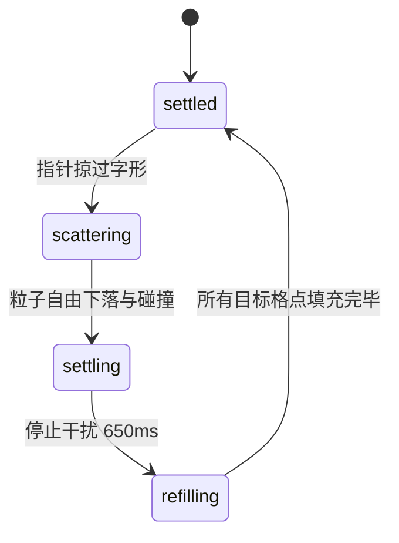

# Sand Text · 沙粒重构物理文字

由动态沙粒重力沉降与气流吹散组成的物理文字。包含三大核心机制：

1. **栅格化遮罩与目标格点分配**：将文本使用离屏 Canvas 光栅化提取 Alpha 通道（阈值 120），将字形转化为离散网格点；每个格点具有固定态（pinned）、松散下落态（loose）与游离态。
2. **指针吹散动力学与多步碰撞**：指针掠过字形产生 14px 半径的气流扰动，根据位移向量与距离反比向粒子施加散射初速度；每帧施加 0.22 重力加速度与 0.96 水平阻尼。
3. **延迟回填与底部沉降**：停止交互 650ms 后，缺失格点按每帧 `max(24, round(targets / 55))` 速率由上方持续漏入填补；多余沉底粒子逐步消退。

## 原型清单

| 原型分组 | 原型元素 | 动效 / 状态变化 | 去向 |
| --- | --- | --- | --- |
| — | 粒子画布 `canvas` | 离屏光栅化字形、沙粒重力沉降、气流吹散、回填、五档明度调色 | `.sand-canvas` |
| — | 词汇切换选项栏 `.words` | 选项按钮、滑块指示器与点击切换文字 | `.sand-words` |
| — | 顶栏、外观切换 `#themeBtn`、舞台外壳 | — | 演示外壳，已删除 |

## 适用

- 品牌 Hero 首屏、艺术标语、创意过渡标题。
- 强调自然流体感、时间流逝感或沙漏意象的内容展示。
- 允许鼠标移动即时吹散、离开后自动聚合复原的互动展板。

## 不适用

- 需要文本可选中、复制、读屏朗读的常规段落 → [typewriter-terminal](typewriter-terminal.md)
- 机械翻滚数字与计费面板 → [slot-text](slot-text.md)
- 拟真机械键帽触感键盘 → [keycap-keyboard](keycap-keyboard.md)
- 基础静态标签与普通按钮 → [button](../buttons/button.md)

## 状态机

| 状态 | 进入条件 | 视觉表现 | 退出到 |
| --- | --- | --- | --- |
| settled | 初始；回填完成且沙粒完全落定 | 文字清晰稳定呈现在画布中央，无正在运动的粒子 | scattering / refilling |
| scattering | 指针在文字区域内快速移动 | 交互半径内沙粒剥离网格，赋予初速度飞出并受重力下落 | settling / refilling |
| refilling | 指针离开或停止晃动 650ms | 新沙粒从顶部源源不断落下并吸附回填至字形缺失空位 | settled |
| reduced | 用户开启减少动态效果 | 画布跳过粒子模拟，直接静态填充字形遮罩点阵 | settled |



## 最小 DOM

```html
<div class="sand-text" role="region" aria-label="沙粒文字物理展示">
  <div class="sand-canvas-wrap">
    <canvas class="sand-canvas"></canvas>
  </div>
  <div class="sand-words" role="radiogroup" aria-label="选择预设词汇">
    <button type="button" class="sand-word-btn" role="radio" aria-checked="true" data-word="Dunes">Dunes</button>
    <button type="button" class="sand-word-btn" role="radio" aria-checked="false" data-word="Hourglass">Hourglass</button>
    <button type="button" class="sand-word-btn" role="radio" aria-checked="false" data-word="Shore">Shore</button>
  </div>
</div>
```

- `.sand-text`：组件根容器，设定响应式宽高与主题颜色。
- `.sand-canvas-wrap`：画布包裹层，限制相对尺寸与手势操作范围。
- `.sand-canvas`：物理沙粒粒子渲染的双缓冲 2D 画布。
- `.sand-words`：用于切换目标展示词汇的单选控件组。
- `.sand-word-btn`：独立词汇切换按钮，维护 `aria-checked` 状态。

## 参数

| 名称 | 值 | 用于 | 来源 |
| --- | --- | --- | --- |
| grainPx | `2px` | 每个物理沙粒格点像素尺寸 | 原型 |
| alphaThreshold | `120` | 文字遮罩光栅化判为有字的不透明度阈值（0~255） | 原型 |
| glyph.weight | `500` | 离屏测量文字字重 | 原型 |
| glyph.letterSpacing | `-0.03em` | 离屏字距紧缩比率 | 原型 |
| pointer.radiusPx | `14px` | 气流吹散影响半径 | 原型 |
| pointer.refillAfterMs | `650ms` | 停止交互后启动沙粒回填补齐的延迟 | 原型 |
| fall.gravityPerFrame | `0.22` | 自由落体垂直重力加速度 | 原型 |
| fall.horizontalDamping | `0.96` | 散射粒子水平速度衰减系数 | 原型 |
| settle.pinAfterAge | `4 帧` | 粒子在静止网格停留超过 4 帧转为固定文字态 | 原型 |
| settle.purgeAfterAge | `20 帧` | 超出字形范围的残余下落粒子存活上限 | 原型 |
| paletteOffsets | `[-36, -18, 0, 18, 36]` | 基于文字基础 RGB 色偏移生成的五档色阶 | 原型 |

## CSS

```css
.sand-text {
  --sand-color: #171717;
  --sand-bg: #f9f9f9;
  --sand-border: rgba(0, 0, 0, 0.08);
  --accent: #2563eb;
  position: relative;
  display: flex;
  flex-direction: column;
  align-items: center;
  justify-content: center;
  width: 100%;
  max-width: 680px;
  margin-inline: auto;
  gap: 16px;
  font-family: system-ui, -apple-system, sans-serif;
  color: var(--sand-color);
}

@media (prefers-color-scheme: dark) {
  .sand-text {
    --sand-color: #f5f5f5;
    --sand-bg: #1a1a1a;
    --sand-border: rgba(255, 255, 255, 0.1);
  }
}

.sand-canvas-wrap {
  position: relative;
  width: 100%;
  height: 220px;
  background: var(--sand-bg);
  border: 1px solid var(--sand-border);
  border-radius: 12px;
  overflow: hidden;
  touch-action: pan-y;
  cursor: crosshair;
}

.sand-canvas {
  display: block;
  width: 100%;
  height: 100%;
}

.sand-words {
  display: inline-flex;
  gap: 6px;
  padding: 4px;
  background: var(--sand-bg);
  border: 1px solid var(--sand-border);
  border-radius: 9999px;
}

.sand-word-btn {
  padding: 6px 14px;
  border: 0;
  border-radius: 9999px;
  background: transparent;
  color: var(--sand-color);
  font-size: 14px;
  font-weight: 500;
  cursor: pointer;
  transition: background-color 0.2s cubic-bezier(0.2, 0.8, 0.2, 1),
              color 0.2s cubic-bezier(0.2, 0.8, 0.2, 1);
}

.sand-word-btn:hover {
  background: rgba(0, 0, 0, 0.05);
}

@media (prefers-color-scheme: dark) {
  .sand-word-btn:hover {
    background: rgba(255, 255, 255, 0.1);
  }
}

.sand-word-btn[aria-checked="true"] {
  background: var(--sand-color);
  color: var(--sand-bg);
}

@media (prefers-reduced-motion: reduce) {
  .sand-canvas-wrap {
    cursor: default;
  }
}
```

## JS

```js
export function createSandText(el, options = {}) {
  const canvas = el.querySelector('.sand-canvas');
  const buttons = el.querySelectorAll('.sand-word-btn');
  if (!canvas) return { destroy: () => {} };

  const ctx = canvas.getContext('2d');
  const offscreen = document.createElement('canvas');
  const offCtx = offscreen.getContext('2d', { willReadFrequently: true });

  const grain = options.grain || 2;
  const scatterRadius = options.radius || 14;
  let word = options.initialWord || 'Dunes';
  let isReduced = window.matchMedia('(prefers-reduced-motion: reduce)').matches;

  let cols = 0;
  let rows = 0;
  let animId = null;
  let disposed = false;
  let lastScatterTime = -Infinity;
  let refillTimer = null;

  // 网格状态：0 空白，1 固定字形，2 松散下落
  let gridState = new Uint8Array(0);
  let gridTones = new Uint8Array(0);
  let gridAge = new Uint8Array(0);
  let targetMask = new Uint8Array(0);
  let targetIndices = [];
  let flyingParticles = [];
  let colors = [];

  const pointer = { x: -1000, y: -1000, px: -1000, py: -1000, inside: false };

  function buildPalette() {
    colors = [];
    const baseColor = getComputedStyle(el).color || '#171717';
    offCtx.clearRect(0, 0, 1, 1);
    offCtx.fillStyle = baseColor;
    offCtx.fillRect(0, 0, 1, 1);
    const rgb = Array.from(offCtx.getImageData(0, 0, 1, 1).data).slice(0, 3);
    for (const offset of [-36, -18, 0, 18, 36]) {
      const col = rgb.map((c) => Math.max(0, Math.min(255, c + offset)));
      colors.push(`rgb(${col[0]},${col[1]},${col[2]})`);
    }
  }

  function resize() {
    const rect = canvas.getBoundingClientRect();
    const dpr = Math.min(window.devicePixelRatio || 1, 2);
    canvas.width = Math.floor(rect.width * dpr);
    canvas.height = Math.floor(rect.height * dpr);

    cols = Math.floor(canvas.width / grain);
    rows = Math.floor(canvas.height / grain);

    const size = cols * rows;
    gridState = new Uint8Array(size);
    gridTones = new Uint8Array(size);
    gridAge = new Uint8Array(size);
    targetMask = new Uint8Array(size);
    targetIndices = [];
    flyingParticles = [];

    buildPalette();
    rasterizeWord(word);
    requestFrame();
  }

  function rasterizeWord(text) {
    targetMask.fill(0);
    targetIndices = [];
    if (!cols || !rows || !text) return;

    offscreen.width = cols;
    offscreen.height = rows;
    offCtx.clearRect(0, 0, cols, rows);

    let fontSize = Math.floor(rows * 0.45);
    offCtx.font = `500 ${fontSize}px system-ui, sans-serif`;
    offCtx.textAlign = 'center';
    offCtx.textBaseline = 'middle';
    offCtx.fillStyle = '#000000';
    offCtx.fillText(text, cols / 2, rows / 2);

    const imgData = offCtx.getImageData(0, 0, cols, rows).data;
    for (let i = 0; i < cols * rows; i++) {
      if (imgData[i * 4 + 3] > 120) {
        targetMask[i] = 1;
        targetIndices.push(i);
      }
    }

    if (isReduced) {
      gridState.fill(0);
      for (const idx of targetIndices) {
        gridState[idx] = 1;
        gridTones[idx] = Math.floor(Math.random() * colors.length);
      }
    } else {
      // 标记原有多余的为松散下落
      for (let i = 0; i < gridState.length; i++) {
        if (gridState[i] === 1 && !targetMask[i]) {
          gridState[i] = 2;
          gridAge[i] = 0;
        }
      }
    }
  }

  function scatter() {
    if (isReduced || !pointer.inside) return;
    const dx = pointer.x - pointer.px;
    const dy = pointer.y - pointer.py;
    pointer.px = pointer.x;
    pointer.py = pointer.y;

    if (Math.hypot(dx, dy) < 0.2) return;
    const r = scatterRadius / grain;
    const left = Math.max(0, Math.floor(pointer.x - r));
    const right = Math.min(cols - 1, Math.ceil(pointer.x + r));
    const top = Math.max(0, Math.floor(pointer.y - r));
    const bottom = Math.min(rows - 1, Math.ceil(pointer.y + r));

    for (let y = top; y <= bottom; y++) {
      for (let x = left; x <= right; x++) {
        const idx = y * cols + x;
        if (gridState[idx] === 0) continue;
        const rx = x + 0.5 - pointer.x;
        const ry = y + 0.5 - pointer.y;
        const dist = Math.hypot(rx, ry);
        if (dist > r) continue;

        gridState[idx] = 0;
        const strength = (1 - dist / r) * 0.9 + 0.25;
        flyingParticles.push({
          x: x + 0.5,
          y: y + 0.5,
          tone: gridTones[idx],
          vx: (rx / (dist || 1)) * strength + dx * 0.3 + (Math.random() - 0.5) * 0.5,
          vy: (ry / (dist || 1)) * strength + dy * 0.3 - 0.8 * Math.random()
        });
      }
    }
    lastScatterTime = performance.now();
  }

  function updateSimulation() {
    if (isReduced) return false;
    let active = false;

    // 1. 飞行粒子物理计算
    for (let k = flyingParticles.length - 1; k >= 0; k--) {
      const p = flyingParticles[k];
      p.vy += 0.22; // 重力
      p.vx *= 0.96; // 阻尼
      p.x += p.vx;
      p.y += p.vy;

      const gx = Math.floor(p.x);
      const gy = Math.floor(p.y);

      if (gx < 0 || gx >= cols || gy >= rows) {
        flyingParticles.splice(k, 1);
        continue;
      }

      if (gy >= 0) {
        const idx = gy * cols + gx;
        if (gridState[idx] === 0) {
          gridState[idx] = 2;
          gridTones[idx] = p.tone;
          gridAge[idx] = 0;
          flyingParticles.splice(k, 1);
          active = true;
          continue;
        }
      }
      active = true;
    }

    // 2. 底部松散粒子沉降与消退
    for (let y = rows - 2; y >= 0; y--) {
      for (let x = 0; x < cols; x++) {
        const idx = y * cols + x;
        if (gridState[idx] !== 2) continue;

        const below = idx + cols;
        if (gridState[below] === 0) {
          gridState[below] = 2;
          gridTones[below] = gridTones[idx];
          gridAge[below] = 0;
          gridState[idx] = 0;
          active = true;
        } else {
          gridAge[idx]++;
          if (targetMask[idx] && gridAge[idx] > 4) {
            gridState[idx] = 1; // 重新锚定为固定字形
          } else if (!targetMask[idx] && gridAge[idx] > 20) {
            gridState[idx] = 0; // 消退
            active = true;
          }
        }
      }
    }

    // 3. 回填
    if (performance.now() - lastScatterTime > 650) {
      const missing = targetIndices.filter((i) => gridState[i] === 0);
      if (missing.length > 0) {
        const count = Math.min(missing.length, Math.max(16, Math.floor(targetIndices.length / 50)));
        for (let i = 0; i < count; i++) {
          const targetIdx = missing[Math.floor(Math.random() * missing.length)];
          const col = targetIdx % cols;
          flyingParticles.push({
            x: col + (Math.random() - 0.5) * 2,
            y: 0,
            tone: Math.floor(Math.random() * colors.length),
            vx: (Math.random() - 0.5) * 0.4,
            vy: 1.5 + Math.random() * 2
          });
        }
        active = true;
      }
    }

    return active;
  }

  function render() {
    ctx.clearRect(0, 0, canvas.width, canvas.height);

    for (let i = 0; i < gridState.length; i++) {
      if (gridState[i] === 0) continue;
      const x = (i % cols) * grain;
      const y = Math.floor(i / cols) * grain;
      ctx.fillStyle = colors[gridTones[i]] || '#333333';
      ctx.fillRect(x, y, grain, grain);
    }

    for (const p of flyingParticles) {
      ctx.fillStyle = colors[p.tone] || '#333333';
      ctx.fillRect(Math.floor(p.x * grain), Math.floor(p.y * grain), grain, grain);
    }
  }

  function loop() {
    if (disposed) return;
    scatter();
    const moving = updateSimulation();
    render();

    if (moving || pointer.inside || flyingParticles.length > 0) {
      animId = requestAnimationFrame(loop);
    } else {
      animId = null;
    }
  }

  function requestFrame() {
    if (!animId && !disposed) {
      animId = requestAnimationFrame(loop);
    }
  }

  function onPointerMove(e) {
    const rect = canvas.getBoundingClientRect();
    const dpr = Math.min(window.devicePixelRatio || 1, 2);
    pointer.x = ((e.clientX - rect.left) * dpr) / grain;
    pointer.y = ((e.clientY - rect.top) * dpr) / grain;
    pointer.inside = true;
    requestFrame();
  }

  function onPointerLeave() {
    pointer.inside = false;
  }

  function setWord(newWord) {
    if (word === newWord) return;
    word = newWord;
    buttons.forEach((btn) => {
      btn.setAttribute('aria-checked', String(btn.dataset.word === word));
    });
    rasterizeWord(word);
    requestFrame();
    if (typeof options.onChange === 'function') options.onChange(word);
  }

  buttons.forEach((btn) => {
    btn.addEventListener('click', () => setWord(btn.dataset.word));
  });

  canvas.addEventListener('pointermove', onPointerMove);
  canvas.addEventListener('pointerleave', onPointerLeave);
  canvas.addEventListener('pointercancel', onPointerLeave);

  const resizeObserver = new ResizeObserver(() => {
    if (!disposed) resize();
  });
  resizeObserver.observe(canvas);

  resize();

  return {
    setWord,
    getWord() {
      return word;
    },
    destroy() {
      disposed = true;
      if (animId) cancelAnimationFrame(animId);
      clearTimeout(refillTimer);
      resizeObserver.disconnect();
      canvas.removeEventListener('pointermove', onPointerMove);
      canvas.removeEventListener('pointerleave', onPointerLeave);
      canvas.removeEventListener('pointercancel', onPointerLeave);
    }
  };
}
```

## 接入目标项目

- 状态来源：目标页面选中的词汇属性驱动 `setWord(val)`，并在沙粒重组时回调 `onChange`。
- 尺寸策略：画布随父级容器尺寸动态重设像素缓冲区，支持 `devicePixelRatio` 适配（最高限制 2 以防性能负载过大）。
- 驱动方式：`const sand = createSandText(rootEl);`，在页面卸载时调用 `sand.destroy()` 释放粒子物理帧与画布监听。

## 重入与清理

- 连续高频切换词汇时，直接在当前网格上重绘目标掩码，多余的在位沙粒直接转化为松散粒子下落，复用同一片内存缓冲区。
- 停止交互后经 650ms 防抖计时器触发逐批回填，避免在用户持续拖拽晃动时光标附近反复生成新沙粒。
- 销毁时停止 `requestAnimationFrame`，断开 `ResizeObserver`，置空粒子数组与强引用。

## 减少动态效果

- 在 `prefers-reduced-motion: reduce` 环境中，跳过重力、散射、回填物理循环。
- 直接根据离屏 Alpha 通道将字形点阵静态填充到画布上，无粒子飞行与重组动画。

## 焦点与键盘

- 词汇选择按钮组包裹在 `role="radiogroup"` 下，各按钮标记 `role="radio"` 与 `aria-checked` 状态。
- 用户可使用 Tab 键在各词汇间切换，按 Enter / Space 激活选中。
- 画布对辅助读屏无交互干扰，外层容器提供明确的 `aria-label`。

## 兼容回退

| 特性 | 不支持时 |
| --- | --- |
| 离屏 Canvas `willReadFrequently` | 回退至常规 2D 上下文（可能带来控制台警告，但不影响功能） |
| `ResizeObserver` | 回退至 `window.addEventListener('resize')` 重新计算 |
| `Uint8Array` 缓冲区 | 回退至原生 JavaScript 密集数组（性能略有下降） |

## 验收清单

- [ ] 初始加载时，沙粒从画布上方落下并自动拼凑出预设英文单词。
- [ ] 鼠标掠过文字时，光标周围 14px 范围内的沙粒被迅速吹散飞溅并下落。
- [ ] 鼠标移出画布并等待 650ms 后，上方自动漏下新沙粒逐步将文字缺失处填平。
- [ ] 点击不同的词汇按钮，旧词汇多余的沙粒下落消散，新词汇迅速由上方落入补全。
- [ ] 开启系统“减少动态效果”时，文字以静态点阵形式瞬间就绪，不播放吹散与重力动画。
