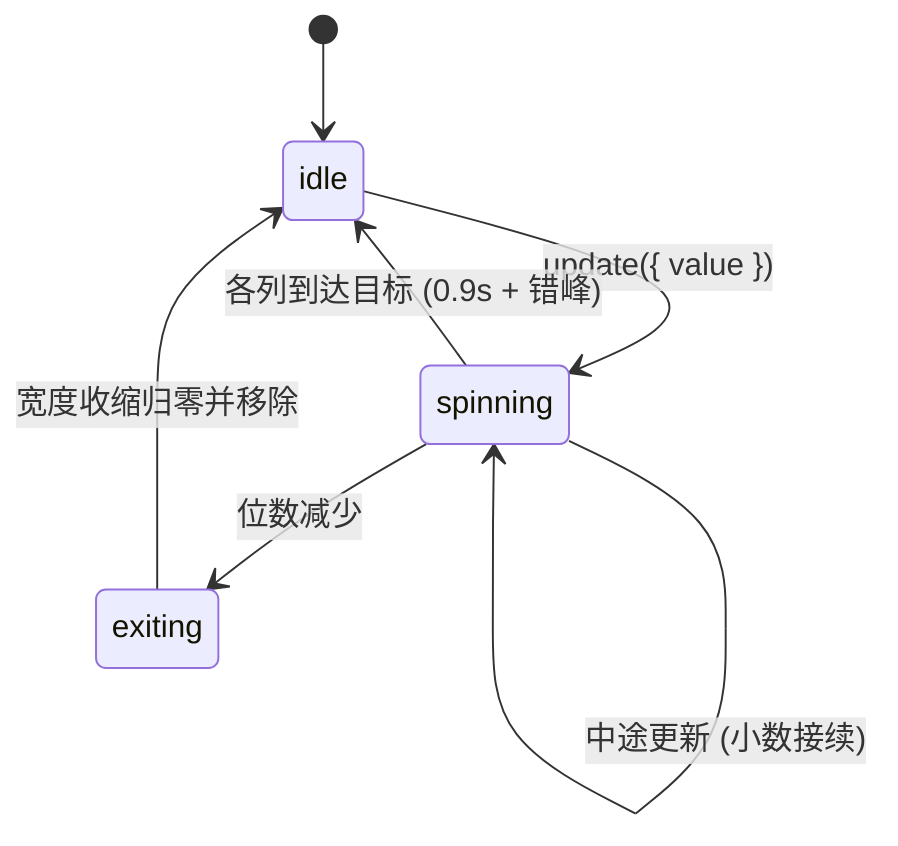

# Slot Text · 滚轮字符数字滚动

金融与统计级平滑逐列滚轮字符组件。核心动效机制包括：

1. **确定性字符带生成（Deterministic Strips）**：针对数字按递增或递减方向计算模 10 跨越路径与整圈旋转（`spins * 10 + distance`）；字母使用带种子的伪随机排列，保持每次跳转轨迹确定可测。
2. **渐进停靠曲线与速度动态模糊**：所有列同时启动滚动，并按每列 `0.07s` 错峰延迟停靠；采用 `cubic-bezier(0.12, 0.8, 0.16, 1)` 零过冲曲线降速，同时根据每帧角速度动态施加最高 2.4px 的垂直运动模糊（`filter: blur`）。
3. **Ghost Sizer 零抖动列宽弹簧**：每列内置不可见测量占位符（`.slot-sizer`），当字符增减或字体就绪改变尺寸时，宽度采用 0.6s 临界阻尼弹簧横向伸缩；退场列在 0.35s 内收缩至 0px 并从 DOM 移除。

## 原型清单

| 原型分组 | 原型元素 | 动效 / 状态变化 | 去向 |
| --- | --- | --- | --- |
| — | 滚轮根容器 `.slot-root` | 承载隐藏读屏文本与视觉滚轮容器 | `.slot-root` |
| — | 字符列 `.slot-column` | 独立分配 key、宽度弹簧过渡、动态进退场 | `.slot-column` |
| — | 隐藏尺寸探测器 `.slot-sizer` | 锁定当前字符精确物理宽度，防止横向跳动 | `.slot-sizer` |
| — | 垂直字符带 `.slot-strip` | `translate3d` 垂直滚动、停靠曲线、动态运动模糊 | `.slot-strip` |
| — | 统计卡片与周期切换栏 | 示例数值演示外壳 | 接入目标项目（可选项） |
| — | 顶栏、外观切换 `#themeBtn`、舞台外壳 | — | 演示外壳，已删除 |

## 适用

- 金融看板、仪表盘中的收入、利润、账户余额与汇率变动。
- 动态倒计时、仪表计数器或带单位/符号混合的指标跳动。
- 需要高刷新率且在数值突变时保持容器平滑伸缩的展示位。

## 不适用

- 拟真立体机械键帽输入键盘 → [keycap-keyboard](keycap-keyboard.md)
- 粒子吹散重组特效文字 → [sand-text](sand-text.md)
- 长文本打字机终端排版 → [typewriter-terminal](typewriter-terminal.md)
- 常规静态分段切换器 → [button-group](../buttons/button-group.md)

## 状态机

| 状态 | 进入条件 | 视觉表现 | 退出到 |
| --- | --- | --- | --- |
| idle | 初始；动画停靠完成 | 字符垂直居中静止，滤镜关闭，列宽锁定目标值 | spinning / interrupting |
| spinning | 数值发生变化更新目标 | 各列同时启动滚动，根据速度产生垂直微模糊，按错峰时长先后停靠 | idle / interrupting |
| interrupting | 滚动未结束时再次传入新数值 | 从当前瞬时可见字符和小数偏移生成接续字符带继续滚动 | spinning / idle |
| exiting | 新数值位数减少，部分列需要退场 | 列宽在 350ms 内平滑收窄为 0px 并被销毁 | idle |



## 最小 DOM

```html
<span class="slot-root" role="text" aria-label="$12,840">
  <span class="slot-sr-only" aria-live="polite">$12,840</span>
  <span class="slot-reels" aria-hidden="true">
    <span class="slot-column" style="width: 14px;">
      <span class="slot-sizer">$</span>
      <span class="slot-window">
        <span class="slot-strip" style="transform: translate3d(0, 0, 0);">
          <span class="slot-cell">$</span>
        </span>
      </span>
    </span>
    <span class="slot-column" style="width: 18px;">
      <span class="slot-sizer">1</span>
      <span class="slot-window">
        <span class="slot-strip" style="transform: translate3d(0, 0, 0);">
          <span class="slot-cell">1</span>
        </span>
      </span>
    </span>
  </span>
</span>
```

- `.slot-root`：组件宿主行内块，提供等宽数字（tabular-nums）与基线对齐。
- `.slot-sr-only`：屏幕阅读器专用文本槽，配置 `aria-live="polite"` 播报真实值。
- `.slot-reels`：视觉滚轮挂载容器，设置 `aria-hidden="true"` 避免干扰读屏。
- `.slot-column`：单字符物理列，受宽度弹簧驱动，承载单个字符及其滚动窗口。
- `.slot-sizer`：隐藏的字符尺寸测量器，用于实时测量当前字符在当前字体下的精确物理宽度。
- `.slot-window`：垂直溢出隐藏裁剪窗口，带有上下边缘透明渐变遮罩。
- `.slot-strip`：垂直长条字符带，承载所有连续滚动的候选字符。
- `.slot-cell`：字符带中的单行字符单元。

## 参数

| 名称 | 值 | 用于 | 来源 |
| --- | --- | --- | --- |
| duration | `0.9s` | 基础滚动时长 | 原型 |
| stagger | `0.07s` | 从左到右各列累加的错峰延迟时长 | 原型 |
| spins | `1` | 数字跳转经历的基础完整圈数（10 个数字） | 原型 |
| cellPitchEm | `1.6em` | 字符单元垂直行距 | 原型 |
| lineHeightEm | `1.15em` | 视窗可见高度 | 原型 |
| landingBezier | `[0.12, 0.8, 0.16, 1]` | 停靠缓动贝塞尔曲线 | 原型 |
| blur.maximumPx | `2.4px` | 滚动时动态运动模糊上限 | 原型 |
| blur.velocityFactor | `0.05` | 像素/秒速度转化为模糊像素的系数 | 原型 |
| width.visualDuration | `min(time, 0.6s)` | 列宽弹簧展开持续时间 | 原型 |
| width.exitVisualDuration | `0.35s` | 退场列收窄移除时长 | 原型 |

## CSS

```css
.slot-root {
  position: relative;
  display: inline-block;
  font-variant-numeric: tabular-nums;
  line-height: 1.15;
  white-space: nowrap;
  vertical-align: bottom;
}

.slot-sr-only {
  position: absolute;
  width: 1px;
  height: 1px;
  overflow: hidden;
  clip-path: inset(50%);
  white-space: nowrap;
}

.slot-reels {
  display: inline-flex;
  height: 1.15em;
  align-items: flex-start;
}

.slot-column {
  position: relative;
  display: inline-block;
  height: 1.15em;
  flex: none;
  overflow: visible;
  transition: width 0.35s cubic-bezier(0.2, 0.8, 0.2, 1);
}

.slot-sizer {
  display: inline-block;
  visibility: hidden;
  white-space: pre;
  pointer-events: none;
}

.slot-window {
  position: absolute;
  inset: -0.22em -0.08em;
  overflow: hidden;
  -webkit-mask-image: linear-gradient(
    to bottom,
    transparent,
    #000 0.24em,
    #000 calc(100% - 0.24em),
    transparent
  );
  mask-image: linear-gradient(
    to bottom,
    transparent,
    #000 0.24em,
    #000 calc(100% - 0.24em),
    transparent
  );
}

.slot-strip {
  position: absolute;
  top: calc(0.22em - 0.225em);
  right: 0.08em;
  left: 0.08em;
  display: flex;
  flex-direction: column;
  align-items: center;
  will-change: transform;
}

.slot-cell {
  display: block;
  height: 1.6em;
  padding-top: 0.225em;
  box-sizing: border-box;
  line-height: 1.15;
  white-space: pre;
  text-align: center;
}

@media (prefers-reduced-motion: reduce) {
  .slot-column {
    transition: none !important;
  }
  .slot-strip {
    transition: none !important;
    filter: none !important;
  }
}
```

## JS

```js
export function createSlotText(el, options = {}) {
  const DIGITS = '0123456789';
  const LOWER = 'abcdefghijklmnopqrstuvwxyz';
  const UPPER = LOWER.toUpperCase();
  const CELL = 1.6;

  function classOf(char) {
    if (DIGITS.includes(char)) return DIGITS;
    if (LOWER.includes(char)) return LOWER;
    if (UPPER.includes(char)) return UPPER;
    return null;
  }

  function cubicBezier(t, p1x, p1y, p2x, p2y) {
    let low = 0, high = 1, current = t;
    const calc = (v, a, b) => 3 * (1 - v) ** 2 * v * a + 3 * (1 - v) * v * v * b + v ** 3;
    for (let i = 0; i < 20; i++) {
      const x = calc(current, p1x, p2x);
      if (Math.abs(x - t) < 0.0001) break;
      if (x < t) low = current; else high = current;
      current = (low + high) / 2;
    }
    return calc(current, p1y, p2y);
  }

  function easeLanding(t) {
    return cubicBezier(t, 0.12, 0.8, 0.16, 1);
  }

  function buildStrip(from, to, spins, rising) {
    if (from === to) return [to];
    const set = classOf(to);
    if (!set) return [from, to];
    if (set === DIGITS && classOf(from) === DIGITS) {
      const a = Number(from);
      const b = Number(to);
      const steps = spins * 10 + (rising ? (b - a + 10) % 10 : (a - b + 10) % 10);
      return Array.from({ length: steps + 1 }, (_, i) =>
        String((a + (rising ? i : -i) + 100) % 10)
      );
    }
    return [from, to];
  }

  let reelsContainer = el.querySelector('.slot-reels');
  let srText = el.querySelector('.slot-sr-only');

  if (!reelsContainer) {
    reelsContainer = document.createElement('span');
    reelsContainer.className = 'slot-reels';
    reelsContainer.setAttribute('aria-hidden', 'true');
    el.appendChild(reelsContainer);
  }

  if (!srText) {
    srText = document.createElement('span');
    srText.className = 'slot-sr-only';
    srText.setAttribute('aria-live', 'polite');
    el.insertBefore(srText, reelsContainer);
  }

  const columns = new Map();
  let currentValue = options.value ?? 12840;
  let disposed = false;
  const isReduced = window.matchMedia('(prefers-reduced-motion: reduce)').matches;

  function updateValue(nextVal) {
    const prevNum = Number(currentValue);
    const nextNum = Number(nextVal);
    const rising = !isNaN(prevNum) && !isNaN(nextNum) ? nextNum >= prevNum : true;
    currentValue = nextVal;

    const formatted = typeof nextVal === 'number'
      ? (options.format ? options.format(nextVal) : nextVal.toLocaleString('en-US'))
      : String(nextVal);

    srText.textContent = formatted;
    const chars = Array.from(formatted);

    // 从末尾对齐字符键
    const activeKeys = new Set();
    const len = chars.length;

    chars.forEach((char, index) => {
      const key = `col-${len - 1 - index}`;
      activeKeys.add(key);

      let col = columns.get(key);
      if (!col) {
        const node = document.createElement('span');
        node.className = 'slot-column';

        const sizer = document.createElement('span');
        sizer.className = 'slot-sizer';

        const win = document.createElement('span');
        win.className = 'slot-window';

        const strip = document.createElement('span');
        strip.className = 'slot-strip';

        win.appendChild(strip);
        node.appendChild(sizer);
        node.appendChild(win);
        reelsContainer.appendChild(node);

        col = {
          node,
          sizer,
          strip,
          char: '',
          pos: 0,
          frame: 0
        };
        columns.set(key, col);
      }

      const prevChar = col.char || char;
      col.char = char;
      col.sizer.textContent = char;

      // 动态更新列宽
      const measured = col.sizer.getBoundingClientRect().width;
      col.node.style.width = `${Math.ceil(measured || 14)}px`;

      const stripChars = isReduced ? [char] : buildStrip(prevChar, char, options.spins ?? 1, rising);
      col.strip.replaceChildren(
        ...stripChars.map((c) => {
          const cell = document.createElement('span');
          cell.className = 'slot-cell';
          cell.textContent = c;
          return cell;
        })
      );

      const targetIndex = stripChars.length - 1;
      if (isReduced || targetIndex === 0) {
        col.strip.style.transform = `translate3d(0, ${-targetIndex * CELL}em, 0)`;
        col.strip.style.filter = 'none';
      } else {
        cancelAnimationFrame(col.frame);
        const startTime = performance.now();
        const duration = (options.duration ?? 0.9) * 1000 + index * 70;

        function tick(now) {
          const progress = Math.min(1, (now - startTime) / duration);
          const currentEased = easeLanding(progress);
          const currentPos = targetIndex * currentEased;
          col.pos = currentPos;

          col.strip.style.transform = `translate3d(0, ${(-currentPos * CELL).toFixed(4)}em, 0)`;

          const speed = (1 - progress) * 2;
          const blur = Math.min(speed, 2.4);
          col.strip.style.filter = blur > 0.15 ? `blur(${blur.toFixed(2)}px)` : 'none';

          if (progress < 1) {
            col.frame = requestAnimationFrame(tick);
          } else {
            col.strip.style.filter = 'none';
          }
        }
        col.frame = requestAnimationFrame(tick);
      }
    });

    // 移除多余的旧列
    for (const [key, col] of columns.entries()) {
      if (!activeKeys.has(key)) {
        cancelAnimationFrame(col.frame);
        col.node.style.width = '0px';
        setTimeout(() => {
          col.node.remove();
          columns.delete(key);
        }, 350);
      }
    }

    if (typeof options.onChange === 'function') {
      options.onChange(currentValue);
    }
  }

  updateValue(currentValue);

  return {
    update(val) {
      if (!disposed) updateValue(val);
    },
    getValue() {
      return currentValue;
    },
    destroy() {
      disposed = true;
      for (const col of columns.values()) {
        cancelAnimationFrame(col.frame);
      }
      columns.clear();
      reelsContainer.replaceChildren();
    }
  };
}
```

## 接入目标项目

- 状态来源：目标财务报表或统计卡片的当前数值，在周期或数据响应返回时调用 `slot.update(newNum)`。
- 尺寸策略：内部 `.slot-sizer` 透明计算字体字形宽度并赋予 `.slot-column`，杜绝传统滚轮在 `1` 与 `8` 之间切换导致的外框横向抖动。
- 驱动方式：实例化 `const slot = createSlotText(el, { spins: 1, duration: 0.9 });`，组件卸载时调用 `slot.destroy()`。

## 重入与清理

- 连续高频传入数值时，取消上一轮动画帧并在新生成的字符带上从当前位置无缝计算过渡。
- 退出中的多余列通过 350ms 延时平滑淡缩后清理，防止残留空白占位。
- 销毁时停止全部活跃列的 `requestAnimationFrame` 并移除内部 DOM。

## 减少动态效果

- 在 `prefers-reduced-motion: reduce` 环境中，跳过字符带连续平移与动态模糊。
- 字符带仅保留目标单字并直接到位，列宽立即同步，退场列瞬间移除。

## 焦点与键盘

- 根节点标记 `role="text"`，通过不可见 `slot-sr-only` 与 `aria-live="polite"` 播报真实值。
- 视觉滚轮标记 `aria-hidden="true"`，防止屏幕阅读器将每个滚轮候选字符读出为乱码。
- 本身作为展示组件不拦截焦点，若包含周期切换按钮，沿用标准 radio 键盘导航语义。

## 兼容回退

| 特性 | 不支持时 |
| --- | --- |
| CSS 遮罩 `mask-image` | 回退至常规透明溢出隐藏（无边缘羽化渐隐） |
| `font-variant-numeric: tabular-nums` | 回退使用系统等宽字体（如 ui-monospace） |
| `clip-path` | 回退使用绝对定位与 `overflow: hidden` 隐藏辅助读屏文本 |

## 验收清单

- [ ] 金额更新时，所有数字列同时转动，并在 0.9s 加错峰延迟后优雅停靠。
- [ ] 滚动过程中能观察到随速度变化的微量垂直运动模糊，停靠时滤镜完全清除。
- [ ] 位数增加时，新增列从左侧顺畅展开宽度；位数减少时，多余列平滑收窄退场。
- [ ] 读屏器仅朗读真实数值（如 "$12,840"），不朗读翻滚中的中间数字。
- [ ] 开启系统的“减少动态效果”时，数字瞬时切换到位，无滚动与模糊。
