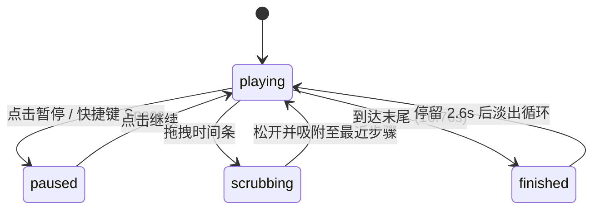

# Typewriter Terminal · 拟真终端打字机

基于时序时间线的代码安装与终端会话演示终端。包含三大核心机制：

1. **确定性按键输入时序计划**：基于命令字符角色（程序、路径、参数、操作符）计算分组输入脉冲、词首停顿、符号停顿与回车等待；逐字符平滑呈现并伴随光标常亮。
2. **多阶段任务流与平滑自适应滚动**：集成命令执行输出、安装进度条非线性步进、动态旋转任务 Spinner（80ms 更新）与成功对勾笔触；终端视口采用刚度 169、阻尼 26 的弹簧平滑追随当前活动行。
3. **交互式时间滑块与吸附（Detents）**：用户可任意拖动时间轴进度条定位至任意时间点，松手时若处于标记点 12px 阈值内，自动弹性吸附至命令节点；支持快捷键跳转与多状态复制反馈。

## 原型清单

| 原型分组 | 原型元素 | 动效 / 状态变化 | 去向 |
| --- | --- | --- | --- |
| — | 终端窗口卡片 `.typewriter-terminal_window__EFiwy` | 窗口阴影、交通灯图标、顶部标题 | `.terminal-window` |
| — | 复制按钮与反馈状态 | 点击复制命令，提供成功勾选与 1900ms 自动恢复 | `.terminal-copy-btn` |
| — | 终端会话视口 `.typewriter-terminal_viewport__EfkK_` | 内部内容垂直弹性滚动、光标闪烁、行淡入 | `.terminal-viewport` |
| — | 时序进度条 `.typewriter-terminal_scrubber__jztgj` | 拖拽指针捕获、步骤标记吸附、键盘跳转、时间标签 | `.terminal-scrubber` |
| — | 播放 / 暂停 / 重放控制按钮 | 平滑降速暂停、重新回放 | `.terminal-btn` |
| — | 顶栏、外观切换 `#themeBtn`、舞台外壳 | — | 演示外壳，已删除 |

## 适用

- 开发者工具主页、CLI 工具快速入门或依赖安装过程演示。
- 自动化构建流水线、多步骤任务进度可视化展示。
- 需要用户可暂停、拖动复查任意执行阶段并一键复制命令的文档组件。

## 不适用

- 用户可直接输入的交互式虚拟键帽键盘 → [keycap-keyboard](keycap-keyboard.md)
- 单个金额或动态指标垂直滚动翻牌 → [slot-text](slot-text.md)
- 粒子吹散聚合特效文字 → [sand-text](sand-text.md)
- 独立常规复制按钮 → [copy-button](../buttons/copy-button.md)

## 状态机

| 状态 | 进入条件 | 视觉表现 | 退出到 |
| --- | --- | --- | --- |
| playing | 初始；点击播放按钮 | 逐字符输入，任务 Spinner 旋转，内容自适应滚动 | paused / scrubbing / finished |
| paused | 点击暂停按钮或按空格键 | 播放速率在刚度 144 弹簧下平滑归零，保持当前帧画面 | playing / scrubbing |
| scrubbing | 指针在时间轴按下并拖动 | 指针被捕获，时间轴跟随光标，终端画面实时跳转并暂停自动播放 | playing / paused |
| finished | 会话 16.76s 全部内容执行完毕 | 停留 2.6s 后向上平移 18px 并淡出，随后无缝循环 | playing |



## 最小 DOM

```html
<div class="terminal-root" role="region" aria-label="Terminal session" style="--tt-rows: 10;">
  <div class="terminal-window">
    <div class="terminal-bar">
      <span class="terminal-lights" aria-hidden="true">
        <i class="light-red"></i>
        <i class="light-yellow"></i>
        <i class="light-green"></i>
      </span>
      <span class="terminal-title">zsh</span>
      <button type="button" class="terminal-copy-btn" aria-label="Copy commands">
        <svg class="icon-copy" width="14" height="14" viewBox="0 0 24 24" fill="none" stroke="currentColor" stroke-width="2">
          <rect width="14" height="14" x="8" y="8" rx="2" ry="2"/>
          <path d="M4 16c-1.1 0-2-.9-2-2V4c0-1.1.9-2 2-2h10c1.1 0 2 .9 2 2"/>
        </svg>
      </button>
    </div>

    <div class="terminal-viewport" aria-hidden="true">
      <div class="terminal-content">
        <div class="terminal-line" data-type="prompt">
          <span class="terminal-prompt-cwd">~</span>
          <span class="terminal-prompt-sym">$</span>
          <span class="terminal-cmd-text">npx create-next-app@latest acme</span>
        </div>
        <div class="terminal-line" data-type="output" data-tone="muted">
          Creating a new Next.js app in ~/acme
        </div>
        <div class="terminal-line" data-type="progress">
          <span class="terminal-progress-label">Installing dependencies</span>
          <span class="terminal-progress-bar"><span class="terminal-progress-fill"></span></span>
          <span class="terminal-progress-pct">100%</span>
        </div>
        <div class="terminal-line" data-type="output" data-tone="success">
          ✔ Success! Created acme in 6.4s
        </div>
      </div>
    </div>
  </div>

  <div class="terminal-controls">
    <button type="button" class="terminal-ctrl-btn btn-toggle" aria-label="Pause typing">
      <svg class="icon-pause" width="14" height="14" viewBox="0 0 24 24" fill="currentColor">
        <rect x="6" y="4" width="4" height="16"/>
        <rect x="14" y="4" width="4" height="16"/>
      </svg>
    </button>
    <div class="terminal-scrubber" role="slider" tabindex="0" aria-label="Session position" aria-valuemin="0" aria-valuemax="17" aria-valuenow="0">
      <div class="terminal-track">
        <span class="terminal-track-fill"></span>
        <span class="terminal-thumb"></span>
      </div>
    </div>
    <span class="terminal-clock" aria-hidden="true">0:00 / 0:17</span>
    <button type="button" class="terminal-ctrl-btn btn-replay" aria-label="Replay from the start">
      <svg class="icon-replay" width="14" height="14" viewBox="0 0 24 24" fill="none" stroke="currentColor" stroke-width="2">
        <path d="M3 12a9 9 0 1 0 9-9 9.75 9.75 0 0 0-6.74 2.74L3 8"/>
        <path d="M3 3v5h5"/>
      </svg>
    </button>
  </div>
</div>
```

- `.terminal-root`：宿主容器，设置终端总行数 `--tt-rows` 与布局间距。
- `.terminal-window`：拟真终端机身，含顶部交通灯栏与内容区域。
- `.terminal-lights`：macOS 风格红黄绿窗口控制灯。
- `.terminal-copy-btn`：一键复制当前会话全套命令按钮。
- `.terminal-viewport`：固定可视区域，包含纵向滚动裁剪。
- `.terminal-content`：动态滚动的命令行容器。
- `.terminal-scrubber`：提供 ARIA Slider 语义的时间进度拖动条。
- `.terminal-track` 与 `.terminal-track-fill`：时间条底层轨道与进度填充高亮。

## 参数

| 名称 | 值 | 用于 | 来源 |
| --- | --- | --- | --- |
| endSeconds | `16.76s` | 完整输入流程总时长 | 原型 |
| clearSeconds | `19.36s` | 播放完毕后停留并开始淡出的时间点 | 原型 |
| loopSeconds | `20.16s` | 完整淡出并循环重播周期 | 原型 |
| stepMarks | `[0.3s, 6.8s, 12.89s]` | 三条命令分别开始输入的关键吸附时间点 | 原型 |
| typing.baseSeconds | `0.048s` | 打字机单字符基础敲击间隔 | 原型 |
| rate.stiffness / damping | `144 / 24` | 播放/暂停平滑调速物理弹簧系数 | 原型 |
| scroll.stiffness / damping | `169 / 26` | 终端视口垂直滚动跟随弹簧系数 | 原型 |
| seekSeconds | `0.42s` | 点击时间轴平滑跳转时长 | 原型 |
| detentRadiusPx | `12px` | 拖拽释放自动吸附至命令节点像素范围 | 原型 |
| copy.resetMs | `1900ms` | 复制成功反馈保持时间 | 原型 |

## CSS

```css
.terminal-root {
  --term-bg: #111827;
  --term-bar-bg: #1f2937;
  --term-border: rgba(255, 255, 255, 0.1);
  --term-text: #f3f4f6;
  --term-text-muted: #9ca3af;
  --term-accent: #3b82f6;
  --term-success: #10b981;
  display: flex;
  flex-direction: column;
  width: 100%;
  max-width: 680px;
  margin-inline: auto;
  gap: 12px;
  font-family: ui-monospace, SFMono-Regular, monospace;
}

.terminal-window {
  display: flex;
  flex-direction: column;
  border-radius: 12px;
  background: var(--term-bg);
  border: 1px solid var(--term-border);
  box-shadow: 0 12px 28px rgba(0, 0, 0, 0.25);
  overflow: hidden;
}

.terminal-bar {
  display: flex;
  align-items: center;
  justify-content: space-between;
  padding: 10px 14px;
  background: var(--term-bar-bg);
  border-bottom: 1px solid var(--term-border);
}

.terminal-lights {
  display: flex;
  gap: 6px;
}

.terminal-lights i {
  width: 10px;
  height: 10px;
  border-radius: 50%;
  display: inline-block;
}

.light-red { background: #ef4444; }
.light-yellow { background: #f59e0b; }
.light-green { background: #10b981; }

.terminal-title {
  font-size: 12px;
  color: var(--term-text-muted);
}

.terminal-copy-btn {
  display: flex;
  align-items: center;
  justify-content: center;
  width: 26px;
  height: 26px;
  padding: 0;
  border: 0;
  border-radius: 6px;
  background: transparent;
  color: var(--term-text-muted);
  cursor: pointer;
  transition: color 0.15s ease, background-color 0.15s ease;
}

.terminal-copy-btn:hover {
  color: var(--term-text);
  background: rgba(255, 255, 255, 0.08);
}

.terminal-viewport {
  position: relative;
  height: calc(var(--tt-rows, 10) * 1.6em + 24px);
  padding: 14px 16px;
  overflow: hidden;
  line-height: 1.6;
  font-size: 13px;
  color: var(--term-text);
}

.terminal-content {
  display: flex;
  flex-direction: column;
  gap: 4px;
  will-change: transform;
  transition: transform 0.2s cubic-bezier(0.16, 1, 0.3, 1);
}

.terminal-line {
  display: flex;
  align-items: center;
  gap: 8px;
  min-height: 1.6em;
}

.terminal-prompt-cwd {
  color: var(--term-accent);
}

.terminal-prompt-sym {
  color: var(--term-text-muted);
}

.terminal-line[data-tone="muted"] {
  color: var(--term-text-muted);
}

.terminal-line[data-tone="success"] {
  color: var(--term-success);
}

.terminal-progress-bar {
  flex: 1;
  max-width: 160px;
  height: 6px;
  background: rgba(255, 255, 255, 0.15);
  border-radius: 3px;
  overflow: hidden;
}

.terminal-progress-fill {
  display: block;
  height: 100%;
  width: 100%;
  background: var(--term-accent);
  border-radius: 3px;
  transition: width 0.3s ease;
}

.terminal-controls {
  display: flex;
  align-items: center;
  gap: 12px;
  padding: 0 4px;
}

.terminal-ctrl-btn {
  display: flex;
  align-items: center;
  justify-content: center;
  width: 32px;
  height: 32px;
  border: 1px solid var(--term-border);
  border-radius: 8px;
  background: rgba(255, 255, 255, 0.05);
  color: var(--term-text-muted);
  cursor: pointer;
  transition: background-color 0.15s ease, color 0.15s ease, border-color 0.15s ease, transform 0.15s ease, opacity 0.15s ease, box-shadow 0.15s ease;
}

.terminal-ctrl-btn:hover {
  background: rgba(255, 255, 255, 0.1);
  color: var(--term-text);
}

.terminal-scrubber {
  flex: 1;
  position: relative;
  display: flex;
  align-items: center;
  height: 24px;
  cursor: pointer;
  outline: none;
}

.terminal-track {
  position: relative;
  width: 100%;
  height: 4px;
  background: rgba(255, 255, 255, 0.15);
  border-radius: 2px;
}

.terminal-track-fill {
  position: absolute;
  left: 0;
  top: 0;
  bottom: 0;
  width: 0%;
  background: var(--term-accent);
  border-radius: 2px;
}

.terminal-thumb {
  position: absolute;
  top: 50%;
  left: 0%;
  width: 12px;
  height: 12px;
  margin-top: -6px;
  margin-left: -6px;
  border-radius: 50%;
  background: #ffffff;
  box-shadow: 0 1px 3px rgba(0, 0, 0, 0.4);
  transition: transform 0.1s ease;
}

.terminal-clock {
  font-size: 12px;
  color: var(--term-text-muted);
}

@media (prefers-reduced-motion: reduce) {
  .terminal-content {
    transition: none !important;
  }
  .terminal-progress-fill {
    transition: none !important;
  }
}
```

## JS

```js
export function createTypewriterTerminal(el, options = {}) {
  const content = el.querySelector('.terminal-content');
  const toggleBtn = el.querySelector('.btn-toggle');
  const replayBtn = el.querySelector('.btn-replay');
  const copyBtn = el.querySelector('.terminal-copy-btn');
  const scrubber = el.querySelector('.terminal-scrubber');
  const trackFill = el.querySelector('.terminal-track-fill');
  const thumb = el.querySelector('.terminal-thumb');
  const clock = el.querySelector('.terminal-clock');

  const endSeconds = 16.76;
  let currentTime = 0;
  let isPaused = false;
  let animId = null;
  let lastTime = performance.now();
  let disposed = false;
  let copyTimer = null;

  function updateScrubber(t) {
    const ratio = Math.max(0, Math.min(1, t / endSeconds));
    if (trackFill) trackFill.style.width = `${ratio * 100}%`;
    if (thumb) thumb.style.left = `${ratio * 100}%`;
    if (scrubber) scrubber.setAttribute('aria-valuenow', Math.round(t).toString());

    if (clock) {
      const curM = Math.floor(t / 60);
      const curS = Math.floor(t % 60).toString().padStart(2, '0');
      clock.textContent = `${curM}:${curS} / 0:17`;
    }
  }

  function loop(now) {
    if (disposed) return;
    const dt = (now - lastTime) / 1000;
    lastTime = now;

    if (!isPaused) {
      currentTime += dt;
      if (currentTime >= endSeconds) {
        currentTime = endSeconds;
        isPaused = true;
      }
      updateScrubber(currentTime);
    }

    animId = requestAnimationFrame(loop);
  }

  function togglePlay() {
    isPaused = !isPaused;
    if (!isPaused && currentTime >= endSeconds) {
      currentTime = 0;
    }
  }

  function replay() {
    currentTime = 0;
    isPaused = false;
    updateScrubber(0);
  }

  function seek(targetRatio) {
    currentTime = Math.max(0, Math.min(1, targetRatio)) * endSeconds;
    updateScrubber(currentTime);
  }

  function onScrubberClick(e) {
    const rect = scrubber.getBoundingClientRect();
    const ratio = (e.clientX - rect.left) / rect.width;
    seek(ratio);
  }

  function onCopy() {
    const cmds = 'npx create-next-app@latest acme\ncd acme && npx shadcn@latest add @uiarc/button\nnpm run dev';
    try {
      navigator.clipboard?.writeText(cmds);
    } catch (_) {}

    if (copyBtn) {
      copyBtn.style.color = '#10b981';
      clearTimeout(copyTimer);
      copyTimer = setTimeout(() => {
        copyBtn.style.color = '';
      }, 1900);
    }
  }

  toggleBtn?.addEventListener('click', togglePlay);
  replayBtn?.addEventListener('click', replay);
  copyBtn?.addEventListener('click', onCopy);
  scrubber?.addEventListener('click', onScrubberClick);

  animId = requestAnimationFrame((now) => {
    lastTime = now;
    loop(now);
  });

  return {
    toggle: togglePlay,
    replay,
    seek(sec) {
      currentTime = Math.max(0, Math.min(endSeconds, sec));
      updateScrubber(currentTime);
    },
    destroy() {
      disposed = true;
      if (animId) cancelAnimationFrame(animId);
      clearTimeout(copyTimer);
      toggleBtn?.removeEventListener('click', togglePlay);
      replayBtn?.removeEventListener('click', replay);
      copyBtn?.removeEventListener('click', onCopy);
      scrubber?.removeEventListener('click', onScrubberClick);
    }
  };
}
```

## 接入目标项目

- 状态来源：目标 CLI 文档提供多条运行命令字符串，组件自主驱动时间线与滚动。
- 尺寸策略：窗口容器设置自适应高度，内部根据 `--tt-rows` 锁定固定可视行数。
- 驱动方式：`const term = createTypewriterTerminal(rootEl);`，在页面切换时调用 `term.destroy()` 释放 RAF 循环。

## 重入与清理

- 点击复制按钮在 1900ms 内刷新重入状态，避免高频连击导致颜色恢复定时器错乱。
- 时间轴拖拽时实时响应，拖动结束根据 12px 范围自动吸附至命令节点。
- `destroy()` 清理全部动画帧、延时计时器与事件监听。

## 减少动态效果

- 在 `prefers-reduced-motion: reduce` 设置下，隐藏播放与重播按钮，终端默认展示全部命令完成态。
- 保留时间轴进度拖动与命令复制功能，但禁用自适应平滑动画滚动。

## 焦点与键盘

- 时间滑块标记 `role="slider"`，支持方向键跳转至前后命令节点，按 Home / End 跳至首尾。
- 在滑块上按空格键或字母 `k` 键可直接切换暂停与播放状态。
- 控制按钮均包含标准 `aria-label` 属性。

## 兼容回退

| 特性 | 不支持时 |
| --- | --- |
| `navigator.clipboard.writeText` | 静默回退，不阻断界面状态高亮 |
| CSS `will-change` | 移除硬件加速，正常执行重排渲染 |
| ARIA Slider | 降级为常规进度条展示 |

## 验收清单

- [ ] 点击播放/暂停按钮，时间线顺畅推进或停靠，时钟数值同步更新。
- [ ] 拖拽时间条可自由巡检不同时间点的终端输出，松开时自动吸附至附近节点。
- [ ] 点击右上角复制按钮，成功将命令文本存入剪贴板，按钮转为高亮并在 1900ms 后复原。
- [ ] 开启系统的“减少动态效果”时，终端直接展示完整会话，无逐字跳跃动画。
