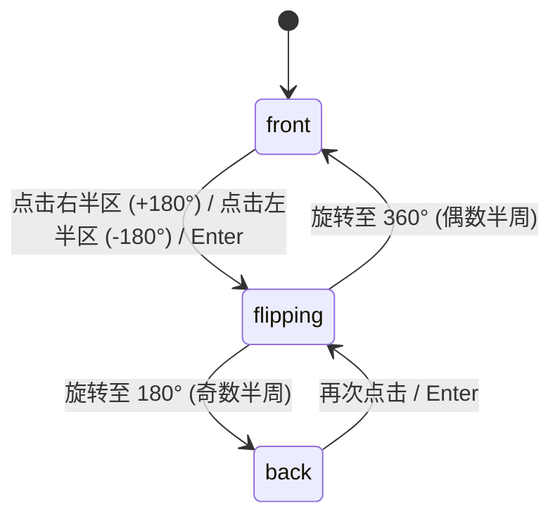

# Holo Card · 全息双面卡片

集成双独立弹簧（倾斜 vs 光泽）、数学三角函数驱动的全息彩虹彩膜、闪粉微粒反光与有方向性 3D 翻转的数字会员卡。

## 原型清单

| 原型分组 | 原型元素 | 动效 / 状态变化 | 去向 |
| --- | --- | --- | --- |
| 3D 旋转容器 | 卡片主体（`.holo-card`） | 900px 透视，点击左半边逆向翻转 180°，点击右半边顺向翻转 180°，键盘 Enter/Space 翻转 | 核心 3D 翻转引擎 |
| 倾斜与光照解耦 | 物理双弹簧 | 倾斜弹簧（stiffness 160）驱动卡片姿态，光泽弹簧（stiffness 120）驱动反光与彩膜平滑延时跟随 | 双弹簧材质光照解耦 |
| 全息彩膜材质 | 彩虹高光层（`.holo-card-foil`） | 利用 `edge = abs(sin(turn/180*PI))` 三角函数在侧边时增大彩膜强度并动态偏移色相（`--hue`） | 全息材质着色器 |
| 闪粉贴图 | SVG 闪粉纹理（`.holo-card-glitter`） | 随光泽坐标产生反向视差偏移（`(--gx, --gy)`），并在侧边增强反光 | 闪粉微粒反射 |
| 正反双面内容 | 正面与反面布局 | 正面展示独立圆角头像、姓名与 Pro 徽章；反面展示会员专属权益与编号 | 正反面双面视图 |
| 演示外壳 | 页面大背景、翻转操作提示文字、外观切换按钮 | 演示环境布局与指示 | 演示外壳，已删除 |

## 适用

- VIP 会员卡、通行凭证、数字身份卡、成就勋章或数字收藏品（Collectible）展示。
- 需要逼真的物理触感反馈：光标移动产生反光与闪粉流转，点击左右半区控制卡片沿不同方向翻转。
- 允许连续快速点击，要求翻转动画具备无缝打断与角速度继承能力。

## 不适用

- 纯展示性平面指标卡片 → [metric-card](../cards/metric-card.md)
- 单面带展开详情的半透明毛玻璃卡片 → [glass-card](../glass/glass-card.md)
- 多张卡片层叠堆放与垂直滑动展开的卡包 → [wallet-stack](wallet-stack.md)
- 常规内容折叠卡片 → [card](../cards/card.md)

## 状态机

| 状态 | 进入条件 | 视觉表现 | 退出到 |
| --- | --- | --- | --- |
| front | 初始默认态；或旋转至偶数个半周（0°, 360°...） | 正面向上，展示独立头像、姓名、Pro 标签，反面隐藏（backface-visibility） | flipping |
| flipping | 点击卡片或按 Enter 触发翻转 | 产生 180° 连续角度过渡，侧边达到 90° 时 edge 达到峰值 1，彩膜与闪粉高亮迸发 | front / back |
| back | 旋转至奇数个半周（180°, 540°...） | 反面向上，展示会员权益列表与专属认证信息 | flipping |



## 最小 DOM

```html
<div class="holo-card-root">
  <div class="holo-card" role="button" aria-label="全息会员卡，点击翻转" tabindex="0" style="--rx: 0deg; --ry: 0deg; --turn: 0deg;">
    <!-- 1. 卡片正面 -->
    <div class="holo-card-face holo-card-front" aria-hidden="false">
      <!-- 全息彩膜与闪粉层 -->
      <div class="holo-card-foil" aria-hidden="true"></div>
      <div class="holo-card-glitter" aria-hidden="true"></div>
      <div class="holo-card-shine" aria-hidden="true"></div>

      <!-- 正面内容 -->
      <div class="holo-card-content">
        <div class="holo-card-top">
          <div class="holo-card-brand">MERIDIAN</div>
          <span class="holo-card-badge">PRO 会员</span>
        </div>
        <div class="holo-card-user">
          <div class="holo-card-avatar">JB</div>
          <div class="holo-card-name">Jasmine Brooks</div>
          <div class="holo-card-role">资深架构师</div>
        </div>
        <div class="holo-card-bottom">
          <span>有效至 2028 / 12</span>
          <span>NO. 8848-09</span>
        </div>
      </div>
    </div>

    <!-- 2. 卡片反面 -->
    <div class="holo-card-face holo-card-back" aria-hidden="true">
      <div class="holo-card-foil" aria-hidden="true"></div>
      <div class="holo-card-glitter" aria-hidden="true"></div>
      <div class="holo-card-shine" aria-hidden="true"></div>

      <!-- 反面内容 -->
      <div class="holo-card-content">
        <div class="holo-card-top">
          <div class="holo-card-brand">MEMBERSHIP PRIVILEGES</div>
        </div>
        <div class="holo-card-perks">
          <div>· 优先访问专属实验室与前沿模型</div>
          <div>· 全天候专属架构师咨询通道</div>
          <div>· 离线安全私有化部署支持</div>
        </div>
        <div class="holo-card-bottom">
          <span>扫码快速核验</span>
          <span class="holo-card-chip">ID: #9924-A</span>
        </div>
      </div>
    </div>
  </div>
</div>
```

- `.holo-card-root`：外层 3D 透视舞台容器（perspective 900px）。
- `.holo-card`：承载 3D 翻转与弹簧倾斜的主体，通过 CSS 变量 `--turn`、`--rx`、`--ry` 驱动空间姿态。
- `.holo-card-face`：卡片正反面双层，具备 `backface-visibility: hidden`。
- `.holo-card-foil`：全息彩虹色相渐变层，基于动态计算的 `--hue` 与 `--foil-x` 变幻。
- `.holo-card-glitter`：微细网格闪粉层，提供珠宝微粒般的漫反射反光。
- `.holo-card-shine`：镜面镜面高光反射光斑。

## 参数

| 名称 | 值 | 用于 | 来源 |
| --- | --- | --- | --- |
| 空间透视 | `900px` | `.holo-card-root` perspective | 原型 |
| 翻转弹簧 | `visualDuration: 0.60s, bounce: 0.10` | 180° 有方向半周翻转 | 原型 |
| 倾斜弹簧 | `stiffness: 160, damping: 22, mass: 0.7` | 鼠标移动时的 ±28° 倾斜姿态 | 原型 |
| 光泽跟随弹簧 | `stiffness: 120, damping: 20` | 反光中心、闪粉偏移与彩膜强度跟随 | 原型 |
| 最大倾斜角度 | `28°` | 倾斜极限值 | 原型 |
| 侧边边缘因子 | `edge = abs(sin(turn / 180 * PI))` | 侧边 90° 时的材质光照峰值 | 原型 |
| 彩膜色相偏移 | `(smoothX - 0.5)*120 + (smoothY - 0.5)*60 + 90*edge` | 动态彩虹色相公式 | 原型 |
| 阴影投影偏移 | `shadowX = -0.9 * ry; shadowY = 18 + 0.9 * rx` | 真实物理阴影映射 | 原型 |

## CSS

```css
.holo-card-root {
  perspective: 900px;
  display: inline-block;
  user-select: none;
  font-family: system-ui, -apple-system, sans-serif;
}

.holo-card {
  position: relative;
  width: 300px;
  height: 188px;
  border-radius: 20px;
  transform-style: preserve-3d;
  cursor: pointer;
  outline: none;
  transform: rotateX(var(--rx, 0deg)) rotateY(calc(var(--turn, 0deg) + var(--ry, 0deg)));
  will-change: transform;
}
.holo-card:focus-visible {
  outline: 2px solid #2563eb;
  outline-offset: 4px;
}

.holo-card-face {
  position: absolute;
  inset: 0;
  border-radius: inherit;
  background: #fafbfc;
  color: #111111;
  border: 1px solid rgba(0, 0, 0, 0.08);
  box-shadow: 0 16px 36px rgba(0, 0, 0, 0.12), 0 2px 6px rgba(0, 0, 0, 0.04);
  overflow: hidden;
  backface-visibility: hidden;
  -webkit-backface-visibility: hidden;
}

.holo-card-back {
  transform: rotateY(180deg);
}

/* 全息彩膜材质 */
.holo-card-foil {
  position: absolute;
  inset: 0;
  pointer-events: none;
  opacity: calc(0.08 + var(--shine, 0) * 0.16);
  background: linear-gradient(
    calc(115deg + var(--hue, 0deg)),
    rgba(255, 0, 128, 0.4) 0%,
    rgba(0, 255, 255, 0.4) 33%,
    rgba(255, 255, 0, 0.4) 66%,
    rgba(128, 0, 255, 0.4) 100%
  );
  background-size: 200% 200%;
  background-position: var(--foil-x, 50%) 50%;
  mix-blend-mode: color-dodge;
}

/* 闪粉纹理层 */
.holo-card-glitter {
  position: absolute;
  inset: 0;
  pointer-events: none;
  opacity: calc(var(--shine, 0) * 0.08);
  background-image: radial-gradient(circle, rgba(0, 0, 0, 0.8) 0.5px, transparent 0.5px);
  background-size: 3px 3px;
  transform: translate(var(--gx, 0px), var(--gy, 0px));
}

/* 镜面高光 */
.holo-card-shine {
  position: absolute;
  inset: 0;
  pointer-events: none;
  opacity: calc(var(--shine, 0) * 0.7);
  background: radial-gradient(
    280px circle at var(--light-x, 50%) var(--light-y, 50%),
    rgba(255, 255, 255, 0.8) 0%,
    transparent 60%
  );
}

/* 正反面内容布局 */
.holo-card-content {
  position: relative;
  z-index: 2;
  display: flex;
  flex-direction: column;
  justify-content: space-between;
  height: 100%;
  padding: 16px;
  box-sizing: border-box;
}

.holo-card-top {
  display: flex;
  align-items: center;
  justify-content: space-between;
}
.holo-card-brand {
  font-weight: 700;
  font-size: 13px;
  letter-spacing: 0.08em;
}
.holo-card-badge {
  padding: 2px 8px;
  border-radius: 9999px;
  background: #111111;
  color: #ffffff;
  font-size: 10px;
  font-weight: 600;
}

.holo-card-user {
  display: flex;
  align-items: center;
  gap: 12px;
}
.holo-card-avatar {
  display: grid;
  place-items: center;
  width: 44px;
  height: 44px;
  border-radius: 12px;
  background: #111111;
  color: #ffffff;
  font-weight: 700;
  font-size: 15px;
}
.holo-card-name {
  font-weight: 600;
  font-size: 15px;
}
.holo-card-role {
  font-size: 12px;
  color: #666666;
}

.holo-card-perks {
  display: flex;
  flex-direction: column;
  gap: 6px;
  font-size: 12px;
  color: #444444;
}

.holo-card-bottom {
  display: flex;
  justify-content: space-between;
  font-size: 11px;
  color: #777777;
  font-variant-numeric: tabular-nums;
}

@media (prefers-reduced-motion: reduce) {
  .holo-card,
  .holo-card-foil,
  .holo-card-shine {
    transition: none !important;
  }
}
```

## JS

```js
export function createHoloCard(root, options = {}) {
  const card = root.querySelector('.holo-card');
  const frontFace = root.querySelector('.holo-card-front');
  const backFace = root.querySelector('.holo-card-back');

  const reducedMotion = window.matchMedia('(prefers-reduced-motion: reduce)').matches;
  let turn = 0; // 累计半周翻转角度 (0, 180, 360, ...)
  let targetTurn = 0;
  let rx = 0, ry = 0;
  let targetRx = 0, targetRy = 0;
  let smoothX = 0.5, smoothY = 0.5;
  let strength = 0;

  let flipAnimId = null;
  let tiltAnimId = null;

  // 材质光照更新
  function updateMaterial() {
    const rad = (turn * Math.PI) / 180;
    const edge = Math.abs(Math.sin(rad));
    const hue = (smoothX - 0.5) * 120 + (smoothY - 0.5) * 60 + 90 * edge;
    const foilX = 100 * smoothX + 60 * edge;
    const shine = Math.min(1, 0.35 + 0.65 * strength + 0.5 * edge);

    card.style.setProperty('--hue', `${hue.toFixed(1)}deg`);
    card.style.setProperty('--foil-x', `${foilX.toFixed(1)}%`);
    card.style.setProperty('--shine', shine.toFixed(2));
    card.style.setProperty('--light-x', `${(smoothX * 100).toFixed(1)}%`);
    card.style.setProperty('--light-y', `${(smoothY * 100).toFixed(1)}%`);
    card.style.setProperty('--gx', `${((0.5 - smoothX) * 16).toFixed(1)}px`);
    card.style.setProperty('--gy', `${((0.5 - smoothY) * 16).toFixed(1)}px`);
  }

  // 翻转弹簧驱动
  function animateTurn() {
    cancelAnimationFrame(flipAnimId);
    if (reducedMotion) {
      turn = targetTurn;
      card.style.setProperty('--turn', `${turn}deg`);
      updateFacesAria();
      updateMaterial();
      return;
    }

    let tVel = 0;
    const stiffness = 180, damping = 22;
    let last = performance.now();

    function step(now) {
      const dt = Math.min((now - last) / 1000, 0.032);
      last = now;

      const f = -stiffness * (turn - targetTurn) - damping * tVel;
      tVel += f * dt;
      turn += tVel * dt;

      card.style.setProperty('--turn', `${turn.toFixed(1)}deg`);
      updateMaterial();

      if (Math.abs(turn - targetTurn) > 0.5 || Math.abs(tVel) > 1) {
        flipAnimId = requestAnimationFrame(step);
      } else {
        turn = targetTurn;
        card.style.setProperty('--turn', `${turn}deg`);
        updateFacesAria();
        updateMaterial();
      }
    }
    flipAnimId = requestAnimationFrame(step);
  }

  function updateFacesAria() {
    const isFront = Math.round(turn / 180) % 2 === 0;
    frontFace.setAttribute('aria-hidden', String(!isFront));
    backFace.setAttribute('aria-hidden', String(isFront));
  }

  // 倾斜与光斑跟随
  function updateTilt() {
    cancelAnimationFrame(tiltAnimId);
    if (reducedMotion) {
      card.style.setProperty('--rx', '0deg');
      card.style.setProperty('--ry', '0deg');
      return;
    }

    let rxVel = 0, ryVel = 0;
    const stiffness = 160, damping = 22;
    let last = performance.now();

    function step(now) {
      const dt = Math.min((now - last) / 1000, 0.032);
      last = now;

      const fX = -stiffness * (rx - targetRx) - damping * rxVel;
      rxVel += fX * dt; rx += rxVel * dt;

      const fY = -stiffness * (ry - targetRy) - damping * ryVel;
      ryVel += fY * dt; ry += ryVel * dt;

      card.style.setProperty('--rx', `${rx.toFixed(1)}deg`);
      card.style.setProperty('--ry', `${ry.toFixed(1)}deg`);
      updateMaterial();

      if (Math.abs(rx - targetRx) > 0.2 || Math.abs(ry - targetRy) > 0.2) {
        tiltAnimId = requestAnimationFrame(step);
      }
    }
    tiltAnimId = requestAnimationFrame(step);
  }

  function flip(dir = 1) {
    targetTurn += dir * 180;
    animateTurn();
    if (typeof options.onFlip === 'function') {
      const isFront = Math.round(targetTurn / 180) % 2 === 0;
      options.onFlip(isFront);
    }
  }

  // 鼠标交互绑定
  function onPointerMove(e) {
    if (e.pointerType === 'touch') return;
    const rect = card.getBoundingClientRect();
    smoothX = Math.max(0, Math.min(1, (e.clientX - rect.left) / rect.width));
    smoothY = Math.max(0, Math.min(1, (e.clientY - rect.top) / rect.height));
    strength = 1;

    targetRy = (smoothX - 0.5) * 28; // ±14deg
    targetRx = (0.5 - smoothY) * 28; // ±14deg

    updateTilt();
  }

  function onPointerLeave() {
    targetRx = 0;
    targetRy = 0;
    strength = 0;
    smoothX = 0.5;
    smoothY = 0.5;
    updateTilt();
  }

  function onClick(e) {
    const rect = card.getBoundingClientRect();
    const isLeft = e.clientX < rect.left + rect.width / 2;
    // 点击左侧逆向翻转，点击右侧顺向翻转
    flip(isLeft ? -1 : 1);
  }

  function onKeyDown(e) {
    if (e.key === 'Enter' || e.key === ' ') {
      e.preventDefault();
      flip(1);
    }
  }

  card.addEventListener('pointermove', onPointerMove);
  card.addEventListener('pointerleave', onPointerLeave);
  card.addEventListener('click', onClick);
  card.addEventListener('keydown', onKeyDown);

  // 初始化材质
  updateMaterial();

  return {
    flip,
    getState: () => ({
      turn,
      isFront: Math.round(turn / 180) % 2 === 0
    }),
    destroy: () => {
      cancelAnimationFrame(flipAnimId);
      cancelAnimationFrame(tiltAnimId);
      card.removeEventListener('pointermove', onPointerMove);
      card.removeEventListener('pointerleave', onPointerLeave);
      card.removeEventListener('click', onClick);
      card.removeEventListener('keydown', onKeyDown);
    }
  };
}
```

## 接入目标项目

- 状态来源：
  - 调用 `createHoloCard(rootEl, { onFlip: (isFront) => { ... } })` 挂载实例。
  - 用户可点击左/右半区或通过键盘空格驱动翻转。
- 尺寸策略：
  - 卡片标准国际信用卡比例为 `300×188px`（85.6 / 53.98），固定比例优雅居中。
- 驱动方式：
  - 外部可调用 `flip(1)` 或 `flip(-1)` 控制翻转方向。
  - 卸载时调用 `destroy()` 释放全部动画帧与监听器。

## 重入与清理

- 连续快速点击：半周角度以 `targetTurn += dir * 180` 累加，动画帧从当前角速度和实际角度平滑接续，支持在半空随意反向打断。
- 卸载清理：`destroy()` 自动清空 `flipAnimId` 与 `tiltAnimId`。

## 减少动态效果

- 满足 `prefers-reduced-motion: reduce` 时：
  - 停用 3D 旋转补间，卡片角度即时跳跃至 0° 或 180°。
  - 停用指针悬停姿态倾斜。

## 焦点与键盘

- 键盘可达性：
  - 卡片具有 `role="button"` 与 `tabindex="0"`。
  - 聚焦时按下 `Enter` 或 `Space` 始终向前翻转 180°。
  - 正反面自动更新 `aria-hidden`，确保当前非活动面不会被屏幕阅读器重复读取。

## 兼容回退

| 特性 | 不支持时 |
| --- | --- |
| `transform-style: preserve-3d` | 降级为正面与反面直接通过 `display: block/none` 切换 |

## 验收清单

- [ ] 鼠标在卡片上移动，产生细腻的姿态倾斜与彩虹全息光泽跟随。
- [ ] 点击卡片右半边向前翻转 180°，点击左半边向后翻转 180°。
- [ ] 翻面至侧边 90° 时，彩膜与闪粉反光达到最大峰值，随后自然收束。
- [ ] 键盘聚焦卡片按回车或空格，卡片向前平滑翻面。
- [ ] 开启系统减少动态效果偏好时，卡片瞬时切换正反面，无旋转过程。
