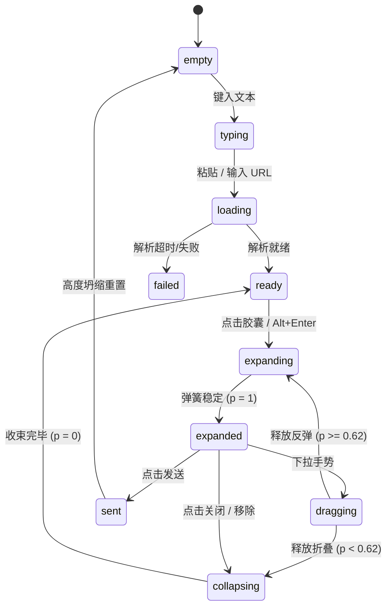

# Link Unfurl · 链接展开卡片

从行内文本胶囊（Inline Chip）到外层富媒体大卡片的非对称双轴形变（水平优先、垂直跟随）、Favicon 锚定坐标投影、半隐式欧拉弹簧与手势下拉折叠。

## 原型清单

| 原型分组 | 原型元素 | 动效 / 状态变化 | 去向 |
| --- | --- | --- | --- |
| 行内胶囊 | 行内药丸标签（`.unfurl-chip`） | 输入或粘贴 URL 后插入不可编辑原子节点；元数据解析就绪后以 340ms 弹性拉长宽度并浮现 Favicon 与标题 | 行内链接胶囊组件 |
| 几何投影外壳 | 形变背景垫片与裁切卡片（`.unfurl-plate`, `.unfurl-card`） | 从胶囊 Favicon 到卡片 Favicon 计算绝对坐标差值 $(tx, ty)$，水平先行（$1-(1-p)^{1.6}$）、垂直跟随（$p^{1.35}$）无重排裁切铺展 | 核心几何形变外壳 |
| 欧拉弹簧驱动 | 半隐式欧拉积分器 | 标量 $p \in [0, 1]$ 驱动展开（$\omega=9.5$）与收起（$\omega=13.0$），支持任意时刻瞬时打断反转 | 物理弹簧计算引擎 |
| 拖拽手势交互 | 下拉折叠手势（`.unfurl-grip`） | 在卡片抓手区域按下并下拉，位移扣减进度；释放时结合速度（$<-1.4$）与进度（$<0.62$）判定自动收拢回弹 | 手势下拉折叠控制器 |
| 消息发送动画 | 发送与重置（`.unfurl-send`） | 点击发送后内容区 180ms 上浮淡出，随后编辑器高度 480ms 平滑坍缩为单行空白 | 消息发送反馈流程 |
| 演示外壳 | 快捷示例按钮、外层居中包装框 | 演示环境布局与指示 | 演示外壳，已删除 |

## 适用

- 富文本编辑器、评论输入框、协同文档（如 Slack、Notion、Linear）内嵌链接的沉浸式富媒体卡片预览。
- 要求在行内文本与大卡片之间保持清晰的视觉因果关系与空间连续性，避免弹窗生硬突兀弹出。
- 追求高帧率无重排（Zero-Reflow）的平滑形变，支持下拉折叠与任意中途反转打断。

## 不适用

- 纯展示性静态指标卡片 → [metric-card](../cards/metric-card.md)
- 全息 3D 双面卡片与反光徽章 → [holo-card](holo-card.md)
- 多层级配置抽屉深度堆叠 → [sheet-stack](sheet-stack.md)
- 移动端卡包 3D 纵向排列 → [wallet-stack](wallet-stack.md)

## 状态机

| 状态 | 进入条件 | 视觉表现 | 退出到 |
| --- | --- | --- | --- |
| empty | 初始状态；或发送清空 | 编辑器空白，发送按钮置灰禁用，无预览卡片 | typing |
| loading | 输入空格或粘贴匹配到有效 URL | 在当前光标处插入原子行内胶囊，显示加载图标 | ready / failed |
| ready | 远程元数据解析完成 | 胶囊弹性拉长并展示网站 Favicon 与标题，卡片就绪准备展开 | expanded |
| expanding | 点击胶囊 / `Alt+Enter` | 欧拉弹簧驱动非对称展开，宽度迅速铺满，高度与大图跟随展现 | expanded |
| expanded | 弹簧形变进度达到稳定终点 | 卡片完全展开，`inert = false`，大图与正文完整可见 | dragging / collapsing / sent |
| dragging | 在展开卡片顶部按住向下拖拽 | 实时跟随指针扣减形变进度，裁切盒随位移收缩 | collapsing / expanding |
| collapsing | 点击关闭按钮 / 下拉达阈值释放 | 目标标量重置为 0，卡片以 13 rad/s 高速平滑收束回行内胶囊 | ready |
| sent | 点击发送 / `Enter` | 内容区上浮淡出，高度坍缩回一行，重置为空白状态 | empty |



## 最小 DOM

```html
<div class="unfurl-composer" data-running="true">
  <!-- 无障碍朗读区 -->
  <div class="unfurl-sr-status" role="status" aria-live="polite"></div>

  <!-- 编辑器与输入区 -->
  <div class="unfurl-content">
    <div class="unfurl-editor" contenteditable="plaintext-only" spellcheck="false" data-empty="true"></div>

    <!-- 预览卡片停靠道 -->
    <div class="unfurl-lane" aria-live="off">
      <div class="unfurl-wrap">
        <!-- 变形背景垫片 -->
        <div class="unfurl-plate"></div>
        <!-- 预览实体卡片 -->
        <article class="unfurl-card" aria-label="网页预览">
          <div class="unfurl-grip" data-grip="true"></div>
          <header class="unfurl-card-header">
            <span class="unfurl-fav" data-fav="true"></span>
            <span class="unfurl-site"></span>
            <div class="unfurl-card-actions">
              <button type="button" class="unfurl-btn-icon" data-action="collapse" aria-label="收起预览">✕</button>
              <button type="button" class="unfurl-btn-icon" data-action="remove" aria-label="移除链接">🗑</button>
            </div>
          </header>
          <div class="unfurl-body">
            <a class="unfurl-title" target="_blank" rel="noopener"></a>
            <p class="unfurl-desc"></p>
          </div>
          <div class="unfurl-media">
            
          </div>
        </article>
      </div>
    </div>
  </div>

  <!-- 底部操作栏 -->
  <div class="unfurl-toolbar">
    <div class="unfurl-samples">
      <button type="button" class="unfurl-sample-btn" data-url="https://linear.app">Linear</button>
      <button type="button" class="unfurl-sample-btn" data-url="https://github.com">GitHub</button>
    </div>
    <button type="button" class="unfurl-send-btn" disabled aria-label="发送消息">发送</button>
  </div>
</div>
```

## 参数

| 参数名 | 物理公式 / 标称值 | 动效作用与工程意义 |
| :--- | :--- | :--- |
| `openOmega` | `9.5 rad/s` | 展开弹簧响应角频率，临界阻尼平稳铺展 |
| `closeOmega` | `13.0 rad/s` | 收起弹簧响应角频率，收拢动作更利落紧凑 |
| `damping` | `2 * omega` | 临界阻尼状态，完全消除弹性振荡卡顿与抖动 |
| `horizontal(p)` | $1 - (1 - p)^{1.6}$ | 水平展开曲线，卡片宽度优先向两侧充盈 |
| `vertical(p)` | $p^{1.35}$ | 垂直延展曲线，高度稍慢于宽度铺展开来 |
| `radius(p)` | $\text{sh}/2 + (18 - \text{sh}/2) \times p$ | 圆角插值：从胶囊全圆角平滑过渡到卡片 18px 圆角 |
| `lift(p)` | $\sin(\pi \times p)$ | 形变中途微幅投影提拉（$\le 1$），增强悬浮感 |
| `drag.thresholdPx` | `4px` | 拖拽位移死区，防止轻触误触发手势折叠 |
| `drag.closeProgress` | `0.62` | 释放时进度低于 62% 则自动回弹收拢 |
| `drag.closeVelocity` | `-1.4` | 向下或反向释放速度超过阈值即刻触发收拢 |
| `chipWidthAndTitleMs` | `340ms cubic-bezier(.16,1,.3,1)` | 胶囊由短变长并展示标题的平滑缓动 |

## CSS

```css
.unfurl-composer {
  --unfurl-bg: #1e1e24;
  --unfurl-plate-bg: #2b2b36;
  --unfurl-border: rgba(255, 255, 255, 0.1);
  --unfurl-text: #f3f3f7;
  --unfurl-muted: #9e9ea7;
  --unfurl-accent: #6366f1;
  position: relative;
  width: 100%;
  max-width: 580px;
  background: var(--unfurl-bg);
  border-radius: 20px;
  border: 1px solid var(--unfurl-border);
  box-shadow: 0 16px 40px rgba(0, 0, 0, 0.35);
  font-family: system-ui, -apple-system, sans-serif;
  color: var(--unfurl-text);
  overflow: hidden;
}

.unfurl-editor {
  min-height: 84px;
  padding: 16px 20px;
  font-size: 15px;
  line-height: 1.6;
  outline: none;
  word-break: break-word;
}

.unfurl-editor[data-empty="true"]::before {
  content: "写下留言或粘贴链接...";
  color: var(--unfurl-muted);
  pointer-events: none;
}

/* 行内链接胶囊 */
.unfurl-chip-wrap {
  display: inline-block;
  vertical-align: middle;
  margin: 0 4px;
  user-select: none;
}

.unfurl-chip {
  display: inline-flex;
  align-items: center;
  gap: 6px;
  height: 26px;
  padding: 0 10px;
  background: rgba(99, 102, 241, 0.18);
  border: 1px solid rgba(99, 102, 241, 0.35);
  border-radius: 13px;
  font-size: 13px;
  color: #a5b4fc;
  cursor: pointer;
  transition: background 0.2s, border-color 0.2s;
}

.unfurl-chip:hover {
  background: rgba(99, 102, 241, 0.28);
  border-color: rgba(99, 102, 241, 0.6);
}

.unfurl-chip-fav {
  width: 14px;
  height: 14px;
  display: flex;
  align-items: center;
  justify-content: center;
}

/* 预览泳道与形变层 */
.unfurl-lane {
  padding: 0 20px 16px;
}

.unfurl-wrap {
  position: relative;
  overflow: visible;
  height: 0px;
}

.unfurl-plate {
  position: absolute;
  top: 0;
  left: 0;
  background: var(--unfurl-plate-bg);
  border: 1px solid var(--unfurl-border);
  box-shadow: 0 10px 25px rgba(0, 0, 0, calc(0.25 + 0.25 * var(--lift, 0)));
  pointer-events: none;
  transform-origin: 0 0;
  will-change: transform, width, height, border-radius;
}

.unfurl-card {
  position: absolute;
  top: 0;
  left: 0;
  width: 100%;
  background: transparent;
  color: var(--unfurl-text);
  overflow: hidden;
  user-select: none;
  will-change: transform, clip-path, opacity;
}

.unfurl-grip {
  width: 36px;
  height: 4px;
  margin: 8px auto 4px;
  background: rgba(255, 255, 255, 0.25);
  border-radius: 2px;
  cursor: grab;
}

.unfurl-card-header {
  display: flex;
  align-items: center;
  gap: 8px;
  padding: 8px 16px;
  font-size: 13px;
  color: var(--unfurl-muted);
}

.unfurl-card-actions {
  margin-left: auto;
  display: flex;
  gap: 6px;
}

.unfurl-btn-icon {
  width: 24px;
  height: 24px;
  border-radius: 6px;
  border: none;
  background: rgba(255, 255, 255, 0.08);
  color: var(--unfurl-text);
  cursor: pointer;
  display: flex;
  align-items: center;
  justify-content: center;
  font-size: 12px;
  line-height: 1;
}

.unfurl-body {
  padding: 4px 16px 12px;
}

.unfurl-title {
  display: block;
  font-size: 15px;
  font-weight: 600;
  color: var(--unfurl-text);
  text-decoration: none;
  margin-bottom: 4px;
}

.unfurl-desc {
  font-size: 13px;
  color: var(--unfurl-muted);
  line-height: 1.4;
  margin: 0;
}

.unfurl-media {
  padding: 0 16px 16px;
  overflow: hidden;
}

.unfurl-img {
  width: 100%;
  height: 140px;
  object-fit: cover;
  border-radius: 10px;
  display: block;
  transform-origin: center center;
}

/* 底部工具栏 */
.unfurl-toolbar {
  display: flex;
  align-items: center;
  justify-content: space-between;
  padding: 12px 20px;
  border-top: 1px solid var(--unfurl-border);
  background: rgba(0, 0, 0, 0.15);
}

.unfurl-samples {
  display: flex;
  gap: 8px;
}

.unfurl-sample-btn {
  padding: 6px 12px;
  background: rgba(255, 255, 255, 0.06);
  border: 1px solid var(--unfurl-border);
  border-radius: 8px;
  color: var(--unfurl-muted);
  font-size: 12px;
  cursor: pointer;
  transition: background-color 0.2s, color 0.2s, border-color 0.2s, transform 0.2s, opacity 0.2s, box-shadow 0.2s;
}

.unfurl-sample-btn:hover {
  background: rgba(255, 255, 255, 0.12);
  color: var(--unfurl-text);
}

.unfurl-send-btn {
  padding: 6px 16px;
  background: var(--unfurl-accent);
  border: none;
  border-radius: 8px;
  color: #fff;
  font-size: 13px;
  font-weight: 500;
  cursor: pointer;
  transition: opacity 0.2s;
}

.unfurl-send-btn:disabled {
  opacity: 0.4;
  cursor: not-allowed;
}

.unfurl-sr-status {
  position: absolute;
  width: 1px;
  height: 1px;
  padding: 0;
  margin: -1px;
  overflow: hidden;
  clip: rect(0, 0, 0, 0);
  border: 0;
}

@media (prefers-reduced-motion: reduce) {
  .unfurl-plate,
  .unfurl-card,
  .unfurl-chip {
    transition: none !important;
  }
}
```

## JS

```js
export function bindLinkUnfurl(root, options = {}) {
  const editor = root.querySelector('.unfurl-editor');
  const lane = root.querySelector('.unfurl-lane');
  const wrap = root.querySelector('.unfurl-wrap');
  const plate = root.querySelector('.unfurl-plate');
  const card = root.querySelector('.unfurl-card');
  const body = root.querySelector('.unfurl-body');
  const media = root.querySelector('.unfurl-img');
  const sendBtn = root.querySelector('.unfurl-send-btn');
  const sampleBtns = [...root.querySelectorAll('.unfurl-sample-btn')];
  const collapseBtn = card ? card.querySelector('[data-action="collapse"]') : null;
  const removeBtn = card ? card.querySelector('[data-action="remove"]') : null;
  const grip = card ? card.querySelector('[data-grip="true"]') : null;
  const status = root.querySelector('.unfurl-sr-status');

  const reducedMotion = matchMedia('(prefers-reduced-motion: reduce)').matches;

  let state = {
    p: 0,
    v: 0,
    target: 0,
    dragging: false,
    url: '',
    title: '',
    site: '',
    expanded: false,
    empty: true
  };

  let dragContext = null;
  let rafId = 0;
  let lastTime = 0;
  let disposed = false;
  const abortController = new AbortController();

  const clamp = (val, min = 0, max = 1) => Math.max(min, Math.min(max, val));

  function announce(msg) {
    if (status) status.textContent = msg;
  }

  function paint() {
    if (disposed || !wrap || !plate || !card) return;
    const p = clamp(state.p);
    const W = card.offsetWidth || 540;
    const H = card.offsetHeight || 280;

    // 非对称双轴：水平优先、垂直跟随
    const horizontal = 1 - Math.pow(1 - p, 1.6);
    const vertical = Math.pow(p, 1.35);

    const chip = editor ? editor.querySelector('.unfurl-chip-wrap') : null;
    const wrapRect = wrap.getBoundingClientRect();
    let sx = 0, sy = 0, sw = 132, sh = 26, tx = 0, ty = 0;

    if (chip && chip.isConnected) {
      const chipRect = chip.getBoundingClientRect();
      sw = Math.min(chipRect.width, W);
      sh = Math.min(chipRect.height, H);
      tx = chipRect.left - wrapRect.left;
      ty = chipRect.top - wrapRect.top;
    }

    const x = sx * (1 - horizontal);
    const y = sy * (1 - vertical);
    const w = sw + (W - sw) * horizontal;
    const h = sh + (H - sh) * vertical;
    const curTx = tx * (1 - horizontal);
    const curTy = ty * (1 - vertical);
    const radius = sh / 2 + (18 - sh / 2) * p;
    const opacity = clamp(p / 0.1);
    const isShown = p > 0.0005;

    wrap.style.height = `${((H + 10) * vertical).toFixed(2)}px`;

    plate.style.transform = `translate3d(${(x + curTx).toFixed(2)}px, ${(y + curTy).toFixed(2)}px, 0)`;
    plate.style.width = `${w.toFixed(2)}px`;
    plate.style.height = `${h.toFixed(2)}px`;
    plate.style.borderRadius = `${radius.toFixed(2)}px`;
    plate.style.opacity = String(opacity);
    plate.style.setProperty('--lift', (p > 0 && p < 1 ? Math.sin(Math.PI * p) : 0).toFixed(3));

    card.style.transform = `translate3d(${curTx.toFixed(2)}px, ${curTy.toFixed(2)}px, 0)`;
    card.style.clipPath = `inset(${y.toFixed(2)}px ${(W - x - w).toFixed(2)}px ${(H - y - h).toFixed(2)}px ${x.toFixed(2)}px round ${radius.toFixed(2)}px)`;
    card.style.opacity = String(opacity);
    card.style.visibility = isShown ? 'visible' : 'hidden';
    card.inert = !isShown;

    if (body) {
      body.style.opacity = clamp((vertical - 0.15) / 0.55).toFixed(3);
    }
    if (media) {
      media.style.transform = `scale(${(1.08 - 0.08 * vertical).toFixed(4)})`;
    }
  }

  function tick(now) {
    rafId = 0;
    if (disposed) return;
    const dt = lastTime ? Math.min(0.034, Math.max(0.001, (now - lastTime) / 1000)) : 1 / 60;
    lastTime = now;

    if (!state.dragging) {
      const omega = state.target === 1 ? 9.5 : 13.0;
      state.v += (-omega * omega * (state.p - state.target) - 2 * omega * state.v) * dt;
      state.p += state.v * dt;

      if (Math.abs(state.p - state.target) < 0.0003 && Math.abs(state.v) < 0.01) {
        state.p = state.target;
        state.v = 0;
      }
    }

    paint();

    const moving = state.dragging || (state.p !== state.target) || Math.abs(state.v) > 0.001;
    if (moving && !disposed) {
      rafId = requestAnimationFrame(tick);
    }
  }

  function schedule() {
    if (disposed) return;
    if (reducedMotion) {
      state.p = state.target;
      state.v = 0;
      paint();
      return;
    }
    if (!rafId) {
      lastTime = 0;
      rafId = requestAnimationFrame(tick);
    }
  }

  function expand(targetState) {
    state.target = targetState ? 1 : 0;
    state.expanded = targetState;
    announce(targetState ? `已展开 ${state.site || '网页'} 预览卡片` : '已收起链接预览');
    schedule();
  }

  function populateCard(meta) {
    state.url = meta.url;
    state.title = meta.title;
    state.site = meta.site;

    const titleEl = card ? card.querySelector('.unfurl-title') : null;
    const descEl = card ? card.querySelector('.unfurl-desc') : null;
    const siteEl = card ? card.querySelector('.unfurl-site') : null;
    const favEl = card ? card.querySelector('[data-fav="true"]') : null;

    if (titleEl) {
      titleEl.textContent = meta.title;
      titleEl.href = meta.url;
    }
    if (descEl) descEl.textContent = meta.description || '';
    if (siteEl) siteEl.textContent = meta.site;
    if (favEl) favEl.textContent = '🌐';
    if (media) {
      media.src = meta.image || 'data:image/svg+xml,<svg xmlns="http://www.w3.org/2000/svg" width="300" height="150" fill="%233b3b4f"/>';
    }
  }

  function insertChip(url) {
    const meta = {
      url,
      site: new URL(url, 'https://example.com').hostname.replace(/^www\./, ''),
      title: '富媒体预览：' + (url.split('/').filter(Boolean).pop() || '首页'),
      description: '基于半隐式欧拉弹簧物理引擎实现的高性能链接展开交互卡片。',
      image: ''
    };

    populateCard(meta);

    if (editor) {
      let chipWrap = editor.querySelector('.unfurl-chip-wrap');
      if (!chipWrap) {
        chipWrap = document.createElement('span');
        chipWrap.className = 'unfurl-chip-wrap';
        chipWrap.contentEditable = 'false';
        chipWrap.innerHTML = `
          <span class="unfurl-chip" role="button" tabindex="0" aria-label="${meta.title}">
            <span class="unfurl-chip-fav">🌐</span>
            <span class="unfurl-chip-label">${meta.site}</span>
          </span>
        `;
        editor.appendChild(chipWrap);
        chipWrap.querySelector('.unfurl-chip').addEventListener('click', () => {
          expand(!state.expanded);
        }, { signal: abortController.signal });
      }
      editor.dataset.empty = 'false';
    }

    state.empty = false;
    if (sendBtn) sendBtn.disabled = false;

    expand(true);
  }

  function onPointerDown(e) {
    if (e.button !== 0 || !state.expanded || !card) return;
    dragContext = {
      pointerId: e.pointerId,
      startY: e.clientY,
      startP: state.p,
      startTime: e.timeStamp,
      cardH: card.offsetHeight || 280,
      moved: false
    };
  }

  function onPointerMove(e) {
    if (!dragContext || dragContext.pointerId !== e.pointerId) return;
    const dy = e.clientY - dragContext.startY;
    if (!dragContext.moved) {
      if (Math.abs(dy) < 4) return;
      dragContext.moved = true;
      state.dragging = true;
      try { card.setPointerCapture(e.pointerId); } catch {}
    }

    const raw = dragContext.startP - dy / (0.8 * dragContext.cardH);
    const p = raw > 1 ? 1 + (raw - 1) * 0.08 : clamp(raw);
    const dt = Math.max(1, e.timeStamp - dragContext.startTime) / 1000;
    state.v = 0.6 * state.v + ((clamp(p) - state.p) / dt) * 0.4;
    state.p = clamp(p);
    dragContext.startTime = e.timeStamp;

    schedule();
  }

  function onPointerUp(e) {
    if (!dragContext || dragContext.pointerId !== e.pointerId) return;
    const moved = dragContext.moved;
    dragContext = null;
    state.dragging = false;

    if (moved) {
      if (state.v < -1.4 || (state.p < 0.62 && state.v < 1.2)) {
        expand(false);
      } else {
        expand(true);
      }
    }
  }

  if (grip && card) {
    grip.addEventListener('pointerdown', onPointerDown, { signal: abortController.signal });
    card.addEventListener('pointermove', onPointerMove, { signal: abortController.signal });
    card.addEventListener('pointerup', onPointerUp, { signal: abortController.signal });
    card.addEventListener('pointercancel', onPointerUp, { signal: abortController.signal });
  }

  if (collapseBtn) {
    collapseBtn.addEventListener('click', (e) => {
      e.stopPropagation();
      expand(false);
    }, { signal: abortController.signal });
  }

  if (removeBtn) {
    removeBtn.addEventListener('click', (e) => {
      e.stopPropagation();
      expand(false);
      const chip = editor ? editor.querySelector('.unfurl-chip-wrap') : null;
      if (chip) chip.remove();
      state.empty = !editor || !editor.textContent.trim();
      if (editor) editor.dataset.empty = String(state.empty);
      if (sendBtn) sendBtn.disabled = state.empty;
      announce('链接已移除');
    }, { signal: abortController.signal });
  }

  sampleBtns.forEach((btn) => {
    btn.addEventListener('click', () => {
      const url = btn.dataset.url;
      if (url) insertChip(url);
    }, { signal: abortController.signal });
  });

  if (sendBtn) {
    sendBtn.addEventListener('click', () => {
      expand(false);
      if (editor) {
        editor.textContent = '';
        editor.dataset.empty = 'true';
      }
      sendBtn.disabled = true;
      announce('消息已发送');
    }, { signal: abortController.signal });
  }

  paint();

  return {
    insert: insertChip,
    expand,
    destroy() {
      disposed = true;
      if (rafId) cancelAnimationFrame(rafId);
      abortController.abort();
    }
  };
}
```

## 接入目标项目

1. **导入模块与样式**：
   引入 `unfurl-composer` 结构及配套 CSS，在宿主编辑器容器上调用 `bindLinkUnfurl(root)`。
2. **连接后端元数据解析器**：
   在 `insertChip(url)` 阶段替换默认 mock 对象，向自身的 OpenGraph 抓取 API 发起请求，将解析得到的 `title`、`description`、`favicon` 与大图赋予卡片。
3. **保持文本与胶囊的原子性**：
   行内胶囊必须标记 `contenteditable="false"`，并置于独立的原子标签内，防止键盘 Backspace 误将标签拆散为残缺 HTML。

## 重入与清理

1. **打断重入**：
   展开未完成时再次点击胶囊或关闭按钮，欧拉弹簧无缝从当前位置和速度反向积分回到目标 0，无突变跳帧。
2. **实例清理**：
   调用返回的 `destroy()` 方法，立即取消正在运行的 `requestAnimationFrame`，触发 `abortController.abort()` 释放所有事件监听，并清空内部状态。

## 减少动态效果

在系统开启 `prefers-reduced-motion: reduce` 时：
1. 弹簧积分循环直接旁路，标量 $p$ 瞬间赋予目标值 `target`。
2. 禁用大图微缩放与投影浮起（`--lift = 0`），仅执行瞬时显示与隐藏。

## 焦点与键盘

- **Tab 键焦点隔离**：卡片折叠期间自动添加 HTML5 原生 `inert` 属性，阻止用户通过键盘 Tab 误入不可见的卡片内部交互元素。
- **快捷键支持**：
  - `Alt+Enter`：快速触发当前聚焦行内链接的展开/折叠。
  - `Escape`：在卡片聚焦时快速收起回到编辑器。
  - `Enter`（无 Shift）：触发快速发送。

## 兼容回退

- **clip-path 兼容**：在极少数不支持 `clip-path: inset(...)` 圆角裁切的环境下，回退为普通的 `opacity` 与 `visibility` 瞬时切换。
- **inert 降级**：若浏览器不支持原生 `inert`，脚本自动降级向内部所有可聚焦元素添加 `tabindex="-1"`。

## 验收清单

- [ ] **双轴非对称解耦**：展开时宽度先于高度铺满，图片无横向挤压变形。
- [ ] **Favicon 锚点平滑**：从行内药丸图标到大卡片图标的屏幕绝对坐标平滑过渡，无跳跃。
- [ ] **手势任意打断**：在展开进行至中途时反向拖拽，弹簧动量自然反转。
- [ ] **Inert 隔离**：收起状态下键盘 Tab 无法选中预览卡片内的按钮或链接。
- [ ] **发送收缩正常**：点击发送后，编辑器与泳道平滑执行单行高度折叠与清空。
