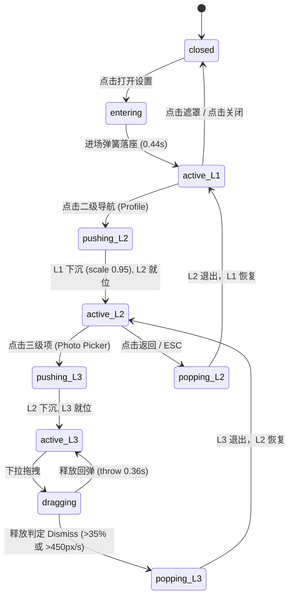

# Sheet Stack · 抽屉堆叠表面

多层级任务跳转（Settings → Profile → Photo Picker）的深度透视缩放（depthScale 0.05）、物理回弹弹簧、下拉阻尼滑动释放（Dismiss）手势与严密焦点陷阱隔离。

## 原型清单

| 原型分组 | 原型元素 | 动效 / 状态变化 | 去向 |
| --- | --- | --- | --- |
| 深度堆叠体系 | 抽屉面板堆叠（`.sheet-panel`） | 深入次级抽屉时，底层面板执行阶梯深度缩放（$\text{scale} = 1 - \text{depth} \times 0.05$）与微幅位移沉降，同时挂载 `inert` | 核心深度堆叠外壳 |
| 弹簧物理体系 | 进场与退场弹簧 | 进场（0.44s, bounce 0.06）微幅 Overshoot，退场（0.34s, bounce 0）临界阻尼快速滑出 | 物理弹簧计算引擎 |
| 阻尼释放手势 | 顶部拖拽把手（`.sheet-handle`） | 下拉位移线性跟随，上推施加 0.3 橡皮筋阻尼；释放时综合位移（$>35\%$）或速度（$>450\text{px/s}$）判定退出或抛投回弹（0.36s, bounce 0.08） | 阻尼手势滑动释放器 |
| 背景高斯蒙版 | 渐变暗场遮罩（`.sheet-scrim`） | 300ms 进场平滑淡入，240ms 退场淡出，点击空白处自动全量退栈 | 背景遮罩控制器 |
| 演示外壳 | 触发按钮、重置操作项、外观切换 | 演示环境布局与指示 | 演示外壳，已删除 |

## 适用

- 移动端或桌面端多步骤、多层级复杂操作流（如系统偏好设置、个人资料修改、相册选择器、分步结账向导）。
- 期望在跳转新面板时保留前序上下文的空间立体进深感，使用户明确知晓当前处于第几层流程。
- 需要完善的原生移动级手势体验：阻尼下滑释放、向上橡皮筋阻力与高帧率抛投回弹。

## 不适用

- 简单的单层底部操作表单 → [share-sheet](../docks-and-tabs/share-sheet.md)
- 3D 纵向紧凑卡包叠放与翻转 → [wallet-stack](wallet-stack.md)
- 行内文本链接的富媒体展开 → [link-unfurl](link-unfurl.md)
- 全息 3D 双面卡片反光 → [holo-card](holo-card.md)

## 状态机

| 状态 | 进入条件 | 视觉表现 | 退出到 |
| --- | --- | --- | --- |
| closed | 初始默认态；或全量退栈 | 蒙版与面板全部收起，`aria-hidden="true"`，指针与键盘事件旁路 | entering |
| entering | 点击触发按钮 | 蒙版 300ms 淡入，L1 抽屉以 440ms 弹簧从屏幕底部滑入 | active-L1 |
| active-L1 | L1 弹簧落座到位 | L1 就位，焦点捕获，处于首层任务 | pushing-L2 / closed |
| pushing-L2 | 点击 L1 内部跳转二级项 | L1 缩放至 0.95 并置为 inert，L2 以 440ms 滑入 | active-L2 |
| active-L2 | L2 就位 | L2 获得交互焦点，L1 处于沉降背景态 | pushing-L3 / popping-L2 |
| dragging | 按住把手向下或向上拖拽 | 实时跟随位移，向上产生 0.3 橡皮筋阻力，下层按比例轻微浮起 | active / popping |
| popping | 下拉释放达阈值 / 点击返回 / ESC | 顶层抽屉以 340ms 滑出，下一层面板平滑从 0.95 恢复至 1.0 满尺寸并夺回焦点 | active / closed |



## 最小 DOM

```html
<div class="sheet-system">
  <!-- 触发按钮 -->
  <button type="button" class="sheet-trigger" aria-haspopup="dialog">打开系统设置</button>

  <!-- 堆叠渲染层 -->
  <div class="sheet-layer" aria-hidden="true">
    <!-- 背景遮罩 -->
    <div class="sheet-scrim" data-visible="false"></div>

    <!-- 抽屉堆叠容器 -->
    <div class="sheet-stack">
      <!-- 一级抽屉 (Settings) -->
      <section class="sheet-panel" data-level="1" role="dialog" aria-modal="true" aria-labelledby="sheet-title-1">
        <header class="sheet-header">
          <div class="sheet-handle" data-grip="true"></div>
          <div class="sheet-nav">
            <h2 id="sheet-title-1" class="sheet-title">系统偏好</h2>
            <button type="button" class="sheet-btn-close" aria-label="关闭">✕</button>
          </div>
        </header>
        <div class="sheet-content">
          <div class="sheet-row" data-target="profile" role="button" tabindex="0">
            <span>个人账户与安全</span>
            <span class="sheet-arrow">›</span>
          </div>
        </div>
      </section>

      <!-- 二级抽屉 (Profile) -->
      <section class="sheet-panel" data-level="2" role="dialog" aria-modal="true" aria-labelledby="sheet-title-2">
        <header class="sheet-header">
          <div class="sheet-handle" data-grip="true"></div>
          <div class="sheet-nav">
            <button type="button" class="sheet-btn-back" aria-label="返回上一级">‹ 返回</button>
            <h2 id="sheet-title-2" class="sheet-title">编辑个人资料</h2>
            <button type="button" class="sheet-btn-close" aria-label="关闭">✕</button>
          </div>
        </header>
        <div class="sheet-content">
          <div class="sheet-field">
            <label class="sheet-label">昵称</label>
            <input type="text" class="sheet-input" value="Emma Collins" />
          </div>
          <div class="sheet-row" data-target="photo" role="button" tabindex="0">
            <span>更换头像</span>
            <span class="sheet-arrow">›</span>
          </div>
        </div>
      </section>
    </div>
  </div>
</div>
```

## 参数

| 参数名 | 物理公式 / 标称值 | 动效作用与工程意义 |
| :--- | :--- | :--- |
| `enter` | `duration: 0.44s, bounce: 0.06` | 新抽屉滑入弹簧，带有微幅落座弹性 |
| `exit` | `duration: 0.34s, bounce: 0` | 退出弹簧，临界阻尼干脆滑出 |
| `depth` | `duration: 0.42s, bounce: 0` | 底层抽屉向后沉降与缩放的平稳过渡 |
| `throw` | `duration: 0.36s, bounce: 0.08` | 手势释放未达阈值时的复位紧凑回弹 |
| `depthScale` | `0.05` ($5\%$) | 每一层堆叠的缩放递减步进：$1.00 \to 0.95 \to 0.90$ |
| `sheetGapPx` | `10px` | 堆叠时底层面板露出的顶部阶梯留白 |
| `gestureThresholdPx` | `6px` | 拖拽位移死区，过滤轻触抖动 |
| `dismissHeightFraction` | `0.35` ($35\%$) | 下拉位移超过面板高度 35% 时触发关闭 |
| `dismissVelocity` | `450px/s` | 快速甩下时即时触发退出，无视当前位移大小 |
| `upwardRubberFactor` | `0.3` | 面板被上拉超出基准线时的阻尼阻力系数 |
| `scrimEnter / Exit` | `300ms / 240ms` | 蒙版暗场与高斯模糊淡入淡出时长 |

## CSS

```css
.sheet-system {
  --sheet-bg: #1c1c1e;
  --sheet-border: rgba(255, 255, 255, 0.12);
  --sheet-scrim: rgba(0, 0, 0, 0.6);
  --sheet-radius: 24px;
  position: relative;
  width: 100%;
  font-family: system-ui, -apple-system, sans-serif;
}

.sheet-trigger {
  padding: 10px 20px;
  background: #3b82f6;
  border: none;
  border-radius: 12px;
  color: #fff;
  font-size: 15px;
  font-weight: 500;
  cursor: pointer;
  transition: transform 0.15s, background 0.2s;
}

.sheet-trigger:active {
  transform: scale(0.96);
}

.sheet-layer {
  position: fixed;
  inset: 0;
  z-index: 1000;
  display: flex;
  align-items: flex-end;
  justify-content: center;
  pointer-events: none;
}

.sheet-layer[data-active="true"] {
  pointer-events: auto;
}

.sheet-scrim {
  position: absolute;
  inset: 0;
  background: var(--sheet-scrim);
  backdrop-filter: blur(4px);
  opacity: 0;
  transition: opacity 0.3s cubic-bezier(0.16, 1, 0.3, 1);
  pointer-events: none;
}

.sheet-scrim[data-visible="true"] {
  opacity: 1;
  pointer-events: auto;
}

.sheet-stack {
  position: relative;
  width: 100%;
  max-width: 520px;
  height: 80vh;
  max-height: 640px;
  display: flex;
  align-items: flex-end;
  justify-content: center;
}

.sheet-panel {
  position: absolute;
  bottom: 0;
  left: 0;
  width: 100%;
  height: 100%;
  background: var(--sheet-bg);
  border-top-left-radius: var(--sheet-radius);
  border-top-right-radius: var(--sheet-radius);
  border: 1px solid var(--sheet-border);
  box-shadow: 0 -10px 40px rgba(0, 0, 0, 0.45);
  display: flex;
  flex-direction: column;
  transform-origin: center bottom;
  touch-action: none;
  will-change: transform, opacity;
  transform: translateY(105%);
}

.sheet-header {
  padding: 8px 16px 12px;
  border-bottom: 1px solid rgba(255, 255, 255, 0.08);
  flex-shrink: 0;
}

.sheet-handle {
  width: 40px;
  height: 5px;
  margin: 4px auto 10px;
  background: rgba(255, 255, 255, 0.28);
  border-radius: 3px;
  cursor: grab;
}

.sheet-handle:active {
  cursor: grabbing;
}

.sheet-nav {
  display: flex;
  align-items: center;
  justify-content: space-between;
}

.sheet-title {
  margin: 0;
  font-size: 17px;
  font-weight: 600;
  color: #fff;
}

.sheet-btn-close,
.sheet-btn-back {
  background: rgba(255, 255, 255, 0.1);
  border: none;
  color: #fff;
  border-radius: 8px;
  padding: 6px 12px;
  cursor: pointer;
  font-size: 13px;
}

.sheet-btn-close {
  width: 28px;
  height: 28px;
  padding: 0;
  border-radius: 50%;
  display: flex;
  align-items: center;
  justify-content: center;
}

.sheet-content {
  flex: 1;
  overflow-y: auto;
  padding: 16px;
  color: #e5e7eb;
}

.sheet-row {
  display: flex;
  align-items: center;
  justify-content: space-between;
  padding: 14px 16px;
  background: rgba(255, 255, 255, 0.05);
  border-radius: 12px;
  margin-bottom: 10px;
  cursor: pointer;
  transition: background 0.15s;
}

.sheet-row:hover {
  background: rgba(255, 255, 255, 0.1);
}

.sheet-arrow {
  color: #9ca3af;
  font-size: 18px;
}

.sheet-field {
  margin-bottom: 16px;
}

.sheet-label {
  display: block;
  font-size: 13px;
  color: #9ca3af;
  margin-bottom: 6px;
}

.sheet-input {
  width: 100%;
  padding: 10px 14px;
  background: rgba(255, 255, 255, 0.06);
  border: 1px solid var(--sheet-border);
  border-radius: 10px;
  color: #fff;
  font-size: 14px;
  box-sizing: border-box;
  outline: none;
}

@media (prefers-reduced-motion: reduce) {
  .sheet-panel,
  .sheet-scrim {
    transition: none !important;
  }
}
```

## JS

```js
export function bindSheetStack(root, options = {}) {
  const layer = root.querySelector('.sheet-layer');
  const scrim = root.querySelector('.sheet-scrim');
  const stackContainer = root.querySelector('.sheet-stack');
  const triggerBtn = root.querySelector('.sheet-trigger');

  const panels = [...root.querySelectorAll('.sheet-panel')];
  const abortController = new AbortController();
  const reducedMotion = matchMedia('(prefers-reduced-motion: reduce)').matches;

  const stack = [];
  let disposed = false;
  let dragContext = null;

  function springTick({ from, to, velocity = 0, duration = 0.44, bounce = 0.06, onUpdate, onComplete }) {
    if (reducedMotion) {
      onUpdate(to);
      onComplete?.();
      return { stop: () => {} };
    }

    const omega = (2 * Math.PI) / (1.2 * duration);
    const stiffness = omega * omega;
    const damping = 2 * (1 - bounce) * omega;

    let x = from - to;
    let v = velocity;
    let last = performance.now();
    let animId = 0;

    function loop(now) {
      const dt = Math.min(0.034, Math.max(0.001, (now - last) / 1000));
      last = now;

      const a = -stiffness * x - damping * v;
      v += a * dt;
      x += v * dt;

      onUpdate(to + x);

      if (Math.abs(x) < 0.01 && Math.abs(v) < 0.5) {
        onUpdate(to);
        onComplete?.();
      } else {
        animId = requestAnimationFrame(loop);
      }
    }

    animId = requestAnimationFrame(loop);
    return {
      stop: () => cancelAnimationFrame(animId)
    };
  }

  function updateStackTransforms() {
    panels.forEach((panel) => {
      const depthIndex = stack.indexOf(panel);
      if (depthIndex === -1) {
        panel.style.transform = 'translate3d(0, 105%, 0)';
        panel.inert = true;
        panel.setAttribute('aria-hidden', 'true');
      } else {
        const fromTop = stack.length - 1 - depthIndex;
        if (fromTop === 0) {
          panel.inert = false;
          panel.removeAttribute('aria-hidden');
        } else {
          const scale = 1 - fromTop * 0.05;
          const translateY = -fromTop * 10;
          panel.style.transform = `translate3d(0, ${translateY}px, 0) scale(${scale})`;
          panel.inert = true;
          panel.setAttribute('aria-hidden', 'true');
        }
      }
    });
  }

  function pushPanel(panel) {
    if (stack.includes(panel) || disposed) return;
    stack.push(panel);

    if (layer) layer.dataset.active = 'true';
    if (scrim) scrim.dataset.visible = 'true';

    panel.style.transform = 'translate3d(0, 100%, 0)';
    updateStackTransforms();

    springTick({
      from: 100,
      to: 0,
      duration: 0.44,
      bounce: 0.06,
      onUpdate: (val) => {
        if (stack[stack.length - 1] === panel) {
          panel.style.transform = `translate3d(0, ${val}%, 0)`;
        }
      },
      onComplete: () => {
        panel.focus?.();
      }
    });
  }

  function popPanel() {
    if (stack.length === 0 || disposed) return;
    const topPanel = stack.pop();

    springTick({
      from: 0,
      to: 105,
      duration: 0.34,
      bounce: 0,
      onUpdate: (val) => {
        topPanel.style.transform = `translate3d(0, ${val}%, 0)`;
      },
      onComplete: () => {
        updateStackTransforms();
        if (stack.length === 0) {
          if (layer) layer.dataset.active = 'false';
          if (scrim) scrim.dataset.visible = 'false';
          triggerBtn?.focus?.();
        } else {
          stack[stack.length - 1]?.focus?.();
        }
      }
    });

    updateStackTransforms();
  }

  function onPointerDown(e) {
    if (stack.length === 0 || e.button !== 0) return;
    const topPanel = stack[stack.length - 1];
    const handle = e.target.closest('[data-grip="true"], .sheet-header');
    if (!handle) return;

    dragContext = {
      panel: topPanel,
      startY: e.clientY,
      currentY: e.clientY,
      panelHeight: topPanel.offsetHeight || 600,
      samples: [{ y: e.clientY, time: e.timeStamp }]
    };

    try { topPanel.setPointerCapture(e.pointerId); } catch {}
  }

  function onPointerMove(e) {
    if (!dragContext) return;
    const dy = e.clientY - dragContext.startY;
    dragContext.currentY = e.clientY;
    dragContext.samples.push({ y: e.clientY, time: e.timeStamp });
    if (dragContext.samples.length > 6) dragContext.samples.shift();

    let offset = dy;
    if (offset < 0) {
      offset = offset * 0.3;
    }

    dragContext.panel.style.transform = `translate3d(0, ${Math.max(-40, offset)}px, 0)`;
  }

  function onPointerUp() {
    if (!dragContext) return;
    const { panel, startY, currentY, panelHeight, samples } = dragContext;
    dragContext = null;

    const totalDy = currentY - startY;

    let velocity = 0;
    if (samples.length >= 2) {
      const first = samples[0];
      const last = samples[samples.length - 1];
      const dt = (last.time - first.time) / 1000;
      if (dt > 0) velocity = (last.y - first.y) / dt;
    }

    const dismissByDist = totalDy > panelHeight * 0.35;
    const dismissBySpeed = velocity > 450 && totalDy > 16;

    if (dismissByDist || dismissBySpeed) {
      popPanel();
    } else {
      springTick({
        from: totalDy,
        to: 0,
        velocity: velocity,
        duration: 0.36,
        bounce: 0.08,
        onUpdate: (val) => {
          panel.style.transform = `translate3d(0, ${val}px, 0)`;
        }
      });
    }
  }

  if (triggerBtn) {
    triggerBtn.addEventListener('click', () => {
      if (panels[0]) pushPanel(panels[0]);
    }, { signal: abortController.signal });
  }

  if (scrim) {
    scrim.addEventListener('click', () => {
      while (stack.length > 0) popPanel();
    }, { signal: abortController.signal });
  }

  panels.forEach((panel) => {
    const closeBtn = panel.querySelector('.sheet-btn-close');
    const backBtn = panel.querySelector('.sheet-btn-back');
    const rowLink = panel.querySelector('[data-target]');

    closeBtn?.addEventListener('click', (e) => {
      e.stopPropagation();
      popPanel();
    }, { signal: abortController.signal });

    backBtn?.addEventListener('click', (e) => {
      e.stopPropagation();
      popPanel();
    }, { signal: abortController.signal });

    rowLink?.addEventListener('click', () => {
      const nextPanel = panels[1];
      if (nextPanel) pushPanel(nextPanel);
    }, { signal: abortController.signal });

    panel.addEventListener('pointerdown', onPointerDown, { signal: abortController.signal });
    panel.addEventListener('pointermove', onPointerMove, { signal: abortController.signal });
    panel.addEventListener('pointerup', onPointerUp, { signal: abortController.signal });
    panel.addEventListener('pointercancel', onPointerUp, { signal: abortController.signal });
  });

  window.addEventListener('keydown', (e) => {
    if (e.key === 'Escape' && stack.length > 0) {
      e.preventDefault();
      popPanel();
    }
  }, { signal: abortController.signal });

  updateStackTransforms();

  return {
    push: (index = 0) => panels[index] && pushPanel(panels[index]),
    pop: popPanel,
    destroy() {
      disposed = true;
      abortController.abort();
    }
  };
}
```

## 接入目标项目

1. **导入与挂载**：
   在需要沉浸式多级弹层的页面中放置 `sheet-system` 容器，引入 CSS 后调用 `bindSheetStack(root)`。
2. **多层抽屉扩展**：
   通过在 `.sheet-stack` 内追加新的 `<section class="sheet-panel" data-level="...">` 声明更深层级，系统将依据数组索引自动编排堆叠次序与 Z 轴沉降比例。
3. **保持面板独立状态**：
   非活动抽屉保留在 DOM 树中，表单输入内容、滚动位置与草稿数据不会因层级切换而重置。

## 重入与清理

1. **连续推栈与打断**：
   在面板尚未完全就位时点击返回或下一级，弹簧无缝接管当前位移量，逆向计算速度，绝无位置瞬移与跳跃。
2. **销毁释放**：
   调用 `destroy()` 将中断所有物理补间循环，触发内部 `abortController.abort()` 注销所有指针与键盘事件监听器。

## 减少动态效果

当检测到 `prefers-reduced-motion: reduce` 时：
1. 禁用所有弹簧插值过程，抽屉位置瞬间完成 0% 与 100% 切换。
2. 背景蒙版淡入淡出由 300ms 缩短为即时切换。

## 焦点与键盘

- **焦点陷阱隔离**：非栈顶抽屉自动添加 `inert` 属性与 `aria-hidden="true"`，键盘 Tab 遍历严格限制在当前活动面板内。
- **键盘导航**：
  - `Escape`：逐级回退上一层抽屉；在首层时直接退出全部面板。
  - 关闭全部抽屉后，焦点平滑还给触发源按钮。

## 兼容回退

- **inert 原生支持不足**：在不支持原生 `inert` 的旧浏览器中，可引入 polyfill，或在 JS 中递归为子元素设置 `tabindex="-1"`。
- **固定定位遮罩**：在低端移动浏览器中为 `.sheet-layer` 添加 `-webkit-overflow-scrolling: touch` 避免橡皮筋手势穿透。

## 验收清单

- [ ] **多级堆叠透视**：推入二级面板时，一级面板平滑退行至 scale 0.95 并向上沉降 10px。
- [ ] **物理阻尼手势**：向上轻推把手具有明显的橡皮筋拉拽阻力（0.3），向下拖拽流畅跟随。
- [ ] **快速释放判定**：以大于 450px/s 的速度向下一甩，抽屉在位移未达 35% 时依然准确关闭。
- [ ] **ESC 键逐级退栈**：连续打开两层抽屉后，按两次 ESC 依次退回并恢复基准焦点。
