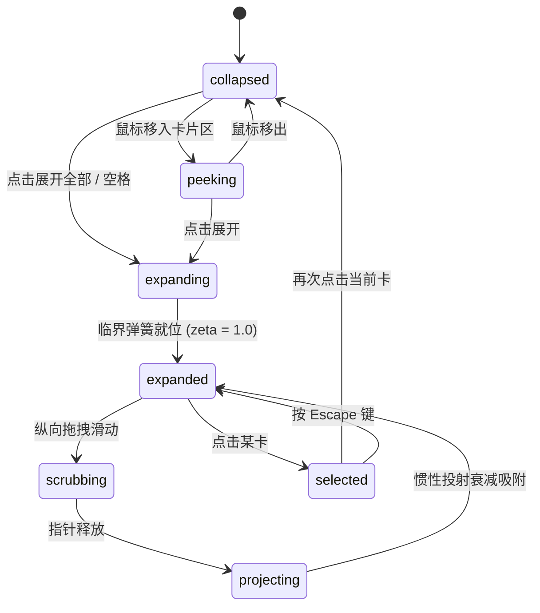

# Wallet Stack · 钱包堆叠卡包

多张卡片的纵向 3D 深度堆叠与展开管理系统，采用临界阻尼弹簧、速度投射衰减、临界跟随限速、光泽与 3D 倾斜陀螺仪。

## 原型清单

| 原型分组 | 原型元素 | 动效 / 状态变化 | 去向 |
| --- | --- | --- | --- |
| 3D 堆叠舞台 | 卡片堆叠槽位（`.wallet-slot`） | 900px 透视，折叠态露边 0.06、悬停态露边 0.22，展开态均分铺展（scale 0.88），多卡独立 Y 轴物理位移 | 核心 3D 舞台与插槽 |
| 临界弹簧系统 | 临界阻尼跟踪器 | 频率 $\omega = 2\pi / 0.48 \approx 13.09$，刚度 $171.35$，阻尼 $26.18$（$\zeta=1.0$），极速就位且绝无 Overshoot | 物理弹簧计算引擎 |
| 速度上限防冲 | 物理截断公式（Velocity Cap） | 同向运动速度强制限幅为 $\omega \times \|x_{\text{target}} - x_{\text{current}}\|$，防止快速连续点击或打断时产生冲击穿透 | 运动学防冲保护器 |
| 惯性滚刷投射 | 纵向滑动释放（Scrub Drag） | 展开态支持指针拖拽滚刷，释放时按 $d = \frac{v}{1000} \times \frac{0.995}{1 - 0.995}$ 预测滑行落点并自动对齐吸附 | 惯性滚刷投射控制器 |
| 材质微倾与高光 | 镜面高光与倾斜（`.wallet-sheen`） | 光标在卡面上移动时产生对立轴转动（$\pm 10^\circ$）与反向高光光斑流动（$\pm 50\%$） | 3D 材质光泽系统 |
| 演示外壳 | 顶部卡片计数、展开切换按钮、明细面板 | 演示环境布局与指示 | 演示外壳，已删除 |

## 适用

- 移动金融与数字钱包应用（如 Apple Wallet、Google Pay Web 客户端）多张信用卡、借记卡或交通卡展示。
- SaaS 订阅管理、多租户多环境凭证卡包、VIP 会员卡夹。
- 追求高保真 3D 空间感、原生级惯性滚刷滑行手感与金属/镜面反光质感。

## 不适用

- 纯展示性平面指标卡片 → [metric-card](../cards/metric-card.md)
- 全息彩膜双面翻转卡片 → [holo-card](holo-card.md)
- 多层级配置抽屉深度堆叠 → [sheet-stack](sheet-stack.md)
- 富媒体链接卡片展开 → [link-unfurl](link-unfurl.md)

## 状态机

| 状态 | 进入条件 | 视觉表现 | 退出到 |
| --- | --- | --- | --- |
| collapsed | 初始默认态；或点击收起 | 卡片以 0.06 卡高阶梯叠放，仅露出顶部辨识卡缘 | peeking / expanding |
| peeking | 鼠标移入折叠卡包 | 露边比例从 0.06 弹性扩展至 0.22，呈现微波浪浮动预备感 | collapsed / expanding |
| expanding | 点击展开全部 / 空白处 | 各卡片以临界阻尼弹簧向各自纵向目标槽位展开 | expanded |
| expanded | 展开弹簧就位 | 卡片整体缩放至 0.88 并均分展开，支持纵向滑动 | scrubbing / selected / collapsed |
| scrubbing | 指针在舞台纵向按住拖动 | 实时跟随指针位移，边界处施加 0.55 橡皮筋阻尼 | projecting |
| projecting | 释放拖拽指针 | 基于末速度计算指数衰减投射位移，平滑吸附对齐 | expanded |
| selected | 点击任意卡片 | 选定卡片拉升至 Z 轴最前方，下方交易详情面板弹性滑入 | collapsed / expanded |



## 最小 DOM

```html
<div class="wallet-root" data-expanded="false" data-selected="0">
  <!-- 头部控制栏 -->
  <header class="wallet-header">
    <div class="wallet-title-wrap">
      <h2 class="wallet-title">数字资产</h2>
      <span class="wallet-count" aria-live="polite">3 张卡片</span>
    </div>
    <button type="button" class="wallet-btn-toggle" aria-expanded="false">展开全部</button>
  </header>

  <!-- 3D 卡片渲染舞台 -->
  <div class="wallet-stage" role="region" aria-label="卡包列表">
    <!-- 卡片 1 -->
    <div class="wallet-slot" data-index="0">
      <button type="button" class="wallet-card" data-theme="dark" aria-label="Titanium Black, 余额 $8,420">
        <div class="wallet-sheen"></div>
        <div class="wallet-chip"></div>
        <div class="wallet-card-info">
          <span class="wallet-card-name">Titanium Black</span>
          <span class="wallet-card-num">•••• 8824</span>
        </div>
        <div class="wallet-card-balance">$8,420.50</div>
      </button>
    </div>

    <!-- 卡片 2 -->
    <div class="wallet-slot" data-index="1">
      <button type="button" class="wallet-card" data-theme="purple" aria-label="Amethyst Reserve, 余额 $12,950">
        <div class="wallet-sheen"></div>
        <div class="wallet-chip"></div>
        <div class="wallet-card-info">
          <span class="wallet-card-name">Amethyst Reserve</span>
          <span class="wallet-card-num">•••• 3190</span>
        </div>
        <div class="wallet-card-balance">$12,950.00</div>
      </button>
    </div>

    <!-- 卡片 3 -->
    <div class="wallet-slot" data-index="2">
      <button type="button" class="wallet-card" data-theme="emerald" aria-label="Emerald Cash, 余额 $3,120">
        <div class="wallet-sheen"></div>
        <div class="wallet-chip"></div>
        <div class="wallet-card-info">
          <span class="wallet-card-name">Emerald Cash</span>
          <span class="wallet-card-num">•••• 6041</span>
        </div>
        <div class="wallet-card-balance">$3,120.20</div>
      </button>
    </div>
  </div>

  <!-- 详情面板 -->
  <div class="wallet-detail" aria-hidden="true">
    <h3 class="wallet-detail-title">最近交易明细</h3>
    <ul class="wallet-tx-list">
      <li class="wallet-tx-item">
        <span>Apple Store 直营店</span>
        <span class="wallet-tx-amount">-$999.00</span>
      </li>
      <li class="wallet-tx-item">
        <span>Starbucks Coffee</span>
        <span class="wallet-tx-amount">-$6.50</span>
      </li>
    </ul>
  </div>
</div>
```

## 参数

| 参数名 | 物理公式 / 标称值 | 动效作用与工程意义 |
| :--- | :--- | :--- |
| `cardAspectRatio` | `85.6 / 53.98` ($\approx 1.585$) | 国际 ISO/IEC 7810 ID-1 信用卡物理比例 |
| `omega` | $2\pi / 0.48 \approx 13.09\text{ rad/s}$ | 临界阻尼特征频率 |
| `stiffness` | $\omega^2 \approx 171.35$ | 弹簧刚度常数 |
| `damping` | $2 \times \omega \approx 26.18$ | 确保 $\zeta = 1.0$ 完美临界阻尼 |
| `velocityCap` | $\text{sign}(v) \times \min(\|v\|, \omega \times \|\Delta\|)$ | 抑制同向大速度冲击穿透 |
| `projection` | $\frac{v}{1000} \times \frac{0.995}{1 - 0.995}$ | 惯性滚刷释放时的位移预测终点 |
| `closedPeekFraction` | `0.06` ($6\%$ 卡高) | 折叠时露出的紧凑卡边厚度 |
| `hoverPeekFraction` | `0.22` ($22\%$ 卡高) | 鼠标悬停时露出的操作预备区 |
| `expandedScale` | `0.88` | 展开后卡片整体轻微缩小以容纳更多卡面 |
| `perspectivePx` | `900px` | 保证卡片倾斜时不产生极端近大远小畸变 |
| `tiltRangeDeg` | $\pm 10^\circ$ | 倾角控制在自然微晃范围 |
| `sheenRangePercent` | $\pm 50\%$ | 镜面高光随光标的移动幅度 |

## CSS

```css
.wallet-root {
  --wallet-bg: #0f0f12;
  --wallet-border: rgba(255, 255, 255, 0.1);
  --wallet-card-radius: 16px;
  position: relative;
  width: 100%;
  max-width: 360px;
  background: var(--wallet-bg);
  border-radius: 24px;
  padding: 24px 20px;
  border: 1px solid var(--wallet-border);
  box-shadow: 0 20px 50px rgba(0, 0, 0, 0.6);
  font-family: system-ui, -apple-system, sans-serif;
  color: #fff;
  user-select: none;
  overflow: hidden;
}

.wallet-header {
  display: flex;
  align-items: center;
  justify-content: space-between;
  margin-bottom: 20px;
}

.wallet-title {
  margin: 0;
  font-size: 18px;
  font-weight: 600;
}

.wallet-count {
  font-size: 13px;
  color: #9ca3af;
}

.wallet-btn-toggle {
  background: rgba(255, 255, 255, 0.08);
  border: 1px solid var(--wallet-border);
  border-radius: 8px;
  color: #fff;
  padding: 6px 12px;
  font-size: 12px;
  cursor: pointer;
  transition: background 0.2s;
}

.wallet-btn-toggle:hover {
  background: rgba(255, 255, 255, 0.15);
}

/* 3D 渲染舞台 */
.wallet-stage {
  position: relative;
  width: 100%;
  height: 380px;
  perspective: 900px;
  touch-action: none;
}

.wallet-slot {
  position: absolute;
  top: 0;
  left: 0;
  width: 100%;
  transform-style: preserve-3d;
  will-change: transform;
}

.wallet-card {
  position: relative;
  width: 100%;
  aspect-ratio: 85.6 / 53.98;
  border-radius: var(--wallet-card-radius);
  border: none;
  padding: 16px 20px;
  box-sizing: border-box;
  text-align: left;
  color: #fff;
  cursor: pointer;
  overflow: hidden;
  outline: none;
  box-shadow: 0 12px 28px rgba(0, 0, 0, 0.4);
  transform-style: preserve-3d;
  will-change: transform;
}

.wallet-card[data-theme="dark"] {
  background: linear-gradient(135deg, #2b2b36 0%, #15151b 100%);
}

.wallet-card[data-theme="purple"] {
  background: linear-gradient(135deg, #6366f1 0%, #312e81 100%);
}

.wallet-card[data-theme="emerald"] {
  background: linear-gradient(135deg, #10b981 0%, #064e3b 100%);
}

/* 镜面高光 */
.wallet-sheen {
  position: absolute;
  inset: -50%;
  background: radial-gradient(circle at center, rgba(255, 255, 255, 0.35) 0%, rgba(255, 255, 255, 0) 65%);
  pointer-events: none;
  opacity: 0;
  transform: translate3d(0, 0, 0);
  transition: opacity 0.2s ease;
  mix-blend-mode: overlay;
}

.wallet-card:hover .wallet-sheen {
  opacity: 1;
}

.wallet-chip {
  width: 32px;
  height: 24px;
  background: linear-gradient(135deg, #fbbf24 0%, #d97706 100%);
  border-radius: 5px;
  margin-bottom: 24px;
}

.wallet-card-info {
  display: flex;
  justify-content: space-between;
  font-size: 13px;
  margin-bottom: 8px;
  letter-spacing: 0.5px;
}

.wallet-card-balance {
  font-size: 22px;
  font-weight: 700;
  letter-spacing: 0.5px;
}

/* 详情抽屉 */
.wallet-detail {
  margin-top: 16px;
  padding-top: 16px;
  border-top: 1px solid var(--wallet-border);
  opacity: 0;
  transform: translateY(12px);
  transition: opacity 0.25s, transform 0.25s;
}

.wallet-detail[data-visible="true"] {
  opacity: 1;
  transform: none;
}

.wallet-detail-title {
  font-size: 14px;
  margin: 0 0 12px;
  color: #9ca3af;
}

.wallet-tx-list {
  list-style: none;
  padding: 0;
  margin: 0;
}

.wallet-tx-item {
  display: flex;
  justify-content: space-between;
  font-size: 13px;
  padding: 8px 0;
  border-bottom: 1px solid rgba(255, 255, 255, 0.05);
}

.wallet-tx-amount {
  font-weight: 600;
  color: #f87171;
}

@media (prefers-reduced-motion: reduce) {
  .wallet-slot,
  .wallet-card,
  .wallet-detail {
    transition: none !important;
  }
}
```

## JS

```js
export function bindWalletStack(root, options = {}) {
  const stage = root.querySelector('.wallet-stage');
  const slots = [...root.querySelectorAll('.wallet-slot')];
  const toggleBtn = root.querySelector('.wallet-btn-toggle');
  const detail = root.querySelector('.wallet-detail');

  const reducedMotion = matchMedia('(prefers-reduced-motion: reduce)').matches;
  const abortController = new AbortController();

  const OMEGA = (2 * Math.PI) / 0.48;
  const STIFFNESS = OMEGA * OMEGA;
  const DAMPING = 2 * OMEGA;

  let state = {
    selected: 0,
    expanded: false,
    hovering: false,
    dragY: 0,
    dragging: false
  };

  const cards = slots.map(() => ({
    y: 0,
    v: 0,
    targetY: 0,
    rotX: 0,
    rotY: 0,
    sheenX: 0,
    sheenY: 0
  }));

  let rafId = 0;
  let lastTime = 0;
  let disposed = false;
  let dragContext = null;

  function updateLayoutTargets() {
    const stageH = stage ? stage.offsetHeight || 380 : 380;
    const cardH = (stage ? stage.offsetWidth || 320 : 320) * (53.98 / 85.6);

    const peekFraction = state.hovering ? 0.22 : 0.06;
    const closedGap = cardH * peekFraction;

    cards.forEach((card, i) => {
      if (state.expanded) {
        const spreadGap = Math.max(48, (stageH - cardH) / (cards.length - 1 || 1));
        card.targetY = i * spreadGap + state.dragY;
      } else {
        card.targetY = i * closedGap;
      }
    });
  }

  function updatePhysics(dt) {
    let active = false;

    cards.forEach((card) => {
      const delta = card.targetY - card.y;

      // 速度上限截断 (Velocity Cap)
      if (Math.sign(card.v) === Math.sign(delta)) {
        const maxV = OMEGA * Math.abs(delta);
        if (Math.abs(card.v) > maxV) {
          card.v = Math.sign(card.v) * maxV;
        }
      }

      const a = -STIFFNESS * (card.y - card.targetY) - DAMPING * card.v;
      card.v += a * dt;
      card.y += card.v * dt;

      if (Math.abs(card.y - card.targetY) < 0.01 && Math.abs(card.v) < 0.1) {
        card.y = card.targetY;
        card.v = 0;
      } else {
        active = true;
      }
    });

    return active;
  }

  function paint() {
    slots.forEach((slot, i) => {
      const card = cards[i];
      const btn = slot.querySelector('.wallet-card');
      const sheen = slot.querySelector('.wallet-sheen');

      const scale = state.expanded ? 0.88 : 1 - (cards.length - 1 - i) * 0.02;
      const zIndex = i === state.selected && !state.expanded ? 20 : i + 1;

      slot.style.zIndex = zIndex;
      slot.style.transform = `translate3d(0, ${card.y.toFixed(2)}px, 0) scale(${scale})`;

      if (btn) {
        btn.style.transform = `rotateX(${card.rotX.toFixed(2)}deg) rotateY(${card.rotY.toFixed(2)}deg)`;
      }

      if (sheen) {
        sheen.style.transform = `translate3d(${card.sheenX.toFixed(2)}%, ${card.sheenY.toFixed(2)}%, 0)`;
      }
    });

    if (detail) {
      detail.dataset.visible = String(!state.expanded && state.selected !== -1);
      detail.setAttribute('aria-hidden', String(state.expanded));
    }
  }

  function loop(now) {
    rafId = 0;
    if (disposed) return;
    const dt = lastTime ? Math.min(0.034, Math.max(0.001, (now - lastTime) / 1000)) : 1 / 60;
    lastTime = now;

    const moving = updatePhysics(dt);
    paint();

    if ((moving || state.dragging) && !disposed) {
      rafId = requestAnimationFrame(loop);
    }
  }

  function schedule() {
    if (disposed) return;
    if (reducedMotion) {
      cards.forEach((c) => {
        c.y = c.targetY;
        c.v = 0;
      });
      paint();
      return;
    }
    if (!rafId) {
      lastTime = 0;
      rafId = requestAnimationFrame(loop);
    }
  }

  function setExpanded(isExpanded) {
    state.expanded = isExpanded;
    root.dataset.expanded = String(isExpanded);
    if (toggleBtn) {
      toggleBtn.textContent = isExpanded ? '收起卡包' : '展开全部';
      toggleBtn.setAttribute('aria-expanded', String(isExpanded));
    }
    state.dragY = 0;
    updateLayoutTargets();
    schedule();
  }

  function selectCard(index) {
    state.selected = index;
    root.dataset.selected = String(index);
    setExpanded(false);
  }

  function onPointerDown(e) {
    if (!state.expanded || e.button !== 0 || !stage) return;
    dragContext = {
      startY: e.clientY,
      lastY: e.clientY,
      initialDragY: state.dragY,
      samples: [{ y: e.clientY, time: e.timeStamp }]
    };
    state.dragging = true;
    try { stage.setPointerCapture(e.pointerId); } catch {}
  }

  function onPointerMove(e) {
    if (!dragContext) return;
    const dy = e.clientY - dragContext.startY;
    dragContext.samples.push({ y: e.clientY, time: e.timeStamp });
    if (dragContext.samples.length > 8) dragContext.samples.shift();

    state.dragY = dragContext.initialDragY + dy;
    updateLayoutTargets();
    schedule();
  }

  function onPointerUp() {
    if (!dragContext) return;
    const samples = dragContext.samples;
    dragContext = null;
    state.dragging = false;

    let velocity = 0;
    if (samples.length >= 2) {
      const first = samples[0];
      const last = samples[samples.length - 1];
      const dt = (last.time - first.time) / 1000;
      if (dt > 0) velocity = (last.y - first.y) / dt;
    }

    const projectedOffset = (velocity / 1000) * (0.995 / 0.005);
    state.dragY += projectedOffset;
    state.dragY = Math.max(-120, Math.min(60, state.dragY));

    updateLayoutTargets();
    schedule();
  }

  slots.forEach((slot, i) => {
    const btn = slot.querySelector('.wallet-card');
    if (!btn) return;

    btn.addEventListener('click', () => {
      if (state.expanded) {
        selectCard(i);
      } else {
        setExpanded(true);
      }
    }, { signal: abortController.signal });

    btn.addEventListener('pointermove', (e) => {
      if (reducedMotion || e.pointerType !== 'mouse') return;
      const rect = btn.getBoundingClientRect();
      const px = (e.clientX - rect.left) / rect.width - 0.5;
      const py = (e.clientY - rect.top) / rect.height - 0.5;

      cards[i].rotX = -py * 12;
      cards[i].rotY = px * 12;
      cards[i].sheenX = px * 60;
      cards[i].sheenY = py * 60;
      schedule();
    }, { signal: abortController.signal });

    btn.addEventListener('pointerleave', () => {
      cards[i].rotX = 0;
      cards[i].rotY = 0;
      schedule();
    }, { signal: abortController.signal });
  });

  if (stage) {
    stage.addEventListener('mouseenter', () => {
      if (!state.expanded) {
        state.hovering = true;
        updateLayoutTargets();
        schedule();
      }
    }, { signal: abortController.signal });

    stage.addEventListener('mouseleave', () => {
      if (!state.expanded) {
        state.hovering = false;
        updateLayoutTargets();
        schedule();
      }
    }, { signal: abortController.signal });

    stage.addEventListener('pointerdown', onPointerDown, { signal: abortController.signal });
    stage.addEventListener('pointermove', onPointerMove, { signal: abortController.signal });
    stage.addEventListener('pointerup', onPointerUp, { signal: abortController.signal });
    stage.addEventListener('pointercancel', onPointerUp, { signal: abortController.signal });
  }

  if (toggleBtn) {
    toggleBtn.addEventListener('click', () => {
      setExpanded(!state.expanded);
    }, { signal: abortController.signal });
  }

  updateLayoutTargets();
  cards.forEach((c) => { c.y = c.targetY; });
  paint();

  return {
    select: selectCard,
    toggle: () => setExpanded(!state.expanded),
    destroy() {
      disposed = true;
      if (rafId) cancelAnimationFrame(rafId);
      abortController.abort();
    }
  };
}
```

## 接入目标项目

1. **导入与样式加载**：
   在钱包页面引入 `wallet-root` DOM 骨架与 CSS，调用 `bindWalletStack(root)`。
2. **动态卡片数量配置**：
   插槽通过 `.wallet-slot` 标识，JS 自动根据子元素个数均分展开间距。
3. **数据驱动卡面与账单**：
   可通过自定义 `data-theme` 或背景渐变自定义卡面皮肤，选中后在 `.wallet-detail` 填充真实消费流水。

## 重入与清理

1. **打断重入**：
   在展开或滑动尚未停止时再次点击卡片，临界弹簧无缝接管当前位移与被截断的速度，绝对平滑收回。
2. **销毁释放**：
   调用 `destroy()` 将终止 `requestAnimationFrame` 积分，并执行 `abortController.abort()` 释放所有指针事件。

## 减少动态效果

当 `prefers-reduced-motion: reduce` 生效时：
1. 取消逐帧弹簧插值，卡片纵向坐标瞬时对齐到目标槽位。
2. 禁用 3D 旋转倾角与镜面高光反射跟随。

## 焦点与键盘

- **焦点管理**：每张卡片均为原生可聚焦 `<button>` 元素，完全支持 Tab 键顺序遍历。
- **键盘操作**：
  - `Enter / Space`：选定当前聚焦卡片并收起展开态。
  - `Escape`：从单卡选中聚焦态退出，返回展开总览。

## 兼容回退

- **3D 透视降级**：若运行环境不支持 `perspective: 900px` 或 `transform-style: preserve-3d`，界面自动降级为平面的 2D 垂直纵向列表与透明度过渡。

## 验收清单

- [ ] **两态露边预览**：未展开状态下，鼠标悬停时露出的卡边高度是否从 6% 平滑浮起至 22%。
- [ ] **临界弹簧无振荡**：点击展开后，各卡片到达目标卡槽时是否利落就位，无多余反复抖动。
- [ ] **速度上限截断**：连续多次快速点击展开/收起，卡片运动是否平滑受控，无飞出穿帮。
- [ ] **3D 倾斜反光**：光标在卡面四周旋转，反光高光是否平滑跟随且卡片产生细微透视转角。
