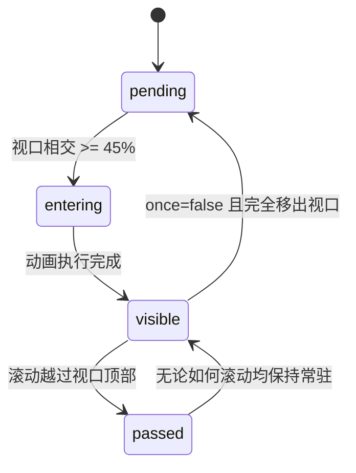

# In-view Title · 视口入场标题

元素滚入浏览器视口时触发的高级标题入场动效。支持 Blur（高斯模糊浮显）、Words（逐词遮罩升起）、Lines（逐行自下而上滑入）、Tracking（字距展开）以及 Wipe（横向裁切擦除）五种动效模式。核心机制基于 IntersectionObserver 视口占比检测、越过视口顶部的 passed 状态锁定、以及优雅的纯 CSS 离线兜底。

## 原型清单

| 原型分组 | 原型元素 | 动效 / 状态变化 | 去向 |
| --- | --- | --- | --- |
| 视口观测 | 标题宿主容器（`.in-view-title-host`） | 使用 IntersectionObserver 在元素达 45% 视口曝光时激活 `is-visible`；越过顶部后锁定为 `passed` 状态，不再重复回放 | 视口检测与状态锁定 |
| Blur 效果 | 逐词模糊层（`.variant-blur .word-item`） | 每词自 0.2em 垂直位移、8px 高斯模糊渐显归位，错峰步长 40ms | Blur 词级模糊渐显 |
| Words 效果 | 逐词升起层（`.variant-words .word-item`） | 行内遮罩裁剪，每词自 0.9em 位移穿透遮罩平滑升起 | Words 遮罩升起 |
| Lines 效果 | 逐行滑入层（`.variant-lines .line-item`） | 文本分行，每行自 112% 位移向上平滑滑入并淡入 | Lines 逐行剪裁滑入 |
| Tracking 效果 | 字距展开层（`.variant-tracking`） | 标题从收紧字距（`-0.08em`）与透明度 0 舒缓展开至正常排版间距 | Tracking 字距动态插值 |
| Wipe 效果 | 擦除揭示层（`.variant-wipe`） | CSS `clip-path: inset(0 0 0 0)` 自左向右线性擦除显现 | Wipe 渐进式遮罩擦除 |
| 演示外壳 | 顶部主题切换、效果切换选项栏、重播按钮（Replay） | 演示用途 | 演示外壳，已删除 |

## 适用

- 营销落地页（Landing Page）、大屏展示页主标题首屏视口进入动效。
- 随用户纵向滚动逐段呈现的高品质章节标题。
- 需要针对不同设计风格选用模糊渐显、逐字排版或擦除显现的场景。

## 不适用

- 长段落或富文本逐词入场 → [text-reveal](text-reveal.md)
- 按钮内多状态文案字形原地变异与复用 → [text-morph](text-morph.md)
- 异步加载或同步进行中的光斑扫光流光 → [text-shimmer](text-shimmer.md)

## 状态机

| 状态 | 进入条件 | 视觉表现 | 退出到 |
| --- | --- | --- | --- |
| pending | 初始离屏或尚未进入视口（<45%） | 词/行元素保持在初始位移与模糊状态（透明度 0） | entering / passed |
| entering | 滚入视口并达到 45% 阈值 | 执行设定变体的进入动画（400ms~760ms），依序错峰展开 | visible |
| visible | 入场动效结束，静止展现 | 文字完全清晰可见，解除 CSS 滤镜与变换，保持原生字体清晰渲染 | pending (若 once=false) / passed |
| passed | 标题滚出视口顶部（BoundingRect.top < 0） | 锁定为永久可见，防止用户向上回滚时反复出现打扰性重播 | visible |



## 最小 DOM

```html
<div class="in-view-title-host" data-variant="blur" data-visible="false">
  <!-- 辅助技术可读标题 -->
  <h2 class="in-view-title" aria-label="Crafting Motion for Modern Interfaces">
    <!-- 视觉分词槽位 (对辅助技术隐藏) -->
    <span class="word-wrap" aria-hidden="true">
      <span class="word-item" style="--index: 0">Crafting</span>
      <span class="word-item" style="--index: 1">Motion</span>
      <span class="word-item" style="--index: 2">for</span>
      <span class="word-item" style="--index: 3">Modern</span>
      <span class="word-item" style="--index: 4">Interfaces</span>
    </span>
  </h2>
</div>
```

- `.in-view-title-host`：外层观测容器，承载 `data-visible` 状态。
- `.in-view-title`：语义化标题标签（h1/h2/h3），通过 `aria-label` 提供完整无障碍朗读名称。
- `.word-wrap`：用于视觉动画分词排版的隔离容器，声明 `aria-hidden="true"`。
- `.word-item`：单个词节点，承载 `--index` 错峰延迟与动效变换。

## 参数

| 名称 | 值 | 用于 | 来源 |
| --- | --- | --- | --- |
| 视口触发曝光比例 | `0.45` | IntersectionObserver threshold | 原型 |
| 词入场错峰步长 | `40ms` | `--index * 40ms` 延迟计算 | 原型 |
| Blur 入场时长 | `580ms` / `cubic-bezier(0.16, 1, 0.3, 1)` | 模糊半径 8px 衰减至 0 | 原型 |
| Words 升起时长 | `640ms` / `cubic-bezier(0.16, 1, 0.3, 1)` | 位移 0.9em 升起 | 原型 |
| Tracking 展开时长 | `720ms` / `cubic-bezier(0.16, 1, 0.3, 1)` | 字距 -0.08em 展开 | 原型 |
| Wipe 擦除时长 | `680ms` / `cubic-bezier(0.16, 1, 0.3, 1)` | clip-path inset 自左向右揭示 | 原型 |
| 无脚本 CSS 兜底时长 | `2400ms` | 无 JS 环境下延迟自动显露 | 原型 |

## CSS

```css
.in-view-title-host {
  --ease-calm: cubic-bezier(0.16, 1, 0.3, 1);
  display: block;
  overflow: hidden;
  font-family: system-ui, -apple-system, sans-serif;
}

.in-view-title {
  margin: 0;
  font-size: 32px;
  font-weight: 700;
  line-height: 1.25;
  color: #111827;
  letter-spacing: -0.02em;
}

.word-wrap {
  display: inline-flex;
  flex-wrap: wrap;
  gap: 0.28em;
}

/* 1. Blur 效果 */
.in-view-title-host[data-variant="blur"] .word-item {
  display: inline-block;
  opacity: 0;
  filter: blur(8px);
  transform: translateY(0.2em);
  transition: opacity 480ms var(--ease-calm),
              filter 580ms var(--ease-calm),
              transform 580ms var(--ease-calm);
  transition-delay: calc(var(--index, 0) * 40ms);
}

.in-view-title-host[data-variant="blur"][data-visible="true"] .word-item {
  opacity: 1;
  filter: blur(0);
  transform: translateY(0);
}

/* 2. Words 升起效果 */
.in-view-title-host[data-variant="words"] .word-item {
  display: inline-block;
  opacity: 0;
  transform: translateY(0.9em);
  transition: opacity 400ms var(--ease-calm),
              transform 640ms var(--ease-calm);
  transition-delay: calc(var(--index, 0) * 45ms);
}

.in-view-title-host[data-variant="words"][data-visible="true"] .word-item {
  opacity: 1;
  transform: translateY(0);
}

/* 3. Tracking 展开效果 */
.in-view-title-host[data-variant="tracking"] .in-view-title {
  letter-spacing: -0.08em;
  opacity: 0;
  transition: letter-spacing 720ms var(--ease-calm), opacity 500ms var(--ease-calm);
}

.in-view-title-host[data-variant="tracking"][data-visible="true"] .in-view-title {
  letter-spacing: -0.02em;
  opacity: 1;
}

/* 4. Wipe 擦除效果 */
.in-view-title-host[data-variant="wipe"] .in-view-title {
  clip-path: inset(0 100% 0 0);
  transition: clip-path 680ms var(--ease-calm);
}

.in-view-title-host[data-variant="wipe"][data-visible="true"] .in-view-title {
  clip-path: inset(0 0 0 0);
}

/* 减少动态效果 */
@media (prefers-reduced-motion: reduce) {
  .word-item,
  .in-view-title {
    transition: opacity 160ms ease !important;
    transform: none !important;
    filter: none !important;
    clip-path: none !important;
    letter-spacing: -0.02em !important;
  }
}
```

## JS

```js
export function createInViewTitle(el, options = {}) {
  const root = el;
  const title = root.querySelector('.in-view-title');
  const wordWrap = root.querySelector('.word-wrap');

  const variant = options.variant || root.dataset.variant || 'blur';
  const once = options.once !== false;
  let isPassed = false;

  root.dataset.variant = variant;

  // 将文本内容拆分为带索引的词结构
  if (wordWrap && options.text) {
    wordWrap.innerHTML = '';
    const words = options.text.trim().split(/\s+/);
    if (title) title.setAttribute('aria-label', options.text);

    words.forEach((w, i) => {
      const span = document.createElement('span');
      span.className = 'word-item';
      span.style.setProperty('--index', String(i));
      span.textContent = w;
      wordWrap.appendChild(span);
    });
  }

  function setVisible(visible) {
    root.dataset.visible = String(visible);
  }

  // 视口观察器
  let observer = null;
  if ('IntersectionObserver' in window) {
    observer = new IntersectionObserver((entries) => {
      entries.forEach(entry => {
        const rect = entry.boundingClientRect;
        if (rect.top < 0) {
          isPassed = true;
          setVisible(true);
          if (once) observer?.disconnect();
          return;
        }

        if (entry.isIntersecting) {
          setVisible(true);
          if (once) observer?.disconnect();
        } else if (!once && !isPassed) {
          setVisible(false);
        }
      });
    }, {
      threshold: options.threshold || 0.45
    });

    observer.observe(root);
  } else {
    // 降级：无观察器直接显示
    setVisible(true);
  }

  return {
    destroy: () => {
      observer?.disconnect();
    },
    replay: () => {
      setVisible(false);
      void root.offsetWidth;
      setVisible(true);
    },
    setVariant: (v) => {
      root.dataset.variant = v;
    }
  };
}
```

## 接入目标项目

- 状态来源：
  - 由页面滚动位置通过 IntersectionObserver 自动检测与驱动，无须业务层手动监听 `scroll` 事件。
- 尺寸策略：
  - 容器为块级自动排版，多词之间通过 `gap: 0.28em` 实现与自然空格一致的间隙。
- 驱动方式：
  - 挂载时调用 `const titleMotion = createInViewTitle(container, { variant: 'blur', once: true })`。
  - 卸载时调用 `titleMotion.destroy()` 断开视口观察器。

## 重入与清理

- 连续滚动与越界：通过 `rect.top < 0` 判定已滚过顶部的元素进入 `passed` 状态锁定为可见，杜绝快速滚动回顶部时产生重复剧烈闪烁。
- 卸载清理：`destroy()` 严格释放 IntersectionObserver 实例。

## 减少动态效果

- 激活 `prefers-reduced-motion: reduce` 时：
  - 禁用全部位移（translateY）、高斯模糊滤镜（filter）与裁切（clip-path）。
  - 各变体统一转换为 160ms 轻量级纯透明度过渡显现。

## 焦点与键盘

- 视觉分词使用 `<span aria-hidden="true">` 阻断屏幕阅读器拆字朗读。
- 标题宿主标签保留语义级别（h1/h2/h3），并通过 `aria-label` 提供纯文本完整句面朗读，不干扰常规键盘 Tab 导航。

## 兼容回退

| 特性 | 不支持时 |
| --- | --- |
| `IntersectionObserver` | 自动优雅降级为挂载即刻显现，不阻断阅读。 |
| CSS `clip-path` | Wipe 效果自动退化为透明度渐现。 |

## 验收清单

- [ ] 页面滚动至标题露出 45% 时，标题各词依据指定模式（如 Blur 模糊展开）错峰浮显。
- [ ] 标题一旦完全滚过视口顶部后，向上回滚不再重新播放入场动画。
- [ ] 辅助技术能连续完整朗读整句标题，不出现拆词顿挫。
- [ ] 开启系统减少动态偏好时，动画位移与模糊全部关闭，文字以纯淡入方式呈现。
