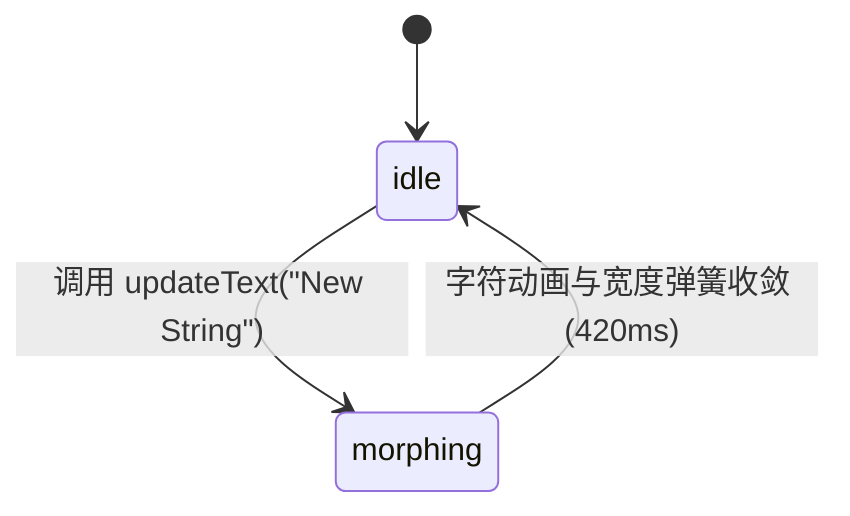

# Text Morph · 字形平滑形变

高保真单行文案平滑字形形变与状态流转组件。核心动效包含新旧字符按出现频次复用（Keyed Character Reuse）、相同字符平滑弹簧位移、退场字符绝对脱轨模糊淡出、进场字符错峰升起模糊淡入、以及外层容器宽度自适应弹性收敛（Zero-Jitter Container Width Morph）。

## 原型清单

| 原型分组 | 原型元素 | 动效 / 状态变化 | 去向 |
| --- | --- | --- | --- |
| 字符舞台 | 字符行容器（`.morph-chars`） | 测量新旧文案物理宽度，使用 420ms / bounce 0.16 弹簧平滑调整外框宽度 | 容器宽度弹簧形变 |
| 字符复用 | 相同字符节点（`.char-stay`） | 依据码点与出现序号匹配同一字符，通过 FLIP 或定位平滑滑动至新位置 | 字符复用与平滑位移 |
| 退场字符 | 消失字符节点（`.char-out`） | 脱离文档流，在原地绝对定位并以 180ms 向上微移 0.14em、4px 高斯模糊淡出 | 退场字符模糊淡出 |
| 进场字符 | 新增字符节点（`.char-in`） | 延时 50ms + 序数 × 32ms，自 0.8 倍缩放、0.14em 下部位移及 4px 模糊升起 | 进场字符错峰模糊淡入 |
| 演示外壳 | 顶部主题切换、Next status 切换按钮、Follow 关注按钮、说明文案 | 演示用途 | 演示外壳，已删除 |

## 适用

- 按钮状态流转（例如 "Publish" → "Publishing" → "Published"）需要极具质感的逐字连续平滑演进。
- 关注/取消关注、点赞、计数或单行短标题的连续原地动态置换。
- 文本长度产生增减时，容器外框需要伴随字符自然弹性伸缩。

## 不适用

- 长段落或多行文章视口首次逐词展露 → [text-reveal](text-reveal.md)
- 视口进入时的整句大标题入场动效 → [in-view-title](in-view-title.md)
- 异步加载或分析中的连续扫光流光 → [text-shimmer](text-shimmer.md)
- 包含复杂图标流转与提交时序的完整按钮 → [action-button](../buttons/action-button.md)

## 状态机

| 状态 | 进入条件 | 视觉表现 | 退出到 |
| --- | --- | --- | --- |
| idle | 文本渲染稳定状态 | 所有字符清晰驻留，容器锁定当前文本准确物理宽度 | morphing |
| morphing | 触发 `updateText(newText)` | 旧字符绝对定位升起淡出，新字符错峰升入，保留字符滑向新坐标，外框平滑伸缩 | idle |



## 最小 DOM

```html
<div class="arc-text-morph" role="status" aria-live="polite">
  <!-- 辅助技术真实朗读副本 -->
  <span class="sr-text">Publish</span>

  <!-- 视觉字形物理动画槽 -->
  <span class="morph-stage" aria-hidden="true">
    <span class="morph-track">
      <!-- 动态维护字形节点 -->
    </span>
  </span>
</div>
```

- `.arc-text-morph`：主容器，具备 `aria-live="polite"` 同步屏幕阅读器。
- `.sr-text`：视觉隐藏（Visually Hidden）的纯文本完整节点。
- `.morph-stage`：带有宽度过渡的物理测量外框，裁剪溢出并保护上下行高。
- `.morph-track`：单行排版轨道，承载字形绝对定位与变换。

## 参数

| 名称 | 值 | 用于 | 来源 |
| --- | --- | --- | --- |
| 容器宽度弹簧 | `420ms` / `cubic-bezier(0.16, 1, 0.3, 1)` | `.morph-stage` width 平滑伸缩 | 原型 |
| 进场字符错峰基准 | `50ms` | 首个新字符延迟 | 原型 |
| 进场字符错峰步长 | `32ms` | 限制最大第 9 档（约 338ms） | 原型 |
| 进场字符动画 | `280ms` / `scale(0.8) translateY(0.14em) blur(4px) -> 正常` | `.char-in` 升起淡入 | 原型 |
| 退场字符动画 | `180ms` / `translateY(-0.14em) blur(4px) opacity(0)` | `.char-out` 升起淡出 | 原型 |
| 退场节点销毁延时 | `220ms` | 动画结束后移除 DOM 垃圾 | 原型 |

## CSS

```css
.arc-text-morph {
  --ease-morph: cubic-bezier(0.16, 1, 0.3, 1);
  --ease-exit: cubic-bezier(0.22, 1, 0.36, 1);

  display: inline-flex;
  align-items: center;
  position: relative;
  font-family: system-ui, -apple-system, sans-serif;
  font-size: 14px;
  font-weight: 500;
  line-height: 1.4;
  color: #24292f;
  user-select: none;
}

.sr-text {
  position: absolute;
  width: 1px;
  height: 1px;
  padding: 0;
  margin: -1px;
  overflow: hidden;
  clip: rect(0, 0, 0, 0);
  white-space: nowrap;
  border: 0;
}

.morph-stage {
  display: inline-block;
  position: relative;
  overflow: visible;
  white-space: nowrap;
  transition: width 420ms var(--ease-morph);
}

.morph-track {
  display: inline-flex;
  position: relative;
  align-items: baseline;
}

.morph-char {
  display: inline-block;
  white-space: pre;
  transform-origin: 50% 50%;
  transition: transform 420ms var(--ease-morph),
              opacity 280ms var(--ease-morph),
              filter 280ms var(--ease-morph);
}

.char-out {
  position: absolute;
  pointer-events: none;
  opacity: 0 !important;
  transform: translateY(-0.14em) scale(0.9) !important;
  filter: blur(4px) !important;
  transition: transform 180ms var(--ease-exit),
              opacity 180ms var(--ease-exit),
              filter 180ms var(--ease-exit) !important;
}

.char-in {
  opacity: 0;
  transform: translateY(0.14em) scale(0.8);
  filter: blur(4px);
}

@media (prefers-reduced-motion: reduce) {
  .morph-stage,
  .morph-char {
    transition: opacity 120ms ease !important;
    transform: none !important;
    filter: none !important;
  }
}
```

## JS

```js
export function createTextMorph(el, options = {}) {
  const root = el;
  const stage = root.querySelector('.morph-stage');
  const track = root.querySelector('.morph-track');
  const srText = root.querySelector('.sr-text');

  let currentText = options.text || root.textContent.trim() || 'Submit';
  let isTransitioning = false;

  function renderInitial() {
    if (!track) return;
    track.innerHTML = '';
    const chars = Array.from(currentText);
    chars.forEach(ch => {
      const span = document.createElement('span');
      span.className = 'morph-char';
      span.textContent = ch === ' ' ? '\u00A0' : ch;
      track.appendChild(span);
    });
    if (srText) srText.textContent = currentText;
    if (stage) stage.style.width = `${track.offsetWidth}px`;
  }

  function setText(newText) {
    if (!track || newText === currentText) return;
    const oldChars = Array.from(track.children);
    const oldText = currentText;
    currentText = newText;
    if (srText) srText.textContent = newText;

    // 测量旧宽度
    const oldWidth = track.offsetWidth;
    if (stage) stage.style.width = `${oldWidth}px`;

    // 快速字符标记退场
    oldChars.forEach(node => {
      node.classList.add('char-out');
      setTimeout(() => node.remove(), 220);
    });

    // 挂载新字符
    const newChars = Array.from(newText);
    newChars.forEach((ch, idx) => {
      const span = document.createElement('span');
      span.className = 'morph-char char-in';
      span.textContent = ch === ' ' ? '\u00A0' : ch;
      const delay = Math.min(338, 50 + idx * 32);
      span.style.transitionDelay = `${delay}ms`;
      track.appendChild(span);

      // 触发淡入
      requestAnimationFrame(() => {
        span.classList.remove('char-in');
      });
    });

    // 动态平滑宽度过渡
    void track.offsetWidth;
    const targetWidth = track.offsetWidth;
    if (stage) {
      stage.style.width = `${targetWidth}px`;
    }
  }

  renderInitial();

  return {
    destroy: () => {
      if (track) track.innerHTML = '';
    },
    update: (txt) => {
      setText(txt);
    }
  };
}
```

## 接入目标项目

- 状态来源：
  - 由操作按钮的异步流转生命周期（Idle → Pending → Success）传入新字符串驱动。
- 尺寸策略：
  - 容器内部字形宽度通过 `track.offsetWidth` 动态实时测量，并施加于 `.morph-stage`，实现 0 抖动的顺滑物理外框贴合。
- 驱动方式：
  - 初始化时调用 `const morph = createTextMorph(container, { text: 'Publish' })`。
  - 状态改变时调用 `morph.update('Published')`。
  - 卸载时调用 `morph.destroy()`。

## 重入与清理

- 连续高频重入：在旧字形未完全销毁时直接调用新文案，新旧字形各持独立退场延时，不会因快速点击导致字符重叠混乱。
- 卸载清理：`destroy()` 清空内部临时退场节点并终止动画。

## 减少动态效果

- 激活 `prefers-reduced-motion: reduce` 时：
  - 禁用全部 `scale` 与 `translateY` 几何运动。
  - 禁用 4px 高斯模糊滤镜与阶梯延时，仅以 120ms 纯透明度淡入淡出直接呈现。

## 焦点与键盘

- 视觉字形节点全部挂载于 `aria-hidden="true"` 的容器内，不进入无障碍树。
- 辅助技术直接读取绝对定位的 `.sr-text` 纯文本，确保屏幕阅读器无论在形变期间还是静止时均能精准完整朗读。

## 兼容回退

| 特性 | 不支持时 |
| --- | --- |
| `Array.from` 码点拆分 | 使用原生字符遍历回退，覆盖常见 ASCII 字符。 |
| CSS 高斯模糊 `filter: blur()` | 回退为直接通过透明度 `opacity` 实现字形显隐。 |

## 验收清单

- [ ] 调用 `update("Publishing")` 时，原有字符轻微上移模糊淡出，新字符错峰升入，容器外框平滑伸长。
- [ ] 连续快速多次更新文案，字符无破损重叠，最终宽度完全精准贴合。
- [ ] 辅助技术完整朗读目标文案，无重复碎读。
- [ ] 开启系统减少动态偏好时，动画位移与模糊停用，文本以轻量淡出淡入完成置换。
