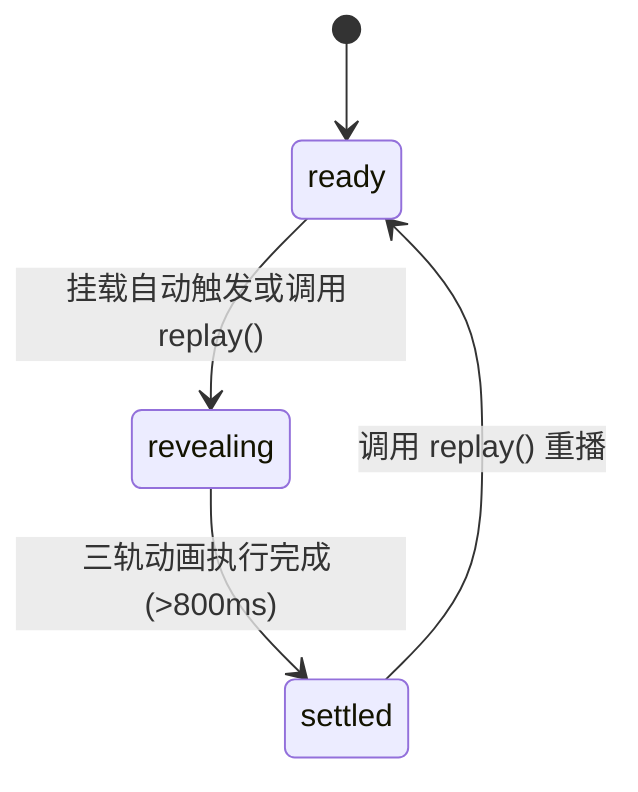

# Text Reveal · 逐词文本浮现

标题与正文段落的高品质逐词浮现入场动效。核心动效包含三条独立的 CSS 关键帧轨道（位移 760ms、透明度 440ms、高斯清晰度 580ms）、基于自然空格智能分词、动态自适应错峰步长、遮罩羽化为下行字母留白、以及动画结束后释放滤镜以保障文字字体清晰原生渲染。

## 原型清单

| 原型分组 | 原型元素 | 动效 / 状态变化 | 去向 |
| --- | --- | --- | --- |
| 标题浮现 | 标题分词节点（`h2 .reveal-word`） | 初始 0.62em 下位移、8px 高斯模糊与 0% 透明度；760ms/440ms/580ms 三轨异步复原 | 标题三轨逐词浮现 |
| 段落浮现 | 正文分词节点（`p .reveal-word`） | 初始 0.62em 下位移、4px 轻度模糊与 0% 透明度；错峰跟随标题进入 | 段落低饱和度逐词浮显 |
| 遮罩羽化 | 词容器排版行（`.reveal-line`） | 底部添加额外留白以容纳英文字母下行部（Descender，如 g/y/p/q）及模糊发散 | 遮罩溢出羽化留白 |
| 错峰步长 | 延时计算机制 | 依据总词数计算步长 `min(0.04s, 0.48s / 总词数)`，行与词双重累加延迟 | 智能词间错峰步长 |
| 演示外壳 | 顶部主题切换、Replay 重播按钮、全局排版居中舞台 | 演示用途 | 演示外壳，已删除 |

## 适用

- 页面首屏叙述性大段落、品牌宣言、文章引言或产品介绍逐词展开。
- 强调优雅、舒缓、具有排版呼吸感的内容揭示体验。
- 纯 CSS 时间线驱动，无需滚动监听，挂载即可自动依序执行。

## 不适用

- 基于视口滚动到达指定阈值时触发的标题入场 → [in-view-title](in-view-title.md)
- 按钮状态流转时的字形原地置换与复用 → [text-morph](text-morph.md)
- 异步进行中的光斑扫描流光 → [text-shimmer](text-shimmer.md)

## 状态机

| 状态 | 进入条件 | 视觉表现 | 退出到 |
| --- | --- | --- | --- |
| ready | 挂载前或未开始 | 词节点保持在 0.62em 下位移、模糊与透明度 0 状态 | revealing |
| revealing | 挂载后启动动画 | 三条轨道按动态延时开始行进，词间如流水般连续显露 | settled |
| settled | 动画三轨全部执行完毕（>800ms） | 清理 `transform` 与 `filter` 属性，恢复系统原生字体抗锯齿清晰渲染 | ready (若触发 replay) |



## 最小 DOM

```html
<div class="arc-text-reveal">
  <!-- 标题逐词展露 -->
  <h2 class="reveal-heading" aria-label="Simplicity carried to an extreme becomes elegance.">
    <span class="reveal-content" aria-hidden="true">
      <span class="reveal-word" style="--delay: 0s">Simplicity</span>
      <span class="reveal-word" style="--delay: 0.04s">carried</span>
      <span class="reveal-word" style="--delay: 0.08s">to</span>
      <span class="reveal-word" style="--delay: 0.12s">an</span>
      <span class="reveal-word" style="--delay: 0.16s">extreme</span>
      <span class="reveal-word" style="--delay: 0.20s">becomes</span>
      <span class="reveal-word" style="--delay: 0.24s">elegance.</span>
    </span>
  </h2>
</div>
```

- `.arc-text-reveal`：组件外层容器。
- `.reveal-heading`：语义化标题标签，通过 `aria-label` 维护完整的屏幕阅读器可访问名称。
- `.reveal-content`：声明 `aria-hidden="true"` 的分词渲染插槽。
- `.reveal-word`：单个词节点，承载 `--delay` 延时与三轨动画。

## 参数

| 名称 | 值 | 用于 | 来源 |
| --- | --- | --- | --- |
| 位移轨道时长 | `760ms` / `cubic-bezier(0.16, 1, 0.3, 1)` | `translateY(0.62em) -> 0` | 原型 |
| 透明度轨道时长 | `440ms` / `cubic-bezier(0.16, 1, 0.3, 1)` | `opacity: 0 -> 1` | 原型 |
| 模糊清晰度时长 | `580ms` / `cubic-bezier(0.16, 1, 0.3, 1)` | 标题 `blur(8px)` / 段落 `blur(4px) -> 0` | 原型 |
| 基础错峰步长 | `Math.min(0.04, 0.48 / Math.max(totalWords, 1))s` | 步长随词数自适应伸缩 | 原型 |
| 减少动态透明度过渡 | `160ms ease` | prefers-reduced-motion 模式 | 原型 |

## CSS

```css
.arc-text-reveal {
  --ease-calm: cubic-bezier(0.16, 1, 0.3, 1);
  display: block;
  font-family: system-ui, -apple-system, sans-serif;
  color: #111827;
  max-width: 640px;
}

.reveal-heading {
  margin: 0 0 16px;
  font-size: 28px;
  font-weight: 700;
  line-height: 1.3;
  letter-spacing: -0.02em;
}

.reveal-content {
  display: inline-flex;
  flex-wrap: wrap;
  gap: 0.28em;
}

.reveal-word {
  display: inline-block;
  opacity: 0;
  transform: translateY(0.62em);
  filter: blur(8px);
  animation-name: revealMove, revealFade, revealBlur;
  animation-duration: 760ms, 440ms, 580ms;
  animation-timing-function: var(--ease-calm), var(--ease-calm), var(--ease-calm);
  animation-fill-mode: backwards, backwards, backwards;
  animation-delay: var(--delay, 0s);
  animation-fill-mode: forwards;
}

@keyframes revealMove {
  from { transform: translateY(0.62em); }
  to { transform: translateY(0); }
}

@keyframes revealFade {
  from { opacity: 0; }
  to { opacity: 1; }
}

@keyframes revealBlur {
  from { filter: blur(8px); }
  to { filter: blur(0); }
}

@media (prefers-reduced-motion: reduce) {
  .reveal-word {
    animation-name: revealFadeReduced !important;
    animation-duration: 160ms !important;
    animation-delay: 0s !important;
    transform: none !important;
    filter: none !important;
  }
}

@keyframes revealFadeReduced {
  from { opacity: 0; }
  to { opacity: 1; }
}
```

## JS

```js
export function createTextReveal(el, options = {}) {
  const root = el;
  const content = root.querySelector('.reveal-content');
  const heading = root.querySelector('.reveal-heading');

  function splitAndRender(text) {
    if (!content) return;
    content.innerHTML = '';
    const words = text.trim().split(/\s+/);
    const total = words.length;
    const step = Math.min(0.04, 0.48 / Math.max(total, 1));
    const baseDelay = options.delay || 0;

    if (heading) {
      heading.setAttribute('aria-label', text);
    }

    words.forEach((w, idx) => {
      const span = document.createElement('span');
      span.className = 'reveal-word';
      const delay = (baseDelay + idx * step).toFixed(3);
      span.style.setProperty('--delay', `${delay}s`);
      span.textContent = w;
      content.appendChild(span);
    });
  }

  function replay() {
    if (!content) return;
    const words = Array.from(content.querySelectorAll('.reveal-word'));
    words.forEach(w => {
      w.style.animation = 'none';
      void w.offsetWidth;
      w.style.animation = '';
    });
  }

  if (options.text) {
    splitAndRender(options.text);
  }

  return {
    destroy: () => {
      if (content) content.innerHTML = '';
    },
    replay,
    setText: (newText) => {
      splitAndRender(newText);
    }
  };
}
```

## 接入目标项目

- 状态来源：
  - 数据由静态文案或异步取得的文章内容驱动，调用 `setText(newText)` 即可自动根据字数生成步长与时间线。
- 尺寸策略：
  - 分词采用行内弹性流式布局（`inline-flex`），换行与空格行为与标准排版完全一致。
- 驱动方式：
  - 页面挂载时调用 `const reveal = createTextReveal(container, { text: 'Your Title Here' })`。
  - 需要重新播放时调用 `reveal.replay()`。
  - 卸载时调用 `reveal.destroy()`。

## 重入与清理

- 连续调用 `replay()`：通过清空 `animation` 并强制触发 `offsetWidth` 重绘，确保三条关键帧轨道可靠重置，不发生卡帧。
- 卸载清理：`destroy()` 清空动态插入的 span 节点，阻断动画垃圾滞留。

## 减少动态效果

- 激活 `prefers-reduced-motion: reduce` 时：
  - 关闭垂直位移关键帧（revealMove）与高斯模糊关键帧（revealBlur）。
  - 阶梯错峰延迟归零，所有词节点以 160ms 纯透明度单轨动画统一浮现。

## 焦点与键盘

- 分词节点全部挂载于 `aria-hidden="true"` 容器内，杜绝无障碍阅读器出现卡顿拆读。
- 语义级标题标签保留完整的 `aria-label`，键盘焦点切换不受任何影响。

## 兼容回退

| 特性 | 不支持时 |
| --- | --- |
| CSS 关键帧动画 | 词节点默认继承 `forwards` 最终样式，无动画直接可见。 |
| CSS `gap` 在行内排版 | 词间自动补全普通不换行空格间隙。 |

## 验收清单

- [ ] 页面加载后标题各词依序自下部 0.62em 处平滑升起，高斯模糊渐退至完全清晰。
- [ ] 动画结束后文字释放滤镜，边缘清晰无发虚。
- [ ] 调用 `replay()` 可平滑重启入场流程。
- [ ] 开启系统减少动态偏好时，文字无任何几何位移与模糊，一次性淡入显现。
