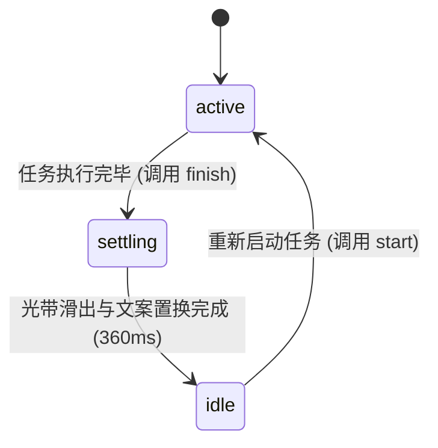

# Text Shimmer · 文本扫光微动效

文本表面高品质动态流光与扫描微动效。核心机制包含 2.2em 光带周期性扫掠（Shimmer Light Band）、32% 周期驻留微憩、离屏视口自动暂停、完成态光带平滑滑出（Settle Glide）、文字微模糊置换（Micro-blur Text Swap）以及图标矢量变异至成功对勾。

## 原型清单

| 原型分组 | 原型元素 | 动效 / 状态变化 | 去向 |
| --- | --- | --- | --- |
| 扫光文字 | 活跃文本标签（`.shimmer-label`） | 2.2em 宽度渐变高光带以 1.8s 周期横向扫掠，扫掠结束后停顿 32% 周期 | 文本扫光高光带与周期停歇 |
| 状态收敛 | 状态切换与收敛（`settle` 插值） | 点击完成时，流光带平滑向右滑出而非瞬间截断；文本自 0.3em 偏移与 4px 模糊置换为最终文案 | 光带平滑收敛与微模糊文案置换 |
| 图标联动 | 状态图标容器（`.shimmer-icon`） | 活跃态展示闪烁星标/同步文件夹；完成态以 0.6x 缩放与 2px 模糊变异为绿色对勾 | 图标微模糊缩放流转 |
| 视口节能 | 视口相交监听器 | 超出视口 64px 边界时自动暂停 requestAnimationFrame 动画循环，重入时平滑恢复 | 视口能耗管理 |
| 演示外壳 | 顶部主题切换按钮、演示卡片面板、全局居中舞台 | 演示用途 | 演示外壳，已删除 |

## 适用

- AI 生成内容中（如“正在生成摘要…”、“思考中…”）的流光进行中反馈。
- 文件后台同步、数据导出、网络重连过程中的轻量级文字级加载指示。
- 任务完成时由扫光态自然演进为静止确认文案与对勾。

## 不适用

- 整块卡片或骨架屏占位扫光 → [skeleton](../progress/skeleton.md)
- 视口进入时的整句大标题入场动效 → [in-view-title](in-view-title.md)
- 按钮内部多状态文案字符级形变 → [text-morph](text-morph.md)
- 异步操作按钮完整时序流转 → [action-button](../buttons/action-button.md)

## 状态机

| 状态 | 进入条件 | 视觉表现 | 退出到 |
| --- | --- | --- | --- |
| active | 初始加载或任务进行中 | 2.2em 光带持续周期性扫掠，具备 `aria-busy="true"`，图标处于进行中形态 | settling |
| settling | 任务完成触发 `finish()` | 光带平滑向右滑出（360ms 缓动），文本执行微模糊置换，图标变异为绿色对勾 | idle |
| idle | 任务完成稳定状态 | 文本静止无扫光，移除 `aria-busy`，展示最终成功状态文案 | active |



## 最小 DOM

```html
<div class="arc-text-shimmer" data-state="active" aria-busy="true">
  <div class="shimmer-icon" aria-hidden="true">
    <svg class="icon-active" width="16" height="16" viewBox="0 0 24 24" fill="none" stroke="currentColor" stroke-width="2">
      <path d="M12 2v4M12 18v4M4.93 4.93l2.83 2.83M16.24 16.24l2.83 2.83M2 12h4M18 12h4M4.93 19.07l2.83-2.83M16.24 7.76l2.83-2.83" />
    </svg>
    <svg class="icon-done" width="16" height="16" viewBox="0 0 24 24" fill="none" stroke="#16a34a" stroke-width="2.5">
      <polyline points="20 6 9 17 4 12"></polyline>
    </svg>
  </div>

  <div class="shimmer-body">
    <span class="shimmer-stage">
      <span class="shimmer-label">Generating summary...</span>
    </span>
  </div>
</div>
```

- `.arc-text-shimmer`：主组件宿主，管理 `data-state` 与 `aria-busy`。
- `.shimmer-icon`：图标容器，层叠进行中图标与完成对勾图标。
- `.shimmer-stage`：带有宽度形变能力的容器。
- `.shimmer-label`：扫光渐变背景的承载文本元素。

## 参数

| 名称 | 值 | 用于 | 来源 |
| --- | --- | --- | --- |
| 光带物理宽度 | `2.2em` | 光带在文本上展开的相对宽度 | 原型 |
| 单次扫掠时长 | `1800ms` | 单次光斑自左向右完整扫过时长 | 原型 |
| 周期驻留比例 | `32%`（约 576ms） | 每次扫光完成后的停顿空档 | 原型 |
| 光带滑出时长 | `360ms` / `cubic-bezier(0.16, 1, 0.3, 1)` | 结束时流光顺畅滑出视野 | 原型 |
| 文案微模糊置换 | `140ms` / `translateY(0.3em) blur(4px) -> 0` | 状态切换时文字置换 | 原型 |
| 图标变异时长 | `260ms` / `scale(0.6) blur(2px) -> 1` | 对勾图标缩放浮显 | 原型 |

## CSS

```css
.arc-text-shimmer {
  --ts-base: #57606a;
  --ts-highlight: #24292f;
  --ease-calm: cubic-bezier(0.16, 1, 0.3, 1);

  display: inline-flex;
  align-items: center;
  gap: 8px;
  font-family: system-ui, -apple-system, sans-serif;
  font-size: 13px;
  line-height: 1.4;
  color: var(--ts-base);
  user-select: none;
}

.shimmer-icon {
  position: relative;
  width: 16px;
  height: 16px;
  display: grid;
  place-items: center;
}

.shimmer-icon svg {
  position: absolute;
  inset: 0;
  transition: opacity 240ms var(--ease-calm),
              transform 260ms var(--ease-calm),
              filter 240ms var(--ease-calm);
}

.icon-active {
  opacity: 1;
  transform: scale(1);
  animation: spinSlow 3s linear infinite;
}

.icon-done {
  opacity: 0;
  transform: scale(0.6);
  filter: blur(2px);
}

@keyframes spinSlow {
  to { transform: rotate(360deg); }
}

.arc-text-shimmer[data-state="idle"] .icon-active {
  opacity: 0;
  transform: scale(0.6);
  filter: blur(2px);
}

.arc-text-shimmer[data-state="idle"] .icon-done {
  opacity: 1;
  transform: scale(1);
  filter: blur(0);
}

.shimmer-stage {
  display: inline-block;
  overflow: visible;
  transition: width 360ms var(--ease-calm);
}

.shimmer-label {
  display: inline-block;
  background-clip: text;
  -webkit-background-clip: text;
  color: transparent;
  transition: opacity 140ms ease, transform 140ms ease, filter 140ms ease;
}

.shimmer-label.label-swap {
  opacity: 0;
  transform: translateY(0.3em);
  filter: blur(4px);
}

@media (prefers-reduced-motion: reduce) {
  .icon-active {
    animation: none;
  }
  .shimmer-label {
    background-image: none !important;
    color: var(--ts-highlight) !important;
  }
}
```

## JS

```js
export function createTextShimmer(el, options = {}) {
  const root = el;
  const label = root.querySelector('.shimmer-label');
  const stage = root.querySelector('.shimmer-stage');

  let active = options.active !== false;
  let t = 0;
  let wait = 120;
  let previous = performance.now();
  let frame = 0;
  let isVisible = true;
  let settle = active ? 0 : 1;

  const falloff = [[-1, 0], [-0.5, 0.5], [-0.2, 0.9], [0, 1], [0.2, 0.9], [0.5, 0.5], [1, 0]];

  function buildGradient(progress, settleVal) {
    const base = `color-mix(in oklab, var(--ts-highlight) ${(settleVal * 100).toFixed(1)}%, var(--ts-base))`;
    const stops = falloff.map(([offset, strength]) => {
      const color = `color-mix(in oklab, var(--ts-highlight) ${(strength * 100).toFixed(1)}%, ${base})`;
      const pos = `calc(${(progress * 100).toFixed(2)}% + ${((2 * progress - 1 + offset) * 2.2).toFixed(3)}em)`;
      return `${color} ${pos}`;
    });
    return `linear-gradient(90deg, ${base}, ${stops.join(', ')}, ${base})`;
  }

  function tick(now) {
    const elapsed = Math.min(64, now - previous);
    previous = now;

    if (active && isVisible && document.visibilityState !== 'hidden') {
      if (wait > 0) {
        wait -= elapsed;
      } else {
        t += elapsed / 1800;
        if (t >= 1) {
          t = 0;
          wait = 1800 * 0.32;
        }
      }
    }

    if (label) {
      label.style.backgroundImage = buildGradient(t, settle);
    }

    frame = requestAnimationFrame(tick);
  }

  frame = requestAnimationFrame(tick);

  // 视口节能检测
  let observer = null;
  if ('IntersectionObserver' in window) {
    observer = new IntersectionObserver((entries) => {
      entries.forEach(entry => {
        isVisible = entry.isIntersecting;
      });
    }, { rootMargin: '64px' });
    observer.observe(root);
  }

  function finish(doneText = 'Summary ready') {
    active = false;
    root.dataset.state = 'idle';
    root.removeAttribute('aria-busy');

    // Settle 曲线滑出
    const start = performance.now();
    const duration = 360;
    function settleStep(now) {
      const p = Math.min(1, (now - start) / duration);
      settle = 1 - Math.pow(1 - p, 3);
      if (p < 1) requestAnimationFrame(settleStep);
    }
    requestAnimationFrame(settleStep);

    // 文案微模糊置换
    if (label) {
      label.classList.add('label-swap');
      setTimeout(() => {
        label.textContent = doneText;
        label.classList.remove('label-swap');
      }, 140);
    }
  }

  function restart(activeText = 'Generating summary...') {
    active = true;
    settle = 0;
    t = 0;
    wait = 120;
    root.dataset.state = 'active';
    root.setAttribute('aria-busy', 'true');

    if (label) {
      label.classList.add('label-swap');
      setTimeout(() => {
        label.textContent = activeText;
        label.classList.remove('label-swap');
      }, 140);
    }
  }

  return {
    destroy: () => {
      cancelAnimationFrame(frame);
      observer?.disconnect();
    },
    finish,
    restart
  };
}
```

## 接入目标项目

- 状态来源：
  - 由异步后台任务生命周期驱动。在任务进行中设置 `active: true`，任务返回后调用 `finish(doneText)`。
- 尺寸策略：
  - 文本采用行内弹性流式布局，新旧文案字数差异时由外层 `.shimmer-stage` 平滑适应宽度。
- 驱动方式：
  - 页面挂载时调用 `const shimmer = createTextShimmer(container)`。
  - 数据就绪后调用 `shimmer.finish('Done')`。
  - 卸载时调用 `shimmer.destroy()` 释放动画帧与视口观察器。

## 重入与清理

- 连续触发完成与重启：`settle` 采用插值过渡而非硬切换，保证流光带在未退场时重新激活也能无缝从当前位置平滑倒回。
- 卸载清理：`destroy()` 取消 `requestAnimationFrame` 循环，断开 IntersectionObserver 观察器。

## 减少动态效果

- 激活 `prefers-reduced-motion: reduce` 时：
  - 停用流光渐变背景与图标旋转，将文字颜色直接设为高亮固定色彩，无动画进行。

## 焦点与键盘

- 活跃态设置 `aria-busy="true"` 同步给无障碍辅助技术。
- 完成态移除 `aria-busy` 并更新文案，配合宿主外层 `aria-live="polite"` 完成朗读。

## 兼容回退

| 特性 | 不支持时 |
| --- | --- |
| `background-clip: text` | 文本直接显示常规高对比度静态颜色，不展示流光渐变。 |
| `color-mix()` | 采用预设 Hex 渐变色阶降级渲染。 |

## 验收清单

- [ ] 活跃态下 2.2em 高光渐变光带每隔约 2.4s 平滑扫过文本表面，循环周期稳定。
- [ ] 页面滚动出屏幕外时，动画帧暂停计算以节省 CPU 能耗。
- [ ] 调用 `finish()` 时，光斑平滑向右滑出，文案微模糊置换为完成状态，图标变异为绿色对勾。
- [ ] 开启系统减少动态偏好时，流光关闭，文本直接以清晰静态样式呈现。
