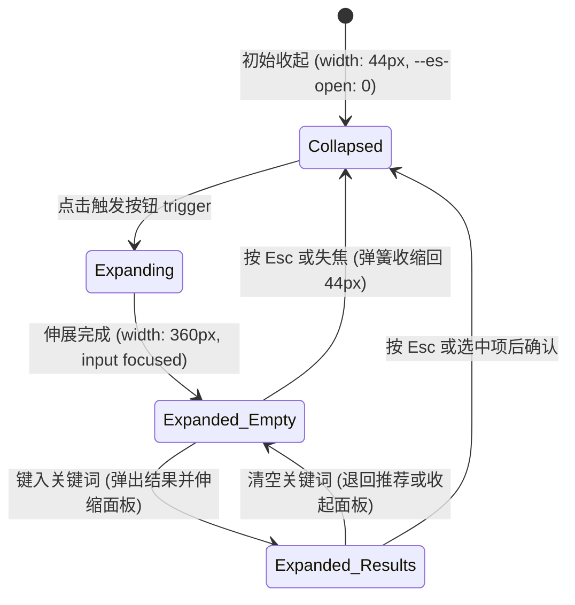

# Expanding Search · 展开式搜索字段

从 44px 紧凑圆形图标按钮平滑横向伸展至 360px 完整搜索栏的形变组件。解决导航栏/紧凑空间中的搜索视觉侵占问题。涵盖四大核心机制：

1. 弹簧驱动几何形变（Morphing Shell & Width Spring）：外壳在 44px 圆形图标与最大 360px 输入栏之间物理弹簧展开/收缩，同步映射 `--es-open`（0 ~ 1）过渡变量控制内部元素交替显隐。
2. 动态高度伸缩结果面板（Morphing Height Dropdown Panel）：展开且获得焦点时，下方挂载自适应高度的搜索建议浮层；利用 `ResizeObserver` 监听内容高度并通过物理平滑弹簧进行平滑过渡，杜绝展开面板时的截断或硬跳。
3. 高光跟随药丸光标（Gliding Option Highlight Pill）：在下拉结果列表中通过键盘上下方向键或光标移动时，背景高亮药丸通过单一共享 DOM 沿垂直方向 `translateY` 弹性平移。
4. 键盘/焦点闭环与 Esc 还原（Focus Management & Escape Collapse）：点击展开时即刻聚焦 input；按 Escape 或失焦（且无内容）时即刻收缩为圆形图标并将焦点返还触发器按钮。

## 原型清单

| 原型分组 | 原型元素 | 动效 / 状态变化 | 去向 |
| --- | --- | --- | --- |
| 官方展开搜索舞台 | 根容器 `.expanding-search-root` | 声明对齐方式 `data-anchor="end"` 与最大宽度 `--es-width` | 变量契约 |
| 官方展开搜索舞台 | 字段外壳 `.expanding-search-shell` | 从 44px 弹簧伸展至 360px；映射 `--es-open` | 弹簧驱动几何形变 |
| 官方展开搜索舞台 | 收起态触发按钮 `.expanding-search-trigger` | 悬停发亮；点击后隐藏并展开输入框 | 键盘/焦点闭环与 Esc 还原 |
| 官方展开搜索舞台 | 搜索放大镜图标 `svg.expanding-search-icon` | 随宽度展开平滑由居中转为靠左 | 样式实现 |
| 官方展开搜索舞台 | 搜索输入框 `.expanding-search-input` | 展开时淡入 `opacity: 0 -> 1`，收起时置为 `inert` | 弹簧驱动几何形变 |
| 官方展开搜索舞台 | 尾部清除按钮 `.expanding-search-clear` | 键入文字时 `scale(0.6) + blur(2px) -> 1` 浮现 | 交互实现 |
| 官方展开搜索舞台 | 下拉建议面板 `.expanding-search-panel` | 自适应高度平滑弹簧伸缩；淡入淡出 | 动态高度伸缩结果面板 |
| 官方展开搜索舞台 | 选项列表 `.expanding-search-listbox` | ARIA combobox 选项列表容器 | 结构与语义 |
| 官方展开搜索舞台 | 选项高光指示器 `.expanding-search-highlight` | 随活动项沿 Y 轴物理滑动 | 高光跟随药丸光标 |
| 官方展开搜索舞台 | 读屏实时通报 `[role="status"]` | 动态报告搜索匹配数量 | 无障碍与无动画 |
| — | 顶栏独立主题切换器 `#themeBtn` | 演示主题切换 | 演示外壳，已删除 |
| — | 演示状态槽 `.demo-status` | 演示数据变动状态显示 | 演示外壳，已删除 |

## 适用

- 顶部导航栏、紧凑工具栏、移动端窄屏或卡片头部等空间寸土寸金的搜索入口。
- 用户默认不一定高频使用搜索，但点击后需要完整的即席检索体验。

## 不适用

- 常驻展开的标准搜索输入框（无需折叠收起为圆形按钮） → [search-field](search-field.md)
- 普通单行文本输入 → [input](input.md)
- 密码输入与明暗文切换 → [password-field](password-field.md)
- 多行长文本输入 → [textarea](textarea.md)

## 状态机



| 状态 | 进入条件 | 视觉表现 | 退出到 |
| --- | --- | --- | --- |
| Collapsed | 初始或失焦且内容为空 | 外壳呈 44px 圆形，内部仅显示放大镜图标，`input` 处于 `inert` | Expanding |
| Expanding | 点击触发器按钮 | 触发器隐藏，输入框解除 `inert`，外壳宽度以物理弹簧曲线向外伸展 | Expanded_Empty |
| Expanded_Empty | 展开完成且获得焦点 | 宽度锁定 360px，`--es-open: 1`，输入框可见，下方弹出默认建议面板 | Expanded_Results / Collapsed |
| Expanded_Results | 用户键入搜索词 | 尾部浮现清除按钮，面板自适应高度变动，支持上下键高光浏览 | Expanded_Empty / Collapsed |

## 动效参数

| 机制 | 属性 / 技术 | 持续时间 / 参数 | 缓动函数 | 说明 |
| --- | --- | --- | --- | --- |
| 外壳展开弹簧 | `width`, `--es-open` | ~380ms 物理振荡 | `linear(0, 0.02, ..., 1.006, ..., 1)` (回退 `cubic-bezier(.16,1,.3,1)`) | 从 44px 到 360px 弹性拉伸 |
| 外壳收缩平滑 | `width`, `--es-open` | 260ms | `cubic-bezier(.22,1,.36,1)` | 快速利落回缩，避免多余回弹 |
| 面板高度伸缩 | `height` (WAAPI / JS 弹簧) | 240ms | `cubic-bezier(.22,1,.36,1)` | 根据子内容 offsetHeight 连续自适应补间 |
| 选项药丸滑动 | `transform: translateY(...)` | 180ms | `cubic-bezier(.16,1,.3,1)` | 键盘快速切换时轻快跟手 |
| 清除按钮出入场 | `opacity`, `transform: scale(0.6)`, `filter: blur(2px)` | 入场 260ms / 退场 120ms | `cubic-bezier(.16,1,.3,1)` | 缩放淡入淡出并去模糊 |

## 变量契约

### 依赖的全局/主题变量

| 变量名 | 默认值（浅色） | 暗色值 | 作用 |
| --- | --- | --- | --- |
| `--control-height-md` | `2.75rem` (44px) | `2.75rem` (44px) | 控件基础高度与收起态基准直径 |
| `--radius-control` | `1.125rem` (18px) | `1.125rem` (18px) | 展开时外壳圆角与面板圆角 |
| `--radius-pill` | `9999px` | `9999px` | 收起态圆形胶囊形态 |
| `--border-strong` | `oklch(82% 0 0)` | `oklch(40% 0 0)` | 外壳静止状态边框色 |
| `--foreground` | `oklch(22% 0 0)` | `oklch(96% 0 0)` | 文本前景色与激活高亮边框色 |
| `--surface` | `oklch(100% 0 0)` | `oklch(21.5% 0 0)` | 输入框与面板背景填充色 |
| `--surface-muted` | `oklch(97.8% 0 0)` | `oklch(26% 0 0)` | 选项药丸高光底色与悬停色 |
| `--shadow-floating` | `0 20px 48px oklch(0% 0 0/.105)` | `0 22px 55px oklch(0% 0 0/.34)` | 下拉浮层投影 |

### 组件私有变量

| 变量名 | 默认值 | 作用 |
| --- | --- | --- |
| `--es-width` | `360px` | 展开时的最大宽度目标值 |
| `--es-open` | `0` | 展开进度归一化标量（0.0 ~ 1.0） |

## 结构与语义

```html
<div class="expanding-search-root" data-anchor="end" style="--es-width: 360px;">
  <div class="expanding-search-shell" style="width: 44px; --es-open: 0;">
    <button type="button" class="expanding-search-trigger" aria-label="Search projects and docs"></button>
    <svg
      class="expanding-search-icon"
      xmlns="http://www.w3.org/2000/svg"
      width="18"
      height="18"
      viewBox="0 0 24 24"
      fill="none"
      stroke="currentColor"
      stroke-width="1.75"
      stroke-linecap="round"
      stroke-linejoin="round"
      aria-hidden="true"
    >
      <path d="m21 21-4.34-4.34" />
      <circle cx="11" cy="11" r="8" />
    </svg>
    <input
      class="expanding-search-input"
      type="text"
      role="combobox"
      placeholder="Search projects and docs"
      aria-label="Search projects and docs"
      aria-expanded="false"
      aria-autocomplete="list"
      autocomplete="off"
      spellcheck="false"
      enterkeyhint="search"
      inert
    />
  </div>
  <span class="expanding-search-sr-only" role="status" aria-live="polite"></span>
</div>
```

## 样式实现

```css
.expanding-search-root {
  position: relative;
  display: flex;
  justify-content: flex-end;
  width: var(--es-width, 360px);
}

.expanding-search-root[data-anchor="start"] {
  justify-content: flex-start;
}

.expanding-search-shell {
  position: relative;
  display: flex;
  height: 44px;
  box-sizing: border-box;
  align-items: center;
  border: 1px solid var(--border-strong, #d1d1d1);
  border-radius: var(--radius-control, 18px);
  background: var(--surface, #ffffff);
  padding: 0 0.75rem;
  overflow: hidden;
  will-change: width;
  transition: border-color 160ms cubic-bezier(0.22, 1, 0.36, 1);
}

.expanding-search-shell:focus-within {
  border-color: var(--foreground, #1c1c1c);
}

/* 覆盖于收起态之上的透明触发器按钮 */
.expanding-search-trigger {
  position: absolute;
  inset: 0;
  width: 100%;
  height: 100%;
  border: 0;
  background: transparent;
  cursor: pointer;
  z-index: 2;
  margin: 0;
  padding: 0;
}

.expanding-search-icon {
  flex: 0 0 auto;
  color: var(--foreground, #1c1c1c);
  pointer-events: none;
}

.expanding-search-input {
  width: 100%;
  min-width: 0;
  border: 0;
  background: transparent;
  color: var(--foreground, #1c1c1c);
  font: inherit;
  font-size: 0.875rem;
  line-height: 1.4;
  outline: 0;
  padding-left: 0.5rem;
  opacity: var(--es-open, 0);
  transition: opacity 160ms cubic-bezier(0.22, 1, 0.36, 1);
}

/* 尾部清除按钮 */
.expanding-search-clear {
  position: absolute;
  right: 8px;
  display: grid;
  width: 24px;
  height: 24px;
  place-items: center;
  border: 0;
  border-radius: 50%;
  background: transparent;
  color: var(--text-muted, #717171);
  cursor: pointer;
  padding: 0;
}

/* 下拉浮层面板 */
.expanding-search-panel {
  position: absolute;
  top: calc(100% + 8px);
  right: 0;
  overflow: hidden;
  background: var(--surface, #ffffff);
  border: 1px solid var(--border-strong, #d1d1d1);
  border-radius: var(--radius-control, 18px);
  box-shadow: 0 20px 48px rgba(0, 0, 0, 0.1);
  z-index: 100;
  will-change: height, width;
}

.expanding-search-root[data-anchor="start"] .expanding-search-panel {
  right: auto;
  left: 0;
}

.expanding-search-body {
  padding: 0.5rem;
}

.expanding-search-option {
  position: relative;
  display: flex;
  align-items: center;
  gap: 0.5rem;
  padding: 0.5rem 0.75rem;
  border-radius: calc(var(--radius-control, 18px) - 6px);
  cursor: pointer;
  color: var(--foreground, #1c1c1c);
  font-size: 0.875rem;
}

.expanding-search-highlight {
  position: absolute;
  inset: 0;
  border-radius: inherit;
  background: var(--surface-muted, #f5f5f5);
  pointer-events: none;
  z-index: -1;
}

.expanding-search-sr-only {
  position: absolute;
  width: 1px;
  height: 1px;
  overflow: hidden;
  clip-path: inset(50%);
  white-space: nowrap;
}

@media (prefers-reduced-motion: reduce) {
  .expanding-search-shell,
  .expanding-search-input,
  .expanding-search-panel {
    transition: none !important;
  }
}
```

## 交互实现

```javascript
/**
 * 启动展开式搜索的形态伸缩与焦点控制
 * @param {HTMLElement} rootEl - .expanding-search-root 元素
 */
export function setupExpandingSearch(rootEl) {
  const shell = rootEl.querySelector('.expanding-search-shell');
  const trigger = rootEl.querySelector('.expanding-search-trigger');
  const input = rootEl.querySelector('.expanding-search-input');
  if (!shell || !trigger || !input) return;

  let expanded = false;
  const fullWidth = 360;
  const collapsedWidth = 44;
  const prefersReduced = window.matchMedia('(prefers-reduced-motion: reduce)').matches;

  function setWidth(w) {
    shell.style.width = w + 'px';
    const progress = Math.max(0, Math.min(1, (w - collapsedWidth) / (fullWidth - collapsedWidth)));
    shell.style.setProperty('--es-open', String(progress));
  }

  function expand() {
    if (expanded) return;
    expanded = true;
    trigger.hidden = true;
    input.inert = false;
    input.setAttribute('aria-expanded', 'true');

    if (prefersReduced) {
      setWidth(fullWidth);
      input.focus();
    } else {
      // 物理弹簧向外伸展
      const anim = shell.animate(
        [
          { width: `${collapsedWidth}px` },
          { width: `${fullWidth}px` }
        ],
        {
          duration: 380,
          easing: 'cubic-bezier(0.16, 1, 0.3, 1)',
          fill: 'forwards'
        }
      );
      anim.finished.then(() => {
        setWidth(fullWidth);
        input.focus();
      });
    }
  }

  function collapse() {
    if (!expanded) return;
    expanded = false;
    input.value = '';
    input.inert = true;
    input.setAttribute('aria-expanded', 'false');
    trigger.hidden = false;

    if (prefersReduced) {
      setWidth(collapsedWidth);
      trigger.focus();
    } else {
      const anim = shell.animate(
        [
          { width: `${fullWidth}px` },
          { width: `${collapsedWidth}px` }
        ],
        {
          duration: 240,
          easing: 'cubic-bezier(0.22, 1, 0.36, 1)',
          fill: 'forwards'
        }
      );
      anim.finished.then(() => {
        setWidth(collapsedWidth);
        trigger.focus();
      });
    }
  }

  trigger.addEventListener('click', expand);

  input.addEventListener('keydown', e => {
    if (e.key === 'Escape') {
      e.preventDefault();
      collapse();
    }
  });

  input.addEventListener('blur', () => {
    // 若失焦且无文字内容，则平滑自动回缩
    setTimeout(() => {
      if (expanded && !input.value.trim() && !shell.contains(document.activeElement)) {
        collapse();
      }
    }, 150);
  });

  return { expand, collapse };
}
```

## 无障碍与无动画

1. **Combobox 语义与键盘支持**：
   - 处于收起态时，`input` 必须设置 `inert`，防止 Tab 键将焦点移入看不见的输入框中；此时只有 `trigger` 按钮可被 Tab 键访问，带有 `aria-label="Search projects and docs"`。
   - 展开态下，`trigger.hidden = true`，`input` 移除 `inert` 并获取焦点，`aria-expanded="true"`。
   - 无论处于何种状态，按下 `Escape` 均可退出搜索并自动把焦点归还到触发按钮 `trigger.focus()`。
2. **Reduced Motion 降级**：
   - 在 `prefers-reduced-motion: reduce` 下，跳过弹簧振荡补间，直接将宽度修改为 44px 或 360px，透明度与 `--es-open` 瞬时切换。

## 踩坑与微调

1. **`--es-open` 与子元素抗锯齿**：
   - 展开过程中若同时对 `input` 和文字执行多种 transform，容易导致光栅化字体模糊。采用 `--es-open` 只驱动纯粹的 `opacity` 与微位移，字体保持 sharp 矢量清晰。
2. **失焦与点击面板项冲突**：
   - 用户点击下拉面板里的某一项时，`input` 会触发 `blur`。若在 `blur` 里立即同步 `collapse()`，会导致用户的 `click` 还没冒泡面板就被销毁了。必须在 `blur` 中做短延时检查，或者在面板的 `mousedown` 上调用 `event.preventDefault()` 保持输入框焦点不丢失。

## 验收清单

- [x] 收起态高度与直径严格锁定 44px，展开态弹性延伸至 360px。
- [x] 完整映射 `--es-open` 标量变量驱动内部元素平滑交替。
- [x] 收起态对 input 施加 `inert`，消除键盘不可见跳焦。
- [x] 支持按 Escape 键一键回缩并自动返还焦点至触发按钮。
- [x] 支持失焦无内容时平滑自动收起。
- [x] 包含完整的 `prefers-reduced-motion` 瞬间直达降级。
