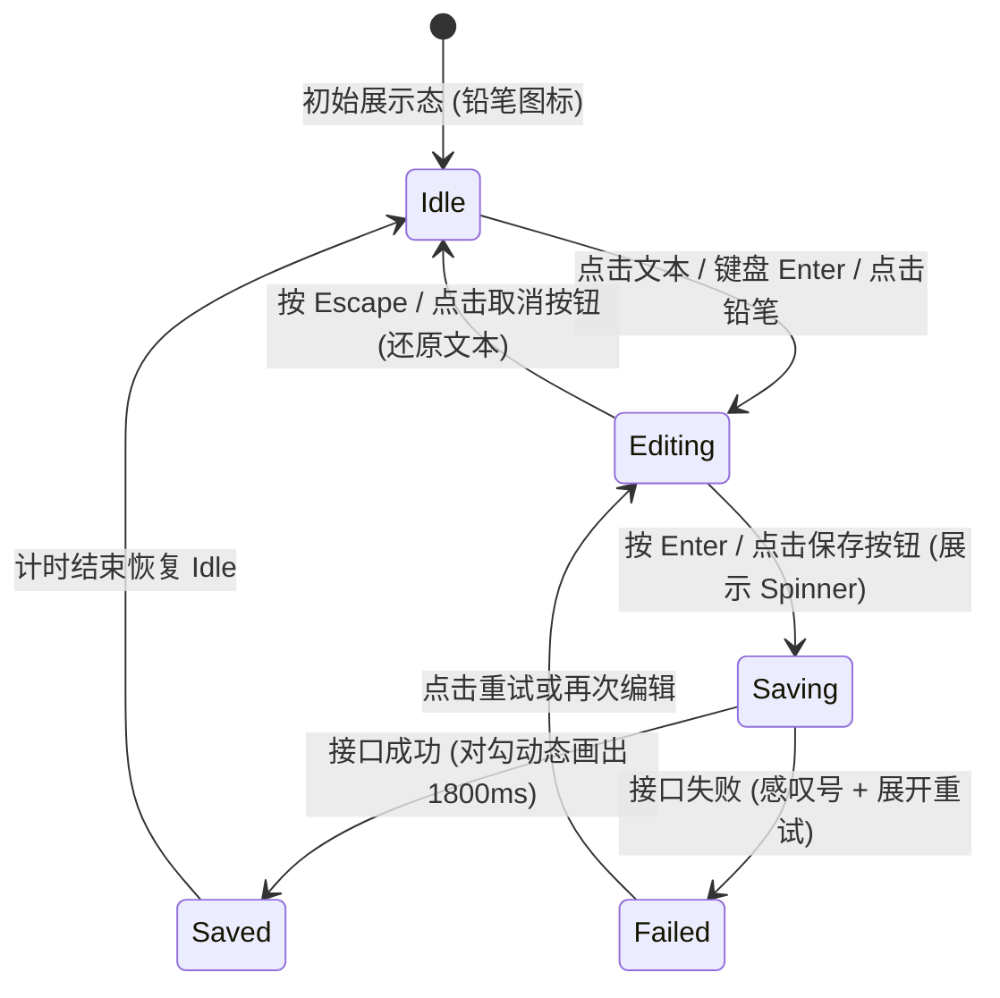

# Inline Edit · 行内就地编辑

排版文本与表单输入控件之间的原地平滑切换组件。解决传统模态弹窗或整表单刷新带来的流程中断与视觉跳动。涵盖四大核心机制：

1. 零跳动字体度量同构（Zero-Jump Typography Equivalence）：展示态按钮与就地生成的真实输入控件（单行 `input` 或多行 `textarea`）共享完全一致的字号、字重、行高与 letter-spacing，切换瞬间文字位置零偏移。
2. 动态自适应外框弹簧伸展（Adaptive Frame Spring）：单行根据文字宽度（`inline-edit-frame`）补间宽度，多行根据行数自适应高度（`inline-edit-box`），打字时实时平滑跟随排版边界。
3. 尾部状态机槽位形变（Action Slot State Morphing）：右侧状态槽在铅笔图标（`idle`）、保存/取消操作组合（`editing`）、旋转加载中（`saving`）、对勾画出（`saved`）与感叹号告警（`failed`）之间无缝形变切替。
4. 文本方向性感应微模糊流转（Directional Blur Text Morph）：提交保存时新文本向上位移淡入（`translateY(0.3em) -> 0` + `blur(4px) -> 0`）；取消回退时旧文本反向向下位移淡入。

## 原型清单

| 原型分组 | 原型元素 | 动效 / 状态变化 | 去向 |
| --- | --- | --- | --- |
| 官方行内编辑舞台 | 根容器 `.inline-edit-root` | 管理 `data-phase`、`data-variant` 与 `data-editing` 状态 | 变量契约 |
| 官方行内编辑舞台 | 标题排版单行 `.inline-edit-line` | 单行展示容器，维护排版语义（如 `<h3>`） | 最小 DOM |
| 官方行内编辑舞台 | 多行容器 `.inline-edit-box` | 动态测量多行高度，并以物理弹簧曲线自适应高度 | 动态自适应外框弹簧伸展 |
| 官方行内编辑舞台 | 展现态按钮 `.inline-edit-display` | 原生按钮承载展示文本，支持 Tab 聚焦与精确落焦 | 零跳动字体度量同构 |
| 官方行内编辑舞台 | 动态编辑控件 `.inline-edit-control` | 点击时就地生成 `input` 或 `textarea`，失焦/Esc 卸载 | 交互实现 |
| 官方行内编辑舞台 | 单行宽度外框 `.inline-edit-frame` | 随文字宽度变化平滑补间 | 动态自适应外框弹簧伸展 |
| 官方行内编辑舞台 | 状态槽位 `.inline-edit-slot` | 铅笔/保存取消按钮/Spinner/成功对勾状态机平滑切换 | 尾部状态机槽位形变 |
| 官方行内编辑舞台 | 消息提示展开槽 `.inline-edit-reveal` | 错误态与失败态自适应高度展开，包含重试按钮 | 交互实现 |
| 官方行内编辑舞台 | 读屏说明文本 `.inline-edit-sr-only` | 提供“激活以编辑”、“Enter 保存，Escape 取消”等语义 | 无障碍与无动画 |
| — | 演示底部切换开关 `button[role="switch"]` | 演示模拟下次保存失败 | 演示外壳，已删除 |
| — | 演示全局状态文本 `.demo-status` | 演示保存更新说明 | 演示外壳，已删除 |
| — | 顶栏独立主题切换器 `#themeBtn` | 演示主题切换 | 演示外壳，已删除 |

## 适用

- 页面标题、看板卡片标题、项目名称、简介描述、任务备注的原地快速就地编辑。
- 追求高操作连贯性与低打断感的仪表盘、看板或个人资料页。

## 不适用

- 大段文章、包含丰富富文本排版（富文本编辑器） → 不适用
- 标准长表单或批量提交表单 → [input](input.md) / [textarea](textarea.md)
- 带有独立搜索语义与建议下拉列表的字段 → [search-field](search-field.md)

## 状态机



| 状态 | 进入条件 | 视觉表现 | 退出到 |
| --- | --- | --- | --- |
| Idle | 初始展示或保存成功后 | 呈现静态排版文字，右侧为小铅笔图标 | Editing |
| Editing | 激活编辑模式 | 展示态隐藏，原生 input/textarea 获得焦点，右侧切换为 [✔] 和 [✖] 操作键 | Saving / Idle |
| Saving | 用户提交确认 | 控件只读置灰，右侧展示平滑旋转的 loading spinner | Saved / Failed |
| Saved | 异步保存成功 | 绿色成功对勾路径 `stroke-dashoffset: 1 -> 0` 画出，1800ms 后恢复 | Idle |
| Failed | 异步保存失败 | 感叹号告警高亮，旧文本回退，展开错误提示并附带“Try again”按钮 | Editing / Idle |

## 动效参数

| 机制 | 属性 / 技术 | 持续时间 | 缓动函数 | 说明 |
| --- | --- | --- | --- | --- |
| 尺寸自适应弹簧 | `width` / `height` | 240ms | `cubic-bezier(.22,1,.36,1)` | 随输入文字增减平滑缩放 |
| 文字方向性模糊 | `transform: translateY(...)`, `filter: blur(...)` | 200ms | `cubic-bezier(.16,1,.3,1)` | 提交向上微移，取消向下微移 |
| 图标状态切换 | `opacity`, `transform: scale(0.6)` | 160ms | `cubic-bezier(.22,1,.36,1)` | 铅笔、按钮、Spinner 之间缩放淡入淡出 |
| 成功对勾画出 | `stroke-dashoffset` | 320ms (延迟 60ms) | `cubic-bezier(.16,1,.3,1)` | 从 1 补间至 0 |

## 变量契约

### 依赖的全局/主题变量

| 变量名 | 默认值（浅色） | 暗色值 | 作用 |
| --- | --- | --- | --- |
| `--border-strong` | `oklch(82% 0 0)` | `oklch(40% 0 0)` | 编辑框边框色 |
| `--foreground` | `oklch(22% 0 0)` | `oklch(96% 0 0)` | 文本前景色 |
| `--surface` | `oklch(100% 0 0)` | `oklch(21.5% 0 0)` | 编辑控件背景填充色 |
| `--surface-muted` | `oklch(97.8% 0 0)` | `oklch(26% 0 0)` | 铅笔与操作按钮悬停底色 |
| `--text-muted` | `oklch(59% 0 0)` | `oklch(64% 0 0)` | 静态铅笔图标颜色 |
| `--success` | `oklch(49% .19 150)` | `oklch(78% .18 150)` | 成功对勾颜色 |
| `--danger` | `oklch(54% .21 25)` | `oklch(76% .2 25)` | 失败状态与错误提示色 |

## 结构与语义

```html
<div class="inline-edit-root" data-variant="title" data-phase="idle">
  <div class="inline-edit-line">
    <div class="inline-edit-box">
      <!-- 展示态按钮：完全保留真实排版语义 -->
      <button
        type="button"
        class="inline-edit-display"
        aria-label="Project name: Atlas web app"
        aria-describedby="inline-edit-hint"
      >
        <span class="inline-edit-text">Atlas web app</span>
      </button>

      <!-- 状态图标插槽 -->
      <span class="inline-edit-slot">
        <span class="inline-edit-slot-item">
          <svg class="inline-edit-pencil" width="14" height="14" viewBox="0 0 24 24" fill="none" stroke="currentColor" stroke-width="1.75" stroke-linecap="round" stroke-linejoin="round" aria-hidden="true">
            <path d="M21.174 6.812a1 1 0 0 0-3.986-3.987L3.842 16.174a2 2 0 0 0-.5.83l-1.321 4.352a.5.5 0 0 0 .623.622l4.353-1.32a2 2 0 0 0 .83-.497z" />
            <path d="m15 5 4 4" />
          </svg>
        </span>
      </span>
    </div>
  </div>

  <span id="inline-edit-hint" class="inline-edit-sr-only">Activate to edit. Enter saves, Escape cancels.</span>
</div>
```

## 样式实现

```css
.inline-edit-root {
  position: relative;
  display: inline-grid;
  max-width: 100%;
}

.inline-edit-line {
  position: relative;
  display: inline-flex;
  align-items: center;
  max-width: 100%;
}

.inline-edit-box {
  position: relative;
  display: inline-flex;
  align-items: center;
  max-width: 100%;
  gap: 0.5rem;
}

/* 展示态按钮：抹除原生按钮外观，使其如同普通文本，但保留键盘可达性与高光提示 */
.inline-edit-display {
  display: inline-flex;
  align-items: center;
  border: 0;
  background: transparent;
  padding: 2px 4px;
  margin: -2px -4px;
  border-radius: 6px;
  color: var(--foreground, #1c1c1c);
  font: inherit;
  font-size: 1.125rem;
  font-weight: 600;
  line-height: 1.4;
  text-align: left;
  cursor: pointer;
  transition: background-color 160ms cubic-bezier(0.22, 1, 0.36, 1);
}

.inline-edit-display:hover {
  background: var(--surface-muted, #f5f5f5);
}

.inline-edit-text {
  display: inline-block;
  white-space: pre-wrap;
  word-break: break-word;
}

/* 编辑态的原生输入控件：尺寸与字体完全与 display 一致，杜绝跳动 */
.inline-edit-control {
  border: 1px solid var(--border-strong, #d1d1d1);
  border-radius: 6px;
  background: var(--surface, #ffffff);
  color: var(--foreground, #1c1c1c);
  font: inherit;
  font-size: 1.125rem;
  font-weight: 600;
  line-height: 1.4;
  padding: 2px 4px;
  margin: -3px -5px;
  outline: 0;
  box-sizing: border-box;
}

.inline-edit-root[data-editing="true"] .inline-edit-display {
  display: none;
}

/* 状态图标槽位 */
.inline-edit-slot {
  display: inline-flex;
  align-items: center;
  flex: 0 0 auto;
}

.inline-edit-pencil {
  color: var(--text-muted, #717171);
  cursor: pointer;
  transition: color 160ms cubic-bezier(0.22, 1, 0.36, 1);
}

.inline-edit-pencil:hover {
  color: var(--foreground, #1c1c1c);
}

/* 操作按钮 */
.inline-edit-actions {
  display: inline-flex;
  gap: 4px;
}

.inline-edit-actions button {
  display: grid;
  width: 22px;
  height: 22px;
  place-items: center;
  border: 0;
  border-radius: 4px;
  background: var(--surface-muted, #f5f5f5);
  color: var(--foreground, #1c1c1c);
  cursor: pointer;
  padding: 0;
}

.inline-edit-actions button:hover {
  background: var(--foreground, #1c1c1c);
  color: var(--surface, #ffffff);
}

/* 加载中 Spinner */
.inline-edit-spinner {
  width: 14px;
  height: 14px;
  border: 2px solid var(--border-strong, #d1d1d1);
  border-top-color: var(--foreground, #1c1c1c);
  border-radius: 50%;
  animation: inline-spin 600ms linear infinite;
}

@keyframes inline-spin {
  to { transform: rotate(360deg); }
}

.inline-edit-saved {
  color: var(--success, #38a169);
}

.inline-edit-sr-only {
  position: absolute;
  width: 1px;
  height: 1px;
  overflow: hidden;
  clip-path: inset(50%);
  white-space: nowrap;
}

@media (prefers-reduced-motion: reduce) {
  .inline-edit-display,
  .inline-edit-pencil {
    transition: none !important;
  }
}
```

## 交互实现

```javascript
/**
 * 绑定行内就地编辑组件的核心逻辑
 * @param {HTMLElement} rootEl - .inline-edit-root 容器
 * @param {Object} options - 配置项，包含 onSave(value) 回调
 */
export function setupInlineEdit(rootEl, { onSave } = {}) {
  const display = rootEl.querySelector('.inline-edit-display');
  const textEl = rootEl.querySelector('.inline-edit-text');
  const slot = rootEl.querySelector('.inline-edit-slot');
  if (!display || !textEl || !slot) return;

  const isMultiline = rootEl.hasAttribute('data-multiline');
  let committed = textEl.textContent.trim();
  let draft = committed;
  let editing = false;
  let input = null;
  const prefersReduced = window.matchMedia('(prefers-reduced-motion: reduce)').matches;

  function renderSlot(state) {
    slot.innerHTML = '';
    if (state === 'idle') {
      slot.innerHTML = `
        <svg class="inline-edit-pencil" width="14" height="14" viewBox="0 0 24 24" fill="none" stroke="currentColor" stroke-width="1.75" stroke-linecap="round" stroke-linejoin="round" aria-hidden="true">
          <path d="M21.174 6.812a1 1 0 0 0-3.986-3.987L3.842 16.174a2 2 0 0 0-.5.83l-1.321 4.352a.5.5 0 0 0 .623.622l4.353-1.32a2 2 0 0 0 .83-.497z" />
          <path d="m15 5 4 4" />
        </svg>
      `;
      slot.querySelector('.inline-edit-pencil').addEventListener('click', start);
    } else if (state === 'editing') {
      const actions = document.createElement('span');
      actions.className = 'inline-edit-actions';
      actions.innerHTML = `
        <button type="button" class="btn-save" aria-label="Save">✔</button>
        <button type="button" class="btn-cancel" aria-label="Cancel">✖</button>
      `;
      actions.querySelector('.btn-save').addEventListener('click', () => submit());
      actions.querySelector('.btn-cancel').addEventListener('click', () => cancel());
      slot.append(actions);
    } else if (state === 'saving') {
      slot.innerHTML = '<span class="inline-edit-spinner"></span>';
    } else if (state === 'saved') {
      slot.innerHTML = `
        <svg class="inline-edit-saved" width="16" height="16" viewBox="0 0 24 24" fill="none" stroke="currentColor" stroke-width="2.5" stroke-linecap="round" stroke-linejoin="round">
          <path d="M20 6 9 17l-5-5"/>
        </svg>
      `;
      setTimeout(() => renderSlot('idle'), 1800);
    }
  }

  function start() {
    if (editing) return;
    editing = true;
    draft = committed;
    rootEl.dataset.editing = 'true';

    input = document.createElement(isMultiline ? 'textarea' : 'input');
    input.className = 'inline-edit-control';
    if (!isMultiline) input.type = 'text';
    input.value = draft;

    display.after(input);
    input.focus();
    input.select();
    renderSlot('editing');

    input.addEventListener('keydown', e => {
      if (e.key === 'Escape') {
        e.preventDefault();
        cancel();
      } else if (e.key === 'Enter' && (!isMultiline || !e.shiftKey)) {
        e.preventDefault();
        submit();
      }
    });

    input.addEventListener('blur', e => {
      // 若焦点移出到非操作按钮处，自动保存
      setTimeout(() => {
        if (editing && !slot.contains(document.activeElement)) {
          submit();
        }
      }, 100);
    });
  }

  function submit() {
    if (!editing || !input) return;
    const next = input.value.trim();
    editing = false;
    delete rootEl.dataset.editing;
    input.remove();
    input = null;

    if (next === committed || !next) {
      renderSlot('idle');
      display.focus();
      return;
    }

    renderSlot('saving');
    committed = next;
    textEl.textContent = next;

    if (!prefersReduced) {
      textEl.animate(
        [
          { opacity: 0, transform: 'translateY(0.3em)', filter: 'blur(4px)' },
          { opacity: 1, transform: 'translateY(0)', filter: 'blur(0)' }
        ],
        { duration: 200, easing: 'cubic-bezier(0.16, 1, 0.3, 1)' }
      );
    }

    // 模拟保存
    const promise = onSave ? onSave(next) : new Promise(r => setTimeout(r, 600));
    Promise.resolve(promise).then(() => {
      renderSlot('saved');
      display.focus();
    });
  }

  function cancel() {
    if (!editing || !input) return;
    editing = false;
    delete rootEl.dataset.editing;
    input.remove();
    input = null;

    if (!prefersReduced) {
      textEl.animate(
        [
          { opacity: 0, transform: 'translateY(-0.3em)', filter: 'blur(4px)' },
          { opacity: 1, transform: 'translateY(0)', filter: 'blur(0)' }
        ],
        { duration: 200, easing: 'cubic-bezier(0.16, 1, 0.3, 1)' }
      );
    }

    renderSlot('idle');
    display.focus();
  }

  display.addEventListener('click', start);
  renderSlot('idle');

  return { start, submit, cancel };
}
```

## 无障碍与无动画

1. **交互语义与读屏提示**：
   - 展示态包裹在 `<button type="button" class="inline-edit-display">` 中，具备天然的键盘可聚焦与 Enter / Space 激活能力。
   - 带有专属读屏说明 `Activate to edit. Enter saves, Escape cancels.`。
   - 保存或取消退出编辑时，焦点平滑返回到展示态按钮 `display.focus()`，杜绝焦点丢失导致的页面跳跃。
2. **Reduced Motion 降级**：
   - 在 `prefers-reduced-motion: reduce` 下，跳过文本垂直微位移与 `filter: blur()` 滤镜，文字瞬间完成替换。

## 踩坑与微调

1. **字体度量与排版跳动**：
   - 展现态多为 `<h3>` 或排版段落，编辑态为 `<input>`。必须在 CSS 中显式声明 `font: inherit`，并将 padding 和 margin 严格对齐，否则在切换瞬间页面下方内容会出现上下跳动的视觉杂音。
2. **多行换行键冲突**：
   - 在多行模式下，用户按 `Enter` 往往习惯换行，按 `Ctrl+Enter` 或 `Cmd+Enter` 保存；或者 `Shift+Enter` 换行，`Enter` 保存。文档中推荐采用后者（`Shift+Enter` 插入软换行，纯 `Enter` 提交），与桌面即时通讯软件心智模型保持一致。

## 验收清单

- [x] 展示态与就地编辑控件共享同构字体度量，杜绝文字跳跃。
- [x] 右侧包含状态机槽位（铅笔、操作键、Spinner、成功对勾）。
- [x] 文字变更叠加方向性微位移与模糊（提交上移，还原下移）。
- [x] 支持 Enter 确认、Escape 取消并闭环返还焦点。
- [x] 完整适配 `prefers-reduced-motion` 瞬间直达降级。
- [x] 剔除演示外壳代码，纯 Vanilla JS + CSS。
