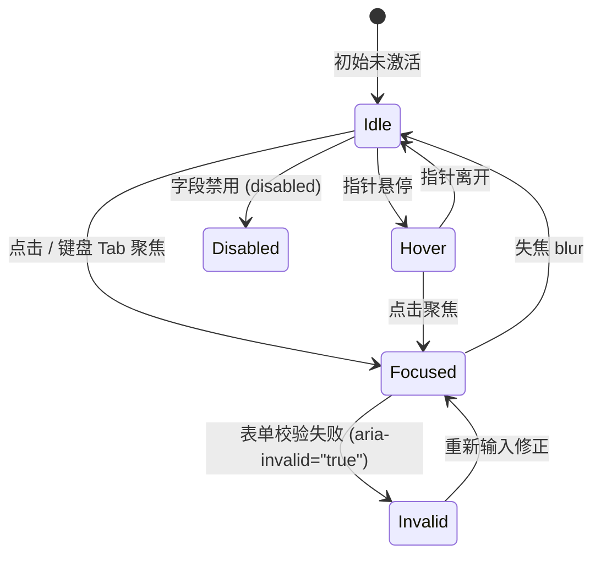

# Input · 基础输入框

单行表单输入控件。在保留浏览器原生输入合成、选择、撤销与辅助技术的基础上，提供零尺寸抖动的边框平滑过渡，以及下方自适应高度与逐字微模糊进退场的消息插槽。涵盖三大核心机制：

1. 零尺寸抖动状态反馈（Jitter-Free Border Transition）：输入框高度锁定为 44px，通过 CSS `border-color` 顺滑响应悬停（Hover）、聚焦（Focus-Visible）、非法校验（`aria-invalid="true"`）与禁用（Disabled），在各状态流转过程中绝对不产生盒模型布局抖动。
2. 动态消息插槽折叠与逐字微模糊（Message Slot Morphing & Blur Transition）：下方提示信息容器 `.input-message-slot` 自适应高度，内部文字在提示说明与错误警告切换时，通过微高斯模糊与轻量纵向位移（Blur Rise/Sink）平滑更新。
3. 原生输入行为完整保留：严格遵循原生 `<input>` 行为规范，保证中文/日文等 IME 输入法组合输入（Composition）、原生光标选择、密码管理器自动填充与复制粘贴不受任何动效脚本阻断。

## 原型清单

| 原型分组 | 原型元素 | 动效 / 状态变化 | 去向 |
| --- | --- | --- | --- |
| 官方输入舞台 | 字段容器 `.input-field` | 垂直网格流式布局 | 最小 DOM |
| 官方输入舞台 | 标签文本 `.input-label` | 语义绑定与静态标题 | 最小 DOM |
| 官方输入舞台 | 输入控件 `.input-control` | 悬停/聚焦边框过渡；校验失败变红；禁用置灰 | 零尺寸抖动状态反馈 |
| 官方输入舞台 | 消息插槽 `.input-message-slot` | 自适应高度折叠与展开 | 动态消息插槽折叠与逐字微模糊 |
| 官方输入舞台 | 描述文本 `.input-description` / `.input-word` | 逐字微模糊进入与淡出 | 动态消息插槽折叠与逐字微模糊 |
| 官方输入舞台 | 状态提示槽 `.demo-status` | 演示数据变动状态显示 | 演示外壳，已删除 |
| — | 顶栏独立主题切换器 `#themeBtn` | 演示主题切换 | 演示外壳，已删除 |
| — | 舞台外壳 `.demo-stack` 与 `.demo-roomy` | 演示居中外壳 | 演示外壳，已删除 |

## 适用

- 基础表单文本输入、数字输入、邮箱或 URL 输入。
- 需要严格保持原生输入行为，同时追求现代高保真边框焦点与错误反馈的输入场景。
- 下方带有动态帮助提示或动态异步表单校验错误提示的输入行。

## 不适用

- 多行长文本编辑与自适应高度展开 → [textarea](textarea.md)
- 密码输入与明暗文显示切换 → [password-field](password-field.md)
- 带有清除按钮与搜索语义的输入框 → [search-field](search-field.md)
- 原地将段落或标题就地转为输入框进行编辑 → [inline-edit](inline-edit.md)

## 状态机



| 状态 | 进入条件 | 视觉表现 | 退出到 |
| --- | --- | --- | --- |
| `idle` | 初始载入 / 正常无焦点 | 边框为深灰色线框（`rgba(0, 0, 0, 0.16)`），背景白底 | `hover`, `focused`, `disabled` |
| `hover` | 鼠标指针悬停于控件上方 | 边框平滑变深为前景色，无尺寸伸缩 | `idle`, `focused` |
| `focused` | 点击或通过键盘 Tab 键聚焦 | 边框稳定高亮为前景色，保持 1px 细线不发散 | `idle`, `invalid` |
| `invalid` | 设置 `aria-invalid="true"` | 边框转为警示危险色（`#f43f5e`），消息槽展示报错 | `focused`, `idle` |
| `disabled` | 设置 `disabled` 属性 | 背景变为浅灰，透明度降低至 0.5，禁用交互 | `idle` |

## 最小 DOM

```html
<div class="input-field">
  <label class="input-label" for="project-name">Project name</label>
  <input
    id="project-name"
    class="input-control"
    type="text"
    value="Arc launch"
    aria-describedby="project-name-desc"
  />
  <span class="input-message-slot" aria-live="polite">
    <span id="project-name-desc" class="input-description">
      Use a short, descriptive name.
    </span>
  </span>
</div>
```

- `.input-field`：容器网格。
- `.input-control`：原生 `<input>` 元素，承载所有的输入与状态属性。
- `.input-message-slot`：高度可自适应过渡的消息插槽，容纳帮助文本或报错信息。

## 参数

| 名称 | 值 | 用于 | 来源 |
| --- | --- | --- | --- |
| 控件高度 | `44px` (`2.75rem`) | 输入框恒定垂直高度 | 原型 |
| 边框过渡时长 | `160ms` (`var(--duration-fast)`) | 悬停/聚焦/报错时的边框色过渡 | 原型 |
| 缓动曲线 | `cubic-bezier(0.22, 1, 0.36, 1)` | 边框色变动标准曲线 | 原型 |
| 圆角半径 | `18px` (`1.125rem`) | 标准控件外轮廓圆角 | 原型 |
| 错误危险色 | `#f43f5e` | `[aria-invalid="true"]` 边框与错误文本色 | 原型 |
| 消息微模糊时长 | `200ms cubic-bezier(0.16, 1, 0.3, 1)` | 提示消息更新时的平滑过渡 | 原型 |

## CSS

```css
.input-field {
  display: grid;
  min-width: 0;
  width: 100%;
  font-family: inherit;
  box-sizing: border-box;
}

.input-label {
  margin-bottom: 8px;
  color: var(--foreground, #0b0b0b);
  font-size: 14px;
  font-weight: 500;
  line-height: 1.4;
  user-select: none;
}

.input-control {
  width: 100%;
  min-height: 44px;
  padding: 0 14px;
  border: 1px solid rgba(0, 0, 0, 0.16);
  border-radius: 18px;
  background: var(--surface, #ffffff);
  color: var(--foreground, #0b0b0b);
  font: inherit;
  font-size: 14px;
  line-height: 1.4;
  outline: none;
  box-sizing: border-box;
  transition: border-color 160ms cubic-bezier(0.22, 1, 0.36, 1),
              background-color 160ms cubic-bezier(0.22, 1, 0.36, 1);
}

.input-control::placeholder {
  color: #888888;
}

@media (hover: hover) and (pointer: fine) {
  .input-control:hover:not(:disabled):not([aria-invalid="true"]) {
    border-color: var(--foreground, #0b0b0b);
  }
}

.input-control:focus,
.input-control:focus-visible {
  border-color: var(--foreground, #0b0b0b);
}

.input-control[aria-invalid="true"] {
  border-color: #f43f5e;
}

.input-control:disabled {
  cursor: not-allowed;
  opacity: 0.5;
  background: var(--surface-muted, #f4f4f4);
}

.input-message-slot {
  display: block;
  overflow: hidden;
  transition: height 200ms cubic-bezier(0.16, 1, 0.3, 1);
}

.input-description {
  display: block;
  padding-top: 6px;
  font-size: 12.5px;
  line-height: 1.4;
  color: #777777;
  will-change: opacity, transform, filter;
}

.input-control[aria-invalid="true"] ~ .input-message-slot .input-description {
  color: #f43f5e;
}
```

## JS

```js
/**
 * 绑定输入框与自适应消息提示控制器
 * @param {HTMLElement} fieldEl .input-field 容器
 * @param {Object} options 配置项
 * @param {(value: string) => void} [options.onChange] 内容变更回调
 * @returns {{ setMessage: Function, setInvalid: Function, destroy: Function }} 控制接口
 */
export function bindInputField(fieldEl, { onChange } = {}) {
  const input = fieldEl.querySelector('.input-control');
  const slot = fieldEl.querySelector('.input-message-slot');
  const desc = fieldEl.querySelector('.input-description');

  const onInput = () => {
    if (typeof onChange === 'function') {
      onChange(input.value);
    }
  };
  input.addEventListener('input', onInput);

  /**
   * 平滑更新下方提示文案
   * @param {string} nextText 新文本内容
   */
  function setMessage(nextText) {
    if (!desc) return;
    if (desc.textContent.trim() === nextText.trim()) return;

    desc.animate(
      [
        { opacity: 1, transform: 'translateY(0)', filter: 'blur(0px)' },
        { opacity: 0, transform: 'translateY(-2px)', filter: 'blur(2px)' }
      ],
      { duration: 120, easing: 'cubic-bezier(0.22, 1, 0.36, 1)' }
    ).onfinish = () => {
      desc.textContent = nextText;
      desc.animate(
        [
          { opacity: 0, transform: 'translateY(2px)', filter: 'blur(2px)' },
          { opacity: 1, transform: 'translateY(0)', filter: 'blur(0px)' }
        ],
        { duration: 160, easing: 'cubic-bezier(0.16, 1, 0.3, 1)' }
      );
    };
  }

  /**
   * 切换校验合法性
   * @param {boolean} isInvalid 是否存在错误
   */
  function setInvalid(isInvalid) {
    input.setAttribute('aria-invalid', String(isInvalid));
  }

  return {
    setMessage,
    setInvalid,
    destroy() {
      input.removeEventListener('input', onInput);
    }
  };
}
```

## 接入目标项目

- 状态来源：目标表单状态管理（如原生表单、Formik、React Hook Form 等受控或非受控字段）。
- 尺寸策略：宽度默认填满父容器（100%），高度锁定 44px。
- 驱动方式：纯 CSS 驱动核心边框与聚焦状态；动态错误与消息提示通过 `setMessage` 和 `setInvalid` 驱动。

## 重入与清理

- 连续快速输入：输入事件直接放行原生渲染管道，不做多余的防抖截断，保障键盘跟手度。
- 销毁机制：调用 `destroy()` 解除绑定的输入监听。

## 减少动态效果

系统开启 `prefers-reduced-motion: reduce` 时：
1. 边框变色过渡时间置为 `0.01ms`，保持即时响应。
2. 提示文字更新移除微高斯模糊与位移动画，直接更新文本。

```css
@media (prefers-reduced-motion: reduce) {
  .input-control,
  .input-message-slot,
  .input-description {
    transition: none !important;
    animation: none !important;
  }
}
```

## 焦点与键盘

- 原生键盘导航：完整保留 Tab 键聚焦与原生输入焦点，配合 `aria-describedby` 关联下方消息插槽。
- 轮廓规范：通过 `:focus-visible` 清除默认双层轮廓，收敛至组件自身 1px 高对比度边框高亮。

## 兼容回退

| 特性 | 不支持时 |
| --- | --- |
| WAAPI `element.animate()` | 直接同步赋值 `desc.textContent = nextText`，无动效平滑回退。 |

## 验收清单

- [ ] 鼠标悬停在输入框上方，边框颜色平滑深色过渡，无尺寸外扩与位置跳动。
- [ ] 键盘 Tab 键聚焦进入，边框高亮为纯黑/前景色，光标闪烁正常。
- [ ] 设置 `aria-invalid="true"` 时，边框平滑过渡为危险红色，下方消息提示同步标红。
- [ ] 更新下方消息提示文本，文字带有轻微模糊与向上过渡，无排版撕裂。
- [ ] 输入框禁用（`disabled`）时，透明度降低且禁止悬停高亮。
- [ ] 减弱动态效果开启时，所有颜色过渡与文字渐变瞬时完成。
