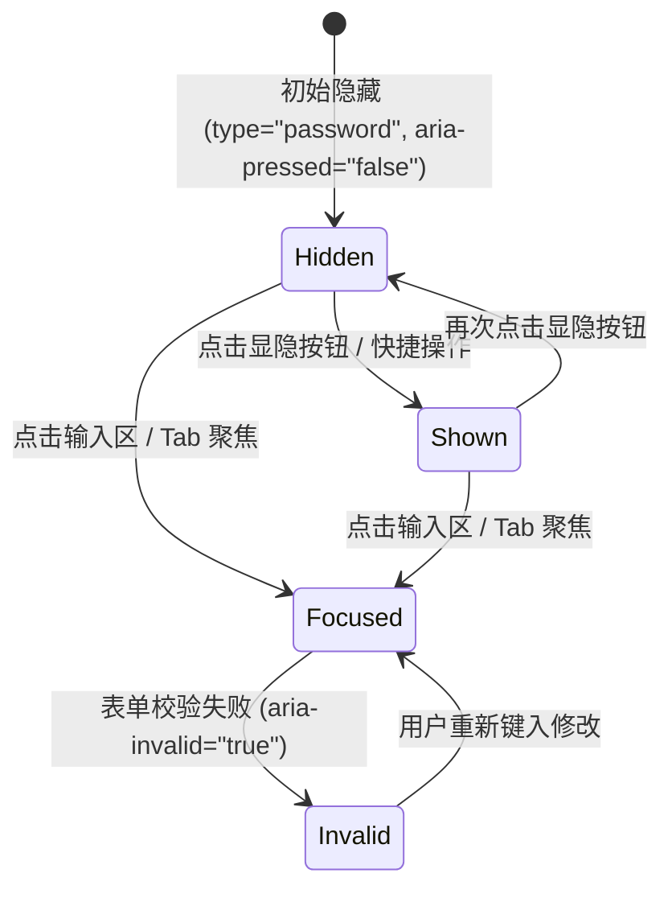

# Password Field · 密码输入框

专用于敏感凭据与密码输入的单行字段控件。解决明暗文切换时的生硬突变与图标割裂问题。涵盖三大核心机制：

1. 零尺寸抖动输入容器（Jitter-Free Password Shell）：容器高度固定为 44px（`2.75rem`），通过边框颜色平滑过渡响应悬停、聚焦与校验失败态，杜绝布局抖动。
2. 原生单图标蒙版画出斜线（Masked Stroke-Dash Eye Morph）：不替换两套独立 SVG，仅使用单一 SVG 配合 `<mask id="...">` 遮罩与 `stroke-dashoffset` 动画，将斜划线顺滑画出并自动在眼睛轮廓上产生镂空避让缝隙。
3. 原地文字高斯微模糊解析（In-Place Reveal Blur Transition）：密文圆点（dots）与明文字符切换瞬间，输入框文字叠加微高斯模糊（`blur(4px) -> blur(0)`）平滑消解，防窥同时消除字符跳突感。

## 原型清单

| 原型分组 | 原型元素 | 动效 / 状态变化 | 去向 |
| --- | --- | --- | --- |
| 官方密码框舞台 | 字段容器 `.password-field` | 垂直网格流式布局 | 最小 DOM |
| 官方密码框舞台 | 标签文本 `label` | 语义绑定与静态标题 | 最小 DOM |
| 官方密码框舞台 | 字段外壳 `.password-shell` | 聚焦/悬停边框过渡，容纳输入框与尾部切换按钮 | 零尺寸抖动输入容器 |
| 官方密码框舞台 | 密码输入框 `.password-input` | 明暗文切换时 `blur(4px) -> blur(0)` 微模糊动画；聚焦边框过渡 | 原地文字高斯微模糊解析 |
| 官方密码框舞台 | 显隐切换按钮 `button` | 悬停背景变亮、点击缩放 `scale(0.96)`、`aria-pressed` 状态切换 | 结构与语义 |
| 官方密码框舞台 | 眼睛图标与遮罩 `<svg>` / `<mask>` | 斜线动态画出 `stroke-dashoffset: 1 -> 0` 与眼睛镂空协同 | 原生单图标蒙版画出斜线 |
| 官方密码框舞台 | 消息提示插槽 `.password-message-slot` | 自适应高度折叠与展开 | 动态消息插槽 |
| 官方密码框舞台 | 状态提示槽 `.demo-status` | 演示数据变动状态显示 | 演示外壳，已删除 |
| — | 顶栏独立主题切换器 `#themeBtn` | 演示主题切换 | 演示外壳，已删除 |
| — | 舞台外壳 `.demo-stack` | 演示居中外壳 | 演示外壳，已删除 |

## 适用

- 密码、PIN 码、API 密钥、安全访问令牌等需要防窥隐藏同时支持临时验看明文的输入场景。
- 追求高质感细节，避免切换显示时图标硬切或密码文字突跳的现代表单。

## 不适用

- 普通单行文本输入（无需切换明暗文） → [input](input.md)
- 包含 4 段式强度计量条、实时校验规则对勾动效的注册/改密场景 → [password-strength](password-strength.md)
- 包含一键清除按钮与搜索语义的输入场景 → [search-field](search-field.md)
- 多行长文本输入 → [textarea](textarea.md)

## 状态机



| 状态 | 进入条件 | 视觉表现 | 退出到 |
| --- | --- | --- | --- |
| Hidden | 初始状态或切换为密文 | `type="password"`，眼睛斜线 `stroke-dashoffset: 1` 隐藏，无斜杠镂空 | Shown |
| Shown | 点击显隐切换按钮 | `type="text"`，文字触发 `blur(4px) -> blur(0)`，斜线画出至 `stroke-dashoffset: 0` 且镂空眼睛主体 | Hidden |
| Focused | 获得输入焦点 | 边框颜色平滑转为 `--foreground`，尺寸零变化 | Hidden / Shown / Invalid |
| Invalid | 表单校验失败 | 边框颜色平滑转为 `--danger`（亮红） | Focused |

## 动效参数

| 机制 | 属性 / 技术 | 持续时间 | 缓动函数 | 说明 |
| --- | --- | --- | --- | --- |
| 边框状态过渡 | `border-color` | 160ms (`--duration-fast`) | `cubic-bezier(.22,1,.36,1)` | 悬停、聚焦与失焦之间的平滑过渡 |
| 斜线动态画出 | `stroke-dashoffset`, `opacity` | 240ms (`--duration-standard`) | `cubic-bezier(.22,1,.36,1)` | 遮罩黑线与外部黑线同步从 1 补间到 0 |
| 文字微模糊解析 | `filter: blur(...)` (WAAPI) | 240ms | `cubic-bezier(.16,1,.3,1)` | 从 `blur(4px)` 平滑恢复为 `blur(0)`，消除文字重排生硬感 |
| 按钮点击弹性 | `transform: scale(0.96)` | 100ms | `cubic-bezier(.22,1,.36,1)` | 指针按下时的轻量微反馈 |

## 变量契约

### 依赖的全局/主题变量

| 变量名 | 默认值（浅色） | 暗色值 | 作用 |
| --- | --- | --- | --- |
| `--control-height-md` | `2.75rem` (44px) | `2.75rem` (44px) | 统一控件容器基准高度 |
| `--radius-control` | `1.125rem` (18px) | `1.125rem` (18px) | 输入框外壳与按钮圆角 |
| `--border-strong` | `oklch(82% 0 0)` | `oklch(40% 0 0)` | 静态/休眠状态边框色 |
| `--foreground` | `oklch(22% 0 0)` | `oklch(96% 0 0)` | 文本前景色与激活边框色 |
| `--surface` | `oklch(100% 0 0)` | `oklch(21.5% 0 0)` | 输入框背景填充色 |
| `--surface-muted` | `oklch(97.8% 0 0)` | `oklch(26% 0 0)` | 切换按钮悬停背景色 |
| `--danger` | `oklch(54% .21 25)` | `oklch(76% .2 25)` | 校验错误高亮边框色 |
| `--text-muted` | `oklch(59% 0 0)` | `oklch(64% 0 0)` | 图标默认前景色与占位符色 |

### 组件私有变量

| 变量名 | 默认值 | 作用 |
| --- | --- | --- |
| `--button-size` | `30px` | 内部切换按钮正方形基准尺寸 |

## 结构与语义

```html
<div class="password-field">
  <label for="password-input">Access key</label>
  <div class="password-shell">
    <input
      id="password-input"
      type="password"
      class="password-input"
      value="arc-library-secret"
      aria-describedby="password-hint"
      autocomplete="current-password"
      spellcheck="false"
    />
    <button
      type="button"
      class="password-toggle-btn"
      aria-label="Show password"
      aria-pressed="false"
    >
      <svg
        width="18"
        height="18"
        viewBox="0 0 24 24"
        fill="none"
        stroke="currentColor"
        stroke-width="1.75"
        stroke-linecap="round"
        stroke-linejoin="round"
        aria-hidden="true"
      >
        <mask id="eye-mask" maskUnits="userSpaceOnUse" x="0" y="0" width="24" height="24">
          <rect width="24" height="24" fill="white" stroke="none" />
          <path d="M2 2l20 20" stroke="black" stroke-width="5" opacity="0" pathLength="1" stroke-dashoffset="1" stroke-dasharray="1 1" />
        </mask>
        <g mask="url(#eye-mask)">
          <path d="M2.062 12.348a1 1 0 0 1 0-.696 10.75 10.75 0 0 1 19.876 0 1 1 0 0 1 0 .696 10.75 10.75 0 0 1-19.876 0" />
          <circle cx="12" cy="12" r="3" />
        </g>
        <path d="M2 2l20 20" opacity="0" pathLength="1" stroke-dashoffset="1" stroke-dasharray="1 1" />
      </svg>
    </button>
  </div>
  <span id="password-hint" class="password-message-slot">
    <span class="password-hint">Use at least 8 characters.</span>
  </span>
</div>
```

## 样式实现

```css
.password-field {
  display: grid;
  min-width: 0;
  width: 100%;
}

.password-field label {
  margin-bottom: 0.5rem;
  font-size: 0.875rem;
  font-weight: 500;
  color: var(--foreground, #1c1c1c);
}

/* 高度固定锁定为 44px，通过边框颜色响应聚焦，绝对避免 outline 抖动 */
.password-shell {
  display: flex;
  height: 44px;
  min-height: 44px;
  box-sizing: border-box;
  align-items: center;
  border: 1px solid var(--border-strong, #d1d1d1);
  border-radius: var(--radius-control, 18px);
  padding: 0 calc((44px - 2px - 30px) / 2) 0 0.75rem;
  background: var(--surface, #ffffff);
  transition: border-color 160ms cubic-bezier(0.22, 1, 0.36, 1);
}

@media (hover: hover) and (pointer: fine) {
  .password-shell:hover:not(:focus-within) {
    border-color: var(--foreground, #1c1c1c);
  }
}

.password-shell:focus-within {
  border-color: var(--foreground, #1c1c1c);
}

.password-shell:has(.password-input[aria-invalid="true"]) {
  border-color: var(--danger, #e53e3e);
}

.password-input {
  width: 100%;
  min-width: 0;
  border: 0;
  background: transparent;
  color: var(--foreground, #1c1c1c);
  font: inherit;
  font-size: 0.875rem;
  line-height: 1.4;
  outline: 0;
}

.password-input::placeholder {
  color: var(--text-muted, #717171);
}

/* 显隐切换按钮 */
.password-toggle-btn {
  display: grid;
  width: 30px;
  height: 30px;
  flex: 0 0 auto;
  place-items: center;
  border: 0;
  border-radius: calc(var(--radius-control, 18px) - 4px);
  background: transparent;
  color: var(--text-muted, #717171);
  cursor: pointer;
  padding: 0;
  transition:
    background-color 160ms cubic-bezier(0.22, 1, 0.36, 1),
    color 160ms cubic-bezier(0.22, 1, 0.36, 1),
    transform 100ms cubic-bezier(0.22, 1, 0.36, 1);
}

@media (hover: hover) and (pointer: fine) {
  .password-toggle-btn:hover {
    background: var(--surface-muted, #f5f5f5);
    color: var(--foreground, #1c1c1c);
  }
}

.password-toggle-btn:active {
  transform: scale(0.96);
}

.password-toggle-btn[aria-pressed="true"] {
  color: var(--foreground, #1c1c1c);
}

.password-message-slot {
  display: block;
  overflow: hidden;
}

.password-hint {
  display: block;
  padding-top: 0.5rem;
  color: var(--text-muted, #717171);
  font-size: 0.75rem;
  line-height: 1.4;
}

@media (prefers-reduced-motion: reduce) {
  .password-shell,
  .password-toggle-btn {
    transition: none !important;
  }
  .password-toggle-btn:active {
    transform: none !important;
  }
}
```

## 交互实现

```javascript
/**
 * 绑定密码字段的明暗文平滑流转与斜线蒙版动画
 * @param {HTMLElement} shellEl - .password-shell 元素
 */
export function setupPasswordField(shellEl) {
  const input = shellEl.querySelector('.password-input');
  const button = shellEl.querySelector('.password-toggle-btn');
  if (!input || !button) return;

  const paths = [...button.querySelectorAll('path')].filter(
    path => path.getAttribute('d') === 'M2 2l20 20'
  );

  // 初始化 pathLength 与虚线偏移
  paths.forEach(path => {
    path.style.strokeDasharray = '1 1';
    path.style.strokeDashoffset = '1';
    path.style.opacity = '0';
  });

  const prefersReduced = window.matchMedia('(prefers-reduced-motion: reduce)').matches;

  button.addEventListener('click', () => {
    const isShown = input.type === 'password';
    input.type = isShown ? 'text' : 'password';

    button.setAttribute('aria-label', isShown ? 'Hide password' : 'Show password');
    button.setAttribute('aria-pressed', String(isShown));

    // 1. 斜线画出与眼睛蒙版镂空协同
    paths.forEach(path => {
      if (prefersReduced) {
        path.style.strokeDashoffset = isShown ? '0' : '1';
        path.style.opacity = isShown ? '1' : '0';
      } else {
        path.animate(
          [
            { strokeDashoffset: path.style.strokeDashoffset || (isShown ? '1' : '0'), opacity: path.style.opacity || (isShown ? '0' : '1') },
            { strokeDashoffset: isShown ? '0' : '1', opacity: isShown ? '1' : '0' }
          ],
          {
            duration: 240,
            easing: 'cubic-bezier(0.22, 1, 0.36, 1)',
            fill: 'forwards'
          }
        );
        path.style.strokeDashoffset = isShown ? '0' : '1';
        path.style.opacity = isShown ? '1' : '0';
      }
    });

    // 2. 文字微模糊防窥渐变，消除圆点切明文的硬跳动
    if (!prefersReduced) {
      input.animate(
        [
          { filter: 'blur(4px)', opacity: '0.85' },
          { filter: 'blur(0px)', opacity: '1' }
        ],
        {
          duration: 240,
          easing: 'cubic-bezier(0.16, 1, 0.3, 1)'
        }
      );
    }
  });
}
```

## 无障碍与无动画

1. **ARIA 状态与角色对应**：
   - 按钮必须声明 `type="button"`，防止在 form 表单中意外触发 submit 提交。
   - 显隐按钮初始为 `aria-pressed="false"` 与 `aria-label="Show password"`；展开明文时同步置为 `aria-pressed="true"` 与 `aria-label="Hide password"`，读屏器能清晰通报当前状态切换。
   - 输入框关联 `autocomplete="current-password"` 或 `"new-password"`，以及 `spellcheck="false"` 阻止浏览器拼写红波浪线泄露凭据特征。
2. **Reduced Motion 降级**：
   - 当检测到 `prefers-reduced-motion: reduce` 时，完全跳过文字 `filter: blur()` 微模糊动画，斜线 `strokeDashoffset` 立即赋值为 `0` 或 `1`，取消一切缓动。

## 踩坑与微调

1. **SVG Mask ID 命名冲突**：
   - 在一个页面内若有多个密码输入框（如“新密码”与“确认密码”），若 mask 标签写死 `id="eye-mask"`，会导致后一个组件遮罩引用前一个，甚至出现斜线动画被覆盖的渲染错乱。
   - 【微调建议】：动态为 mask 生成唯一 ID（如通过 `crypto.randomUUID()` 或自增计数器生成 `eye-mask-${id}`），并同步设置 `<g mask="url(#...)">`。
2. **`pathLength="1"` 的跨浏览器一致性**：
   - 使用 `pathLength="1"` 可以把整条 SVG 路径长度归一化为 1.0，从而设置 `stroke-dasharray: 1 1` 和 `stroke-dashoffset: 1 -> 0`。但个别旧版本 WebKit 在动态修改 dashoffset 时可能会有亚像素跳跃。保留原生路径坐标精度并在结束时立即同步真实 style 属性可解决该问题。

## 验收清单

- [x] 输入外壳高度严格锁定为 44px（`--control-height-md`），通过 `border-color` 响应悬停/聚焦，零布局抖动。
- [x] 眼睛图标采用原生单一 SVG + mask 动态画出斜线，不硬性切图。
- [x] 明暗文切换时叠加 240ms `blur(4px) -> blur(0)` 平滑消解。
- [x] 切换按钮具备正确的 `type="button"`, `aria-label` 与 `aria-pressed` 状态。
- [x] `prefers-reduced-motion` 完整处理，零延迟立即切换。
- [x] 杜绝任何 React/Vue 等框架强绑定，纯原生 HTML/CSS/JS。
