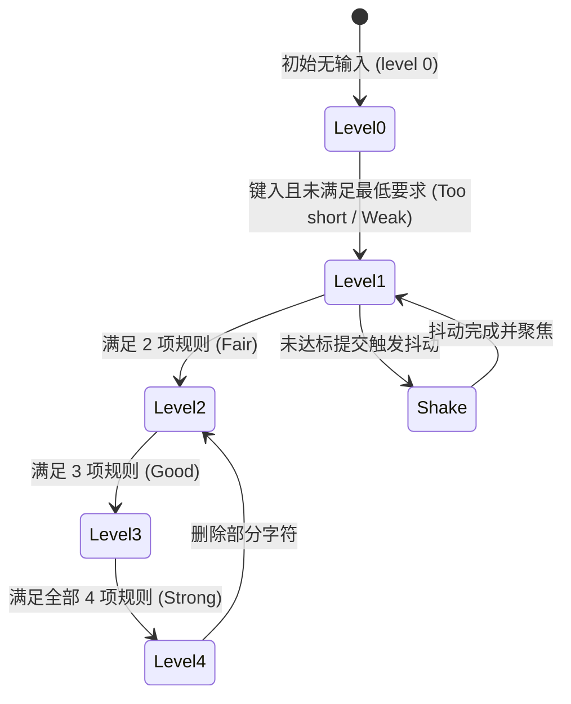

# Password Strength · 密码强度计量字段

结合实时强度计算、分段波浪计量条与条件核验反馈的高阶密码输入控件。在用户键入密码时提供毫秒级、零卡顿的多维度视觉指引。涵盖四大核心机制：

1. 四段式硬件加速计量条（Wave-Cascaded 4-Segment Meter）：包含 4 个物理分段，利用 `translateX(-101%) -> 0` 的 GPU 合成属性填充各段，并在等级提升或降低时呈现从左至右或从右至左的 50ms/30ms 级联波浪推进。
2. 规则达成标点缩放与对勾画出（Rule Mark Fill & Stroke Dash Tick）：四项规则（长度、大小写、数字、符号）达成时，标点圆底从 `scale(0.5)` 放大至 `scale(1)` 且淡入，SVG 对勾路径通过 `stroke-dashoffset: 1 -> 0` 平滑画出。
3. 强度等级文案纵向滑动翻转（Strength Level Word Flip）：右侧评价文本（Too short / Weak / Fair / Good / Strong）随分值升降沿纵向淡入淡出并切换颜色。
4. 校验失败水平微物理抖动（Horizontal Error Shake）：当用户在不满足最低安全标准下提交时，外壳触发 3 次衰减式水平往复抖动（`translateX: -6px, 5px, -3px, 0`）并展开错误信息插槽。

## 原型清单

| 原型分组 | 原型元素 | 动效 / 状态变化 | 去向 |
| --- | --- | --- | --- |
| 官方密码强度舞台 | 字段容器 `.password-strength-field` | 依 `data-level` 动态同步 `--tone` 主题变量 | 变量契约 |
| 官方密码强度舞台 | 标签 `label` | 语义绑定与静态标题 | 最小 DOM |
| 官方密码强度舞台 | 字段外壳 `.password-strength-shell` | 悬停/聚焦边框过渡；校验失败触发水平物理抖动 | 零尺寸抖动外壳与校验抖动 |
| 官方密码强度舞台 | 密码输入框 `.password-strength-input` | 实时计算强度规则；明暗文切换微模糊 | 交互实现 |
| 官方密码强度舞台 | 显隐切换按钮 `.password-strength-reveal` | 切换明暗文并动态画出 SVG 蒙版斜线 | 结构与语义 |
| 官方密码强度舞台 | 四段计量器 `[role="meter"]` | 4 段式平移填充 `translateX(-101%) -> 0`，波浪级联推进 | 四段式硬件加速计量条 |
| 官方密码强度舞台 | 强度文案 `.password-strength-word` | 依等级高低纵向滑动切替 | 强度等级文案纵向滑动翻转 |
| 官方密码强度舞台 | 规则列表 `.password-strength-rules` | 4 项规则列表容器 | 最小 DOM |
| 官方密码强度舞台 | 规则圆标与对勾 `.password-strength-mark` | 圆底缩放进入，对勾 `stroke-dashoffset: 1 -> 0` 画出 | 规则达成标点缩放与对勾画出 |
| 官方密码强度舞台 | 缺额字符提示 `.password-strength-remaining` | 实时显示还需输入的字符数并淡入淡出 | 规则达成标点缩放与对勾画出 |
| 官方密码强度舞台 | 动态错误提示槽 `.password-strength-error-slot` | 自适应高度折叠与展开 | 交互实现 |
| — | 演示按钮 “Suggest one” 与 “Save” | 模拟随机生成与模拟保存 | 演示外壳，已删除 |
| — | 顶栏独立主题切换器 `#themeBtn` | 演示主题切换 | 演示外壳，已删除 |

## 适用

- 用户注册账号、修改密码、重置安全凭据等对安全性有明确规则要求的输入场景。
- 需要以清晰直观的视觉层级引导用户逐步满足多项复杂度要求的安全表单。

## 不适用

- 普通登录凭据输入（无需显示强度计量和规则拆解） → [password-field](password-field.md)
- 通用单行文本输入 → [input](input.md)
- 带有清除按钮与搜索语义的输入框 → [search-field](search-field.md)
- 多行长文本输入 → [textarea](textarea.md)

## 状态机



| 状态 | 进入条件 | 视觉表现 | 退出到 |
| --- | --- | --- | --- |
| Level 0 | 初始或清空内容 | 计量条全部为空，规则为灰色空心圆，无强度文字 | Level 1 |
| Level 1 | 长度不足或仅满足 1 项 | `--tone` 为危险色（红），第 1 段填满，显示 "Too short" 或 "Weak" | Level 0 / 2 |
| Level 2 | 满足 2 项要求 | `--tone` 为警示色（黄），前 2 段填满，显示 "Fair" | Level 1 / 3 |
| Level 3 | 满足 3 项要求 | `--tone` 为成功色（绿），前 3 段填满，显示 "Good" | Level 2 / 4 |
| Level 4 | 满足全部 4 项要求 | `--tone` 为安全绿，4 段全满，显示 "Strong"，对勾全绿画出 | Level 3 |
| Shake | 不合规时尝试提交 | 外壳产生水平物理抖动（`shake`），边框变红并展开错误文字 | 对应 Level |

## 动效参数

| 机制 | 属性 / 技术 | 持续时间 | 缓动函数 | 说明 |
| --- | --- | --- | --- | --- |
| 计量段填充平移 | `transform: translateX(...)` | 260ms | `cubic-bezier(.22,1,.36,1)` | 级联间隔：升段 50ms/格，降段 30ms/格 |
| 标点底色缩放 | `transform: scale(...)` | 200ms | `cubic-bezier(.22,1,.36,1)` | 从 `scale(0.5)` 到 `scale(1)` 弹出 |
| 对勾路径画出 | `stroke-dashoffset` | 220ms | `cubic-bezier(.16,1,.3,1)` | 从 `1` 补间到 `0` |
| 等级文字切换 | `opacity`, `transform: translateY` | 180ms | `cubic-bezier(.22,1,.36,1)` | 升段上移淡入，降段下移淡入 |
| 错误校验抖动 | `transform: translateX` (WAAPI) | 360ms | `cubic-bezier(.36,.07,.19,.97)` | 衰减式左右微震颤 `[-6px, 5px, -3px, 2px, 0]` |

## 变量契约

### 依赖的全局/主题变量

| 变量名 | 默认值（浅色） | 暗色值 | 作用 |
| --- | --- | --- | --- |
| `--control-height-md` | `2.75rem` (44px) | `2.75rem` (44px) | 统一控件容器基准高度 |
| `--radius-control` | `1.125rem` (18px) | `1.125rem` (18px) | 输入框外壳圆角 |
| `--radius-pill` | `9999px` | `9999px` | 计量段与圆标圆角 |
| `--border` | `oklch(93.5% 0 0)` | `oklch(29% 0 0)` | 计量槽默认轨道背景色 |
| `--border-strong` | `oklch(82% 0 0)` | `oklch(40% 0 0)` | 静态边框与未达成圆圈边框色 |
| `--foreground` | `oklch(22% 0 0)` | `oklch(96% 0 0)` | 主文本与激活状态文字色 |
| `--danger` | `oklch(54% .21 25)` | `oklch(76% .2 25)` | 弱密码提示与错误警示色 |
| `--warning` | `oklch(58% .18 75)` | `oklch(83% .17 80)` | 中等强度提示色 |
| `--success` | `oklch(49% .19 150)` | `oklch(78% .18 150)` | 强密码与规则达成对勾色 |

### 组件私有变量

| 变量名 | 默认值 | 作用 |
| --- | --- | --- |
| `--tone` | `var(--border-strong)` | 当前强度等级的主题色映射，随 `data-level` 动态切换 |

## 结构与语义

```html
<div class="password-strength-field" data-level="0">
  <label class="password-strength-label" for="password-input">New password</label>
  <div class="password-strength-shell">
    <input
      id="password-input"
      type="password"
      class="password-strength-input"
      name="new-password"
      autocomplete="new-password"
      autocapitalize="off"
      autocorrect="off"
      spellcheck="false"
      aria-describedby="password-rules"
    />
    <button
      type="button"
      class="password-strength-reveal"
      aria-label="Show password"
      aria-pressed="false"
      aria-controls="password-input"
    >
      <svg width="18" height="18" viewBox="0 0 24 24" fill="none" stroke="currentColor" stroke-width="1.75" stroke-linecap="round" stroke-linejoin="round" aria-hidden="true">
        <mask id="ps-eye-mask" maskUnits="userSpaceOnUse" x="0" y="0" width="24" height="24">
          <rect width="24" height="24" fill="white" stroke="none" />
          <path d="M3 3l18 18" stroke="black" stroke-width="5" opacity="0" pathLength="1" stroke-dashoffset="1" stroke-dasharray="1 1" />
        </mask>
        <g mask="url(#ps-eye-mask)">
          <path d="M2.062 12.348a1 1 0 0 1 0-.696 10.75 10.75 0 0 1 19.876 0 1 1 0 0 1 0 .696 10.75 10.75 0 0 1-19.876 0" />
          <circle cx="12" cy="12" r="3" />
        </g>
        <path d="M3 3l18 18" opacity="0" pathLength="1" stroke-dashoffset="1" stroke-dasharray="1 1" />
      </svg>
    </button>
  </div>

  <div class="password-strength-meter-row">
    <div
      class="password-strength-meter"
      role="meter"
      aria-label="Password strength"
      aria-valuemin="0"
      aria-valuemax="4"
      aria-valuenow="0"
      aria-valuetext="No password yet"
    >
      <span class="password-strength-segment"><span class="password-strength-fill"></span></span>
      <span class="password-strength-segment"><span class="password-strength-fill"></span></span>
      <span class="password-strength-segment"><span class="password-strength-fill"></span></span>
      <span class="password-strength-segment"><span class="password-strength-fill"></span></span>
    </div>
    <span class="password-strength-word" aria-hidden="true"></span>
  </div>

  <ul id="password-rules" class="password-strength-rules" aria-label="Password requirements">
    <li class="password-strength-rule" data-rule="length">
      <span class="password-strength-mark" aria-hidden="true">
        <span class="password-strength-mark-fill"></span>
        <svg class="password-strength-tick" viewBox="0 0 16 16" fill="none" stroke="currentColor" stroke-width="1.75" stroke-linecap="round" stroke-linejoin="round">
          <path d="M4.75 8.25 7 10.5l4.25-4.75" opacity="0" pathLength="1" stroke-dashoffset="1" stroke-dasharray="1 1" />
        </svg>
      </span>
      <span class="password-strength-rule-label">At least 12 characters<span class="password-strength-sr-only">, not met</span></span>
      <span class="password-strength-remaining" aria-hidden="true"></span>
    </li>
    <li class="password-strength-rule" data-rule="case">
      <span class="password-strength-mark" aria-hidden="true">
        <span class="password-strength-mark-fill"></span>
        <svg class="password-strength-tick" viewBox="0 0 16 16" fill="none" stroke="currentColor" stroke-width="1.75" stroke-linecap="round" stroke-linejoin="round">
          <path d="M4.75 8.25 7 10.5l4.25-4.75" opacity="0" pathLength="1" stroke-dashoffset="1" stroke-dasharray="1 1" />
        </svg>
      </span>
      <span class="password-strength-rule-label">Upper and lowercase letters<span class="password-strength-sr-only">, not met</span></span>
      <span class="password-strength-remaining" aria-hidden="true"></span>
    </li>
    <li class="password-strength-rule" data-rule="number">
      <span class="password-strength-mark" aria-hidden="true">
        <span class="password-strength-mark-fill"></span>
        <svg class="password-strength-tick" viewBox="0 0 16 16" fill="none" stroke="currentColor" stroke-width="1.75" stroke-linecap="round" stroke-linejoin="round">
          <path d="M4.75 8.25 7 10.5l4.25-4.75" opacity="0" pathLength="1" stroke-dashoffset="1" stroke-dasharray="1 1" />
        </svg>
      </span>
      <span class="password-strength-rule-label">At least one number<span class="password-strength-sr-only">, not met</span></span>
      <span class="password-strength-remaining" aria-hidden="true"></span>
    </li>
    <li class="password-strength-rule" data-rule="symbol">
      <span class="password-strength-mark" aria-hidden="true">
        <span class="password-strength-mark-fill"></span>
        <svg class="password-strength-tick" viewBox="0 0 16 16" fill="none" stroke="currentColor" stroke-width="1.75" stroke-linecap="round" stroke-linejoin="round">
          <path d="M4.75 8.25 7 10.5l4.25-4.75" opacity="0" pathLength="1" stroke-dashoffset="1" stroke-dasharray="1 1" />
        </svg>
      </span>
      <span class="password-strength-rule-label">At least one symbol<span class="password-strength-sr-only">, not met</span></span>
      <span class="password-strength-remaining" aria-hidden="true"></span>
    </li>
  </ul>
  <span class="password-strength-sr-only" role="status"></span>
</div>
```

## 样式实现

```css
.password-strength-field {
  --tone: var(--border-strong, #d1d1d1);
  display: grid;
  min-width: 0;
  width: 100%;
}

.password-strength-field[data-level="1"] {
  --tone: var(--danger, #e53e3e);
}
.password-strength-field[data-level="2"] {
  --tone: var(--warning, #dd6b20);
}
.password-strength-field[data-level="3"],
.password-strength-field[data-level="4"] {
  --tone: var(--success, #38a169);
}

.password-strength-label {
  margin-bottom: 0.5rem;
  color: var(--foreground, #1c1c1c);
  font-size: 0.875rem;
  font-weight: 500;
  line-height: 1.4;
}

.password-strength-shell {
  display: flex;
  height: 44px;
  min-height: 44px;
  box-sizing: border-box;
  align-items: center;
  gap: 0.25rem;
  padding: 0 5px 0 0.75rem;
  border: 1px solid var(--border-strong, #d1d1d1);
  border-radius: var(--radius-control, 18px);
  background: var(--surface, #ffffff);
  transition: border-color 160ms cubic-bezier(0.22, 1, 0.36, 1);
}

@media (hover: hover) and (pointer: fine) {
  .password-strength-shell:hover:not(:focus-within) {
    border-color: var(--text-muted, #717171);
  }
}

.password-strength-shell:focus-within {
  border-color: var(--foreground, #1c1c1c);
}

.password-strength-shell:has(.password-strength-input[aria-invalid="true"]) {
  border-color: var(--danger, #e53e3e);
}

.password-strength-input {
  width: 100%;
  min-width: 0;
  height: 100%;
  padding: 0;
  border: 0;
  background: transparent;
  color: var(--foreground, #1c1c1c);
  font: inherit;
  font-size: 0.875rem;
  outline: 0;
}

.password-strength-reveal {
  display: grid;
  width: 34px;
  height: 34px;
  flex: 0 0 auto;
  place-items: center;
  padding: 0;
  border: 0;
  border-radius: calc(var(--radius-control, 18px) - 5px);
  background: transparent;
  color: var(--text-muted, #717171);
  cursor: pointer;
  transition:
    background-color 160ms cubic-bezier(0.22, 1, 0.36, 1),
    color 160ms cubic-bezier(0.22, 1, 0.36, 1),
    transform 100ms cubic-bezier(0.22, 1, 0.36, 1);
}

.password-strength-reveal:active {
  transform: scale(0.94);
}

.password-strength-reveal[aria-pressed="true"] {
  color: var(--foreground, #1c1c1c);
}

/* 计量条外层与分段 */
.password-strength-meter-row {
  display: flex;
  align-items: center;
  gap: 0.75rem;
  margin-top: 0.75rem;
}

.password-strength-meter {
  display: grid;
  flex: 1 1 auto;
  min-width: 0;
  grid-template-columns: repeat(4, minmax(0, 1fr));
  gap: 5px;
}

.password-strength-segment {
  position: relative;
  height: 4px;
  overflow: hidden;
  isolation: isolate;
  border-radius: var(--radius-pill, 9999px);
  background: var(--border, #ebebeb);
}

.password-strength-fill {
  position: absolute;
  inset: 0;
  border-radius: inherit;
  background: var(--tone);
  transform: translateX(-101%);
  transition:
    transform 260ms cubic-bezier(0.22, 1, 0.36, 1),
    background-color 240ms cubic-bezier(0.22, 1, 0.36, 1);
}

.password-strength-word {
  position: relative;
  display: block;
  flex: 0 0 4.5rem;
  height: 1.4em;
  color: var(--foreground, #1c1c1c);
  font-size: 0.875rem;
  font-weight: 500;
  line-height: 1.4;
  text-align: right;
  white-space: nowrap;
}

/* 规则列表 */
.password-strength-rules {
  display: grid;
  gap: 6px;
  margin: 1rem 0 0;
  padding: 0;
  list-style: none;
}

.password-strength-rule {
  display: flex;
  min-height: 1.25rem;
  align-items: center;
  gap: 10px;
  color: var(--text-muted, #717171);
  font-size: 0.875rem;
  line-height: 1.4;
  transition: color 240ms cubic-bezier(0.22, 1, 0.36, 1);
}

.password-strength-rule[data-met] {
  color: var(--foreground, #1c1c1c);
}

.password-strength-mark {
  position: relative;
  display: block;
  width: 16px;
  height: 16px;
  flex: 0 0 16px;
  border: 1.25px solid var(--border-strong, #d1d1d1);
  border-radius: var(--radius-pill, 9999px);
  color: var(--success, #38a169);
  transition: border-color 160ms cubic-bezier(0.22, 1, 0.36, 1);
}

.password-strength-rule[data-met] .password-strength-mark {
  border-color: transparent;
}

.password-strength-mark-fill {
  position: absolute;
  inset: -1.25px;
  border-radius: inherit;
  background: color-mix(in oklab, var(--success, #38a169) 16%, transparent);
  opacity: 0;
  transform: scale(0.5);
  transition:
    opacity 200ms cubic-bezier(0.22, 1, 0.36, 1),
    transform 200ms cubic-bezier(0.22, 1, 0.36, 1);
}

.password-strength-rule[data-met] .password-strength-mark-fill {
  opacity: 1;
  transform: scale(1);
}

.password-strength-tick {
  position: absolute;
  inset: -1.25px;
  width: 16px;
  height: 16px;
}

.password-strength-sr-only {
  position: absolute;
  width: 1px;
  height: 1px;
  overflow: hidden;
  clip-path: inset(50%);
  white-space: nowrap;
}

@media (prefers-reduced-motion: reduce) {
  .password-strength-fill,
  .password-strength-mark-fill,
  .password-strength-shell {
    transition: none !important;
  }
}
```

## 交互实现

```javascript
/**
 * 启动密码强度实时检测、波浪分段与规则反馈
 * @param {HTMLElement} fieldEl - .password-strength-field 容器
 */
export function setupPasswordStrength(fieldEl) {
  const input = fieldEl.querySelector('.password-strength-input');
  const shell = fieldEl.querySelector('.password-strength-shell');
  const reveal = fieldEl.querySelector('.password-strength-reveal');
  const meter = fieldEl.querySelector('[role="meter"]');
  const word = fieldEl.querySelector('.password-strength-word');
  const rules = [...fieldEl.querySelectorAll('.password-strength-rule')];
  const fills = [...meter.querySelectorAll('.password-strength-fill')];
  const status = fieldEl.querySelector('[role="status"]');

  // 四项规则检验函数
  const tests = [
    val => Array.from(val).length >= 12,                  // 至少 12 字符
    val => /\p{Ll}/u.test(val) && /\p{Lu}/u.test(val),    // 包含大小写字母
    val => /\p{N}/u.test(val),                           // 包含数字
    val => /[^\p{L}\p{N}\s]/u.test(val)                  // 包含特殊符号
  ];

  let previousLevel = 0;
  let waveTimers = [];

  function update() {
    waveTimers.forEach(clearTimeout);
    waveTimers = [];

    const value = input.value;
    const met = tests.map(t => t(value));
    const count = met.filter(Boolean).length;
    const isShort = value && Array.from(value).length < 8;

    // 阶梯等级计算
    const level = !value ? 0 : isShort ? 1 : Math.max(1, Math.min(4, count));
    const labels = ['Weak', 'Fair', 'Good', 'Strong'];
    const label = !level ? '' : isShort ? 'Too short' : labels[level - 1];

    fieldEl.dataset.level = String(level);
    meter.setAttribute('aria-valuenow', String(level));
    meter.setAttribute('aria-valuetext', label || 'No password yet');
    word.textContent = label;

    // 1. 计量段平移填充动画（级联推进）
    fills.forEach((fill, index) => {
      const active = index < level;
      const delay = active
        ? Math.max(0, index - previousLevel) * 50
        : Math.max(0, previousLevel - 1 - index) * 30;

      const timer = setTimeout(() => {
        fill.style.transform = active ? 'translateX(0%)' : 'translateX(-101%)';
      }, delay);
      waveTimers.push(timer);
    });

    // 2. 规则列表圆标与对勾平滑过渡
    rules.forEach((row, index) => {
      const ok = Boolean(value) && met[index];
      row.toggleAttribute('data-met', ok);

      const sr = row.querySelector('.password-strength-sr-only');
      if (sr) sr.textContent = ok ? ', met' : ', not met';

      const tick = row.querySelector('path');
      if (tick) {
        tick.style.strokeDashoffset = ok ? '0' : '1';
        tick.style.opacity = ok ? '1' : '0';
      }
    });

    if (status) {
      status.textContent = level ? `Strength: ${label}. ${count} of 4 requirements met.` : '';
    }

    previousLevel = level;
  }

  input.addEventListener('input', update);

  // 显隐按钮
  if (reveal) {
    const slash = [...reveal.querySelectorAll('path')].filter(p => p.getAttribute('d') === 'M3 3l18 18');
    slash.forEach(p => {
      p.style.strokeDasharray = '1 1';
      p.style.strokeDashoffset = '1';
      p.style.opacity = '0';
    });

    reveal.addEventListener('click', () => {
      const isShown = input.type === 'password';
      input.type = isShown ? 'text' : 'password';
      reveal.setAttribute('aria-pressed', String(isShown));
      reveal.setAttribute('aria-label', isShown ? 'Hide password' : 'Show password');
      slash.forEach(p => {
        p.style.strokeDashoffset = isShown ? '0' : '1';
        p.style.opacity = isShown ? '1' : '0';
      });
    });
  }

  // 物理水平抖动 API，供表单提交不满足时调用
  fieldEl.shake = function () {
    shell.animate(
      [
        { transform: 'translateX(0)' },
        { transform: 'translateX(-6px)' },
        { transform: 'translateX(5px)' },
        { transform: 'translateX(-3px)' },
        { transform: 'translateX(2px)' },
        { transform: 'translateX(0)' }
      ],
      {
        duration: 360,
        easing: 'cubic-bezier(0.36, 0.07, 0.19, 0.97)'
      }
    );
  };
}
```

## 无障碍与无动画

1. **ARIA 计量语义**：
   - 计量条采用 `role="meter"`，并动态更新 `aria-valuemin="0"`、`aria-valuemax="4"`、`aria-valuenow` 与清晰的自然语言描述 `aria-valuetext="Fair"` 等。
   - 每条规则项内提供读屏专用的隐藏状态描述 `.password-strength-sr-only`，读屏器扫描时会读出如 `At least 12 characters, met`。
   - 包含全局屏幕阅读器 `role="status"` 实时通报：`Strength: Good. 3 of 4 requirements met.`。
2. **Reduced Motion 降级**：
   - 在 `prefers-reduced-motion: reduce` 环境下，所有计量段的平移过渡与圆底缩放均立即生效（`transition: none`），取消延时波浪等待；`shake()` 物理震颤不执行。

## 踩坑与微调

1. **Unicode 码点长度计算**：
   - 使用普通 `value.length` 计算字符长度时，若用户粘贴带 Emoji 组合（如 `👨‍👩‍👧‍👦` 或特殊复合符号），UTF-16 代理对会导致计数虚高。
   - 【微调建议】：使用 `Array.from(value).length` 或扩展运算符 `[...value].length` 按 Unicode 完整码点计算长度。
2. **GPU 合成层透色漏白**：
   - 计量段使用了 `border-radius: 9999px` 与 `overflow: hidden`，内部子元素快速 `translateX` 时在部分显卡硬件上可能会出现抗锯齿黑边或透色漏光。
   - 在母容器上声明 `isolation: isolate;` 可彻底杜绝这一图形光栅化瑕疵。

## 验收清单

- [x] 4 段式计量条采用纯 GPU 合成平移（`translateX(-101%) -> 0`），杜绝宽度重排。
- [x] 等级提升与降低包含波浪推进级联时差（50ms / 30ms）。
- [x] 4 项规则达成时圆点背景缩放，SVG 对勾平滑画出。
- [x] 集成了显隐切换按钮并保持无障碍可访问。
- [x] 具备表单未达标时的物理抖动 `shake()` 反馈机制。
- [x] 完整实现 `prefers-reduced-motion` 立即生效降级。
