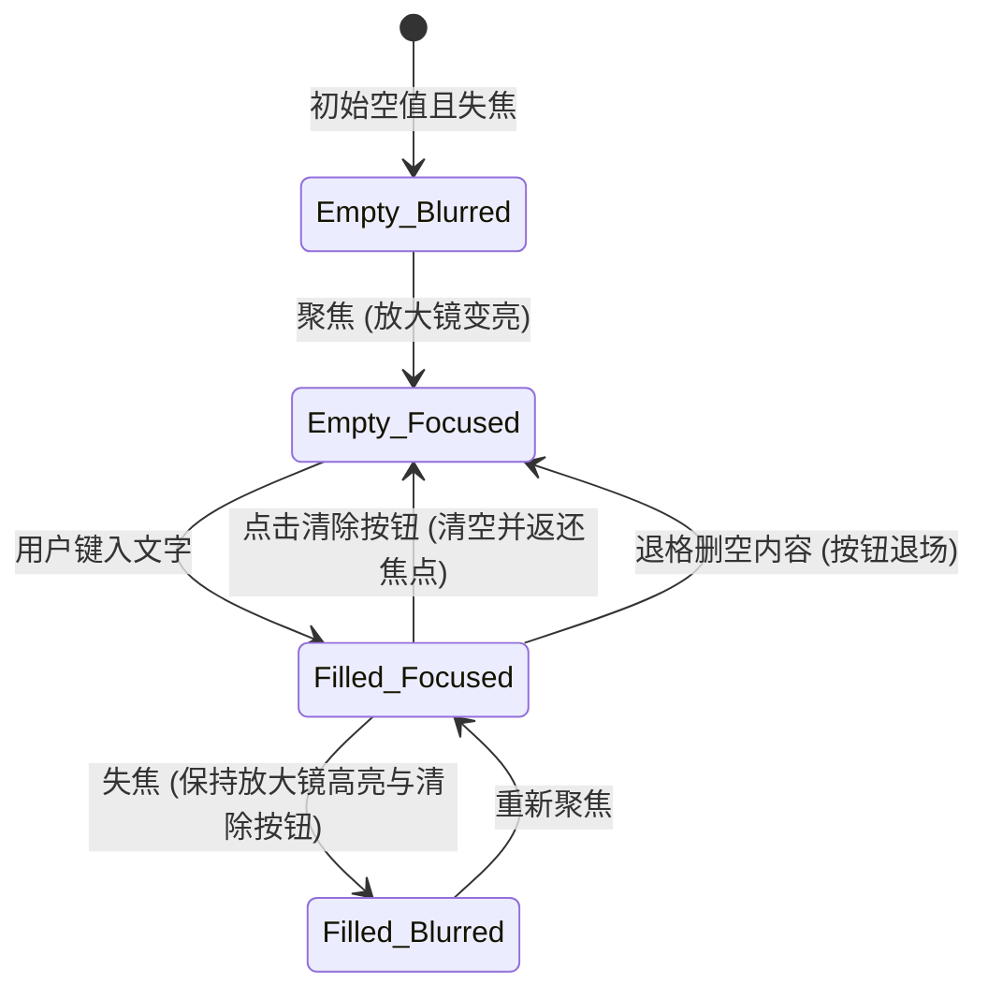

# Search Field · 搜索输入框

带有固定尾部清除槽位与高响应度交互状态的搜索控件。杜绝按钮出现时的内容抖动与焦点丢失。涵盖三大核心机制：

1. 预留清除槽位与零重排流式布局（Reserved Clear Slot & Jitter-Free Flow）：右侧常驻 24px 宽度的 `.search-clear-slot` 预留槽，输入框宽度不随清除按钮的挂载/卸载发生任何挤压或跳动；同时强制禁用浏览器原生取消按钮样式（`::-webkit-search-cancel-button { display: none; }`）。
2. 清除按钮微缩放与微模糊出入场（Scale & Blur Button Transition）：用户开始键入时，清除按钮以 `scale(0.8) + blur(2px) -> scale(1) + blur(0)`（260ms）弹性浮现；清空或退格至空白时，以 `scale(0.8) + blur(2px)`（120ms）快速平滑退场。
3. 搜索图标色彩唤醒与清除返焦（Icon Awakening & Focus Return）：当容器处于聚焦或有输入内容（`data-filled="true"`）时，左侧放大镜 SVG 图标从静止弱化色（`--text-muted`）顺滑唤醒为高对比高亮色（`--foreground`）；点击清除按钮后立即清空并自动返还焦点到输入框。

## 原型清单

| 原型分组 | 原型元素 | 动效 / 状态变化 | 去向 |
| --- | --- | --- | --- |
| 官方搜索框舞台 | 字段容器 `.search-field` | 垂直网格流式布局 | 最小 DOM |
| 官方搜索框舞台 | 标签 `label` | 语义绑定与静态标题 | 最小 DOM |
| 官方搜索框舞台 | 字段外壳 `.search-shell` | 悬停/聚焦边框过渡；有内容时同步标记 `data-filled="true"` | 零尺寸抖动输入容器 |
| 官方搜索框舞台 | 搜索放大镜图标 `svg.lucide-search` | 聚焦与填入内容时颜色从 `--text-muted` 平滑亮起 | 搜索图标色彩唤醒与清除返焦 |
| 官方搜索框舞台 | 搜索输入控件 `.search-input` | 原生 `type="search"`，隐藏浏览器原生取消叉号 | 结构与语义 |
| 官方搜索框舞台 | 预留清除槽 `.search-clear-slot` | 固定 24px×24px 尺寸，内部承载动态挂载的清除按钮 | 预留清除槽位与零重排流式布局 |
| 官方搜索框舞台 | 清除按钮 `button` | 有内容时缩放微模糊浮现，清空时缩小退场；点击清空并返还焦点 | 清除按钮微缩放与微模糊出入场 |
| 官方搜索框舞台 | 实时状态槽 `.demo-status` | 演示搜索状态通报 | 演示外壳，已删除 |
| — | 顶栏独立主题切换器 `#themeBtn` | 演示主题切换 | 演示外壳，已删除 |
| — | 舞台外壳 `.demo-stack` | 演示居中外壳 | 演示外壳，已删除 |

## 适用

- 列表过滤、全文检索、表格搜索、导航搜索等需要一键快速清空重置的搜索输入场景。
- 追求高质感细节，避免清除按钮出现导致光标和输入文字突然发生位移的场景。

## 不适用

- 初始为单图标按钮、点击后向外弹性伸展展开为长条输入框 → [expanding-search](expanding-search.md)
- 普通单行文本输入（无搜索与一键清除需求） → [input](input.md)
- 敏感密码与凭据输入 → [password-field](password-field.md)
- 多行长文本输入 → [textarea](textarea.md)

## 状态机



| 状态 | 进入条件 | 视觉表现 | 退出到 |
| --- | --- | --- | --- |
| Empty_Blurred | 初始无内容且未聚焦 | 边框为 `--border-strong`，放大镜为 `--text-muted`，清除槽为空 | Empty_Focused |
| Empty_Focused | 输入框获得焦点 | 边框变深为 `--foreground`，放大镜变亮为 `--foreground`，清除槽仍为空 | Empty_Blurred / Filled_Focused |
| Filled_Focused | 键入内容且保持聚焦 | 边框与放大镜高亮，清除按钮以 `scale(0.8) + blur(2px) -> 1` 浮现挂载 | Filled_Blurred / Empty_Focused |
| Filled_Blurred | 有输入内容但失去焦点 | 边框恢复 `--border-strong`，但放大镜保持高亮，清除按钮保持可见 | Filled_Focused |

## 动效参数

| 机制 | 属性 / 技术 | 持续时间 | 缓动函数 | 说明 |
| --- | --- | --- | --- | --- |
| 边框与图标过渡 | `border-color`, `color` | 160ms (`--duration-fast`) | `cubic-bezier(.22,1,.36,1)` | 悬停、聚焦与内容填充时的颜色同步 |
| 清除按钮入场 | `opacity`, `transform: scale(0.8)`, `filter: blur(2px)` | 260ms | `cubic-bezier(.16,1,.3,1)` | 顺滑放大并消除微模糊 |
| 清除按钮退场 | `opacity`, `transform: scale(0.8)`, `filter: blur(2px)` | 120ms | `cubic-bezier(.22,1,.36,1)` | 快速收缩并淡出，随后从 DOM 卸载 |
| 清除按钮悬停背景 | `background-color`, `color` | 160ms | `cubic-bezier(.22,1,.36,1)` | 鼠标悬停微发亮反馈 |

## 变量契约

### 依赖的全局/主题变量

| 变量名 | 默认值（浅色） | 暗色值 | 作用 |
| --- | --- | --- | --- |
| `--control-height-md` | `2.75rem` (44px) | `2.75rem` (44px) | 搜索外壳基准高度 |
| `--radius-control` | `1.125rem` (18px) | `1.125rem` (18px) | 搜索外壳与清除按钮圆角 |
| `--border-strong` | `oklch(82% 0 0)` | `oklch(40% 0 0)` | 静态边框色 |
| `--foreground` | `oklch(22% 0 0)` | `oklch(96% 0 0)` | 文本、激活边框与放大镜高亮色 |
| `--surface` | `oklch(100% 0 0)` | `oklch(21.5% 0 0)` | 输入框背景填充色 |
| `--surface-muted` | `oklch(97.8% 0 0)` | `oklch(26% 0 0)` | 清除按钮悬停底色 |
| `--text-muted` | `oklch(59% 0 0)` | `oklch(64% 0 0)` | 图标默认静止色与占位符色 |

### 组件私有变量

| 变量名 | 默认值 | 作用 |
| --- | --- | --- |
| `--clear-slot-size` | `24px` | 预留清除槽位的正方形尺寸 |

## 结构与语义

```html
<div class="search-field">
  <label for="search-input">Search projects</label>
  <div class="search-shell">
    <svg
      class="search-icon"
      xmlns="http://www.w3.org/2000/svg"
      width="18"
      height="18"
      viewBox="0 0 24 24"
      fill="none"
      stroke="currentColor"
      stroke-width="2"
      stroke-linecap="round"
      stroke-linejoin="round"
      aria-hidden="true"
    >
      <path d="m21 21-4.34-4.34" />
      <circle cx="11" cy="11" r="8" />
    </svg>
    <input
      id="search-input"
      type="search"
      class="search-input"
      placeholder="Search by name"
      autocomplete="off"
      spellcheck="false"
    />
    <span class="search-clear-slot"></span>
  </div>
</div>
```

## 样式实现

```css
.search-field {
  display: grid;
  gap: 0.5rem;
  min-width: 0;
  width: 100%;
}

.search-field label {
  font-size: 0.875rem;
  font-weight: 500;
  color: var(--foreground, #1c1c1c);
  line-height: 1.4;
}

.search-shell {
  display: flex;
  height: 44px;
  min-height: 44px;
  box-sizing: border-box;
  align-items: center;
  gap: 0.5rem;
  border: 1px solid var(--border-strong, #d1d1d1);
  border-radius: var(--radius-control, 18px);
  padding: 0 0.75rem;
  background: var(--surface, #ffffff);
  transition: border-color 160ms cubic-bezier(0.22, 1, 0.36, 1);
}

@media (hover: hover) and (pointer: fine) {
  .search-shell:hover:not(:focus-within) {
    border-color: var(--foreground, #1c1c1c);
  }
}

.search-shell:focus-within {
  border-color: var(--foreground, #1c1c1c);
}

.search-icon {
  flex: 0 0 auto;
  color: var(--text-muted, #717171);
  transition: color 160ms cubic-bezier(0.22, 1, 0.36, 1);
}

.search-shell:focus-within .search-icon,
.search-shell[data-filled="true"] .search-icon {
  color: var(--foreground, #1c1c1c);
}

.search-input {
  width: 100%;
  min-width: 0;
  border: 0;
  background: transparent;
  color: var(--foreground, #1c1c1c);
  font: inherit;
  font-size: 0.875rem;
  outline: 0;
}

.search-input:focus-visible {
  outline: 0;
}

.search-input::placeholder {
  color: var(--text-muted, #717171);
}

/* 隐藏 WebKit 浏览器原生搜索输入框的自带叉号，保证全平台视觉一致 */
.search-input::-webkit-search-cancel-button {
  display: none;
}

/* 预留清除槽位：固定尺寸，保证有无按钮时文字内容绝不发生横向抖动 */
.search-clear-slot {
  display: grid;
  width: 24px;
  height: 24px;
  flex: 0 0 auto;
  place-items: center;
}

.search-clear-btn {
  display: grid;
  width: 24px;
  height: 24px;
  flex: 0 0 auto;
  place-items: center;
  border: 0;
  border-radius: var(--radius-control, 18px);
  background: transparent;
  color: var(--text-muted, #717171);
  cursor: pointer;
  padding: 0;
  transition:
    background-color 160ms cubic-bezier(0.22, 1, 0.36, 1),
    color 160ms cubic-bezier(0.22, 1, 0.36, 1);
}

@media (hover: hover) and (pointer: fine) {
  .search-clear-btn:hover {
    background: var(--surface-muted, #f5f5f5);
    color: var(--foreground, #1c1c1c);
  }
}

@media (prefers-reduced-motion: reduce) {
  .search-shell,
  .search-icon,
  .search-clear-btn {
    transition: none !important;
  }
}
```

## 交互实现

```javascript
/**
 * 绑定搜索字段的清除按钮动效与生命周期
 * @param {HTMLElement} shellEl - .search-shell 容器
 */
export function setupSearchField(shellEl) {
  const input = shellEl.querySelector('.search-input');
  const slot = shellEl.querySelector('.search-clear-slot');
  if (!input || !slot) return;

  let button = null;
  let generation = 0;
  const prefersReduced = window.matchMedia('(prefers-reduced-motion: reduce)').matches;

  function update() {
    const version = ++generation;
    const hasValue = Boolean(input.value);

    shellEl.toggleAttribute('data-filled', hasValue);

    if (hasValue && !button) {
      // 动态创建并插入清除按钮
      button = document.createElement('button');
      button.type = 'button';
      button.className = 'search-clear-btn';
      button.setAttribute('aria-label', 'Clear search');
      button.innerHTML = `
        <svg width="16" height="16" viewBox="0 0 24 24" fill="none" stroke="currentColor" stroke-width="2" stroke-linecap="round" stroke-linejoin="round" aria-hidden="true">
          <path d="M18 6 6 18M6 6l12 12"/>
        </svg>
      `;
      slot.append(button);

      button.addEventListener('click', () => {
        input.value = '';
        input.dispatchEvent(new Event('input', { bubbles: true }));
        input.focus(); // 清空后焦点平滑返还输入框
      });

      if (!prefersReduced) {
        button.animate(
          [
            { opacity: 0, transform: 'scale(0.8)', filter: 'blur(2px)' },
            { opacity: 1, transform: 'scale(1)', filter: 'blur(0)' }
          ],
          {
            duration: 260,
            easing: 'cubic-bezier(0.16, 1, 0.3, 1)',
            fill: 'forwards'
          }
        );
      }
    } else if (!hasValue && button) {
      // 清空时退出动画
      const leaving = button;
      button = null;

      if (prefersReduced) {
        leaving.remove();
      } else {
        const anim = leaving.animate(
          [
            { opacity: 1, transform: 'scale(1)', filter: 'blur(0)' },
            { opacity: 0, transform: 'scale(0.8)', filter: 'blur(2px)' }
          ],
          {
            duration: 120,
            easing: 'cubic-bezier(0.22, 1, 0.36, 1)'
          }
        );
        anim.finished
          .then(() => {
            if (generation === version && !input.value) {
              leaving.remove();
            }
          })
          .catch(() => {});
      }
    }
  }

  input.addEventListener('input', update);
}
```

## 无障碍与无动画

1. **清除与无障碍焦点闭环**：
   - 清除按钮提供明确的 `aria-label="Clear search"`，读屏器聚焦时可读出意图。
   - 点击清除按钮后，必须立即通过 `input.focus()` 把焦点返还给输入框，防止焦点丢失落入 `<body>`，导致键盘用户操作流中断。
2. **Reduced Motion 降级**：
   - 在 `prefers-reduced-motion: reduce` 下，清除按钮直接瞬间 `append()` 或 `remove()`，跳过任何 `scale` 与 `blur` 滤镜过渡。

## 踩坑与微调

1. **原生取消按钮闪现**：
   - 在 Safari 或 Chrome 等浏览器中，`type="search"` 默认会带有原生伪元素清除按钮。若不加上 `::-webkit-search-cancel-button { display: none; }`，用户键入文字时会出现两个重叠的清除按钮。
2. **异步退场时的竞态冲突**：
   - 若用户快速连续键入、删空、再键入，120ms 退场动画可能与入场动画产生冲突。通过递增版本号 `generation === version` 守卫，确保只有在状态真正保持为空时才执行 DOM 节点销毁，彻底避免误删当前有效按钮。

## 验收清单

- [x] 尾部保留独立尺寸的 `.search-clear-slot`，消除按钮出现导致的文字位移。
- [x] 成功隐藏 WebKit 原生搜索取消按钮。
- [x] 清除按钮入场/出场伴随 `scale(0.8)` 与微模糊动画。
- [x] 点击清除后自动派发 `input` 事件并将焦点平滑返还输入框。
- [x] 放大镜图标随聚焦和填值平滑高亮。
- [x] 包含完整的 `prefers-reduced-motion` 降级与竞态版本保护。
