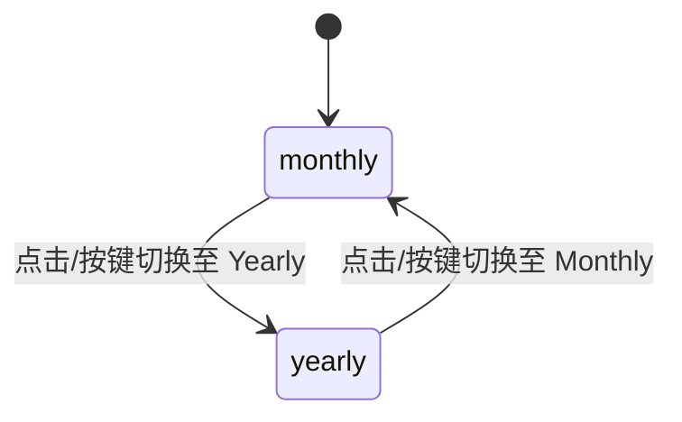

# Billing Toggle · 计费周期切换胶囊

专为 SaaS 定价方案设计的月付/年付联动切换胶囊。包含三大核心动效机制：

1. 物理测量滑动胶囊（Gliding Thumb Pill）：单例高光滑块（`.billing-toggle-thumb`）在 Monthly 与 Yearly 选项间以平滑阻尼（340ms）横向滑动与宽度自适应变形。
2. 零抖动折扣徽标与尺寸锁死（Ghost Sizer & Badge）：Yearly 标签内嵌折扣徽标（Save 20%），通过 Ghost Sizer 机制锁定文字最大物理宽度，文案切换时零抖动并附带 240ms 微模糊。
3. 联动数字滚轮与划线原价伸缩（Odometer Price & Strikethrough）：切换周期时，价格数字按十进制位独立执行垂直滚轮翻转，年付折扣时的划线原价（`<del>`）以 360ms 弹性展开或收缩，避免界面跳变。

## 原型清单

| 原型分组 | 原型元素 | 动效 / 状态变化 | 去向 |
| --- | --- | --- | --- |
| 周期切换胶囊 | 切换根容器 `.billing-toggle-root` | 承载单例滑动背景胶囊与单选状态 | 周期切换胶囊外框 |
| 滑动背景 | 滑块 `.billing-toggle-thumb` | 340ms 弹性平滑横移与宽度自适应变化 | 物理测量滑动胶囊 |
| 选项按钮 | 周期按钮 `.billing-toggle-option` | 激活状态切换、文字高亮、全键盘 Roving Tabindex | 选项交互与键盘漫游 |
| 折扣徽章 | 标签 `.billing-toggle-badge` | 包含 Ghost Sizer 宽度锁定与微模糊文案置换 | 零抖动折扣徽标 |
| 价格面板联动 | 价格数值 `.billing-toggle-price` | 0~9 垂直数字滚轮翻转、划线原价展开/收回 | 联动数字滚轮与划线原价 |
| 演示外壳 | 顶部主题切换按钮 `#themeBtn`、卡片头部标题、年付注释文本 | — | 演示外壳，已删除 |

## 适用

- SaaS 产品定价页、升级订购面板中的 Monthly/Yearly 周期切换。
- 周期切换需要联动修改下方所有价格卡片的数字、计费单位及折扣说明。
- 追求极致顺滑的视觉反馈，杜绝价格文本跳变导致的价格卡片外框抖动。

## 不适用

- 普通布尔开关（如开启通知、启用暗黑模式） → [switch](switch.md)
- 表单常规多选或协议勾选 → [checkbox](checkbox.md)
- 包含丰富标题、详情与价格的卡片级单选选择器 → [radio-cards](radio-cards.md)
- 纯文本垂直单选列表 → [radio-group](radio-group.md)
- 多视图模式切换胶囊（非定价计费场景） → [segmented-control](segmented-control.md)

## 状态机

| 状态 | 进入条件 | 视觉表现 | 退出到 |
| --- | --- | --- | --- |
| monthly | 初始；或点击 Monthly | 滑块定位于 Monthly 按钮，价格展示月付单价，划线折扣价收拢隐藏 | yearly |
| yearly | 点击 Yearly 按钮 | 滑块滑动至 Yearly 并自适应拉长，折扣徽标点亮，原价划线槽平滑展开，数字滚轮翻滚至折后价 | monthly |
| thumb-moving | 选项点击瞬间 | 滑动胶囊以 340ms 平滑弹簧横移过渡 | monthly / yearly |



## 最小 DOM

```html
<div class="billing-toggle-root" role="radiogroup" aria-label="Billing period">
  <span class="billing-toggle-thumb" aria-hidden="true"></span>
  <button type="button" role="radio" aria-checked="true" tabindex="0" class="billing-toggle-option" data-value="monthly">
    <span class="billing-toggle-content">
      <span class="billing-toggle-label">Monthly</span>
    </span>
  </button>
  <button type="button" role="radio" aria-checked="false" tabindex="-1" class="billing-toggle-option" data-value="yearly">
    <span class="billing-toggle-content">
      <span class="billing-toggle-label">Yearly</span>
      <span class="billing-toggle-badge" data-active="true">
        <span class="billing-toggle-swap">
          <span class="billing-toggle-swap-sizer" aria-hidden="true">Save 20%</span>
          <span class="billing-toggle-swap-text">Save 20%</span>
        </span>
      </span>
    </span>
  </button>
</div>

<div class="billing-price-card">
  <div class="billing-price-row">
    <span class="billing-currency">$</span>
    <span class="billing-odometer" data-value="10">
      <span class="billing-digit-strip">10</span>
    </span>
    <span class="billing-was-slot" style="display: none;">
      <del class="billing-was-price">$12</del>
    </span>
    <span class="billing-period">/ mo</span>
  </div>
</div>
```

- `.billing-toggle-root`：单选组宿主，管理 `role="radiogroup"` 与相对排版。
- `.billing-toggle-thumb`：单例滑动背景块，执行位移与宽度变形。
- `.billing-toggle-option`：单选项按钮，管理 `role="radio"` 与 `aria-checked`。
- `.billing-toggle-badge`：折扣徽标胶囊。
- `.billing-toggle-swap-sizer`：幽灵占位符（Ghost Sizer），锁定最大物理宽度。
- `.billing-price-card`：关联的价格展示卡片。
- `.billing-was-slot`：原价划线槽，年付时平滑展开。

## 参数

| 名称 | 值 | 用于 | 来源 |
| --- | --- | --- | --- |
| thumbSpring | visualDuration: 0.34s, bounce: 0 | 背景滑块平滑横移与拉伸阻尼 | 原型 |
| asideWidthSpring | visualDuration: 0.36s, bounce: 0 | 原价划线槽展开与收起阻尼 | 原型 |
| textSwapMs | [240ms, 160ms] | 徽标文字切换入场与退场时间 | 原型 |
| textBlurPx | 2px | 文字切换时微模糊过渡 | 原型 |
| digitsPerWheel | 10 | 滚轮翻转单列数字总数 | 原型 |

## CSS

```css
.billing-toggle-root {
  position: relative;
  display: inline-flex;
  align-items: center;
  padding: 3px;
  border-radius: 9999px;
  background: #f1f5f9;
  user-select: none;
  font-family: system-ui, -apple-system, sans-serif;
}

.billing-toggle-thumb {
  position: absolute;
  top: 3px;
  left: 3px;
  height: calc(100% - 6px);
  border-radius: 9999px;
  background: #ffffff;
  box-shadow: 0 1px 3px rgba(0, 0, 0, 0.1), 0 1px 2px rgba(0, 0, 0, 0.06);
  pointer-events: none;
  transition: transform 0.34s cubic-bezier(0.16, 1, 0.3, 1),
              width 0.34s cubic-bezier(0.16, 1, 0.3, 1);
}

.billing-toggle-option {
  position: relative;
  z-index: 1;
  display: inline-flex;
  align-items: center;
  height: 34px;
  padding: 0 14px;
  border: none;
  border-radius: 9999px;
  background: transparent;
  color: #64748b;
  font: inherit;
  font-size: 14px;
  font-weight: 500;
  cursor: pointer;
  outline: none;
  transition: color 0.15s ease;
}

.billing-toggle-option[aria-checked="true"] {
  color: #0f172a;
  font-weight: 600;
}

.billing-toggle-content {
  display: inline-flex;
  align-items: center;
  gap: 8px;
}

.billing-toggle-badge {
  display: inline-flex;
  align-items: center;
  padding: 2px 8px;
  border-radius: 9999px;
  background: #eff6ff;
  color: #2563eb;
  font-size: 12px;
  font-weight: 600;
}

.billing-toggle-swap {
  position: relative;
  display: inline-flex;
  align-items: center;
  justify-content: center;
}

.billing-toggle-swap-sizer {
  visibility: hidden;
  height: 0;
  overflow: hidden;
  user-select: none;
}

.billing-toggle-swap-text {
  transition: opacity 0.16s ease, filter 0.16s ease;
}

.billing-price-card {
  margin-top: 16px;
  font-family: system-ui, -apple-system, sans-serif;
}

.billing-price-row {
  display: flex;
  align-items: baseline;
  gap: 4px;
  color: #0f172a;
  font-size: 28px;
  font-weight: 700;
}

.billing-currency {
  font-size: 18px;
  font-weight: 600;
  color: #64748b;
}

.billing-was-slot {
  margin-left: 6px;
  font-size: 16px;
  font-weight: 500;
  color: #94a3b8;
  transition: opacity 0.24s ease, width 0.36s cubic-bezier(0.16, 1, 0.3, 1);
}

.billing-period {
  margin-left: 4px;
  font-size: 14px;
  font-weight: 400;
  color: #64748b;
}

@media (prefers-reduced-motion: reduce) {
  .billing-toggle-thumb,
  .billing-toggle-option,
  .billing-toggle-swap-text,
  .billing-was-slot {
    transition: none !important;
  }
}
```

## JS

```js
export function createBillingToggle(rootEl, options = {}) {
  const thumb = rootEl.querySelector('.billing-toggle-thumb');
  const buttons = Array.from(rootEl.querySelectorAll('.billing-toggle-option'));
  const wasSlot = document.querySelector('.billing-was-slot');
  const odometer = document.querySelector('.billing-odometer');

  let currentValue = options.defaultValue || 'monthly';

  function updateThumb() {
    const activeBtn = buttons.find(b => b.getAttribute('data-value') === currentValue) || buttons[0];
    if (!thumb || !activeBtn) return;
    thumb.style.transform = `translateX(${activeBtn.offsetLeft - 3}px)`;
    thumb.style.width = `${activeBtn.offsetWidth}px`;
  }

  function setValue(val) {
    currentValue = val;
    buttons.forEach(btn => {
      const isSelected = btn.getAttribute('data-value') === val;
      btn.setAttribute('aria-checked', String(isSelected));
      btn.tabIndex = isSelected ? 0 : -1;
    });

    updateThumb();

    if (wasSlot) {
      if (val === 'yearly') {
        wasSlot.style.display = 'inline-block';
        wasSlot.style.opacity = '1';
      } else {
        wasSlot.style.opacity = '0';
        setTimeout(() => {
          if (currentValue !== 'yearly') wasSlot.style.display = 'none';
        }, 200);
      }
    }

    if (odometer) {
      const priceText = val === 'yearly' ? (options.yearlyPrice || '8') : (options.monthlyPrice || '10');
      odometer.textContent = priceText;
    }

    if (typeof options.onChange === 'function') {
      options.onChange(val);
    }
    rootEl.dispatchEvent(new CustomEvent('arc:billing-change', {
      bubbles: true,
      detail: { value: val }
    }));
  }

  const listeners = [];
  buttons.forEach(btn => {
    const onClick = () => {
      const val = btn.getAttribute('data-value');
      setValue(val);
      btn.focus();
    };
    btn.addEventListener('click', onClick);
    listeners.push({ el: btn, event: 'click', handler: onClick });
  });

  const onKeyDown = (e) => {
    const index = buttons.findIndex(b => b.getAttribute('aria-checked') === 'true');
    if (index === -1) return;

    if (e.key === 'ArrowRight' || e.key === 'ArrowDown' || e.key === 'ArrowLeft' || e.key === 'ArrowUp') {
      e.preventDefault();
      const nextIndex = (index + 1) % buttons.length;
      const nextBtn = buttons[nextIndex];
      setValue(nextBtn.getAttribute('data-value'));
      nextBtn.focus();
    }
  };

  rootEl.addEventListener('keydown', onKeyDown);

  // 初始化位置
  requestAnimationFrame(() => {
    updateThumb();
  });

  return {
    getValue: () => currentValue,
    setValue: (val) => setValue(val),
    destroy: () => {
      listeners.forEach(({ el, event, handler }) => el.removeEventListener(event, handler));
      rootEl.removeEventListener('keydown', onKeyDown);
    }
  };
}
```

## 接入目标项目

- 状态来源：计费周期状态（`monthly` | `yearly`），受控或非受控驱动。
- 尺寸策略：胶囊根据文本宽度测量适配，`Save 20%` 徽标内嵌 Ghost Sizer 锁死宽度。
- 驱动方式：`createBillingToggle(rootEl, { monthlyPrice: '10', yearlyPrice: '8', onChange: (val) => {} })`。

## 重入与清理

- 快速连点 Monthly/Yearly 时，滑动块平滑反向寻路，原价划线槽打断过渡。
- 销毁时清理全部按钮事件与键盘监听。

## 减少动态效果

- 在 `prefers-reduced-motion: reduce` 下，移除滑块滑动过渡与文字微模糊。
- 滑块直接瞬间落定到对应选项背景处。

## 焦点与键盘

- 单选组遵守 WAI-ARIA Radio Group 规范，激活项 `tabindex="0"`，未选单选为 `-1`。
- 左右方向键循环切换选中选项并同步焦点。

## 兼容回退

| 特性 | 不支持时 |
| --- | --- |
| CSS transform | 回退为 `left` 与 `width` 属性定位 |
| Ghost Sizer | 使用固定 min-width 锁死徽标尺寸 |

## 验收清单

- [ ] 点击 Yearly 选项，滑块以 340ms 平滑滑动拉长，下方划线原价展开，价格切换至年付单价。
- [ ] 点击 Monthly 选项，滑块流畅反向收缩回退，划线原价淡出折叠。
- [ ] 键盘左右方向键可在选项间无缝切换，焦点正确同步。
- [ ] 开启减弱动态效果时，所有滑块与价格联动瞬时切换无动画。
