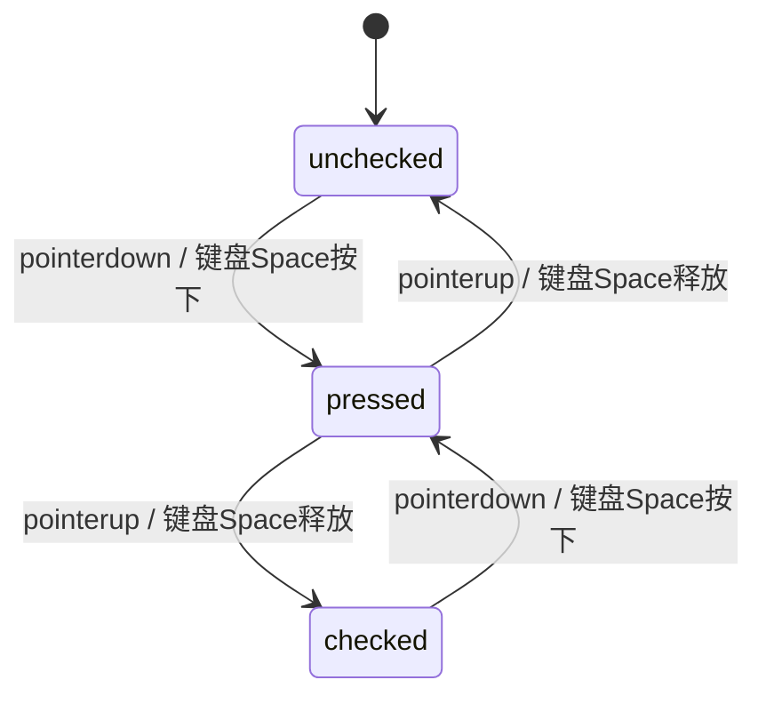

# Checkbox · 弹性笔触复选框

具备极具触感的按压反馈与 SVG 真实笔触书写动画的原生复选框。包含三大核心动效机制：

1. 触感微缩放与弹性过冲（Snappy Press Spring）：按压瞬间视觉外框缩小至 `scale(0.95)`，释放时通过欠阻尼弹簧（260ms，bounce 0.12）微过冲并沉降，呈现真实机械触感。
2. 内部填充层弹性膨胀：激活时内部色彩填充层（`.checkbox-fill`）从 `scale(0.6)` 平滑放大至 `scale(1)` 并淡入，反选时微缩渐隐，外框尺寸始终锁定 0 像素晃动。
3. 对勾矢量路径真实描摹：利用 SVG 归一化路径 `pathLength="1"`，在 260ms 内通过 `stroke-dashoffset` 从 1 变化至 0 绘制对勾笔触；反选时原路倒退收回。

## 原型清单

| 原型分组 | 原型元素 | 动效 / 状态变化 | 去向 |
| --- | --- | --- | --- |
| 按钮主体 | 交互宿主 `button[role="checkbox"]` | `:active` 按压微缩 0.95、无障碍 `aria-checked` 与数据状态更新 | 按钮交互与按压反馈 |
| 视觉方框 | 视觉框 `.checkbox-visual` | 固定 18×18px 视口，承载底边框与高光 | 视觉方框与尺寸锁定 |
| 填充层 | 背景层 `.checkbox-fill` | 勾选时 `scale(0.6)` 扩张至 `scale(1)` 且透明度 0 至 1 | 内部填充层弹性膨胀 |
| 对勾图标 | 描边路径 `svg.checkbox-mark path` | `stroke-dashoffset` 从 1 到 0 实时笔画书写与反向收回 | 对勾矢量路径真实描摹 |
| 标签文案 | 文本区 `.checkbox-copy` | 点击文本联动激活复选框 | 标签联动 |
| 演示外壳 | 顶部主题切换按钮 `#themeBtn`、外部状态提示 `.demo-status` | — | 演示外壳，已删除 |

## 适用

- 表单多选、协议同意、待办事项列表等标准复选场景。
- 追求极致的物理触感与笔画动态反馈，避免静态硬切复选框的沉闷感。
- 强调严格的 WAI-ARIA 无障碍可访问性与键盘 Space 键原生交互。

## 不适用

- 二值即时生效的系统设置切换项（如开启蓝牙、夜间模式） → [switch](switch.md)
- 互斥单选组 → [radio-group](radio-group.md)
- SaaS 计费年付/月付切换胶囊 → [billing-toggle](billing-toggle.md)
- 卡片级富内容选择器 → [radio-cards](radio-cards.md)
- 水平分段选择胶囊 → [segmented-control](segmented-control.md)

## 状态机

| 状态 | 进入条件 | 视觉表现 | 退出到 |
| --- | --- | --- | --- |
| unchecked | 初始；或点击已选中状态 | 边框灰色，填充层透明度 0 且 scale(0.6)，对勾路径 offset 为 1 | checked |
| checked | 点击未选中复选框 | 填充层蓝色放大铺满，对勾笔触自左向右绘制书写完成，offset 为 0 | unchecked |
| pressed | 鼠标按下或 Space 按下未松开 | 整个复选框缩小至 `scale(0.95)` | checked / unchecked |
| disabled | 设置 disabled 属性 | 透明度降低，鼠标手势禁用，点击不触发任何状态流转 | — |



## 最小 DOM

```html
<div class="checkbox-field">
  <button type="button" role="checkbox" aria-checked="false" data-state="unchecked" id="chk1" class="checkbox-button" aria-describedby="chk1-desc">
    <span class="checkbox-visual" aria-hidden="true">
      <span class="checkbox-fill"></span>
      <svg class="checkbox-mark" viewBox="0 0 18 18" fill="none">
        <path stroke="currentColor" stroke-width="2" stroke-linecap="round" stroke-linejoin="round" d="M4.25 9.25 L7.25 12.25 L13.75 5.75" pathLength="1" stroke-dashoffset="1" stroke-dasharray="1 1" />
      </svg>
    </span>
  </button>
  <div class="checkbox-copy">
    <label for="chk1">Include archived projects</label>
    <span id="chk1-desc">Show projects that are no longer active.</span>
  </div>
</div>
```

- `.checkbox-field`：整体表单行弹性容器。
- `.checkbox-button`：原生交互宿主，承载 `role="checkbox"`、`aria-checked` 与键盘焦点。
- `.checkbox-visual`：固定 18×18px 视觉几何体，杜绝边框抖动。
- `.checkbox-fill`：背景色彩层，执行缩放扩张动画。
- `.checkbox-mark`：SVG 对勾矢量容器。
- `path`：对勾路径，声明 `pathLength="1"` 与 `stroke-dashoffset`。
- `.checkbox-copy`：说明文本包装，包含 `label` 与辅助描述。

## 参数

| 名称 | 值 | 用于 | 来源 |
| --- | --- | --- | --- |
| markPx | 18px | 复选框视觉基准外框尺寸 | 原型 |
| pressScale | 0.95 | 按压过程中的物理微缩比 | 原型 |
| springDuration | 0.26s | snappy 弹簧物理振荡周期 | 原型 |
| springBounce | 0.12 | 松开时弹性过冲反弹量 | 原型 |
| strokeWidth | 2px | 对勾笔触描边粗细 | 原型 |

## CSS

```css
.checkbox-field {
  display: inline-flex;
  align-items: flex-start;
  gap: 10px;
  font-family: system-ui, -apple-system, sans-serif;
  user-select: none;
}

.checkbox-button {
  position: relative;
  display: inline-grid;
  place-items: center;
  width: 18px;
  height: 18px;
  margin-top: 2px;
  padding: 0;
  border: none;
  background: transparent;
  cursor: pointer;
  outline: none;
  -webkit-tap-highlight-color: transparent;
  transition: transform 0.12s ease;
}

.checkbox-button:active {
  transform: scale(0.95);
}

.checkbox-visual {
  position: relative;
  width: 18px;
  height: 18px;
  border: 1px solid #cbd5e1;
  border-radius: 4px;
  background: #ffffff;
  overflow: hidden;
  box-sizing: border-box;
  transition: border-color 0.15s ease, box-shadow 0.15s ease;
}

.checkbox-button:focus-visible .checkbox-visual {
  border-color: #3b82f6;
  box-shadow: 0 0 0 3px rgba(59, 130, 246, 0.2);
}

.checkbox-button:hover .checkbox-visual {
  border-color: #94a3b8;
}

.checkbox-fill {
  position: absolute;
  inset: 0;
  background: #2563eb;
  opacity: 0;
  transform: scale(0.6);
  transition: opacity 0.26s cubic-bezier(0.18, 0.89, 0.32, 1.15),
              transform 0.26s cubic-bezier(0.18, 0.89, 0.32, 1.15);
}

.checkbox-button[aria-checked="true"] .checkbox-visual {
  border-color: #2563eb;
}

.checkbox-button[aria-checked="true"] .checkbox-fill {
  opacity: 1;
  transform: scale(1);
}

.checkbox-mark {
  position: absolute;
  inset: 0;
  width: 100%;
  height: 100%;
  color: #ffffff;
  pointer-events: none;
}

.checkbox-mark path {
  transition: stroke-dashoffset 0.26s cubic-bezier(0.18, 0.89, 0.32, 1.15),
              opacity 0.2s ease;
}

.checkbox-copy {
  display: flex;
  flex-direction: column;
  gap: 2px;
}

.checkbox-copy label {
  color: #0f172a;
  font-size: 14px;
  font-weight: 500;
  cursor: pointer;
}

.checkbox-copy span {
  color: #64748b;
  font-size: 13px;
}

.checkbox-button:disabled {
  opacity: 0.5;
  cursor: not-allowed;
}

@media (prefers-reduced-motion: reduce) {
  .checkbox-button,
  .checkbox-fill,
  .checkbox-mark path {
    transition: none !important;
  }
}
```

## JS

```js
export function createCheckbox(containerEl, options = {}) {
  const button = containerEl.matches('button[role="checkbox"]')
    ? containerEl
    : containerEl.querySelector('button[role="checkbox"]');
  const label = containerEl.querySelector('label');
  const path = containerEl.querySelector('.checkbox-mark path');

  if (!button) {
    return { destroy: () => {} };
  }

  let checked = options.defaultChecked !== undefined
    ? Boolean(options.defaultChecked)
    : button.getAttribute('aria-checked') === 'true';

  function applyState(nextChecked) {
    checked = nextChecked;
    button.setAttribute('aria-checked', String(checked));
    button.setAttribute('data-state', checked ? 'checked' : 'unchecked');
    if (path) {
      path.style.strokeDashoffset = checked ? '0' : '1';
    }
  }

  function toggle() {
    if (button.disabled) return;
    applyState(!checked);
    if (typeof options.onChange === 'function') {
      options.onChange(checked);
    }
    button.dispatchEvent(new CustomEvent('arc:checked-change', {
      bubbles: true,
      detail: { checked }
    }));
  }

  const onBtnClick = (e) => {
    e.preventDefault();
    toggle();
  };

  const onLabelClick = (e) => {
    e.preventDefault();
    toggle();
    button.focus();
  };

  const onKeyDown = (e) => {
    if (e.key === ' ') {
      e.preventDefault();
      toggle();
    }
  };

  button.addEventListener('click', onBtnClick);
  button.addEventListener('keydown', onKeyDown);
  if (label) label.addEventListener('click', onLabelClick);

  applyState(checked);

  return {
    isChecked: () => checked,
    setChecked: (val) => applyState(Boolean(val)),
    destroy: () => {
      button.removeEventListener('click', onBtnClick);
      button.removeEventListener('keydown', onKeyDown);
      if (label) label.removeEventListener('click', onLabelClick);
    }
  };
}
```

## 接入目标项目

- 状态来源：布尔值驱动（`true` / `false`），支持受控或非受控。
- 尺寸策略：18×18px 绝对物理固定外形，不随内容长度伸缩。
- 驱动方式：`createCheckbox(el, { defaultChecked: false, onChange: (val) => {} })`。

## 重入与清理

- 极快速连击时，SVG 描边属性在当前插值基础上平滑反向逆向书写，无重叠或断裂。
- 卸载时解除所有 click/keydown/label 监听。

## 减少动态效果

- 在 `prefers-reduced-motion: reduce` 下，禁用 `scale` 弹性扩张与对勾路径描边动画。
- 点击瞬间直接显示完整填充与对勾。

## 焦点与键盘

- 原生 `button[role="checkbox"]` 接收键盘焦点，配合标准外发光光圈。
- `Space` 键完美模拟原生复选框切换行为。

## 兼容回退

| 特性 | 不支持时 |
| --- | --- |
| SVG pathLength | 使用固定数值 stroke-dasharray (如 18 18) |
| cubic-bezier 超调 | 回退为基础 ease-out 缓动 |

## 验收清单

- [ ] 点击复选框，蓝色填充由小及大弹性铺满，同时对勾顺滑从左至右实时画出。
- [ ] 再次点击取消，对勾从右至左反向收束，填充层微缩淡出。
- [ ] 点击配套文案 Label，复选框联动触发且按钮获得焦点。
- [ ] 键盘聚焦后按空格键，触发相同流转。
- [ ] 减弱动态效果开启时，点击直接切换完成无延迟。
