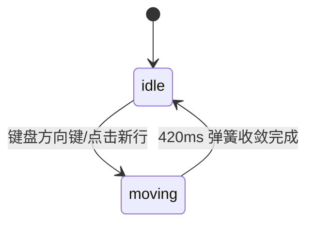

# Radio Group · 滑动高光单选组

垂直选项列表的机械感单选组件。包含三大核心动效机制：

1. 共享垂直滑动高光块（Gliding Vertical Highlight）：所有选项行共享一个唯一的背景高光层（`.radio-highlight`），在选项切换时以 420ms 欠阻尼弹簧（bounce 0.16）沿垂直 Y 轴平滑滑动，并自适应匹配目标行高度。
2. 单选圆点弹性缩放（Snappy Dot Spring）：内部单选圆点（`.radio-dot`）在激活时以 snappy 弹簧从 `scale(0.4)`、`opacity: 0` 弹性放大沉降至 `scale(1)`、`opacity: 1`。
3. 原生单选可访问性绑定与被动尺寸自适应：依托隐藏原生 `<input type="radio">` 保持完整键盘方向键焦点流，外层尺寸变动时无动画即刻重定位，防止高光块晃动。

## 原型清单

| 原型分组 | 原型元素 | 动效 / 状态变化 | 去向 |
| --- | --- | --- | --- |
| 单选外框 | 容器 `.radio-group` 与 `.radio-options` | 承载单选组上下文与共享高光层定位 | 单选容器外框 |
| 背景高光 | 滑块 `.radio-highlight` | 420ms 垂直 Y 轴平滑滑动与自适应测高 | 共享垂直滑动高光块 |
| 选项行 | 单选行 `.radio-option` | 悬停文本加深、点击切换选中、行高适应 | 选项行交互 |
| 单选圆环与点 | 圆点 `.radio-mark` 与 `.radio-dot` | 圆点 `scale(0.4)` 至 `scale(1)` 伴随透明度弹性入场 | 单选圆点弹性缩放 |
| 原生单选框 | 隐式输入 `input[type="radio"]` | 原生 checked 状态管理与全键盘无障碍 | 原生输入绑定 |
| 演示外壳 | 顶部主题切换按钮 `#themeBtn`、外部状态提示 `.demo-status` | — | 演示外壳，已删除 |

## 适用

- 垂直排列的单选设置清单（如代码审查模式、隐私权限分级、通知偏好）。
- 追求高质感的滑动跟随背景，消除传统单选框生硬的无反馈感。
- 每项包含明确的标题与辅助描述文案。

## 不适用

- 复杂横向方案对比与价格卡片 → [radio-cards](radio-cards.md)
- SaaS 计费周期切换胶囊 → [billing-toggle](billing-toggle.md)
- 二值布尔开关 → [switch](switch.md)
- 横向紧凑模式切换器 → [segmented-control](segmented-control.md)

## 状态机

| 状态 | 进入条件 | 视觉表现 | 退出到 |
| --- | --- | --- | --- |
| idle | 某选项选中就绪 | 高光块停留在该选项背后，该项小圆点完整显示，其他选项小圆点隐藏 | moving |
| moving | 点击或方向键选择新选项 | 高光块以 420ms morph 弹簧平滑位移至目标行，旧圆点缩小淡出，新圆点弹出 | idle |



## 最小 DOM

```html
<fieldset class="radio-group">
  <legend class="radio-legend">Review mode</legend>
  <div class="radio-options">
    <span class="radio-highlight" aria-hidden="true"></span>
    <label class="radio-option">
      <input type="radio" value="focused" checked name="reviewMode">
      <span class="radio-mark" aria-hidden="true">
        <span class="radio-dot"></span>
      </span>
      <span class="radio-text">
        <strong>Focused review</strong>
        <small>One reviewer at a time.</small>
      </span>
    </label>
    <label class="radio-option">
      <input type="radio" value="open" name="reviewMode">
      <span class="radio-mark" aria-hidden="true">
        <span class="radio-dot"></span>
      </span>
      <span class="radio-text">
        <strong>Open review</strong>
        <small>Everyone can comment together.</small>
      </span>
    </label>
    <label class="radio-option">
      <input type="radio" value="async" name="reviewMode">
      <span class="radio-mark" aria-hidden="true">
        <span class="radio-dot"></span>
      </span>
      <span class="radio-text">
        <strong>Async review</strong>
        <small>Reviewers leave notes when they can.</small>
      </span>
    </label>
  </div>
</fieldset>
```

- `.radio-group`：语义化 `<fieldset>` 外框。
- `.radio-options`：相对定位容器，包含绝对定位的 `.radio-highlight`。
- `.radio-highlight`：单例共享滑动背景胶囊。
- `.radio-option`：选项行 `<label>`。
- `input[type="radio"]`：隐藏的原生单选输入。
- `.radio-mark`：外圈圆形边框。
- `.radio-dot`：内嵌弹性弹出小圆点。

## 参数

| 名称 | 值 | 用于 | 来源 |
| --- | --- | --- | --- |
| highlightSpring | visualDuration: 0.42s, bounce: 0.16 | 高光背景块 Y 轴平滑滑动与拉伸 | 原型 |
| dotSpring | visualDuration: 0.26s, bounce: 0.12 | 单选小圆点弹性弹出微过冲 | 原型 |
| markPx | 18px | 单选外圈直径基准 | 原型 |
| dotPx | 8px | 单选内部实心圆点直径 | 原型 |

## CSS

```css
.radio-group {
  margin: 0;
  padding: 0;
  border: none;
  font-family: system-ui, -apple-system, sans-serif;
  max-width: 380px;
}

.radio-legend {
  margin-bottom: 8px;
  color: #0f172a;
  font-size: 14px;
  font-weight: 600;
}

.radio-options {
  position: relative;
  display: flex;
  flex-direction: column;
  gap: 4px;
}

.radio-highlight {
  position: absolute;
  left: 0;
  right: 0;
  top: 0;
  z-index: 0;
  border-radius: 8px;
  background: #f1f5f9;
  pointer-events: none;
  transition: transform 0.42s cubic-bezier(0.18, 0.89, 0.32, 1.16),
              height 0.42s cubic-bezier(0.18, 0.89, 0.32, 1.16),
              opacity 0.15s ease;
}

.radio-option {
  position: relative;
  z-index: 1;
  display: flex;
  align-items: flex-start;
  gap: 12px;
  padding: 10px 12px;
  border-radius: 8px;
  cursor: pointer;
  user-select: none;
  -webkit-tap-highlight-color: transparent;
}

.radio-option input[type="radio"] {
  position: absolute;
  opacity: 0;
  width: 0;
  height: 0;
}

.radio-mark {
  display: grid;
  place-items: center;
  width: 18px;
  height: 18px;
  margin-top: 2px;
  flex: none;
  border: 1px solid #cbd5e1;
  border-radius: 9999px;
  background: #ffffff;
  transition: border-color 0.15s ease;
}

.radio-option:has(input:checked) .radio-mark {
  border-color: #2563eb;
}

.radio-dot {
  width: 8px;
  height: 8px;
  border-radius: 9999px;
  background: #2563eb;
  opacity: 0;
  transform: scale(0.4);
  transition: transform 0.26s cubic-bezier(0.18, 0.89, 0.32, 1.15),
              opacity 0.26s cubic-bezier(0.18, 0.89, 0.32, 1.15);
}

.radio-option:has(input:checked) .radio-dot {
  opacity: 1;
  transform: scale(1);
}

.radio-text {
  display: flex;
  flex-direction: column;
  gap: 2px;
}

.radio-text strong {
  color: #0f172a;
  font-size: 14px;
  font-weight: 500;
}

.radio-text small {
  color: #64748b;
  font-size: 13px;
  line-height: 1.4;
}

.radio-option:focus-within {
  outline: 2px solid #3b82f6;
  outline-offset: 1px;
}

@media (prefers-reduced-motion: reduce) {
  .radio-highlight,
  .radio-dot {
    transition: none !important;
  }
}
```

## JS

```js
export function createRadioGroup(rootEl, options = {}) {
  const list = rootEl.querySelector('.radio-options');
  const highlight = rootEl.querySelector('.radio-highlight');
  const inputs = Array.from(rootEl.querySelectorAll('input[type="radio"]'));
  const optionsList = Array.from(rootEl.querySelectorAll('.radio-option'));

  function getSelectedRow() {
    const checkedInput = inputs.find(i => i.checked) || inputs[0];
    return checkedInput ? checkedInput.closest('.radio-option') : optionsList[0];
  }

  function place(animate = true) {
    const row = getSelectedRow();
    if (!highlight || !row) return;

    if (!animate) {
      highlight.style.transition = 'none';
    }

    highlight.style.transform = `translateY(${row.offsetTop}px)`;
    highlight.style.height = `${row.offsetHeight}px`;
    highlight.style.opacity = '1';

    if (!animate) {
      highlight.offsetHeight; // 强制重绘
      highlight.style.transition = '';
    }
  }

  function selectValue(val) {
    inputs.forEach(input => {
      input.checked = (input.value === val);
    });
    place(true);
    if (typeof options.onChange === 'function') {
      options.onChange(val);
    }
    rootEl.dispatchEvent(new CustomEvent('arc:radio-change', {
      bubbles: true,
      detail: { value: val }
    }));
  }

  const listeners = [];
  inputs.forEach(input => {
    const onChange = () => {
      selectValue(input.value);
    };
    input.addEventListener('change', onChange);
    listeners.push({ el: input, event: 'change', handler: onChange });
  });

  const onKeyDown = (e) => {
    const checkedIndex = inputs.findIndex(i => i.checked);
    if (checkedIndex === -1) return;

    if (e.key === 'ArrowDown' || e.key === 'ArrowRight') {
      e.preventDefault();
      const next = (checkedIndex + 1) % inputs.length;
      inputs[next].checked = true;
      inputs[next].focus();
      selectValue(inputs[next].value);
    } else if (e.key === 'ArrowUp' || e.key === 'ArrowLeft') {
      e.preventDefault();
      const prev = (checkedIndex - 1 + inputs.length) % inputs.length;
      inputs[prev].checked = true;
      inputs[prev].focus();
      selectValue(inputs[prev].value);
    }
  };

  rootEl.addEventListener('keydown', onKeyDown);

  let resizeObserver = null;
  if (list && window.ResizeObserver) {
    resizeObserver = new ResizeObserver(() => place(false));
    resizeObserver.observe(list);
  }

  place(false);

  return {
    getValue: () => inputs.find(i => i.checked)?.value || '',
    setValue: (val) => selectValue(val),
    destroy: () => {
      listeners.forEach(({ el, event, handler }) => el.removeEventListener(event, handler));
      rootEl.removeEventListener('keydown', onKeyDown);
      if (resizeObserver) resizeObserver.disconnect();
    }
  };
}
```

## 接入目标项目

- 状态来源：单选枚举值，通过 `options.defaultValue` 或 `setValue(val)` 控制。
- 尺寸策略：垂直流式布局，高度由内容自适应决定。
- 驱动方式：`createRadioGroup(fieldsetEl, { defaultValue: 'focused', onChange: (val) => {} })`。

## 重入与清理

- 连续快速切换选项时，高光块在当前位置平滑打断并直插下一目标行。
- 销毁时清理全部 input change 监听、键盘按键监听与 ResizeObserver。

## 减少动态效果

- 在 `prefers-reduced-motion: reduce` 下，移除高光块滑动与小圆点缩放。
- 高光块直接跳变至目标选项背后，小圆点直接显示。

## 焦点与键盘

- 原生 `<input type="radio">` 具备标准 WAI-ARIA 焦点环。
- 上下方向键在单选项之间循环导航并即时更新选中态。

## 兼容回退

| 特性 | 不支持时 |
| --- | --- |
| :has() 选择器 | 在 JS 中为选中的 label 添加 `.is-checked` 类名 |
| ResizeObserver | 回退为 window resize 事件 |

## 验收清单

- [ ] 点击另一选项行，灰色高光块以 420ms 平滑滑动至目标行并自适应匹配高度。
- [ ] 选中项实心蓝圆点弹性弹出，未选行圆点收缩淡出。
- [ ] 键盘上下方向键循环穿梭于各个选项行并同步高光与选中。
- [ ] 容器尺寸发生动态调整时，高光块静止紧贴选项行无多余位移。
- [ ] 开启减弱动态效果时，高光块与圆点直接切变显示。
