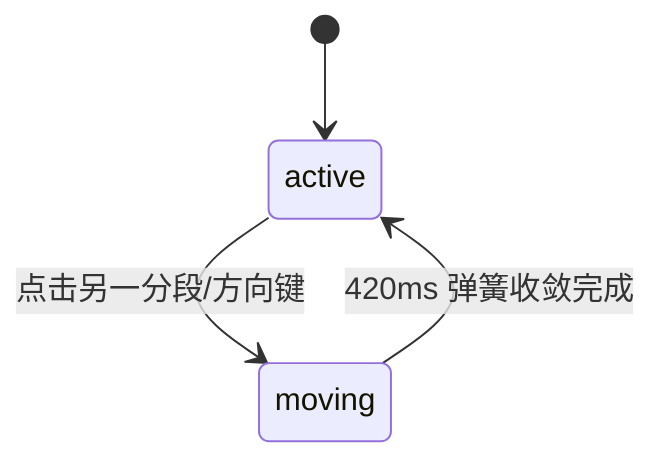

# Segmented Control · 分段控制切换胶囊

用于视图模式切换、页面分栏及紧凑选项互斥的高质感分段胶囊。包含三大核心动效机制：

1. 相对位移插值滑动胶囊（Gliding Pill with Delta Jump）：单例高光胶囊（`.segmented-pill`）在切换按钮时，通过计算两项之间的相对横向位移差进行瞬时锚定，随后以 420ms 欠阻尼弹簧（bounce 0.16）平滑滑动并自适应匹配目标宽度。
2. 溢出横向自适应滚动与边缘淡化遮罩（Scroll Reveal & Edge Fade）：在窄屏或长选项场景下，组件支持水平滑动；激活项发生切换时自动居中滚动（带 20px 缓冲），并在轨道两端动态标记 `data-fade-start` / `data-fade-end` 渐隐遮罩。
3. 全键盘 Roving Tabindex 与循环巡游：单组内仅选中项保持一个 Tab 停靠点，左右方向键循环无缝流转，`Home` 与 `End` 极速定点跳转。

## 原型清单

| 原型分组 | 原型元素 | 动效 / 状态变化 | 去向 |
| --- | --- | --- | --- |
| 分段外框 | 轨道容器 `.segmented-track` | 边缘溢出阴影/淡化遮罩、横向滚动监听 | 溢出滚动与边缘遮罩 |
| 滑动胶囊 | 高光底衬 `.segmented-pill` | 相对坐标 Delta Jump、420ms 弹性横向滑动与宽度自适应 | 相对位移插值滑动胶囊 |
| 分段按钮 | 交互项 `.segmented-item` | 选中文字变深加粗、全键盘 Roving Tabindex、按压微缩 | 分段按钮交互与键盘巡游 |
| 演示外壳 | 顶部主题切换按钮 `#themeBtn`、外部状态提示 `.demo-status` | — | 演示外壳，已删除 |

## 适用

- 视图模式切换（如列表视图、网格视图、看板视图）。
- 统计报表时间跨度筛选（今日、近7天、近30天、全年）。
- 页面主内容区域的紧凑二级 Tab 切换。

## 不适用

- SaaS 定价页月付/年付联动带折扣徽标的切换 → [billing-toggle](billing-toggle.md)
- 垂直排列的单选项列表 → [radio-group](radio-group.md)
- 大尺寸横向对比卡片 → [radio-cards](radio-cards.md)
- 二值系统功能布尔开关 → [switch](switch.md)

## 状态机

| 状态 | 进入条件 | 视觉表现 | 退出到 |
| --- | --- | --- | --- |
| active | 某分段选中就绪 | 白色高光胶囊停留在该分段下，文字加粗，tabindex="0" | moving |
| moving | 点击新分段或键盘导航 | 滑块以 420ms 弹性平滑横向滑动并改变宽度，轨道视口自动滚动至可见区 | active |



## 最小 DOM

```html
<div class="segmented-control" role="group" aria-label="View mode">
  <div class="segmented-track">
    <button type="button" class="segmented-item" aria-pressed="true" tabindex="0">
      <span class="segmented-pill" aria-hidden="true"></span>
      <span class="segmented-label">Review</span>
    </button>
    <button type="button" class="segmented-item" aria-pressed="false" tabindex="-1">
      <span class="segmented-label">Activity</span>
    </button>
    <button type="button" class="segmented-item" aria-pressed="false" tabindex="-1">
      <span class="segmented-label">Files</span>
    </button>
  </div>
</div>
```

- `.segmented-control`：语义外壳，`role="group"`。
- `.segmented-track`：横向滑动轨道，管理 `data-fade-start` 与 `data-fade-end`。
- `.segmented-pill`：挂载于当前激活项内的滑动高光胶囊。
- `.segmented-item`：单个分段按钮，管理 `aria-pressed` 与 Roving Tabindex。
- `.segmented-label`：分段文案。

## 参数

| 名称 | 值 | 用于 | 来源 |
| --- | --- | --- | --- |
| highlightSpring | visualDuration: 0.42s, bounce: 0.16 | 高光胶囊横移与宽度伸缩阻尼 | 原型 |
| scrollRoomPx | 20px | 自动横向滚动揭示时的边缘缓冲距离 | 原型 |
| itemHeight | 32px | 分段胶囊的标准高度 | 原型 |

## CSS

```css
.segmented-control {
  position: relative;
  display: inline-block;
  max-width: 100%;
  font-family: system-ui, -apple-system, sans-serif;
  user-select: none;
}

.segmented-track {
  position: relative;
  display: inline-flex;
  align-items: center;
  padding: 3px;
  border-radius: 9999px;
  background: #f1f5f9;
  overflow-x: auto;
  scrollbar-width: none;
}

.segmented-track::-webkit-scrollbar {
  display: none;
}

.segmented-item {
  position: relative;
  display: inline-flex;
  align-items: center;
  justify-content: center;
  height: 32px;
  padding: 0 16px;
  border: none;
  border-radius: 9999px;
  background: transparent;
  color: #64748b;
  font: inherit;
  font-size: 13px;
  font-weight: 500;
  cursor: pointer;
  outline: none;
  white-space: nowrap;
  -webkit-tap-highlight-color: transparent;
  transition: color 0.15s ease;
}

.segmented-item[aria-pressed="true"] {
  color: #0f172a;
  font-weight: 600;
}

.segmented-pill {
  position: absolute;
  inset: 0;
  z-index: 0;
  border-radius: 9999px;
  background: #ffffff;
  box-shadow: 0 1px 3px rgba(0, 0, 0, 0.1), 0 1px 2px rgba(0, 0, 0, 0.06);
  pointer-events: none;
  transition: transform 0.42s cubic-bezier(0.18, 0.89, 0.32, 1.16),
              width 0.42s cubic-bezier(0.18, 0.89, 0.32, 1.16);
}

.segmented-label {
  position: relative;
  z-index: 1;
}

.segmented-item:focus-visible {
  box-shadow: 0 0 0 2px #3b82f6;
}

@media (prefers-reduced-motion: reduce) {
  .segmented-pill,
  .segmented-item {
    transition: none !important;
  }
}
```

## JS

```js
export function createSegmentedControl(rootEl, options = {}) {
  const track = rootEl.querySelector('.segmented-track') || rootEl;
  const buttons = Array.from(track.querySelectorAll('.segmented-item'));
  let selectionPill = track.querySelector('.segmented-pill');

  if (!selectionPill && buttons[0]) {
    selectionPill = document.createElement('span');
    selectionPill.className = 'segmented-pill';
    selectionPill.setAttribute('aria-hidden', 'true');
    buttons[0].prepend(selectionPill);
  }

  let selectedIndex = buttons.findIndex(b => b.getAttribute('aria-pressed') === 'true');
  if (selectedIndex === -1) selectedIndex = 0;
  let previousLeft = buttons[selectedIndex]?.offsetLeft || 0;

  function updateEdges() {
    track.toggleAttribute('data-fade-start', track.scrollLeft > 1);
    track.toggleAttribute('data-fade-end', track.scrollWidth - track.clientWidth - track.scrollLeft > 1);
  }

  function choose(index, needFocus = false) {
    if (!buttons[index] || !selectionPill) return;
    const button = buttons[index];
    const from = previousLeft;
    selectedIndex = index;
    previousLeft = button.offsetLeft;

    buttons.forEach((item, at) => {
      const isCur = at === index;
      item.setAttribute('aria-pressed', String(isCur));
      item.tabIndex = isCur ? 0 : -1;
    });

    button.prepend(selectionPill);

    // Delta jump
    const delta = from - previousLeft;
    selectionPill.style.transition = 'none';
    selectionPill.style.transform = `translateX(${delta}px)`;
    selectionPill.style.width = `${button.offsetWidth}px`;
    selectionPill.offsetHeight; // 强制重绘

    selectionPill.style.transition = '';
    selectionPill.style.transform = 'translateX(0)';

    if (needFocus) button.focus({ preventScroll: true });

    if (track.scrollWidth > track.clientWidth) {
      const start = button.offsetLeft - 20;
      const end = button.offsetLeft + button.offsetWidth + 20 - track.clientWidth;
      track.scrollTo({
        left: Math.max(0, track.scrollLeft > start ? start : track.scrollLeft < end ? end : track.scrollLeft),
        behavior: 'smooth'
      });
    }

    const value = button.querySelector('.segmented-label')?.textContent.trim() || String(index);
    if (typeof options.onChange === 'function') {
      options.onChange(value, index);
    }
    rootEl.dispatchEvent(new CustomEvent('arc:segmented-change', {
      bubbles: true,
      detail: { value, index }
    }));
  }

  const listeners = [];
  buttons.forEach((btn, index) => {
    const onClick = () => choose(index, false);
    btn.addEventListener('click', onClick);
    listeners.push({ el: btn, event: 'click', handler: onClick });
  });

  const onKeyDown = (e) => {
    let nextIndex = -1;
    if (e.key === 'ArrowRight' || e.key === 'ArrowDown') {
      nextIndex = (selectedIndex + 1) % buttons.length;
    } else if (e.key === 'ArrowLeft' || e.key === 'ArrowUp') {
      nextIndex = (selectedIndex - 1 + buttons.length) % buttons.length;
    } else if (e.key === 'Home') {
      nextIndex = 0;
    } else if (e.key === 'End') {
      nextIndex = buttons.length - 1;
    }

    if (nextIndex >= 0) {
      e.preventDefault();
      choose(nextIndex, true);
    }
  };

  track.addEventListener('keydown', onKeyDown);
  track.addEventListener('scroll', updateEdges, { passive: true });

  let resizeObserver = null;
  if (window.ResizeObserver) {
    resizeObserver = new ResizeObserver(() => {
      if (buttons[selectedIndex]) {
        previousLeft = buttons[selectedIndex].offsetLeft;
        selectionPill.style.width = `${buttons[selectedIndex].offsetWidth}px`;
        selectionPill.style.transform = 'translateX(0)';
      }
      updateEdges();
    });
    resizeObserver.observe(track);
  }

  updateEdges();

  return {
    getValue: () => buttons[selectedIndex]?.querySelector('.segmented-label')?.textContent.trim() || '',
    setValue: (val) => {
      const idx = buttons.findIndex(b => b.querySelector('.segmented-label')?.textContent.trim() === val);
      if (idx !== -1) choose(idx, false);
    },
    destroy: () => {
      listeners.forEach(({ el, event, handler }) => el.removeEventListener(event, handler));
      track.removeEventListener('keydown', onKeyDown);
      track.removeEventListener('scroll', updateEdges);
      if (resizeObserver) resizeObserver.disconnect();
    }
  };
}
```

## 接入目标项目

- 状态来源：单值状态绑定，受控通过 `setValue(val)` 设值。
- 尺寸策略：胶囊根据文本宽度测量适配，整栏内联自适应。
- 驱动方式：`createSegmentedControl(rootEl, { onChange: (val) => {} })`。

## 重入与清理

- 连续快速按键或点选时，Delta 计算基于上一次位移，平滑打断并直插下一目标。
- 销毁时清理滚动与尺寸监听。

## 减少动态效果

- 在 `prefers-reduced-motion: reduce` 下，移除胶囊滑动过渡与平滑滚动。
- 高光胶囊直接落定于目标项。

## 焦点与键盘

- Roving Tabindex 设计，全组仅当前选中项具备 `tabindex="0"`。
- `ArrowRight` / `ArrowLeft` 循环切换，`Home` / `End` 跳转首尾。

## 兼容回退

| 特性 | 不支持时 |
| --- | --- |
| ResizeObserver | 回退为 window resize 事件 |
| smooth scroll | 使用原生即时 `scrollLeft` 赋值 |

## 验收清单

- [ ] 点击另一分段项，白色胶囊以 420ms 弹性平滑横向位移并拉伸匹配新宽度。
- [ ] 键盘左右方向键在各分段之间循环巡游，焦点与高光无缝同步。
- [ ] 分段超出宽度产生滚动时，激活项自动滚动揭示并带有 20px 缓冲。
- [ ] 开启减弱动态效果时，胶囊切换瞬间完成无动画。
