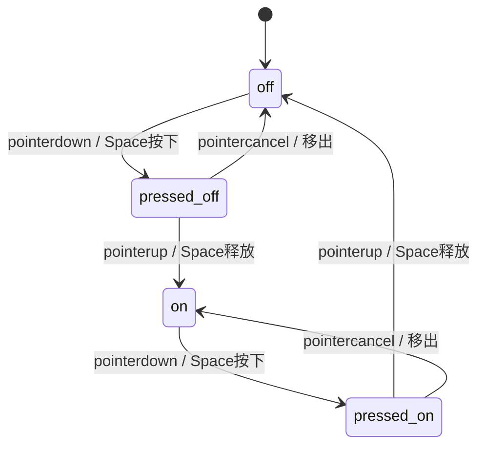

# Switch · 机械拉伸滑动开关

模拟物理受压与横向弹射滑翔的二值开关。包含三大核心动效机制：

1. 按压横向弹性拉伸（Press Stretch）：鼠标按下或键盘 Space 键按下未松开时，圆形滑块（`.switch-thumb`）由 18px 横向伸长 5px 至 23px，模拟指尖按压的物理形变。
2. 释放平滑滑翔（Release Glide）：松开按压时，滑块以 300ms 线性收敛阻尼（bounce 0）滑向对侧终点并恢复为 18px 正圆，轨道背景色同步平滑过渡。
3. 快速打断方向自适应反向（Interrupted Reversal）：滑块在半途移动过程中再次受到触发时，保留当前动态形变与位移平滑反向寻路，杜绝硬切跳闪。

## 原型清单

| 原型分组 | 原型元素 | 动效 / 状态变化 | 去向 |
| --- | --- | --- | --- |
| 开关主体 | 原生按钮 `button[role="switch"]` | 承载 `aria-checked` 与键盘焦点流 | 开关主体状态机 |
| 开关轨道 | 轨道槽 `.switch-track` | 42px 物理轨道宽度，开启变蓝、关闭变灰 | 轨道色彩平滑过渡 |
| 滑块滑轮 | 圆形滑块 `.switch-thumb` | 按压拉长 5px、释放 300ms 滑行 18px | 机械拉伸与释放滑翔 |
| 演示外壳 | 顶部主题切换按钮 `#themeBtn`、外部状态提示 `.demo-status` | — | 演示外壳，已删除 |

## 适用

- 二值状态即时生效设置（如开启蓝牙、夜间模式、允许消息推送）。
- 追求拟物物理触感与按压弹性反馈的控制面板。
- 遵循 WAI-ARIA 规范的 `role="switch"` 无障碍交互。

## 不适用

- 表单提交前可随时修改的多选框 → [checkbox](checkbox.md)
- SaaS 计费年付/月付切换胶囊 → [billing-toggle](billing-toggle.md)
- 多项互斥单选卡片 → [radio-cards](radio-cards.md)
- 水平分段视图切换胶囊 → [segmented-control](segmented-control.md)

## 状态机

| 状态 | 进入条件 | 视觉表现 | 退出到 |
| --- | --- | --- | --- |
| off | 初始；或在开态下点击触发 | 滑块位于左侧 0px，直径 18px，轨道灰色 | on / pressed-off |
| pressed-off | 在 off 态按下指针/Space | 滑块在左侧向右拉伸 5px（宽 23px） | on / off |
| on | 在 off 态松开点击 | 滑块滑至右侧 18px 处，直径 18px，轨道蓝色 | off / pressed-on |
| pressed-on | 在 on 态按下指针/Space | 滑块在右侧向左拉伸 5px（宽 23px） | off / on |



## 最小 DOM

```html
<button type="button" class="switch-root" role="switch" aria-checked="false" data-state="unchecked">
  <span class="switch-track" aria-hidden="true">
    <span class="switch-thumb"></span>
  </span>
</button>
```

- `.switch-root`：原生交互宿主，具备 `role="switch"`、`aria-checked` 与键盘支持。
- `.switch-track`：42px 宽、24px 高的圆角滑道。
- `.switch-thumb`：18px 绝对定位白色滑块。

## 参数

| 名称 | 值 | 用于 | 来源 |
| --- | --- | --- | --- |
| trackPx | 42px | 滑道物理总宽度 | 原型 |
| thumbPx | 18px | 静止滑块基础直径 | 原型 |
| travelPx | 18px | 滑块滑行最大总行程 | 原型 |
| stretchPx | 5px | 按压状态下的横向伸展增量 | 原型 |
| glideSeconds | 0.3s | 释放滑翔与弹簧复原时间 | 原型 |

## CSS

```css
.switch-root {
  position: relative;
  display: inline-flex;
  align-items: center;
  width: 42px;
  height: 24px;
  padding: 0;
  border: none;
  background: transparent;
  cursor: pointer;
  outline: none;
  -webkit-tap-highlight-color: transparent;
}

.switch-track {
  position: relative;
  display: block;
  width: 42px;
  height: 24px;
  border-radius: 9999px;
  background: #cbd5e1;
  transition: background-color 0.25s ease;
}

.switch-root[aria-checked="true"] .switch-track {
  background: #2563eb;
}

.switch-thumb {
  position: absolute;
  top: 3px;
  left: 3px;
  width: 18px;
  height: 18px;
  border-radius: 9999px;
  background: #ffffff;
  box-shadow: 0 1px 3px rgba(0, 0, 0, 0.2), 0 1px 2px rgba(0, 0, 0, 0.1);
  pointer-events: none;
  transform: translateX(0);
  transition: transform 0.3s cubic-bezier(0.16, 1, 0.3, 1),
              width 0.2s cubic-bezier(0.18, 0.89, 0.32, 1.15);
}

.switch-root[aria-checked="true"] .switch-thumb {
  transform: translateX(18px);
}

.switch-root:focus-visible .switch-track {
  box-shadow: 0 0 0 3px rgba(59, 130, 246, 0.3);
}

.switch-root:disabled {
  opacity: 0.5;
  cursor: not-allowed;
}

@media (prefers-reduced-motion: reduce) {
  .switch-track,
  .switch-thumb {
    transition: none !important;
  }
}
```

## JS

```js
export function createSwitch(buttonEl, options = {}) {
  const thumb = buttonEl.querySelector('.switch-thumb');
  let checked = options.defaultChecked !== undefined
    ? Boolean(options.defaultChecked)
    : buttonEl.getAttribute('aria-checked') === 'true';
  let pressed = false;

  function paint() {
    const extra = pressed && !buttonEl.disabled ? 5 : 0;
    const isReduced = window.matchMedia('(prefers-reduced-motion: reduce)').matches;
    if (thumb) {
      if (isReduced) {
        thumb.style.width = '18px';
        thumb.style.transform = `translateX(${checked ? 18 : 0}px)`;
      } else {
        thumb.style.width = `${18 + extra}px`;
        thumb.style.transform = `translateX(${checked ? 18 - extra : 0}px)`;
      }
    }
  }

  function setChecked(val) {
    checked = val;
    buttonEl.setAttribute('aria-checked', String(checked));
    buttonEl.setAttribute('data-state', checked ? 'checked' : 'unchecked');
    paint();
    if (typeof options.onChange === 'function') {
      options.onChange(checked);
    }
    buttonEl.dispatchEvent(new CustomEvent('arc:checked-change', {
      bubbles: true,
      detail: { checked }
    }));
  }

  function release() {
    pressed = false;
    paint();
  }

  const onPointerDown = (e) => {
    if (e.button === 0 && !buttonEl.disabled) {
      pressed = true;
      paint();
    }
  };

  const onKeyDown = (e) => {
    if (e.key === ' ' && !e.repeat && !buttonEl.disabled) {
      pressed = true;
      paint();
    }
  };

  const onClick = (e) => {
    e.preventDefault();
    if (!buttonEl.disabled) {
      setChecked(!checked);
    }
  };

  buttonEl.addEventListener('pointerdown', onPointerDown);
  ['pointerup', 'pointerleave', 'pointercancel', 'blur'].forEach(name => {
    buttonEl.addEventListener(name, release);
  });
  buttonEl.addEventListener('keydown', onKeyDown);
  buttonEl.addEventListener('keyup', release);
  buttonEl.addEventListener('click', onClick);

  buttonEl.setAttribute('aria-checked', String(checked));
  buttonEl.setAttribute('data-state', checked ? 'checked' : 'unchecked');
  paint();

  return {
    isChecked: () => checked,
    setChecked: (val) => setChecked(Boolean(val)),
    destroy: () => {
      buttonEl.removeEventListener('pointerdown', onPointerDown);
      ['pointerup', 'pointerleave', 'pointercancel', 'blur'].forEach(name => {
        buttonEl.removeEventListener(name, release);
      });
      buttonEl.removeEventListener('keydown', onKeyDown);
      buttonEl.removeEventListener('keyup', release);
      buttonEl.removeEventListener('click', onClick);
    }
  };
}
```

## 接入目标项目

- 状态来源：单布尔值驱动（`true` / `false`），支持受控或非受控。
- 尺寸策略：42×24px 固定微型控件，杜绝外部挤压变形。
- 驱动方式：`createSwitch(buttonEl, { defaultChecked: false, onChange: (val) => {} })`。

## 重入与清理

- 连续快速切换时，伸长量与移动坐标基于当前物理插值平滑倒退，无硬闪。
- 卸载时彻底移除 pointerdown、pointerup、blur、keydown 等全部事件。

## 减少动态效果

- 在 `prefers-reduced-motion: reduce` 下，移除拉长 5px 的形变与滑行过渡。
- 开关直接瞬时切换背景色并落定滑块位置。

## 焦点与键盘

- 原生 `role="switch"` 具备原生 Tab 聚焦与外发光高亮环。
- 空格键按住与松开完美还原 pointerdown / pointerup 机械按压与释放拉伸效果。

## 兼容回退

| 特性 | 不支持时 |
| --- | --- |
| CSS transition | 降级为原生即时跳变 |
| pointer-events | 回退为 `mousedown` / `mouseup` 监听 |

## 验收清单

- [ ] 按住开关不松手，滑块向滑动方向弹性伸长 5px（宽 23px）。
- [ ] 松开鼠标，滑块在 300ms 内平滑滑向对侧并收缩回 18px 正圆，轨道变为深蓝色。
- [ ] 键盘聚焦后长按空格键，触发相同拉长与释放滑行。
- [ ] 开启减弱动态效果时，点击瞬时切换无动画。
